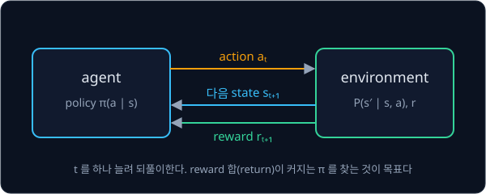
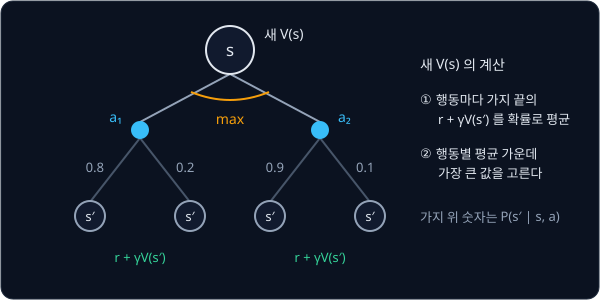
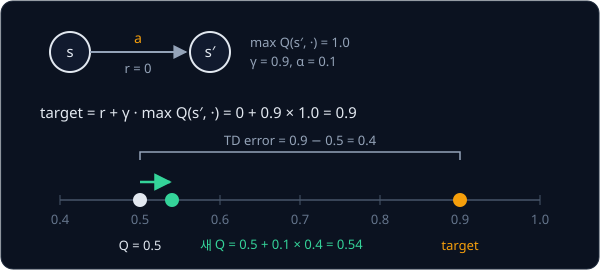

# Bandits & MDPs

## 배경

[NumPy Warm-up](../warmup/README.md) 의 linear regression 에는 입력마다 정답 $y$ 가 있었지만, 로봇이 마주하는 문제에는
정답 행동이 없고 행동한 뒤에 받는 reward 만 있다. reinforcement learning(RL)은 이 reward 의 합이 가장 커지는 행동 규칙을
시행착오로 찾는 문제이고, 이 과제에서는 가장 단순한 두 형태인 multi-armed bandit 과 작은 GridWorld 로 그 기본 개념과
알고리즘을 직접 짠다.

### agent 와 environment

RL 에서 행동을 고르는 쪽을 agent, agent 가 행동하는 대상을 environment 라고 한다. 시점 $t$ 마다 agent 는 지금 상황인
state $s_t$ 를 보고 action $a_t$ 를 고르고, environment 는 그 결과로 다음 state $s_{t+1}$ 과 숫자 하나인 reward $r_{t+1}$
을 돌려준다. agent 가 state 마다 action 을 고르는 규칙을 policy $\pi$ 라고 하고, $\pi(a \mid s)$ 는 state $s$ 에서 action
$a$ 를 고를 확률이다.



GridWorld 라면 state 는 agent 가 서 있는 칸, action 은 상·하·좌·우 이동, reward 는 목표 칸에 닿으면 1, 함정에 빠지면 −1
같은 숫자다. agent 는 어느 칸에서 어느 쪽으로 가야 좋은지 미리 알지 못하고, 움직여 보고 받은 reward 로만 배운다.

### multi-armed bandit

state 가 하나뿐인 가장 단순한 RL 문제가 multi-armed bandit 이다. 레버(arm)가 $k$ 개인 슬롯머신 앞에서 매번 arm 하나를
당기면, 그 arm 의 평균 $q_*(a)$ 근처에서 무작위로 정해지는 reward 를 받는다. agent 는 $q_*(a)$ 를 모르므로 지금까지
받은 reward 의 평균 $Q_t(a)$ 로 추정한다. arm 이 셋이고 지금까지 아래처럼 당겼다면 추정값은 오른쪽 열과 같다.

| arm $a$ | 당긴 횟수 $N_t(a)$ | 받은 reward | 추정값 $Q_t(a)$ |
| --- | --- | --- | --- |
| 0 | 3 | 1.2, 0.4, 0.8 | 0.8 |
| 1 | 1 | 1.5 | 1.5 |
| 2 | 0 | — | 0 (초기값) |

평균은 reward 를 모두 저장해 두지 않아도 새 reward 가 들어올 때마다 고쳐 쓸 수 있다. arm $a$ 를 $n$ 번째로 당겨 reward
$r$ 을 받았다면

$$
Q(a) \leftarrow Q(a) + \frac{1}{n}\big(r - Q(a)\big)
$$

이고, 이를 incremental sample average 라고 한다. 위 표의 arm 0 에 네 번째 reward 1.6 이 들어오면
$Q(0) = 0.8 + \frac{1}{4}(1.6 - 0.8) = 1.0$ 이 되어, 네 값의 평균 $(1.2 + 0.4 + 0.8 + 1.6) / 4$ 과 같다.

### exploration 과 exploitation

위 표에서 추정값이 가장 큰 arm 은 1 이다. 추정값이 가장 큰 arm 을 고르는 것을 exploitation 이라 하고, exploitation 만
하는 agent 를 greedy 라고 한다. 그런데 arm 1 의 1.5 는 한 번 당겨 본 값이라 운이 좋았을 수 있고, arm 2 는 아직 당겨
보지도 않았다. 정보를 더 얻으려고 덜 확실한 arm 을 일부러 당겨 보는 것을 exploration 이라고 한다. greedy agent 는 초반에
운 좋게 높게 나온 arm 에 붙잡혀 더 좋은 arm 을 끝내 찾지 못하는 경우가 많다.

ε-greedy 는 확률 $1 - \varepsilon$ 로 추정값이 가장 큰 arm 을 고르고, 확률 $\varepsilon$ 로 $k$ 개 가운데 하나를 무작위로
고른다. $\varepsilon = 0.1$ 이면 열 번에 한 번꼴로 탐색한다.

### UCB

UCB(upper confidence bound)는 무작위로 탐색하는 대신 적게 당겨 본 arm 일수록 추정값에 큰 bonus 를 더하고, 더한 값이 가장
큰 arm 을 고른다.

$$
A_t = \arg\max_a \Big[\, Q_t(a) + c\sqrt{\frac{\ln t}{N_t(a)}} \,\Big]
$$

$A_t$ 는 $t$ 번째 step 에서 고르는 arm, $Q_t(a)$ 는 지금까지의 평균, $N_t(a)$ 는 arm $a$ 를 당긴 횟수, $t$ 는 지금까지의
전체 step 수, $\ln$ 은 자연로그, $c$ 는 bonus 의 크기를 정하는 상수다. $t = 100$, $c = 2$ 일 때 bonus 는 당긴 횟수가
적을수록 아래처럼 커진다.

| $N_t(a)$ | 50 | 10 | 2 |
| --- | --- | --- | --- |
| bonus $c\sqrt{\ln t / N_t(a)}$ | 0.607 | 1.357 | 3.035 |

그래서 평균이 조금 낮아도 거의 당겨 보지 않은 arm 은 다시 확인하게 되고, 많이 당긴 arm 은 bonus 가 작아져 평균만으로
경쟁한다. $N_t(a) = 0$ 인 arm 은 bonus 를 무한대로 본다.

### MDP 와 return

GridWorld 에서는 행동이 다음 state 를 바꾸기 때문에, 지금 고른 행동이 몇 step 뒤의 reward 에까지 영향을 준다. 이런 문제를
Markov decision process(MDP) $(\mathcal S, \mathcal A, P, r, \gamma)$ 로 적는다.

| 기호 | 뜻 | GridWorld 의 예 |
| --- | --- | --- |
| $\mathcal S$ | state 의 집합 | 칸 12개 |
| $\mathcal A$ | action 의 집합 | 상·하·좌·우 |
| $P(s' \mid s, a)$ | $s$ 에서 $a$ 를 했을 때 $s'$ 으로 갈 확률 | slip 이 0.2 이면 고른 방향으로 0.8, 직각인 두 방향으로 0.1 씩 |
| $r(s, a, s')$ | 그 transition 에서 받는 reward | 목표 도착 1, 함정 −1, 나머지 0 |
| $\gamma$ | 미래 reward 를 얼마나 깎아 셀지 정하는 discount factor, $0 \le \gamma < 1$ | 0.99 |

이름의 Markov 는 다음 state 가 지금 state 와 action 만으로 정해지고, 그 전에 거쳐 온 경로와는 상관없다는 가정에서 왔다.

agent 가 키우려는 것은 reward 하나가 아니라 앞으로 받을 reward 를 모두 더한 return 이다.

$$
G_t = r_{t+1} + \gamma\, r_{t+2} + \gamma^2 r_{t+3} + \cdots
$$

$\gamma = 0.9$ 에서 reward 가 0, 0, 1 순서로 들어오면 $G_t = 0 + 0.9 \times 0 + 0.81 \times 1 = 0.81$ 이라, 같은 목표라도
늦게 닿을수록 작게 센다. state $s$ 에서 시작해 policy $\pi$ 를 따를 때 얻는 return 의 기댓값이 value $V^\pi(s)$ 이고,
모든 policy 가운데 가장 큰 value 를 최적 value $V^*(s)$ 라고 한다. 행동까지 정해 두고 센 value 는 $Q^\pi(s, a)$ 로 적는데,
$s$ 에서 먼저 $a$ 를 하고 그 뒤로 $\pi$ 를 따를 때의 return 기댓값이다.

### value iteration

$P$ 와 $r$ 을 알면 $V^*$ 를 계산으로 구할 수 있다. $V^*$ 는 아래 Bellman optimality equation 을 만족하는데, 한 칸의 value 는
"가장 좋은 행동을 골랐을 때 받을 reward 와 도착한 칸의 value 를 도착 확률로 평균한 값" 과 같다는 뜻이다. value iteration
은 모든 칸의 $V$ 를 0 에서 시작해 이 식의 오른쪽 계산으로 $V$ 를 거듭 덮어쓴다. 모든 칸을 한 번씩 덮어쓰는 것을 sweep
이라 하고, $k$ 는 sweep 횟수다.

$$
V_{k+1}(s) = \max_a \sum_{s'} P(s' \mid s, a)\,\big[r(s,a,s') + \gamma V_k(s')\big]
$$



칸 세 개짜리 복도 `A B G` 에서 확인해 보면, 행동은 왼쪽·오른쪽 둘이고 미끄러지지 않으며, G 에 들어가면 reward 1 을 받고
episode 가 끝난다. A 에서 왼쪽은 벽이라 제자리에 머물고, 종료 state G 의 value 는 0 으로 둔다. $\gamma = 0.9$ 로 sweep 을
돌리면 아래처럼 된다.

| sweep $k$ | $V_k(A)$ | $V_k(B)$ | 계산 |
| --- | --- | --- | --- |
| 0 | 0 | 0 | 초기값 |
| 1 | 0 | 1 | 오른쪽 $1 + 0.9 \times 0$ 과 왼쪽 $0 + 0.9 \times V_0(A)$ 중 큰 값, $V_1(B) = 1$ |
| 2 | 0.9 | 1 | 오른쪽 $0 + 0.9 \times V_1(B)$ 과 왼쪽 $0 + 0.9 \times V_1(A)$ 중 큰 값, $V_2(A) = 0.9$ |
| 3 | 0.9 | 1 | 바뀐 값이 없으므로 멈춘다 |

한 sweep 동안 가장 크게 바뀐 칸의 변화량을 Bellman residual 이라 하고, 이것이 정한 기준(이 과제는 $10^{-8}$)보다 작아지면
멈춘다. 그다음 칸마다 max 를 만든 행동을 고르면 greedy policy 가 되고, 위 복도에서는 A 와 B 모두 오른쪽이다.

### Q-learning

$P$ 를 모르면 위 식의 $\sum_{s'} P(\cdot)$ 를 계산할 수 없다. Q-learning 은 state 와 action 의 짝마다 $Q(s, a)$ 를 표로
두고, 실제로 겪은 transition $(s, a, r, s')$ 하나를 그 평균의 sample 로 삼아 조금씩 고친다.

$$
Q(s,a) \leftarrow Q(s,a) + \alpha\big[\,\underbrace{r + \gamma \max_{a'} Q(s',a')}_{\text{target}} - Q(s,a)\,\big]
$$

target 은 "이번에 받은 reward 와, 도착한 state 에서 가장 좋은 행동의 value" 이고, target 과 지금 값의 차이를 TD error
(temporal difference error)라고 한다. $\alpha$ 는 차이의 몇 분의 일만큼 움직일지 정하는 learning rate 이고, $s'$ 가 종료
state 면 그 뒤 reward 가 없으므로 target 은 $r$ 뿐이다. $Q(s,a) = 0.5$, $r = 0$, $\max_{a'} Q(s', a') = 1.0$, $\gamma = 0.9$,
$\alpha = 0.1$ 이면 target 은 0.9, TD error 는 0.4 라서 $Q(s,a)$ 는 0.54 가 된다.



같은 $(s, a)$ 를 여러 번 겪으면 $Q(s,a)$ 는 여러 target 의 평균 쪽으로 다가간다. 모든 칸과 행동을 충분히 자주 겪으면 $Q$ 는
최적값 $Q^*$ 로 수렴하고, 칸마다 $Q$ 가 가장 큰 행동을 고르면 value iteration 과 같은 policy 가 나온다.

### off-policy

Q-learning 의 agent 는 ε-greedy 로 탐색하며 움직이지만, target 에는 실제로 고를 행동이 아니라 $\max_{a'}$ 를 써서 greedy
policy 의 value 를 배운다. 데이터를 모으는 policy 와 배우는 policy 가 다른 이런 방식을 off-policy 라고 하며, 뒤의 DQN·SAC
가 이 성질을 그대로 이어받는다. 이번 과제에서는 bandit testbed 와 GridWorld 를 numpy 로 짜고, $P$ 를 아는 value iteration
과 모르는 Q-learning 이 같은 policy 에 도달하는지 확인한다.

## 목표

- 10-armed testbed 에서 greedy·ε-greedy·UCB 의 평균 reward 와 optimal action 비율을 비교한다
- transition 표를 아는 GridWorld 에서 value iteration 으로 $V^*$ 와 greedy policy 를 구한다
- 같은 GridWorld 를 transition 표 없이 tabular Q-learning 으로 풀어 value iteration 결과와 비교한다
- value 와 policy 를 격자 위에 heatmap 과 화살표로 그린다

**직접 짤 것**: bandit testbed, GridWorld 의 transition·reward 표, value iteration, Q-learning 전부. numpy 로 짠다.
**가져다 써도 되는 것**: 그림용 matplotlib, 검산용 gymnasium 의 `FrozenLake-v1`·`CliffWalking-v1`.

## 준비물

- Python 3.12, numpy, matplotlib, pytest
- `gymnasium` — `FrozenLake-v1` 은 transition 표를 `env.unwrapped.P` 로 그대로 내주므로 value iteration 검산에 쓰고,
  `CliffWalking-v1` 은 선택 항목의 Q-learning·Sarsa 비교에 쓴다
- GPU 불필요

## 진행 순서

1. `bandit.py` 의 `Testbed` 를 채운다. 만들 때 arm 마다 평균 $q_*(a)\sim\mathcal N(0,1)$ 을 뽑고, `pull(a)` 는
   $\mathcal N(q_*(a),1)$ 에서 reward 를 뽑으며, `optimal_action` 은 $q_*$ 가 가장 큰 arm 이다
2. 같은 파일의 `EpsilonGreedy` 와 `UCB` 를 채운다. 둘 다 `update` 에서 incremental sample average 로 $Q_t(a)$ 를 고친다
3. `plot.py` 에서 문제 2000 개 × 1000 step 을 돌려 greedy·ε=0.1·UCB(c=2) 의 평균 reward 곡선과 optimal action 비율 곡선을
   그려 `results/bandit.png` 로 저장한다. 마지막 100 step 의 평균 reward 가 greedy 1.0, ε=0.1 1.4, UCB 1.5 안팎이고
   optimal action 비율이 35%, 80%, 85% 안팎이면 Sutton & Barto 의 그림 2.2·2.4 와 같은 모양이다
4. `gridworld.py` 의 `make_gridworld` 를 채워 layout 문자열을 `P[s][a] -> [(prob, next_state, reward, done)]` 꼴의 표로
   바꾼다. layout 의 `S` 는 출발, `.` 는 빈 칸, `#` 는 벽, `G` 는 목표, `H` 는 함정이고, 벽이나 격자 밖으로 가는 행동은
   제자리에 머문다. 모든 칸·행동에서 prob 의 합이 1 인지 확인한다
5. `planning.py` 의 `value_iteration` 을 Bellman residual 이 $10^{-8}$ 아래로 떨어질 때까지 돌려 greedy policy 를 뽑고,
   `evaluate_policy_exact` 로 그 policy 를 linear system 으로 다시 평가해 두 $V$ 를 비교한다
6. `gridworld.py` 의 `GridEnv` 로 같은 표를 `reset()`/`step()` 인터페이스로 감싸고, `q_learning.py` 의 `q_learning` 을 채워
   돌린다
7. Q-learning 의 greedy policy 를 value iteration 의 policy 와 칸별로 비교한다
8. `plot.py` 에서 $V^*$ heatmap 위에 두 policy 의 화살표를 겹쳐 그려 `results/gridworld.png` 로 저장한다
9. 평가 기준의 비교(FrozenLake-v1 포함)를 `test_bandit_mdp.py` 에 pytest 로 쓴다

## 시작점

아래 파일은 모두 리포에 들어 있다.

```text
bandit-mdp/
├── pyproject.toml       # 이 과제의 Python 버전과 패키지
├── uv.lock
├── bandit.py            # Testbed, EpsilonGreedy, UCB 의 stub
├── gridworld.py         # make_gridworld, GridEnv 의 stub
├── planning.py          # value_iteration, evaluate_policy_exact 의 stub
├── q_learning.py        # q_learning 의 stub
├── plot.py              # bandit 곡선과 V* heatmap·policy 화살표 그림
└── test_bandit_mdp.py   # 평가 기준을 확인하는 test 를 직접 쓴다
```

[bandit.py](bandit.py)·[gridworld.py](gridworld.py)·[planning.py](planning.py)·[q_learning.py](q_learning.py) 의 함수와
method 는 몸통이 `raise NotImplementedError` 인 stub 이고, 이름과 signature 는 그대로 둔 채 몸통을 채운다. 채점용 test 는
없어서 평가 기준은 [test_bandit_mdp.py](test_bandit_mdp.py) 에 직접 쓴 test 와 `plot.py` 의 그림으로 확인한다. 패키지는
`pyproject.toml` 에 있고, 이 폴더에서 `uv run` 을 처음 실행할 때 `.venv/` 에 설치된다.

```bash
cd projects/bandit-mdp
uv run pytest
uv run python plot.py
```

## 평가 기준

- [ ] 문제 2000 개 평균에서 1000 step 째의 평균 reward 와 optimal action 비율 모두 ε=0.1 이 greedy(ε=0) 보다 높고,
  UCB(c=2) 는 초반 몇십 step 이 지나면 ε=0.1 을 앞선다(Sutton & Barto 2.3절·2.7절 그림과 같은 모양)
- [ ] value iteration 의 $V$ 가 그 greedy policy 를 linear system 으로 정확히 평가한 값과 모든 state 에서 $10^{-6}$ 안으로 일치한다
- [ ] slip 이 0 인 GridWorld 에서 Q-learning 의 greedy policy 가 value iteration 의 policy 와 모든 비종료 칸에서 같다(value 가 같은
  행동끼리는 어느 쪽을 골라도 같은 것으로 본다)
- [ ] `FrozenLake-v1` 의 `env.unwrapped.P` 를 그대로 value iteration 에 넣고, 얻은 policy 로 10,000 episode 를 돌린 평균
  discounted return 이 같은 $\gamma$ 의 $V^*(s_0)$ 와 표준오차 2배 안에서 맞는다. `FrozenLake-v1` 은 기본으로 100 step 에서
  episode 를 끊지만 $V^*(s_0)$ 는 시간 제한이 없는 값이라, rollout 은 `gym.make("FrozenLake-v1", max_episode_steps=10_000)` 으로
  만든 env 에서 돌린다
- [ ] (선택) `CliffWalking-v1` 에서 Q-learning 과 Sarsa 의 학습 중 episode return 과 최종 경로를 비교한다

## 생각해 볼 질문

1. arm 이 10 개일 때 ε 을 0.1 로 고정한 ε-greedy 는 step 을 아무리 늘려도 optimal action 비율이 어디에서 멈추는가?
   UCB 에는 왜 그런 상한이 없는가?
2. 절벽 옆 지름길과 멀리 돌아가는 길이 있을 때, 학습 중 ε-greedy 로 움직이는 Q-learning 과 Sarsa 는 각각 어느 길을 배우는가?
   그 차이는 update 식의 어느 항에서 오는가?
3. $\gamma$ 를 0.5 와 0.99 로 바꾸면 목표에서 먼 칸의 value 와 policy 는 어떻게 달라지는가? 함정을 피해 돌아가는 경로는
   $\gamma$ 가 얼마쯤일 때 사라지는가?

## 힌트

<details>
<summary>UCB 에서 아직 안 뽑은 arm</summary>

$N_t(a)=0$ 인 arm 은 bonus 를 무한대로 보고 먼저 한 번씩 뽑는다. 그래서 처음 $k$ step 동안 모든 arm 을 한 바퀴 돌고,
그 직후 곡선이 잠깐 튀어 오르는데, 구현 실수가 아니라 원래 생기는 모양이다.

</details>

<details>
<summary>Q-learning 이 value iteration 과 안 맞을 때</summary>

종료 state 다음에는 미래가 없으므로 그 transition 의 target 에서 $\gamma\max_{a'}Q(s',a')$ 를 빼야 한다. 그래도 맞지 않으면
탐색 부족을 의심한다. 칸별 방문 횟수를 세어 heatmap 으로 그려 보면 Q 가 초기값에 머문 칸이 거의 가 보지 못한 칸인지 바로 보인다.

</details>

<details>
<summary>반복문 없는 value iteration</summary>

transition 표를 `(S, A, S)` 확률 배열과 `(S, A)` 기대 reward 배열로 한 번 바꿔 두면 sweep 한 번이 행렬곱 하나와
`max(axis=1)` 하나로 줄어든다.

</details>

## 참고 자료

- Richard S. Sutton, Andrew G. Barto, [Reinforcement Learning: An Introduction (2nd edition)](http://incompleteideas.net/book/the-book-2nd.html)
  — 저자가 [PDF](http://incompleteideas.net/book/RLbook2020.pdf) 를 무료로 공개한다. 2장(bandit, 그림 2.2·2.4), 3–4장(MDP·dynamic
  programming), 6장(Q-learning·Sarsa·Cliff Walking)이 이 과제 범위다
- OpenAI Spinning Up, [Part 1: Key Concepts in RL](https://spinningup.openai.com/en/latest/spinningup/rl_intro.html) — state·action·
  policy·return·value 와 Bellman equation 을 짧게 정리한 글
- David Silver, [UCL Course on RL](https://www.davidsilver.uk/teaching/) — 강의 영상과 slide. 2–5강(MDP·dynamic programming·
  model-free control)과 9강(exploration·exploitation)
- Lilian Weng, [The Multi-Armed Bandit Problem and Its Solutions](https://lilianweng.github.io/posts/2018-01-23-multi-armed-bandit/)
  — ε-greedy·UCB·Thompson sampling 비교와 UCB bonus 의 유도
- Christopher J. C. H. Watkins, Peter Dayan, [Q-learning](https://doi.org/10.1007/BF00992698) (1992) — Q-learning 이 최적값으로
  수렴하는 조건의 증명
- Peter Auer 외, [Finite-time Analysis of the Multiarmed Bandit Problem](https://doi.org/10.1023/A:1013689704352) (2002) — 이
  과제의 UCB 식(UCB1)을 낸 논문
- Gymnasium [FrozenLake](https://gymnasium.farama.org/environments/toy_text/frozen_lake/)·[Cliff Walking](https://gymnasium.farama.org/environments/toy_text/cliff_walking/)
  문서 — 칸 번호, 행동 번호, slip 확률, reward 의 정의
- [ShangtongZhang/reinforcement-learning-an-introduction](https://github.com/ShangtongZhang/reinforcement-learning-an-introduction)
  — Sutton & Barto 의 그림을 Python 으로 재현한 코드. 막혔을 때만 연다

## 남은 한계

표 하나로 Q 를 담으려면 state 가 셀 수 있을 만큼 적어야 하는데, CartPole 처럼 state 가 연속값이면 표를 만들 수 없다.
Q 를 neural network 로 근사하는 방법은 [DQN → SAC](../off-policy/README.md) 에서, policy 자체를 neural network 로 두고
gradient ascent 로 개선하는 방법은 [Policy Gradient](../policy-gradient/README.md) 에서 다룬다.
