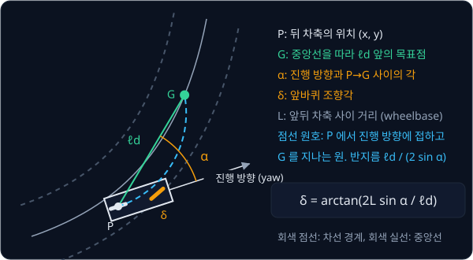
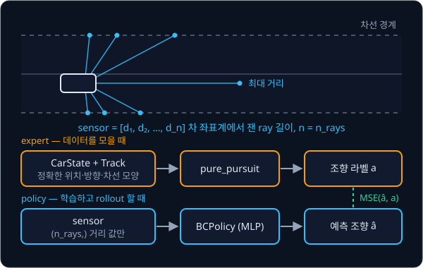
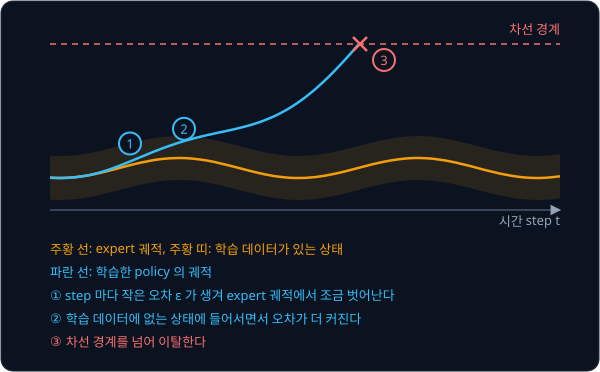

# Behavior Cloning

## 배경

### behavior cloning

1989년 Pomerleau 의 ALVINN 은 30×32 카메라 영상과 8×32 거리 센서 값을 hidden unit 29 개짜리 neural network 에 넣고,
45 개 출력 unit 중에서 "7 m 앞 도로 중앙으로 차를 데려가는 회전 곡률" 을 고르게 했다. 차선을 찾는 규칙도 조향
제어기도 사람이 짜지 않고, 사람이 운전하는 동안 (관측, 그때의 조향) 쌍만 모아 supervised learning 으로 학습했다.
이렇게 잘하는 사람이나 프로그램(expert)의 행동을 정답 라벨로 삼아 그대로 regression 하는 방식을 behavior cloning 이라
부른다.

$$
\min_\theta\ \mathbb{E}_{(o,\,a)\sim d_{\pi^*}}\big[\,\lVert \pi_\theta(o) - a \rVert^2\,\big]
$$

$o$ 는 관측(observation)으로 이 과제에서는 거리 센서 값 15 개이고, $a$ 는 그 순간 expert 가 낸 조향각이다. $\pi^*$ 는
expert 의 policy, $\pi_\theta$ 는 parameter $\theta$ 를 가진 MLP policy 다. $d_{\pi^*}$ 는 expert 가 운전할 때 차가 실제로
지나간 상태들의 분포라서, 이 식은 "expert 가 간 곳에서 expert 와 같은 조향을 내도록" 학습한다는 뜻이다. 학습 자체는
[PyTorch Training Loop](../pytorch-mlp/README.md) 의 MSE regression 과 같다.

### 곡률로 정의한 차선

차선 중앙선은 시작점부터 잰 길이(arc-length) $s$ 마다 얼마나 휘는지를 나타내는 곡률 $\kappa(s)$ 로 정한다. 곡률은 단위
길이당 진행 방향이 바뀌는 양이고 그 순간 원의 반지름 $R$ 과 $\kappa = 1/R$ 관계다. $\kappa = 0.02\ \text{m}^{-1}$ 이면 반지름
50 m 짜리 원을 도는 굽이고, $\kappa = 0$ 이면 직선이다. 진행 방향 $\theta$ 와 위치 $(x, y)$ 는 $\kappa$ 를 차례로 적분해
얻는다.

$$
\theta(s) = \theta(0) + \int_0^s \kappa(u)\,du, \qquad
x(s) = \int_0^s \cos\theta(u)\,du, \qquad y(s) = \int_0^s \sin\theta(u)\,du
$$

차선 폭은 3.5 m 이고 중앙선에서 좌우로 `lane_half_width` = 1.75 m 까지가 차선 안이다. 차의 위치를 중앙선에서 가장 가까운
점에 수직으로 내린 거리를 lateral offset 이라 하고, 그 절댓값이 1.75 m 를 넘으면 이탈(departure)이다.

### kinematic bicycle model

차를 앞바퀴 하나, 뒷바퀴 하나인 자전거로 단순화한 모델이다. 상태는 뒤 차축의 위치 $(x, y)$, 진행 방향 yaw $\psi$,
속도 $v$ 이고, 앞바퀴를 $\delta$ 만큼 꺾으면 시간 간격 $\Delta t$ 동안 아래처럼 움직인다.

$$
x \leftarrow x + v\cos\psi\,\Delta t, \qquad
y \leftarrow y + v\sin\psi\,\Delta t, \qquad
\psi \leftarrow \psi + \frac{v}{L}\tan\delta\,\Delta t
$$

$L$ 은 앞뒤 차축 사이 거리(wheelbase)다. 예를 들어 $v = 10$ m/s, $\Delta t = 0.05$ s, $L = 2.5$ m, $\delta = 0.1$ rad 이면
한 step 에 0.5 m 를 가고 yaw 는 $\frac{10}{2.5}\tan(0.1)\times 0.05 \approx 0.020$ rad 바뀐다. 같은 $\delta$ 를 계속 주면 차는
반지름 $R = L / \tan\delta \approx 24.9$ m 인 원을 돈다. 조향각 상한 `max_steer` = 0.5 rad 에서는 반지름이 약 4.6 m 라서,
곡률이 $1/4.6 \approx 0.22\ \text{m}^{-1}$ 보다 큰 구간은 이 차가 돌 수 없다.

### pure pursuit expert

pure pursuit 은 중앙선 위에서 $\ell_d$ (lookahead distance) 만큼 앞의 점 $G$ 를 목표점으로 잡고, 뒤 차축 $P$ 에서 지금의
진행 방향에 접하면서 $G$ 를 지나는 원호를 따라가도록 조향각을 정하는 규칙이다. 진행 방향과 $P \to G$ 방향 사이의 각을
$\alpha$ 라 하면 그 원의 반지름은 $R = \ell_d / (2\sin\alpha)$ 이고, bicycle model 에서 반지름 $R$ 로 돌려면
$\tan\delta = L / R$ 이어야 하므로 조향각은 아래와 같다.

$$
\delta = \arctan\!\left(\frac{2L\sin\alpha}{\ell_d}\right)
$$

예를 들어 $L = 2.5$ m, $\ell_d = 6$ m 이고 목표점이 진행 방향보다 $\alpha = 0.2$ rad 왼쪽에 있으면 원의 반지름은 약 15.1 m,
조향각은 $\arctan(2 \times 2.5 \times \sin 0.2 / 6) \approx 0.164$ rad (약 9.4°) 다. ALVINN 이 "7 m 앞 도로 중앙으로 데려가는
곡률" 을 라벨로 쓴 것과 같은 발상이다.



expert 는 차의 정확한 위치와 track 모양을 알아야 $G$ 와 $\alpha$ 를 구할 수 있다. 반면 학습할 policy 는 차에서 부채꼴로 쏜
ray 가 차선 경계에 닿기까지의 거리 15 개만 본다. 두 쪽이 보는 정보가 다르므로 코드에서도 policy 가 `CarState` 를 읽지
못하게 둔다.



### distribution shift 와 compounding error

학습 데이터는 expert 가 실제로 지나간 상태 분포 $d_{\pi^*}$ 에서만 나온다. 학습한 policy 가 조금만 틀려도 차는 expert 라면
가지 않았을 위치로 밀려나는데, 그 상태는 학습 데이터에 없어서 오차가 더 커진다. 학습할 때와 실행할 때 입력 분포가 달라지는
것을 distribution shift 라 하고, 그 차이가 step 마다 쌓여 커지는 현상을 compounding error 라 한다.



Ross 와 Bagnell 은 expert 분포에서 step 당 실수 확률이 $\epsilon$ 인 policy 라도, 길이 $T$ 인 episode 의 비용 $J$ (실수한
step 수의 기댓값)가 최악의 경우 expert 보다 $T^2\epsilon$ 까지 늘어난다는 것을 보였다.

$$
J(\hat\pi) \le J(\pi^*) + T^2 \epsilon
$$

$T = 100$, $\epsilon = 0.01$ 이면 실수가 서로 영향을 주지 않을 때의 기댓값은 $T\epsilon = 1$ 이지만, 상한은
$T^2\epsilon = 100$ 이 되어 최악의 경우 episode 의 모든 step 이 틀릴 수 있다.

이번 과제에서는 2D 차선 env 와 pure pursuit expert 를 직접 만들고, validation loss 는 낮은데 rollout 에서는 차선을
벗어나는 현상을 재현한다.

## 목표

- 곡률이 바뀌는 차선과 kinematic bicycle model 로 2D 주행 env 를 만든다
- 차 기준 ray 거리 센서와 pure pursuit expert 를 만든다
- expert 시연으로 "센서 → 조향" MLP 를 behavior cloning 으로 학습한다
- validation loss 와 rollout 이탈률을 함께 내는 eval 로 둘이 어긋나는 것을 확인한다

**직접 짤 것**: env dynamics, 센서, pure pursuit, 데이터 수집과 eval 루프. expert 는 차의 정확한 위치를 보고 policy 는
센서 값만 본다는 구분을 코드에서 지킨다.
**가져다 써도 되는 것**: [PyTorch Training Loop](../pytorch-mlp/README.md) 에서 만든 학습 루프나 `torch.nn`·`torch.optim`,
그림용 matplotlib.

## 준비물

- Python 3.12, numpy, torch, matplotlib, pytest
- (선택) gymnasium — env 를 `gymnasium.Env` 형식으로 감싸고 싶을 때
- GPU 불필요

## 진행 순서

1. `lane_env.py` 의 `Track` 을 짠다. seed 로 $\kappa(s)$ 를 정하고 적분해 중앙선 점을 만든 뒤, `project` 와 `point_at` 이
   서로 맞는지(어떤 $s$ 의 `point_at` 을 `project` 하면 같은 $s$ 와 offset 0 이 나오는지) 확인한다
2. `LaneEnv.step` 에 kinematic bicycle model 을 넣는다. 같은 조향각을 계속 주면 반지름 $L/\tan\delta$ 인 원을 그리는지
   궤적을 그려 확인한다
3. `LaneEnv.sensor` 에 차 좌표계에서 부채꼴로 쏜 ray 와 차선 경계의 거리를 넣는다. 직선 track 의 중앙에 똑바로 놓으면
   좌우 대칭인 값이 나와야 한다
4. `pure_pursuit.py` 의 `pure_pursuit` 을 짜고, 새 track 100 개에서 한 번도 이탈하지 않는 $\ell_d$ 를 찾는다
5. `collect_demos.py` 의 `collect` 로 expert 가 모는 동안의 (센서, 조향) 쌍을 모아 `data/` 아래 npz 로 저장하고 train·validation 으로
   나눈다. `obs` 는 (N, n_rays), `act` 는 (N, 1) 이다
6. `train_bc.py` 의 `BCPolicy` 와 `train_bc` 로 MLP 를 MSE 로 학습하고 validation loss 를 기록한다
7. `lane_eval.py` 의 `rollout`·`departure_rate` 로 학습에 안 쓴 track 에서 expert 와 policy 에 같은 크기의 조향 noise 를 넣고
   이탈률을 잰다. 두 함수는 `(sensor, env)` 를 받아 조향각을 돌려주는 controller 를 받으므로, BC policy 는 `sensor` 만 넣는
   함수로, expert 는 `env.state`·`env.track` 으로 `pure_pursuit` 을 부르는 함수로 감싸 넘긴다
8. `lane_eval.py` 의 `main` 에서 같은 track 의 expert 와 policy 의 lateral offset 을 시간축에 겹쳐 그려 `results/` 에 저장하고
   커밋한다

## 시작점

아래 파일은 모두 리포에 들어 있다.

```text
behavior-cloning/
├── pyproject.toml   # 이 과제의 Python 버전과 패키지
├── uv.lock
├── lane_env.py      # CarState, Track, LaneEnv (bicycle model, ray sensor)
├── pure_pursuit.py  # pure_pursuit expert
├── collect_demos.py # collect: expert rollout -> npz
├── train_bc.py      # BCPolicy, train_bc
└── lane_eval.py     # rollout, departure_rate, offset 그림
```

함수와 method 는 몸통이 `raise NotImplementedError` 인 stub 이고, 이름과 signature 는 그대로 둔 채 몸통을 채운다.
[DAgger](../dagger/README.md) 가 `lane_env.py`·`pure_pursuit.py`·`collect_demos.py`·`train_bc.py`·`lane_eval.py` 를 그대로
import 해서 쓰므로 signature 를 바꾸지 않는다. 채점용 test 는 없어서 평가 기준은 `lane_eval.py` 가 내는 수치·그림과 직접 쓴
test 로 확인한다. 패키지는 `pyproject.toml` 에 있고, 이 폴더에서 `uv run` 을 처음 실행할 때 `.venv/` 에 설치된다.

```bash
cd projects/behavior-cloning
uv run python collect_demos.py
uv run python train_bc.py
uv run python lane_eval.py
```

## 평가 기준

- [ ] 조향 noise 를 넣은 상태로도 pure pursuit expert 가 학습에 안 쓴 track 100 개에서 이탈 0 회다
- [ ] BC policy 의 validation MSE 가 expert 조향 분산의 5% 이하다 ($R^2 \ge 0.95$)
- [ ] 같은 noise 조건의 새 track 100 개에서 같은 policy 의 이탈률이 0 보다 크다
- [ ] 이탈한 rollout 의 offset 궤적을 학습 데이터 offset 히스토그램과 함께 그리면, 이탈하기 전에 학습 데이터 범위를 먼저 벗어나는 구간이 보인다
- [ ] episode 길이를 늘려 가며 잰 평균 |lateral offset| 이 expert 는 거의 일정하고 policy 는 점점 커진다
- [ ] (선택) 시연을 모을 때 실행 조향에만 noise 를 섞고 라벨은 noise 없는 expert 조향으로 저장한 데이터로 학습하면 이탈률이 줄어든다

## 생각해 볼 질문

1. validation loss 는 어떤 상태 분포에서 잰 값인가? rollout 은 실패하는데도 이 값이 낮게 나오는 이유는?
2. ALVINN 은 조향 값 하나를 regression 하지 않고 45 개 출력 unit 위에 언덕 모양의 target 을 두었다. 같은 장면에서
   왼쪽으로 피하는 것과 오른쪽으로 피하는 것이 모두 정답이라면 두 표현은 각각 어떤 출력을 내는가?
3. expert 시연을 10 배로 늘리면 이탈률이 얼마나 줄 것이라 예상하는가? 아무리 늘려도 채워지지 않는 상태는 어떤 상태인가?

## 힌트

<details>
<summary>매끄러운 track 을 만드는 법</summary>

중앙선을 점 목록으로 직접 찍기보다 곡률 $\kappa(s)$ 를 정하고 heading 과 위치를 적분하는 편이 매끄럽다. $\kappa(s)$ 를
진폭과 주기가 다른 sin 몇 개의 합으로 두면 seed 하나로 track 이 정해지고, 최대 곡률을 차의 최소 회전 반경이 허용하는
값보다 작게 묶어 두면 expert 가 못 도는 코너가 생기지 않는다.

</details>

<details>
<summary>이탈이 안 생길 때</summary>

noise 없는 expert 데이터로 학습한 policy 는 noise 없는 rollout 에서 멀쩡히 달리는 경우가 많다. rollout 에 조향 noise 나
한 step 의 지연을 넣으면 학습 데이터에 없던 offset 이 생기고, 그 상태에서 policy 가 무엇을 하는지 드러난다. 같은 noise 를
넣어도 expert 는 복구한다는 것을 함께 보여야 비교가 공정하다.

</details>

<details>
<summary>pure pursuit 의 lookahead</summary>

`Track.project` 로 현재 $s$ 를 구하고 $s + \ell_d$ 위치를 목표점으로 잡은 뒤, 목표점을 차 좌표계로 옮겨 $\alpha$ 를
구한다. $\ell_d$ 가 짧으면 좌우로 흔들리고 길면 코너 안쪽을 가로질러서, 속도에 비례하게 두는 방식도 흔하다.

</details>

## 참고 자료

- Dean A. Pomerleau, [ALVINN: An Autonomous Land Vehicle in a Neural Network](https://proceedings.neurips.cc/paper/1988/hash/812b4ba287f5ee0bc9d43bbf5bbe87fb-Abstract.html) (1989) —
  9 쪽으로 짧다. Figure 1 의 구조와 학습 라벨을 정의하는 부분만 읽어도 충분하다
- Stéphane Ross, J. Andrew Bagnell, [Efficient Reductions for Imitation Learning](https://proceedings.mlr.press/v9/ross10a.html) (2010) —
  $T^2\epsilon$ bound 의 출처. Section 2 의 Theorem 2.1
- Mariusz Bojarski et al., [End to End Learning for Self-Driving Cars](https://arxiv.org/abs/1604.07316) (2016) — 같은 발상을
  CNN 과 실제 도로로 키운 NVIDIA 의 PilotNet. 옆 카메라 영상에 조향을 보정한 라벨을 붙이는 data augmentation 이 나온다
- R. Craig Coulter, [Implementation of the Pure Pursuit Path Tracking Algorithm](https://www.ri.cmu.edu/publications/implementation-of-the-pure-pursuit-path-tracking-algorithm/) (CMU-RI-TR-92-01) —
  목표점과 원호로 조향을 정하는 유도
- Jarrod M. Snider, [Automatic Steering Methods for Autonomous Automobile Path Tracking](https://www.ri.cmu.edu/publications/automatic-steering-methods-for-autonomous-automobile-path-tracking/) (CMU-RI-TR-09-08) —
  kinematic bicycle model 과 pure pursuit 을 그림과 함께 정리하고, lookahead 길이에 따른 동작을 비교한다
- Jason Kong et al., [Kinematic and Dynamic Vehicle Models for Autonomous Driving Control Design](https://doi.org/10.1109/IVS.2015.7225830) (2015) —
  kinematic bicycle model 의 식과 적용 범위
- UC Berkeley CS 285, [Supervised Learning of Behaviors 강의 슬라이드](https://rail.eecs.berkeley.edu/deeprlcourse/static/slides/lec-2.pdf) —
  distribution shift 와 compounding error 를 그림으로 설명한다. [강의 페이지](https://rail.eecs.berkeley.edu/deeprlcourse/)의
  Homework 1 이 imitation learning 이다
- Hugging Face, [Robot Learning: A Tutorial](https://huggingface.co/spaces/lerobot/robot-learning-tutorial) — behavior cloning 장
- PythonRobotics, [pure pursuit 구현](https://github.com/AtsushiSakai/PythonRobotics/tree/master/PathTracking/pure_pursuit) —
  막혔을 때만 연다

## 남은 한계

expert 시연을 아무리 늘려도 policy 가 스스로 벗어난 상태는 데이터에 들어오지 않는다. policy 가 간 상태에 expert 라벨을
받아 오는 방법이 [DAgger](../dagger/README.md) 다. 한 장면에 정답이 여럿일 때 MSE 가 평균을 내는 문제는
[RT-1](../rt1/README.md) 이 다루고, step 마다 쌓이는 오차는 [ACT](../act/README.md) 가 action chunking 으로 줄인다.
