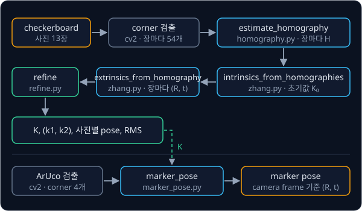
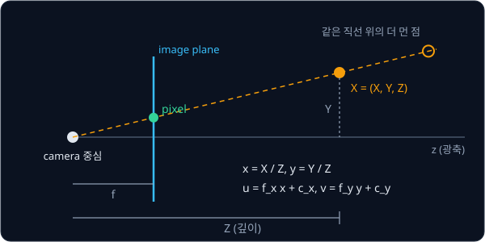
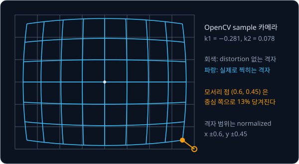

# Camera Geometry

## 배경

[Rigid Transforms](../transforms/README.md) 로 3D frame 사이를 오갈 수는 있지만 카메라가 주는 것은 3D 점이 아니라 pixel 이다.
이번 과제에서는 3D 점이 pixel 로 찍히는 과정을 식(pinhole model)으로 세우고, 그 식의 parameter 를 checkerboard 사진에서 거꾸로
구하는 camera calibration 과, 크기를 아는 marker 의 pose 를 구하는 방법을 짠다.



### pinhole model

OpenCV 의 camera frame 은 렌즈 중심이 원점이고, z 축은 카메라가 바라보는 방향(광축), x 축은 image 의 오른쪽, y 축은 image 의
아래쪽이다. camera frame 의 점 $(X, Y, Z)$ 는 렌즈 중심을 지나는 직선을 따라 image 에 찍히는데, 이 직선이 렌즈 중심에서 거리 1
인 평면과 만나는 좌표 $x = X/Z$, $y = Y/Z$ 를 normalized coordinates 라고 한다. pixel 좌표는 여기에 focal length 를 곱하고
principal point 를 더한 값이다.

$$
u = f_x\,x + c_x, \qquad v = f_y\,y + c_y
$$

$f_x, f_y$ 는 pixel 단위의 focal length 이고, $(c_x, c_y)$ 는 광축이 image 와 만나는 pixel 인 principal point 다. 예를 들어
$f_x = f_y = 500$, $(c_x, c_y) = (320, 240)$ 인 카메라 앞 $(0.1, -0.05, 1.0)$ m 의 점은 $x = 0.1$, $y = -0.05$ 라서 pixel
$(370, 215)$ 에 찍힌다. 두 배 먼 $(0.2, -0.1, 2.0)$ 의 점도 같은 직선 위에 있어서 같은 pixel 에 찍히므로, pixel 하나만으로는
깊이를 알 수 없다.



world(또는 board) frame 의 점 $X_w$ 는 먼저 transforms 의 rigid transform 으로 camera frame 으로 옮긴다. 이 $(R, t)$ 를
extrinsics, $f_x, f_y, c_x, c_y$ 를 모은 행렬 $K$ 를 intrinsics 라고 부르며, 둘을 합치면 투영 전체가 행렬 곱 하나로 적힌다.

$$
s\begin{bmatrix}u\\v\\1\end{bmatrix} = K\,[R\,|\,t]\begin{bmatrix}X_w\\1\end{bmatrix}, \qquad
K = \begin{bmatrix} f_x & \gamma & c_x\\ 0 & f_y & c_y\\ 0&0&1\end{bmatrix}
$$

$s$ 는 camera frame 에서의 깊이 $Z$ 이고, $\gamma$ 는 pixel 축이 기울어진 정도(skew)로 요즘 카메라에서는 0 이다.

### lens distortion

실제 렌즈는 직선을 휘게 만든다. 가장 큰 성분인 radial distortion 은 image 중심에서 멀어질수록 점을 안쪽이나 바깥쪽으로
밀며, normalized coordinates 에 다음과 같이 붙는다. $K$ 는 distortion 을 적용한 뒤의 $x_d$ 에 곱한다.

$$
x_d = x\,(1 + k_1 r^2 + k_2 r^4), \qquad r^2 = x^2 + y^2
$$

OpenCV sample 사진을 찍은 카메라는 $k_1 \approx -0.281$, $k_2 \approx 0.078$ 이다. normalized 좌표 $(0.3, 0)$ 의 점은 0.975 배로
거의 그대로지만, image 모서리 근처 $(0.6, 0.45)$ 의 점은 0.867 배가 되어 중심 쪽으로 13% 당겨진다. 그래서 곧은 격자의 바깥쪽이
안으로 오므라들어 찍힌다(barrel distortion).



### homography 와 DLT

checkerboard 는 평면이므로 board frame 을 board 위에 잡으면 모든 corner 의 $Z = 0$ 이다. 그러면 rotation 의 셋째 열 $r_3$ 이
곱해질 자리가 사라져, board 좌표 $(X, Y)$ 와 pixel 사이의 관계가 3×3 행렬 $H$ 하나로 줄어든다(distortion 은 잠시 무시한다).

$$
s\begin{bmatrix}u\\v\\1\end{bmatrix} = K\,[r_1\ r_2\ r_3\ t]\begin{bmatrix}X\\Y\\0\\1\end{bmatrix}
= \underbrace{K\,[r_1\ r_2\ t]}_{H}\begin{bmatrix}X\\Y\\1\end{bmatrix}
$$

이 $H$ 를 homography 라고 한다. $H$ 에 0 이 아닌 수를 곱해도 같은 투영이므로 미지수는 실제로 8개다. 점 하나의 대응에서 $s$ 를
소거하면 $H$ 의 원소 $h_{ij}$ 에 대한 선형 방정식이 두 개 나온다.

$$
u\,(h_{31}X + h_{32}Y + h_{33}) = h_{11}X + h_{12}Y + h_{13}, \qquad
v\,(h_{31}X + h_{32}Y + h_{33}) = h_{21}X + h_{22}Y + h_{23}
$$

점 $N$ 개의 방정식을 쌓으면 $2N \times 9$ 행렬 $A$ 로 $A\,h = 0$ 꼴이 되고, $\lVert h \rVert = 1$ 인 해 가운데 $\lVert Ah\rVert$ 가 가장
작은 것은 $A$ 의 SVD 에서 가장 작은 singular value 의 right singular vector 다. 이 방법이 DLT(direct linear transform)이고, 점이
4개 이상 필요하다. 9×6 checkerboard 는 사진 한 장에 corner 54개, 방정식 108개를 준다.

### Zhang 의 closed-form

Zhang(2000)의 방법은 board 를 여러 각도에서 찍은 사진의 homography 로 $K$ 를 구한다. $H = \lambda K\,[r_1\ r_2\ t]$ 의 첫 두 열에서
$r_1 = K^{-1}h_1/\lambda$, $r_2 = K^{-1}h_2/\lambda$ 이고, $r_1, r_2$ 는 서로 수직인 unit vector 다. $B = K^{-\top}K^{-1}$ 이라 두면
이 사실이 $B$ 의 원소에 대한 선형 제약 두 개가 된다.

$$
h_1^\top B\, h_2 = 0, \qquad h_1^\top B\, h_1 = h_2^\top B\, h_2
$$

사진 세 장 이상의 제약을 쌓아 DLT 와 같은 방법(SVD)으로 $B$ 를 풀고, $B$ 에서 $K$ 의 원소를 closed-form 으로 꺼낸다. 그다음
사진마다 $\lambda = \lVert K^{-1}h_1 \rVert$ 로 $r_1, r_2$ 와 $t = K^{-1}h_3/\lambda$ 를 구하고, $r_3 = r_1 \times r_2$ 로 rotation 을
채우면 그 사진의 extrinsics 가 나온다.

### reprojection error 와 refinement

reprojection error 는 사진에서 검출한 corner pixel 과, 지금의 parameter 로 board 점을 투영한 pixel 사이의 거리다. 결과는 보통
RMS 로 요약하는데, 모든 점의 거리 제곱을 평균한 뒤 제곱근을 씌운 값 $\sqrt{\sum_i \lVert e_i\rVert^2 / N}$ 이고
`cv2.calibrateCamera` 가 돌려주는 값과 같은 정의다.

closed-form 으로 구한 $K$ 와 pose 를 초기값으로, 이 error 를 최소화하도록 모든 parameter 를 함께 다듬는다. OpenCV sample 13장이면
parameter 는 $f_x, f_y, c_x, c_y, k_1, k_2$ 6개와 사진마다 rotation vector 3개·$t$ 3개를 합쳐 $6 + 13 \times 6 = 84$ 개이고, residual 은
$13 \times 54 \times 2 = 1404$ 개다. 이런 nonlinear least squares 문제는 `scipy.optimize.least_squares` 가 푼다. 같은 sample 에서
tangential distortion 과 $k_3$ 를 끈 `cv2.calibrateCamera` 는 $f_x \approx 536.5$, $f_y \approx 536.7$, $c_x \approx 342.4$,
$c_y \approx 234.3$, RMS 0.418 px 를 낸다.

### ArUco marker 의 pose

ArUco marker 는 검은 테두리 안에 흑백 칸으로 ID 를 적은 정사각형 표식이고, `cv2.aruco.ArucoDetector` 가 영상에서 marker 마다
ID 와 corner 4개의 pixel 을 찾아 준다. 한 변의 길이 $s$ 를 알면 marker 중심을 원점으로 한 marker frame 에서 네 corner 의 3D
좌표가 정해지고, corner 가 모두 $Z = 0$ 평면 위에 있으므로 checkerboard 와 같은 방법(homography 와 $K$)으로 marker 의 pose 를
구할 수 있다. 그 pose 의 왼쪽에 base 에서 본 카메라 pose(extrinsics 의 역변환) $T_{\text{base,cam}}$ 을 곱하면, 곧
$T_{\text{base,marker}} = T_{\text{base,cam}}\,T_{\text{cam,marker}}$ 로 로봇 base 기준의 물체 위치가 된다.

## 목표

- 3D 점을 pixel 로 투영하는 함수(distortion 포함)를 만들고 합성 데이터로 검증한다
- normalized DLT 로 homography 를 추정한다
- Zhang 의 closed-form 으로 $K$ 와 사진별 extrinsics 를 구한다
- reprojection error 를 최소화해 결과를 다듬고 `cv2.calibrateCamera` 와 비교한다
- ArUco marker 의 corner 4개에서 marker pose 를 구하고 `cv2.solvePnP` 와 비교한다

**직접 짤 것**: 투영, distortion, homography 추정, Zhang closed-form, reprojection residual, marker pose 계산.
**가져다 써도 되는 것**: checkerboard corner 검출(`cv2.findChessboardCorners`, `cv2.cornerSubPix`), ArUco 검출
(`cv2.aruco.ArucoDetector`), optimizer `scipy.optimize.least_squares`, 비교 대상 `cv2.calibrateCamera`·`cv2.solvePnP`.

## 준비물

- Python 3.12, numpy, scipy, `opencv-python`(ArUco 가 들어 있어 contrib 패키지는 필요 없다), matplotlib, pytest
- checkerboard 사진 — OpenCV 리포 [samples/data](https://github.com/opencv/opencv/tree/4.x/samples/data) 의
  `left01.jpg`–`left14.jpg`. 640×480, inner corner 9×6 이고 `left10` 이 없어서 13장이다. 시작점의 명령으로 `data/` 에 받는다
- (선택) webcam, [calib.io](https://calib.io/pages/camera-calibration-pattern-generator) 로 만든 checkerboard 인쇄물,
  인쇄한 ArUco marker
- GPU 불필요

## 진행 순서

1. `camera.py` 의 `distort`·`project` 를 짠다. 배경의 예처럼 $f_x = f_y = 500$, $(c_x, c_y) = (320, 240)$, $R = I$, $t = 0$ 에서
   $(0.1, -0.05, 1.0)$ 을 넣으면 $(370, 215)$ 가 나와야 한다
2. `synth.py` 에서 알려진 $K$ 와 pose 로 9×6 board 점을 투영한 합성 데이터를 만든다
3. `homography.py` 의 `estimate_homography` 를 normalized DLT 로 짜서, 합성 데이터에서 추정한 $H$ 로 board 점을 옮긴 pixel 이
   투영값과 같은지 확인한다
4. `zhang.py` 의 `intrinsics_from_homographies` 로 합성 데이터(사진 5장)에서 $K$ 를 되찾는다
5. `extrinsics_from_homography` 로 각 사진의 $R, t$ 를 꺼낸다
6. `refine.py` 에 residual 함수와 `refine` 을 짜서 $K$, $k_1, k_2$, 사진별 pose 를 `least_squares` 로 다듬는다
7. OpenCV sample 사진 13장에 같은 파이프라인을 돌려 `cv2.calibrateCamera` 와 비교하고, `use_distortion=False` 로
   $k_1 = k_2 = 0$ 에 고정한 refinement 의 RMS 도 잰다
8. `synth.py` 에서 알려진 pose 로 ArUco marker 를 투영한 합성 영상을 만들고, `marker_pose.py` 의 `marker_pose` 로 검출한 corner
   에서 marker pose 를 구한다
9. 같은 corner 로 `cv2.solvePnP(..., flags=cv2.SOLVEPNP_IPPE_SQUARE)` 를 돌려 내 결과와 비교한다

비교 결과의 표와 그림은 `results/` 에 저장한다.

## 시작점

아래 파일은 모두 리포에 들어 있다.

```text
camera-geometry/
├── pyproject.toml     # 이 과제의 Python 버전과 패키지
├── uv.lock
├── camera.py          # Pose, distort, project 의 stub
├── homography.py      # estimate_homography 의 stub (normalized DLT)
├── zhang.py           # intrinsics_from_homographies, extrinsics_from_homography 의 stub
├── refine.py          # refine 의 stub, residual 함수도 여기에 둔다
├── marker_pose.py     # marker_pose 의 stub
├── synth.py           # 합성 board 와 marker 영상
└── test_camera.py     # 합성·실제 데이터로 검사하는 test 를 직접 쓴다
```

함수는 몸통이 `raise NotImplementedError` 인 stub 이고, 이름과 signature 는 그대로 둔 채 몸통을 채운다. `Pose` 는 board·marker
frame 에서 camera frame 으로 가는 `(R, t)` 다. [Classical Pick & Place](../classical-pick/README.md) 가 `camera.py` 의
`project` 를 import 해서 쓰므로 signature 를 바꾸지 않는다. 채점용 test 는 없어서 평가 기준은 [test_camera.py](test_camera.py) 에 직접 쓴 test
와 `results/` 의 비교 결과로 확인한다. 패키지는 `pyproject.toml` 에 있고, 이 폴더에서 `uv run` 을 처음 실행할 때 `.venv/` 에
설치된다.

OpenCV sample 사진은 `data/` 에 받는다. `data/` 는 `.gitignore` 에 걸려 있어서 커밋되지 않는다.

```bash
cd projects/camera-geometry
mkdir -p data && for i in 01 02 03 04 05 06 07 08 09 11 12 13 14; do
  curl -sLo data/left$i.jpg https://raw.githubusercontent.com/opencv/opencv/4.x/samples/data/left$i.jpg
done
uv run pytest
uv run python synth.py
```

## 평가 기준

- [ ] noise 없는 합성 데이터(사진 5장)에서 closed-form $K$ 가 참값과 상대 오차 1e-6 안이다
- [ ] OpenCV sample 13장에서 refinement 뒤 $f_x, f_y, c_x, c_y$ 가 `cv2.calibrateCamera` 와 1% 안이고, RMS reprojection error 가
      cv2 값과 0.05 px 안이다
- [ ] distortion 을 빼고 refinement 하면 같은 sample 에서 RMS 가 1 px 를 넘는다
- [ ] 같은 corner 에서 구한 내 marker pose 의 reprojection RMS 가 `cv2.solvePnP` 결과보다 0.01 px 넘게 크지 않다
- [ ] 5 cm marker 를 25–50 cm 거리에 놓은 합성 영상 50장에서 위치 오차의 median 이 카메라까지 거리의 2% 안이다
- [ ] (선택) 직접 찍은 webcam 사진 15장 이상으로 calibration 해서 RMS 1 px 아래를 얻는다

## 생각해 볼 질문

1. Zhang 방법에 사진이 최소 세 장 필요한 이유를 미지수와 제약의 개수로 설명할 수 있는가? 모든 사진에서 board 를 같은
   기울기로 들고 찍으면 어떻게 되는가?
2. 작은 marker 하나로 pose 를 구하면 좌우 위치보다 거리($z$) 방향 오차가 큰 이유는?
3. closed-form 해가 있는데도 reprojection error 를 다시 최소화하는 이유는? closed-form 이 실제로 최소화하는 양은 무엇인가?

## 힌트

<details>
<summary>불안정한 DLT 결과</summary>

pixel 좌표는 수백, board 좌표는 칸 단위로 0–8 이라 그대로 쓰면 행렬 원소 크기의 차이가 커서 SVD 결과가 나빠진다. 두 점 집합을 각각
평균이 0, 원점까지의 평균 거리가 $\sqrt2$ 가 되도록 바꾸는 변환을 먼저 적용하고, 추정한 $H$ 에 그 변환을 되돌려 곱한다(Hartley
normalization).

</details>

<details>
<summary>homography 에서 꺼낸 R 의 SO(3) projection</summary>

noise 때문에 $[r_1\ r_2\ r_1\times r_2]$ 는 정확한 rotation matrix 가 아니다. SVD $U\Sigma V^\top$ 를 구해 $UV^\top$ 로 바꾸면
Frobenius norm 기준으로 가장 가까운 rotation 이 되는데, $\det(UV^\top) = -1$ 이면 reflection 이므로
$U\,\mathrm{diag}(1, 1, -1)\,V^\top$ 로 부호를 바로잡는다. $\lambda$ 의 부호는 board 가 카메라 앞($t_z > 0$)에 오도록 고른다.

</details>

<details>
<summary>cv2.calibrateCamera 와 공정하게 비교하는 법</summary>

`cv2.calibrateCamera` 의 기본 model 에는 $k_1, k_2$ 말고도 tangential distortion $p_1, p_2$ 와 $k_3$ 가 들어 있다. 내 model 과
같은 조건으로 비교하려면 `flags=cv2.CALIB_ZERO_TANGENT_DIST | cv2.CALIB_FIX_K3` 를 준다. OpenCV 버전에 따라
`findChessboardCorners`·`cornerSubPix` 가 돌려주는 corner 배열이 `(N, 1, 2)` 이기도 하고 `(N, 2)` 이기도 해서, 빼기 전에
`reshape(-1, 2)` 로 모양을 맞춘다.

</details>

<details>
<summary>ArUco corner 순서와 합성 영상</summary>

OpenCV 가 주는 corner 4개는 marker 의 왼쪽 위부터 시계 방향이고, `SOLVEPNP_IPPE_SQUARE` 에는 marker 중심을 원점으로 한
$(-s/2, s/2, 0)$, $(s/2, s/2, 0)$, $(s/2, -s/2, 0)$, $(-s/2, -s/2, 0)$ 순서의 3D 점을 넣어야 한다. marker 의 $z$ 축은 카메라 쪽을
향하므로, 합성 영상을 만들 때 marker 가 뒤집혀 보이지 않게 pose 를 잡는다. `cv2.aruco.generateImageMarker` 로 만든 marker image 는 pixel
단위라서, 그 pixel 좌표를 marker 평면의 미터 좌표로 옮기는 scale·평행이동 행렬 $S$ 가 먼저 필요하다(image 의 $y$ 축은 아래, marker
평면의 $y$ 축은 위를 향하므로 부호도 맞춘다). $K[r_1\ r_2\ t]\,S$ 를 `cv2.warpPerspective` 에 넣으면 pose 참값을 아는 영상이 생긴다. homography 로 얻은 pose 를
초기값으로 `least_squares` 를 한 번 더 돌리면 reprojection error 가 줄어든다.

</details>

## 참고 자료

- OpenCV tutorial [Camera Calibration](https://github.com/opencv/opencv/blob/4.x/doc/py_tutorials/py_calib3d/py_calibration/py_calibration.markdown)
  · [Detection of ArUco Markers](https://github.com/opencv/opencv/blob/4.x/doc/tutorials/objdetect/aruco_detection/aruco_detection.markdown)
  — 비교 대상인 `findChessboardCorners`·`calibrateCamera`·`ArucoDetector` 의 사용법. docs.opencv.org 에 같은 글이 있다
- Zhengyou Zhang, [A Flexible New Technique for Camera Calibration](https://www.microsoft.com/en-us/research/publication/a-flexible-new-technique-for-camera-calibration/)
  (2000) — 이 과제의 closed-form. 부록에 $B$ 에서 $K$ 를 꺼내는 식이 있다
- Wilhelm Burger, "Zhang's Camera Calibration Algorithm: In-Depth Tutorial and Implementation" — 원 논문이 생략한 유도와 구현
  세부를 채운 technical report. [imagingbook extras](https://imagingbook.com/extras/) 페이지에 링크가 있다
- Hartley & Zisserman, [Multiple View Geometry](https://www.robots.ox.ac.uk/~vgg/hzbook/) 4장(homography 추정과 DLT
  normalization)·6장(camera model)
- scipy [`least_squares`](https://docs.scipy.org/doc/scipy/reference/generated/scipy.optimize.least_squares.html) — residual
  함수를 넘기는 방법과 `x_scale` 같은 옵션
- 막혔을 때만 열기: Burger 의 Java 구현 [imagingbook-calibrate](https://github.com/imagingbook/imagingbook-calibrate)

## 남은 한계

카메라 한 대가 본 물체의 pose 는 구할 수 있지만, 그 pose 로 팔을 움직여 물체를 집는 데까지는 아직 이어지지 않았다. 카메라와
IK·trajectory 를 하나의 파이프라인으로 묶는 과제가 [Classical Pick & Place](../classical-pick/README.md) 다.
