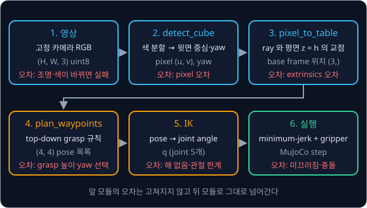
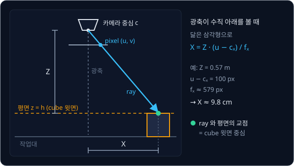
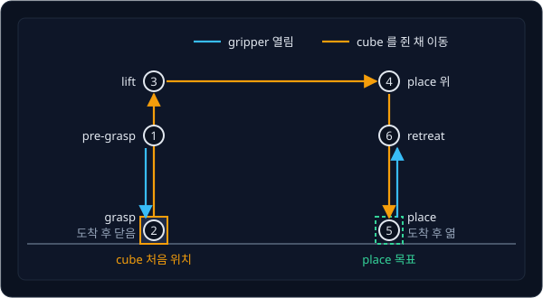

# Classical Pick & Place

## 배경

[MuJoCo Simulation](../mujoco-sim/README.md) 의 팔은 좌표만 주면 그곳으로 가고,
[Camera Geometry](../camera-geometry/README.md) 의 코드는 pixel 과 3D 점 사이를 오간다. 이 둘을 이으면 공장 로봇이 오래 써
온 모듈 파이프라인 방식의 pick-and-place 가 된다. Levine 등(2016)은 카메라 영상에서 motor torque 까지를 neural network
하나로 학습하는 end-to-end visuomotor policy 를 내놓으며 이 방식의 한계를 정면으로 다뤘다. 이 과제에서는 end-to-end policy
와 비교할 baseline 인 모듈 파이프라인을 끝까지 만들어 보고, 어디에서 얼마나 실패하는지를 숫자로 남긴다.

### 모듈 파이프라인

pick-and-place 를 여섯 단계로 나누고, 단계마다 입력과 출력을 정해 둔 함수를 하나씩 짠다. 카메라 영상에서 cube 를 찾아 그
pose 를 로봇 base frame 으로 옮기고, grasp pose 를 정해 IK 로 joint angle 을 구한 뒤 trajectory 를 만들어 따라간다.



모듈마다 입력과 출력이 분명해서 어느 단계가 틀렸는지 따로 시험할 수 있다. 대신 앞 모듈의 오차는 뒤 모듈로 그대로
넘어가고, 물체 모양·조명·카메라 위치가 바뀌면 사람이 규칙을 다시 짜야 한다.

### frame 과 homogeneous transform

frame 은 원점 하나와 서로 수직인 x·y·z 축 세 개로 이루어진 좌표계다. 이 과제에는 로봇 base frame $b$, 카메라 frame $c$,
cube frame $o$, gripper frame $g$ 가 나온다. 한 frame 에서 본 다른 frame 의 pose 는 [Rigid Transforms](../transforms/README.md)
에서 다룬 4×4 homogeneous transform 으로 쓴다.

$$
T_{bc} = \begin{bmatrix} R_{bc} & t_{bc} \\ 0 & 1 \end{bmatrix}, \qquad p_b = T_{bc}\,p_c
$$

$T_{bc}$ 는 "base 에서 본 카메라의 pose" 다. $R_{bc}$ (3×3) 는 카메라 축이 base 에서 어느 방향을 향하는지, $t_{bc}$ (3,) 는
카메라 원점이 base 의 어디에 있는지를 담는다. 카메라 frame 의 좌표 $p_c$ 끝에 1 을 붙인 (4,) 벡터에 $T_{bc}$ 를 곱하면 같은
점의 base frame 좌표 $p_b$ 가 나온다. 카메라의 이 pose $T_{bc}$ 를 extrinsics 라고 한다.

예를 들어 카메라가 base 원점에서 앞으로 0.3 m, 위로 0.6 m 에 있고 수직 아래를 본다고 하자. OpenCV 규약의 카메라 frame
은 $z$ 가 바라보는 방향, $x$ 가 영상의 오른쪽, $y$ 가 영상의 아래쪽이라 $R_{bc} = \mathrm{diag}(1, -1, -1)$,
$t_{bc} = [0.3, 0, 0.6]$ 이다. 카메라 frame 의 점 $p_c = [0.098, 0, 0.57]$ 은

$$
p_b = R_{bc}\,p_c + t_{bc} = [0.098, 0, -0.57] + [0.3, 0, 0.6] = [0.398, 0, 0.03]
$$

으로, base frame 에서 높이 3 cm 인 점이 된다. frame 을 여러 번 건너야 할 때는 transform 을 차례로 곱한다.

$$
T_{bo} = T_{bc}\,T_{co}, \qquad q_{\text{grasp}} = \mathrm{IK}\!\left(T_{bo}\,T_{og}\right)
$$

$T_{co}$ 는 카메라가 본 cube 의 pose, $T_{og}$ 는 cube 기준으로 정한 grasp pose 다. 두 transform 을 곱한 $T_{bg}$ 를 IK 에
넣으면 그 pose 로 gripper 를 보내는 joint angle $q$ 가 나온다.

### pinhole camera 와 intrinsics

pinhole camera 는 3D 점에서 카메라 중심으로 가는 직선이 영상 평면과 만나는 자리에 그 점이 찍힌다고 보는 모델이다.
camera-geometry 에서 다룬 intrinsics 행렬 $K$ 가 카메라 frame 의 방향을 pixel 로 바꾼다.

$$
K = \begin{bmatrix} f_x & 0 & c_x \\ 0 & f_y & c_y \\ 0 & 0 & 1 \end{bmatrix}, \qquad
\begin{bmatrix} u \\ v \\ 1 \end{bmatrix} \propto K \begin{bmatrix} X \\ Y \\ Z \end{bmatrix}
$$

$f_x, f_y$ 는 pixel 단위의 초점 거리이고, $(c_x, c_y)$ 는 광축이 영상과 만나는 principal point 다. MuJoCo 카메라는 세로
화각 `fovy` 하나로 정의되고 pixel 이 정사각형이라 $f_x = f_y = \frac{H/2}{\tan(\text{fovy}/2)}$ 이며, principal point 는
영상 중심이다. 예를 들어 `fovy` 가 45° 이고 영상이 640×480 이면 $f_x = f_y = 240 / \tan 22.5° \approx 579.4$ 이고
$(c_x, c_y) = (320, 240)$ 이다.

### pixel 에서 base frame 의 점까지

영상 한 장만으로는 pixel 이 얼마나 먼 점인지(depth) 알 수 없다. pixel $(u, v)$ 에는 카메라 중심에서 출발하는 반직선(ray) 하나
위의 점이 모두 같은 자리에 찍힌다. cube 는 작업대 위에 놓이므로 윗면의 높이 $z = h$ 를 미리 알고, ray 가 평면 $z = h$ 와 만나는 점을
구하면 depth 영상 없이도 위치가 나온다. 이 교점은 윗면의 중심이라, `detect_cube` 가 내는 cube 중심은 교점에서 $z$ 를 한 변의
절반만큼 내린 점이다.

$$
d = R_{bc}\,K^{-1} \begin{bmatrix} u \\ v \\ 1 \end{bmatrix}, \qquad p(t) = t_{bc} + t\,d \quad (t > 0)
$$

$d$ (3,) 는 base frame 에서 본 ray 의 방향이고, $p(t)$ 의 $z$ 좌표가 $h$ 가 되는 $t$ 를 찾으면 교점이다. 광축이 수직 아래를
보는 특별한 경우에는 닮은 삼각형으로 바로 계산된다.



카메라와 cube 윗면 사이의 거리가 $Z = 0.57$ m 이고 cube 가 영상 중심에서 오른쪽으로 100 pixel 에 찍혔다면, 광축에서 cube
까지의 가로 거리는 $X = 0.57 \times 100 / 579.4 \approx 0.098$ m 다. 앞 절의 예에서 쓴 $p_c$ 가 이 점이다.

### 색 분할과 yaw

색 분할(color segmentation)은 정해 둔 색 범위에 드는 pixel 만 1 로 표시한 mask 를 만들어 물체를 찾는 방법이다. RGB 대신
색상(hue)·채도(saturation)·명도(value)로 나눈 HSV 로 바꾸면, 조명이 조금 바뀌어도 색상 값은 덜 흔들려서 범위를 정하기
쉽다. mask 에서 덩어리의 외곽선(contour)을 찾고, 그 외곽선을 감싸는 가장 작은 회전 사각형을 구하면 중심 pixel 과 기울어진
각도가 나온다. OpenCV 의 `cvtColor`·`inRange`·`findContours`·`minAreaRect` 가 각 단계를 맡는다.

윗면이 정사각형인 cube 는 90° 돌려도 모양이 같아서 yaw 를 하나로 정할 수 없다. 10° 와 100°, 190° 는 모두 같은 cube 이므로
yaw 는 $\pi/2$ 로 나눈 나머지로만 정의되고(`CubeEstimate.yaw` 의 "defined modulo pi / 2"), 오차도 90° 주기를 감안해 잰다.

### top-down grasp 와 waypoint

top-down grasp 는 gripper 를 수직 아래로 향하게 한 채 cube 바로 위에서 내려가 잡는 방식이다. gripper 의 $z$ 축이 base 의
$-z$ 를 향하고, 손가락이 벌어지는 방향은 cube 의 옆면과 수직이 되도록 yaw 를 맞춘다. 이 grasp pose 하나에서 나머지
자세를 정해진 규칙으로 만드는데, 경로에 놓인 이 자세들을 waypoint 라고 부른다.

| 순서 | waypoint | 정하는 규칙 | gripper |
| --- | --- | --- | --- |
| 1 | pre-grasp | grasp pose 를 위로 몇 cm 올린 자세 | 열림 |
| 2 | grasp | cube 를 쥐는 자세 | 도착 후 닫음 |
| 3 | lift | grasp 를 위로 올린 자세 | 닫힘 |
| 4 | place 위 | place 목표 위의 같은 높이 | 닫힘 |
| 5 | place | place 목표에 cube 가 닿는 높이 | 도착 후 엶 |
| 6 | retreat | place 에서 위로 물러난 자세 | 열림 |



pre-grasp 를 거쳐 수직으로 내려가는 이유는 옆에서 다가가다 손가락이 cube 를 밀어내는 일을 막기 위해서다. 높이 몇 cm 같은
숫자는 모두 사람이 정하는 값이다.

### IK 와 minimum-jerk trajectory

waypoint 는 gripper 의 pose 라서 로봇에 보내려면 joint angle 로 바꿔야 하는데, 이 일을
[Inverse Kinematics](../inverse-kinematics/README.md) 의 IK 가 한다. joint angle 사이를 한 번에 건너뛰면 로봇이 튀므로,
[PID Control](../pid-control/README.md) 의 minimum-jerk trajectory 로 시간 $T$ 동안 부드럽게 잇는다.

$$
q(t) = q_0 + (q_f - q_0)\,s(\tau), \qquad s(\tau) = 10\tau^3 - 15\tau^4 + 6\tau^5, \qquad \tau = t / T
$$

$q_0$ 는 출발, $q_f$ 는 도착 joint angle 이다. $s$ 는 0 에서 1 로 가는데 출발과 도착에서 속도와 가속도가 모두 0 이다.

| $\tau$ | 0 | 0.25 | 0.5 | 0.75 | 1 |
| --- | --- | --- | --- | --- | --- |
| $s(\tau)$ | 0 | 0.104 | 0.5 | 0.896 | 1 |
| $ds/d\tau$ | 0 | 1.055 | 1.875 | 1.055 | 0 |

### 성공률과 실패 분류

한 번 성공한 시연만으로는 파이프라인이 얼마나 믿을 만한지 알 수 없어서, cube 를 무작위 위치·yaw 에 놓고 50 번 돌려 성공
비율을 잰다. 성공은 cube 가 5 cm 넘게 들렸다가 place 목표 2 cm 안에 놓인 경우이고, 실패는 원인에 따라 perception(위치·yaw
추정이 틀림), IK(해를 못 찾거나 관절 한계), grasp(쥐었다가 미끄러짐), 충돌로 나눈다. 실패를 모듈별로 나눠 두면 어느 모듈을
고쳐야 하는지가 숫자로 드러난다.

## 목표

- 작업대 위에 cube 와 고정 카메라가 있는 MuJoCo scene 을 만든다
- 렌더링한 영상에서 cube 를 찾아 base frame 기준의 위치와 yaw 를 추정한다
- pre-grasp → grasp → lift → place 로 이어지는 waypoint 를 정하고 IK 로 joint angle 을 구한다
- minimum-jerk trajectory 로 waypoint 를 잇고 gripper 를 여닫는다
- 무작위 cube 배치 50개로 성공률을 재고 실패를 모듈별로 나눈다

**직접 짤 것**: perception(색 분할이나 ArUco 에서 pose 까지), frame 변환 연결, grasp pose 규칙, waypoint 계획, 실행 loop,
평가 script. IK·trajectory·camera 코드는 앞 과제의 것을 쓴다.
**가져다 써도 되는 것**: MuJoCo, `cv2` 의 기본 영상 처리(`inRange`, `findContours`, `minAreaRect`)와 ArUco 검출.

## 준비물

- Python 3.12, `mujoco`, numpy, scipy, `opencv-python`, matplotlib, pytest
- mujoco-sim 과제의 SO-101 scene. actuator 는 Menagerie 기본 `position` 이든 내 PD 든 상관없다
- GPU 불필요

## 진행 순서

1. `assets/pick_scene.xml` 의 주석 자리에 작업대, 한 변 3 cm 인 cube(`<freejoint/>`, body 이름 `cube`), 작업 공간을 위에서
   내려다보는 고정 카메라를 추가한다. `mujoco.MjModel.from_xml_path` 로 오류 없이 읽히고, 렌더링한 카메라 영상에 cube 가
   보이면 된다
2. 카메라의 intrinsics $K$ 를 `fovy` 에서, extrinsics $T_{bc}$ 를 `data.cam_xpos`·`data.cam_xmat` 에서 구한다. cube 중심의 참값
   `data.body("cube").xpos` 를 camera-geometry 의 `project` 로 영상에 찍었을 때 렌더링한 cube 위에 놓이면 둘 다 맞다
3. `perception.py` 의 `detect_cube` 에서 cube 윗면의 중심 pixel 과 yaw 를 구한다
4. 같은 파일의 `pixel_to_table` 로 그 pixel 을 지나는 ray 와 평면 $z = h$ 의 교점을 구한다. `test_perception.py` 에
   cube 를 무작위로 놓고 위치·yaw 오차를 참값과 비교하는 test 를 쓴다
5. `grasp.py` 의 `grasp_pose`·`plan_waypoints` 로 pre-grasp 부터 retreat 까지의 waypoint 를 정하고, waypoint 마다 IK 가 해를
   찾는지 확인한다. 지금 `wrist_roll` 값을 `current_wrist_roll` 로 넘겨, yaw 후보 가운데 그 값에 가장 가까운 것을 고르게 한다
6. `execute.py` 의 `execute_waypoints` 에서 waypoint 사이를 minimum-jerk 로 잇고 gripper 를 여닫으며 실행한다
7. `evaluate.py` 의 `run_trial` 로 한 번의 시도를, `main` 으로 무작위 50회를 돌려 성공률과 실패 원인 표를
   `results/` 에 저장하고 커밋한다
8. 카메라 extrinsics 를 1 cm·2° 틀리게 넣거나 조명을 바꾼 뒤 같은 평가를 다시 돌려 `results/` 에 함께 남긴다

## 시작점

아래 파일은 모두 리포에 들어 있다.

```text
classical-pick/
├── pyproject.toml          # 이 과제의 Python 버전과 패키지
├── uv.lock
├── assets/
│   └── pick_scene.xml      # SO-101 + 작업대 + cube + 고정 카메라 scene. 주석 자리를 채운다
├── perception.py           # CubeEstimate, detect_cube, pixel_to_table
├── grasp.py                # grasp_pose, plan_waypoints
├── execute.py              # execute_waypoints: waypoints → IK → min-jerk → gripper
├── evaluate.py             # run_trial, 무작위 50회 평가와 실패 표
└── test_perception.py      # detect_cube 의 위치·yaw 오차를 보는 test
```

[perception.py](perception.py)·[grasp.py](grasp.py)·[execute.py](execute.py)·[evaluate.py](evaluate.py) 의 함수는 몸통이
`raise NotImplementedError` 인 stub 이고, 이름과 signature 는 그대로 둔 채 몸통을 채운다. 채점용 test 는 없어서 평가 기준은
[test_perception.py](test_perception.py) 에 직접 쓴 test 와 `evaluate.py` 가 `results/` 에 남긴 표로 확인한다.
`execute.py` 첫머리는 앞 과제 폴더를 `sys.path` 에 더해 IK 의 `solve_with_restarts`, URDF 를 읽는 `parse_urdf`, pid-control
의 `min_jerk`, mujoco-sim 의 joint 추종 `track` 을, `perception.py` 첫머리는 camera-geometry 의 `project` 를 import 해 둔다.
`append` 는 목록 끝에 더하므로 이 과제 폴더의 파일이 먼저 찾아진다. 패키지는 `pyproject.toml` 에 있고, 이 폴더에서 `uv run` 을
처음 실행할 때 `.venv/` 에 설치된다.

```bash
cd projects/classical-pick
uv run pytest
uv run python evaluate.py
```

## 평가 기준

- [ ] perception 단위 test 에서 `data.body("cube").xpos` 참값 대비 위치 오차의 median 이 5 mm 아래, yaw 오차가 5° 아래다
- [ ] 무작위 배치 50회 중 80% 이상에서 cube 가 5 cm 넘게 들렸다가 place 목표 2 cm 안에 놓인다
- [ ] 실패한 시도마다 원인을 perception·IK·grasp(미끄러짐)·충돌 가운데 하나로 분류한 표가 있다
- [ ] 카메라 extrinsics 를 1 cm·2° 틀리게 넣었을 때 성공률이 얼마나 떨어지는지 측정했다
- [ ] (선택) cube 를 원기둥이나 색이 다른 물체로 바꿀 때 고쳐야 하는 모듈과 숫자를 목록으로 적는다

## 생각해 볼 질문

1. 이 파이프라인에서 사람이 손으로 정한 숫자와 규칙(색 임계값, grasp 높이, waypoint 간격 …)을 모두 꼽아 보면 몇 개인가?
   물체나 작업이 바뀌면 그중 무엇을 다시 정해야 하는가?
2. perception·IK·실행 단계의 오차가 몇 mm 씩 겹치면 grasp 성공은 무엇으로 정해지는가? end-to-end policy 는 같은 오차를
   어떻게 다루는가?
3. 모듈 파이프라인이 end-to-end policy 보다 분명히 나은 상황은 언제인가?

## 힌트

<details>
<summary>MuJoCo 카메라에서 base frame 의 점까지</summary>

MuJoCo 카메라는 세로 field of view `fovy`(degree) 하나로 정의되고 pixel 이 정사각형이라
$f_x = f_y = \frac{H/2}{\tan(\text{fovy}/2)}$, principal point 는 영상 중심이다. `data.cam_xpos`·`data.cam_xmat` 이 world 에서
본 카메라 pose 인데, MuJoCo 카메라는 $-z$ 를 바라보고 $+y$ 가 위쪽이라 OpenCV 규약으로 쓰려면 x 축 기준 180° rotation 을
오른쪽에 곱한다. cube 는 작업대 위에 놓이니 윗면 높이 $z = h$ 를 알고, pixel $(u, v)$ 의 방향
$d = R_{bc}\,K^{-1}[u, v, 1]^\top$ 로 쏜 ray 가 평면 $z = h$ 와 만나는 점을 구하면 depth 영상 없이도 위치가 나온다.

</details>

<details>
<summary>top-down grasp 와 yaw</summary>

SO-101 은 팔의 joint 가 5개지만, gripper 를 수직 아래로 향하게 하는 grasp 에서는 `wrist_flex` 가 수직을 맞추고 `wrist_roll`
이 yaw 를 맡아서 위치·수직·yaw 를 모두 맞출 수 있다. cube 는 90° 마다 같은 모양이라 yaw 후보 네 개 가운데 `wrist_roll` range
안에서 현재 값과 가장 가까운 것을 고른다.

</details>

<details>
<summary>색 분할 대신 ArUco marker 사용</summary>

marker PNG 를 `type="2d"` texture 로 만들어 cube 의 material 에 붙인다. primitive geom 에는 2d texture 가 local XY 로 투영되기
때문에 윗면에서 marker 가 제대로 보이고, 크기는 material 의 `texrepeat`·`texuniform` 으로 맞춘다. 그러면 camera-geometry 의
marker pose 코드로 위치와 yaw 를 한 번에 얻는다.

</details>

## 참고 자료

- Russ Tedrake, [Robotic Manipulation — Ch. 3 Basic Pick and Place](https://manipulation.csail.mit.edu/pick.html) — 같은
  문제를 spatial algebra, differential IK, grasp·pre-grasp pose, trajectory 순으로 푼다. frame 표기 $^{A}X^{B}$ 를 읽는 법도
  여기서 익힌다
- OpenCV, [Changing Colorspaces](https://github.com/opencv/opencv/blob/4.x/doc/py_tutorials/py_imgproc/py_colorspaces/py_colorspaces.markdown)
  — BGR 을 HSV 로 바꾸고 `inRange` 로 색 하나만 골라내는 예제
- OpenCV, [Contour Features](https://github.com/opencv/opencv/blob/4.x/doc/py_tutorials/py_imgproc/py_contours/py_contour_features/py_contour_features.markdown)
  — moments 로 중심 구하기와 `minAreaRect` 의 반환값(중심, 크기, 각도)
- OpenCV, [Detection of ArUco Markers](https://github.com/opencv/opencv/blob/4.x/doc/tutorials/objdetect/aruco_detection/aruco_detection.markdown)
  — 색 분할 대신 marker 로 pose 를 얻을 때의 검출과 pose 추정
- [MJCF XML reference](https://mujoco.readthedocs.io/en/stable/XMLreference.html) — scene 에 넣을 `camera`·`texture`·`material`·
  `freejoint` 항목
- [MuJoCo Python bindings](https://mujoco.readthedocs.io/en/stable/python.html) — `mujoco.Renderer` 로 카메라 영상을 받는 법
- T. Flash, N. Hogan, [The coordination of arm movements: an experimentally confirmed mathematical model](https://doi.org/10.1523/JNEUROSCI.05-07-01688.1985)
  (1985) — minimum-jerk trajectory 를 처음 제안한 논문
- S. Garrido-Jurado 외, [Automatic generation and detection of highly reliable fiducial markers under occlusion](https://doi.org/10.1016/j.patcog.2014.01.005)
  (2014) — ArUco marker 의 원 논문
- Levine 외, [End-to-End Training of Deep Visuomotor Policies](https://arxiv.org/abs/1504.00702) — 같은 일을 network 하나로
  하는 쪽의 출발점

## 남은 한계

이 파이프라인은 cube 하나, 정해진 카메라, 정해진 조명에 맞춰져 있어서 물체나 작업이 바뀔 때마다 perception 규칙과 grasp
규칙을 사람이 다시 짜야 한다. 그 규칙을 시연 데이터에서 배우는 쪽이 imitation learning 이고,
[Behavior Cloning](../behavior-cloning/README.md) 에서 시작해 [ACT](../act/README.md)·[Diffusion Policy](../diffusion-policy/README.md)
로 이어진다.
