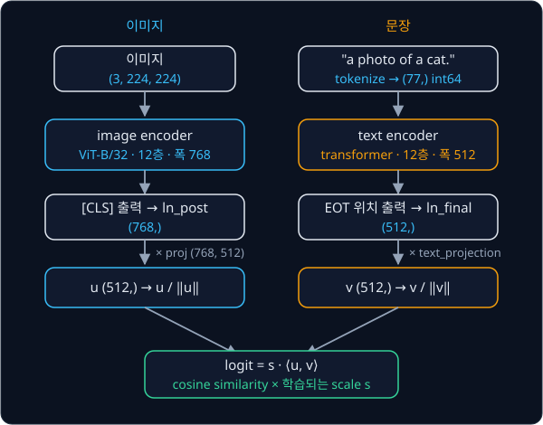
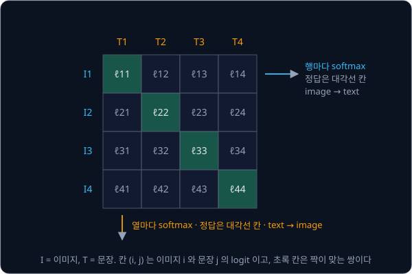
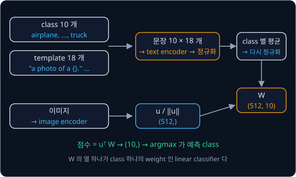

# CLIP

## 배경

[ViT](../vit/README.md) 는 ImageNet 의 1000개 class 처럼 미리 정한 label 로만 학습되어서, "빨간 컵" 같은 새 개념을 알아보게
하려면 그 label 을 단 데이터를 다시 모아야 한다. 2021년 Radford 등은 인터넷에서 모은 이미지–문장 쌍 4억 개로 image encoder 와
text encoder 를 함께 학습시켜, 짝이 맞는 이미지와 문장의 embedding 이 같은 방향을 가리키게 만들었다. 이 모델이 CLIP
(Contrastive Language–Image Pre-training)이다.

### embedding 과 cosine similarity

embedding 은 이미지나 문장 하나를 나타내는 숫자 vector 다. CLIP 은 이미지와 문장을 모두 512 차원 vector 로 바꾸는데, 둘이 같은
공간에 있어서 서로 비교할 수 있다.

두 vector 가 얼마나 같은 방향인지는 cosine similarity 로 잰다. vector 를 길이로 나눠 길이 1 로 만드는 것을 L2 정규화라고 하고,
정규화한 두 vector 의 내적이 cosine similarity 다. 같은 방향이면 1, 직각이면 0, 반대 방향이면 −1 이다.

$$
\cos(u, v) = \Big\langle \frac{u}{\lVert u \rVert}, \frac{v}{\lVert v \rVert} \Big\rangle
$$

$u = [3, 4]$ 는 길이가 5 라서 정규화하면 $[0.6, 0.8]$ 이고, $v = [4, 3]$ 은 $[0.8, 0.6]$ 이다. 둘의 cosine similarity 는
$0.6 \cdot 0.8 + 0.8 \cdot 0.6 = 0.96$ 으로 거의 같은 방향이다.

### image encoder 와 text encoder

image encoder 는 [ViT](../vit/README.md) 와 같은 구조에 patch 32 를 쓴 ViT-B/32 다. 224×224 이미지가 7×7 = 49 개 patch 와
[CLS] token 1 개, 모두 50 개 token 이 되고, 폭 768·12층 encoder 를 지난 [CLS] 출력을 행렬 `proj` 로 512 차원에 옮긴다.

text encoder 는 [GPT-2](../gpt/README.md) 와 같은 causal transformer 다. 문장을 BPE tokenizer 로 최대 77 개 token id 로 바꾸는데,
맨 앞에 문장 시작 token(SOT), 맨 끝에 문장 끝 token(EOT)이 붙고 남는 자리는 0 으로 채운다. "a photo of a cat." 는 SOT 와 6 개
단어·마침표 token, EOT 를 합쳐 8 개 token 이 되고 EOT 는 7번 자리에 온다. causal mask 때문에 EOT 자리의 출력만 문장 전체를 볼
수 있으므로, 이 자리의 출력을 `text_projection` 으로 512 차원에 옮겨 문장의 embedding 으로 쓴다.



| 부분 | OpenAI ViT-B/32 의 값 |
| --- | --- |
| image encoder | patch 32, token 50, 폭 768, 12층, head 12 |
| text encoder | vocab 49,408, context 77, 폭 512, 12층, head 8 |
| embedding 차원 | 512 |
| 전체 parameter | 약 1.5억 개(151,277,313) |

### contrastive loss

batch 안의 $B$ 쌍에서 image embedding $u_i$ 와 text embedding $v_j$ 를 L2 정규화하고, cosine similarity 에 학습되는 scale $s$ 를
곱해 $B\times B$ logits 를 만든다. $i$ 번째 이미지와 $i$ 번째 문장이 짝이므로 정답은 대각선 칸이다. 행마다 대각선이 정답인
cross-entropy(이미지마다 맞는 문장 고르기)와 열마다 대각선이 정답인 cross-entropy(문장마다 맞는 이미지 고르기)를 한 번씩 계산해
평균하면 loss 가 된다. 짝이 맞는 쌍은 가깝게, batch 안의 다른 쌍은 멀게 밀어내는 이런 학습을 contrastive learning 이라고 한다.

$$
\ell_{ij} = s\,\langle u_i, v_j\rangle,\qquad
\mathcal L = \frac{1}{2B}\sum_{i=1}^{B}\Big[-\log\frac{e^{\ell_{ii}}}{\sum_j e^{\ell_{ij}}} - \log\frac{e^{\ell_{ii}}}{\sum_j e^{\ell_{ji}}}\Big]
$$



$B = 3$ 이고 logits 가 아래와 같다면, 행 방향 cross-entropy 는 0.197·0.249·0.196, 열 방향은 0.153·0.354·0.161 이고 loss 는 둘의
평균 0.218 이다.

$$
\ell = \begin{bmatrix} 3.0 & 1.0 & 0.5 \\ 0.8 & 2.5 & 0.2 \\ 0.1 & 0.9 & 2.8 \end{bmatrix}
$$

scale $s$ 는 softmax 의 temperature 를 뒤집은 값이다. 논문은 $s$ 를 temperature 0.07 에 해당하는 $1/0.07 \approx 14.3$ 에서
시작해 학습하고, 100 을 넘지 않게 자른다. weight 에는 $\log s$ 로 저장된다.

### zero-shot classification

학습이 끝나면 class 이름을 "a photo of a {class}." 같은 문장으로 바꿔 text embedding 을 만들고, 이미지 embedding 과 가장 가까운
문장을 고르는 것만으로 처음 보는 dataset 을 분류할 수 있다. 이 dataset 의 이미지로 따로 학습하지 않으므로 zero-shot 이라고
부른다. 문장 틀(template) 여러 개로 같은 class 의 text embedding 을 여러 개 만들어 평균하면 class 마다 vector 하나가 나오고,
이 vector 들을 열로 세운 행렬 $W$ 가 linear classifier 의 weight 가 된다.



OpenAI 는 dataset 마다 template 목록을 공개했고, CIFAR-10 용은 "a photo of a {}.", "a blurry photo of a {}." 같은 18 개다.

### SigLIP

2023년 SigLIP 은 batch 전체에 걸친 softmax 대신 쌍마다 독립적인 sigmoid 를 쓴다. $B^2$ 개 쌍 하나하나를 "짝인가 아닌가" 의
binary classification 으로 보고, 짝이면 $z_{ij} = 1$, 아니면 $-1$ 을 정답으로 둔다.

$$
\mathcal L_{\text{sig}} = -\frac{1}{B}\sum_{i=1}^{B}\sum_{j=1}^{B}\log\sigma\big(z_{ij}\,(t\,\langle u_i, v_j\rangle + b)\big),\qquad
z_{ij} = \begin{cases}\ \ 1 & i=j\\ -1 & i\neq j\end{cases}
$$

$\sigma(x) = 1/(1 + e^{-x})$ 는 sigmoid, $t$ 는 CLIP 의 $s$ 처럼 학습되는 scale, $b$ 는 학습되는 bias 다.

π0 가 쓰는 VLM 인 PaliGemma 의 vision encoder 가 이 loss 로 학습된 SigLIP 이라서, 여기서 만드는 encoder 는 뒤의 VLA 과제에서
이미지를 언어와 같은 공간으로 읽어 들이는 역할을 한다.

## 목표

- [ViT](../vit/README.md) 과제의 encoder 를 CLIP 의 image encoder(ViT-B/32)로 고친다
- [GPT-2](../gpt/README.md) 과제의 decoder 로 text encoder 를 만든다
- OpenAI CLIP ViT-B/32 weight 를 옮겨 넣고 image·text embedding 을 공식 구현과 비교한다
- contrastive loss 와 zero-shot classifier 를 짜서 CIFAR-10 test set 의 zero-shot 정확도를 잰다
- (보너스) SigLIP sigmoid loss 를 짜서 softmax loss 와 batch 크기별로 비교한다

**직접 짤 것**: image encoder, text encoder(causal mask, EOT 위치 pooling), projection, logit scale, contrastive loss, sigmoid
loss, zero-shot classifier, weight 이식.
**가져다 써도 되는 것**: CLIP 의 BPE tokenizer(`clip.tokenize`)와 이미지 전처리, 공식 `clip` 패키지와 HF `CLIPModel`(비교용).
[BPE Tokenizer](../tokenizer/README.md) 과제의 코드로 CLIP vocab 을 읽어 써도 된다.

## 준비물

- Python 3.12, `torch`, `torchvision`, `ftfy`, `regex`, `tqdm`, `pytest`
- OpenAI CLIP 패키지 `clip` — 공식 weight·tokenizer·전처리. GitHub 에서 받는 패키지라 `pyproject.toml` 의
  `[tool.uv.sources]` 에 git 주소가 적혀 있다
- `open-clip-torch` — 선택 평가 기준의 `ClipLoss` 비교용
- [ViT](../vit/README.md) 과제의 `vit.py`, [GPT-2](../gpt/README.md) 과제의 코드 — 두 encoder 의 출발점
- CIFAR-10 test set(torchvision), 보너스용 [COCO 2017](https://cocodataset.org/#download) val 이미지 5,000장과 caption annotation.
  `data/` 에 두면 `.gitignore` 에 걸려 커밋되지 않는다
- CLIP ViT-B/32 는 float32 로 올려도 1 GB 가 안 되어 8 GB GPU 나 Colab T4 면 충분하다. CPU 로도 돌아가지만 CIFAR-10 10,000장 평가는 느리다

## 진행 순서

1. `image_encoder.py` 에서 ViT 과제의 encoder 에 `ln_pre`, `QuickGELU`, 출력 projection 을 더해 CLIP image encoder 를 만든다
2. `text_encoder.py` 에서 GPT-2 과제의 decoder 를 고쳐 EOT token 위치의 출력을 projection 하는 text encoder 를 만든다
3. `clip_model.py` 의 `CLIP` 으로 두 encoder 를 묶고, `load_clip.py` 에서 `clip.load("ViT-B/32", device="cpu")` 로 받은 모델의
   `state_dict` 를 내 모델로 옮기는 대응표를 만든다
4. 같은 이미지·문장에서 내 모델과 공식 모델의 embedding 을 비교하는 test 를 `test_clip.py` 에 쓴다
5. `zeroshot.py` 의 `zeroshot_weights` 로 18개 prompt template 의 평균인 CIFAR-10 10개 class 의 text embedding 을 만든다
6. CIFAR-10 test set 의 zero-shot 정확도를 template 1개일 때와 18개일 때로 나눠 잰다
7. `losses.py` 에 `clip_loss` 와 `siglip_loss` 를 짠다. 위 3×3 예의 logits 를 넣어 0.218 이 나오는지 확인한다
8. (보너스) COCO val2017 에서 projection 이전 feature 를 고정하고, 새로 초기화한 projection 두 개를 batch 크기 32·256·1024 에서
   두 loss 로 각각 학습시킨다. recall@1 표는 `results/` 에 커밋한다

## 시작점

아래 파일은 모두 리포에 들어 있다.

```text
clip/
├── pyproject.toml     # 이 과제의 Python 버전과 패키지
├── uv.lock
├── image_encoder.py   # QuickGELU, ImageEncoder 의 stub. ViT 과제 코드 + ln_pre, QuickGELU, proj
├── text_encoder.py    # TextEncoder 의 stub. GPT-2 과제 코드 + EOT pooling, text_projection
├── clip_model.py      # CLIP 의 stub: encode_image, encode_text, forward
├── losses.py          # clip_loss, siglip_loss 의 stub
├── load_clip.py       # OpenAI state_dict → 내 CLIP, load_openai_clip 의 stub
├── zeroshot.py        # zeroshot_weights 의 stub 과 CIFAR-10 zero-shot 평가
└── test_clip.py       # 공식 모델·open_clip 과 비교하는 test 를 직접 쓴다
```

함수와 method 는 몸통이 `raise NotImplementedError` 인 stub 이고, 이름과 signature 는 그대로 둔 채 몸통을 채운다.
[image_encoder.py](image_encoder.py) 첫머리에서 ViT 과제 폴더를 `sys.path` 에 더해 `vit.py` 의 `PatchEmbed`·`EncoderBlock` 을,
[text_encoder.py](text_encoder.py) 첫머리에서 GPT-2 과제 폴더를 더해 `gpt.py` 의 `GPTConfig`·`Block` 을 import 해 두었다. 채점용
test 는 없어서 평가 기준은 [test_clip.py](test_clip.py) 에 직접 쓴 test 와 `zeroshot.py` 가 출력하는 정확도로 확인한다. 패키지는 `pyproject.toml` 에 있고,
이 폴더에서 `uv run` 을 처음 실행할 때 `.venv/` 에 설치된다.

```bash
cd projects/clip
uv run pytest
uv run python zeroshot.py
```

## 평가 기준

- [ ] 공식 모델(`clip.load("ViT-B/32", device="cpu")`)과 비교해 정규화한 image·text embedding 의 차이가 1e-4 미만이다(float32)
- [ ] CIFAR-10 test set 10,000장의 zero-shot 정확도가 같은 template·같은 전처리를 쓴 공식 모델과 0.1%p 이내다
- [ ] template 1개("a photo of a {}.")일 때와 18개 평균일 때의 정확도 차이를 기록했다
- [ ] (선택) random embedding 에서 내 `clip_loss` 가 open_clip `ClipLoss` 와 1e-6 이내로 같다
- [ ] (보너스) COCO val2017 에서 두 loss 의 image→text recall@1 을 batch 크기별 표로 정리했다

## 생각해 볼 질문

1. softmax contrastive loss 에서 batch 크기는 왜 중요한가? 같은 이미지–문장 쌍이라도 batch 에 함께 들어간 다른 쌍에 따라 loss 가 달라지는 이유는?
2. zero-shot classifier 는 weight 가 text embedding 인 linear classifier 다. prompt 문구만 바꿨는데 정확도가 달라지는 이유는?
3. SigLIP 은 bias $b$ 를 $-10$ 에서 시작한다. $B^2$ 개 쌍 가운데 positive 가 $B$ 개뿐인 것과 이 초기값은 어떤 관계인가?

## 힌트

<details>
<summary>torchvision ViT 와 CLIP image encoder 의 차이</summary>

CLIP 은 position embedding 을 더한 뒤 encoder 에 들어가기 전에 LayerNorm(`ln_pre`)을 한 번 더 거치고, MLP activation 이
GELU 가 아니라 QuickGELU 다. 마지막에는 [CLS] 출력에 `ln_post` 를 적용하고 bias 없는 행렬 `proj` 를 곱해 512차원으로 바꾼다.
LayerNorm eps 도 torchvision ViT 의 1e-6 이 아니라 1e-5 다.

</details>

<details>
<summary>text encoder 가 문장 끝을 찾는 법</summary>

CLIP tokenizer 는 문장 끝에 EOT token 을 붙이는데, 이 token 의 id 가 vocab 에서 가장 크다. 그래서 token id 의 argmax 위치가
곧 EOT 위치다. `ln_final` 을 거친 출력에서 그 위치의 vector 를 골라 `text_projection` 을 곱한다.

</details>

<details>
<summary>공식 모델과 값이 크게 다를 때</summary>

`clip.load` 는 GPU 에 올릴 때 weight 를 float16 으로 바꾸므로 CPU 로 불러 float32 끼리 비교한다. `logit_scale` 은 log 값으로
저장되어 있어서 쓸 때 `exp()` 를 해야 한다.

</details>

## 참고 자료

- Alec Radford et al., [Learning Transferable Visual Models From Natural Language Supervision](https://arxiv.org/abs/2103.00020)
  (2021) — 2.3절과 그림 3 의 의사 코드가 contrastive loss 이고, 3.1.4절이 prompt engineering 과 template ensemble 이다
- Xiaohua Zhai et al., [Sigmoid Loss for Language Image Pre-Training](https://arxiv.org/abs/2303.15343) (2023) — 3.2절이 sigmoid
  loss 의 식이고, Algorithm 1 이 그 의사 코드다
- Yannic Kilcher, [OpenAI CLIP: Connecting Text and Images (Paper Explained)](https://www.youtube.com/watch?v=T9XSU0pKX2E) —
  논문을 그림과 함께 읽어 주는 영상
- Lilian Weng, [Contrastive Representation Learning](https://lilianweng.github.io/posts/2021-05-31-contrastive/) — contrastive
  loss 의 계보와 batch 안의 negative 를 쓰는 방식 정리
- OpenAI, [CLIP](https://github.com/openai/CLIP) — 공식 weight 와 tokenizer. dataset 별 class 이름과 template 은
  [`data/prompts.md`](https://github.com/openai/CLIP/blob/main/data/prompts.md) 에 있고, 구현
  [`model.py`](https://github.com/openai/CLIP/blob/main/clip/model.py) 는 막혔을 때만 연다
- OpenAI, [Prompt Engineering for ImageNet 노트북](https://github.com/openai/CLIP/blob/main/notebooks/Prompt_Engineering_for_ImageNet.ipynb)
  — template ensemble 로 zero-shot classifier 를 만드는 과정
- Hugging Face, [CLIP 문서](https://huggingface.co/docs/transformers/model_doc/clip)와 [`openai/clip-vit-base-patch32`](https://huggingface.co/openai/clip-vit-base-patch32)
  — 같은 weight 의 다른 구현. 비교용
- open_clip, [`loss.py`](https://github.com/mlfoundations/open_clip/blob/main/src/open_clip/loss.py) — `ClipLoss`·`SigLipLoss`
  구현. 막혔을 때만 연다
- Google, [big_vision](https://github.com/google-research/big_vision) — SigLIP 공식 구현과 weight

## 남은 한계

CLIP 은 이미지와 문장이 얼마나 잘 맞는지 점수를 낼 뿐, 문장을 생성하거나 로봇 action 을 내지는 못한다. image encoder 를 language
model 에 붙이고 action 까지 token 으로 생성하게 만든 모델이 [RT-2 → OpenVLA](../vla-tokens/README.md) 다.
