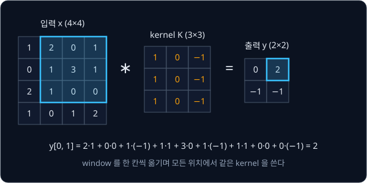
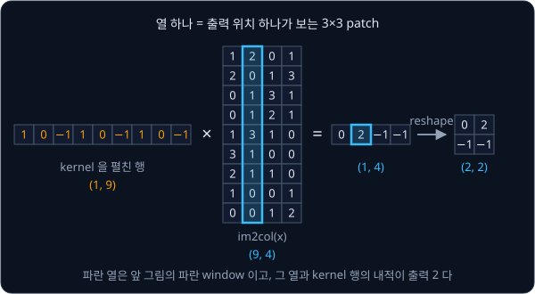
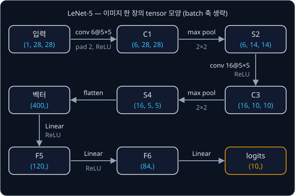

# CNN

## 배경

[PyTorch Training Loop](../pytorch-mlp/README.md) 에서 MNIST 를 푼 MLP 는 28×28 이미지를 784차원 vector 로 펴서 받는다.
펴는 순간 어느 pixel 이 어느 pixel 옆에 있었는지 정보가 사라지고, 숫자가 두세 pixel 만 옆으로 밀려도 입력 vector 가 크게
달라진다. 입력이 224×224 컬러 이미지라면 첫 층의 hidden unit 하나마다 weight 가 150,528 개(224×224×3)씩 필요해서 parameter 수도
감당하기 어렵다. 1998년 LeCun 등은 이 문제를 convolution 과 pooling 을 번갈아 쌓은 LeNet-5 로 풀었다.

### convolution

convolution 은 작은 weight 판 하나(kernel)를 이미지 위에서 한 칸씩 옮겨 가며, 겹친 자리의 값끼리 곱해 모두 더한 값을 그
위치의 출력으로 내는 연산이다. 4×4 입력에 3×3 kernel 을 쓰면 kernel 이 놓일 수 있는 자리가 가로 2 곳, 세로 2 곳이라 출력은
2×2 가 된다.



위 kernel 은 왼쪽 열에 1, 오른쪽 열에 −1 이 있어서 window 의 왼쪽이 오른쪽보다 밝을수록 큰 값을 낸다. 세로 방향 경계에 반응하는
filter 이고, CNN 은 이런 kernel 의 값을 손으로 정하지 않고 학습으로 찾는다.

출력의 모든 위치가 같은 kernel 을 쓰므로 weight 는 kernel 크기만큼만 있으면 된다. 이것이 weight sharing 이다. 출력 하나는 입력의
$k \times k$ 영역만 보는데, 이 영역을 receptive field 라고 한다(local receptive field). 또 입력 그림을 옆으로 옮기면 출력도 같은
만큼 옮겨 간다. 이 성질을 translation equivariance 라고 한다.

딥러닝 라이브러리의 "convolution" 은 수학의 convolution 과 달리 kernel 을 뒤집지 않는다. 엄밀히는 cross-correlation 이지만
kernel 을 학습하므로 차이가 없고, `F.conv2d` 도 뒤집지 않는 쪽이다.

### channel 과 여러 kernel

컬러 이미지는 R·G·B 세 장의 2D 판으로 되어 있고, 이 판 하나하나를 channel 이라 부른다. 입력 channel 이 $C$ 개면 kernel 도
$C \times k \times k$ 크기가 되어 모든 channel 의 window 를 한꺼번에 곱해 더한다. 이런 kernel 을 $C_{\text{out}}$ 개 두면 출력도
$C_{\text{out}}$ 장의 판(feature map)이 된다. 그래서 weight 의 모양은 $(C_{\text{out}}, C_{\text{in}}, k, k)$ 이고, kernel 마다 bias 가
하나씩 있다.

$$
y[o, i, j] = b[o] + \sum_{c}\sum_{u=0}^{k-1}\sum_{v=0}^{k-1} W[o, c, u, v]\; x[c,\; s i + u,\; s j + v]
$$

| 기호 | 뜻 |
| --- | --- |
| $o$ | 출력 channel 번호, $0 \le o < C_{\text{out}}$ |
| $i, j$ | 출력 feature map 의 세로·가로 위치 |
| $c$ | 입력 channel 번호 |
| $u, v$ | kernel 안의 세로·가로 위치 |
| $s$ | stride. kernel 을 한 번에 옮기는 칸 수 |

batch 까지 넣으면 입력은 $(N, C_{\text{in}}, H, W)$, 출력은 $(N, C_{\text{out}}, H_{\text{out}}, W_{\text{out}})$ 이다.

### padding·stride 와 출력 크기

padding $p$ 는 입력 테두리에 0 을 $p$ 줄씩 덧대는 것이고, stride $s$ 는 kernel 을 $s$ 칸씩 건너뛰며 옮기는 것이다. 출력 크기는

$$
H_{\text{out}} = \left\lfloor \frac{H + 2p - k}{s} \right\rfloor + 1
$$

이고 가로도 같은 식이다. $\lfloor\cdot\rfloor$ 는 소수점 아래를 버리는 내림이다. 위 그림은 $H = 4$, $k = 3$, $p = 0$, $s = 1$ 이라
$(4 + 0 - 3)/1 + 1 = 2$ 다. LeNet-5 의 첫 층은 $H = 28$, $k = 5$, $p = 2$, $s = 1$ 이라 $(28 + 4 - 5) + 1 = 28$ 로 크기가
유지된다.

### im2col

정의를 for 문으로 그대로 짜면 출력 위치·channel·kernel 칸마다 Python 반복이 돌아 너무 느리다. im2col 은 출력 위치마다 보는
$C k^2$ 개 입력을 한 열로 펼쳐 $(C k^2) \times (H_{\text{out}} W_{\text{out}})$ 행렬을 만들고, kernel 도
$C_{\text{out}} \times (C k^2)$ 행렬로 펴서 convolution 전체를 행렬곱 한 번으로 계산하는 방법이다. 행렬곱은 BLAS·GPU 에서 가장
빠르게 도는 연산이라, 2006년 Chellapilla 등이 CNN 을 빠르게 계산하려고 이 방법을 썼고 Caffe 같은 framework 도 오랫동안 이 방식을
썼다.



열 안의 순서는 kernel 을 펼친 순서와 같아야 한다. `weight.reshape(C_out, C * k * k)` 는 channel → 세로 → 가로 순서로 펴므로, 각
열도 같은 순서로 채운다. 행렬곱 결과 $(C_{\text{out}}, H_{\text{out}} W_{\text{out}})$ 를 $(C_{\text{out}}, H_{\text{out}}, W_{\text{out}})$
로 reshape 하면 convolution 출력이 된다.

### max pooling

max pooling 은 겹치지 않는 $2 \times 2$ window 마다 가장 큰 값 하나만 남겨 가로·세로를 반으로 줄인다. 위 4×4 입력이라면
왼쪽 위 window $\{1, 2, 0, 1\}$ 에서 2, 오른쪽 위 $\{0, 1, 3, 1\}$ 에서 3 이 남아 출력은 $\begin{bmatrix} 2 & 3 \\ 2 & 2 \end{bmatrix}$
다. weight 가 없고, window 를 열로 펼쳐 열마다 최댓값을 고르면 되므로 im2col 을 그대로 쓸 수 있다.

### LeNet-5

LeNet-5 는 convolution 과 pooling 을 두 번 번갈아 쌓아 $(1, 28, 28)$ 이미지를 $(16, 5, 5)$ 로 줄이고, 이를 400 차원 vector 로 펴서
Linear 세 개로 숫자 10 개 중 하나를 고른다. 이번 과제에서는 직접 짠 im2col convolution 으로 이 구조를 다시 만든다.



## 목표

- im2col 로 `conv2d` 를 짜고 `F.conv2d` 와 같은 결과를 내는지 확인한다
- 같은 patch 펼치기로 max pooling 을 짠다
- 내 `Conv2d` layer 로 LeNet-5 를 조립해 MNIST 를 학습시킨다
- 앞 과제의 MLP 와 parameter 수·test 정확도를 나란히 비교한다
- 첫 conv 층의 filter 와 feature map 을 그림으로 본다

**직접 짤 것**: im2col, convolution, max pooling, LeNet-5 조립.
**가져다 써도 되는 것**: `F.pad`, `nn.Linear`·`torch.optim`·`F.cross_entropy`(앞 과제에서 직접 짜 봤으니), torchvision 의 MNIST
loader. `F.conv2d`·`F.unfold` 는 정답 비교에만 쓴다.

## 준비물

- Python 3.12, `torch`, `torchvision`, `matplotlib`, `pytest`
- MNIST(torchvision 이 자동으로 내려받는다). 받은 파일은 `data/` 에 두면 `.gitignore` 에 걸려 커밋되지 않는다
- GPU 불필요. LeNet-5 는 CPU 로도 학습된다

## 진행 순서

1. `conv.py` 의 `conv_out_size` 와, 정의를 for 문으로 그대로 옮긴 `conv2d_naive` 를 짠다. 위 4×4 예에서 출력 `[[0, 2], [-1, -1]]`
   이 나오면 기준 구현으로 쓸 수 있다
2. 입력 `(N, C, H, W)` 를 `(N, C·k², H_out·W_out)` 로 펼치는 `im2col` 을 짜고, `F.unfold` 와 결과가 같은지 본다
3. kernel 을 행렬로 바꿔 곱하는 `conv2d` 를 짜고, `test_conv.py` 에서 stride·padding 조합마다 `F.conv2d` 와 비교한다
4. `im2col` 을 재사용해 `max_pool2d` 를 짜고 `F.max_pool2d` 와 비교한다
5. `lenet.py` 에 `Conv2d` module 과 LeNet-5 를 조립하고 parameter 수를 센다
6. `train.py` 에서 MNIST 로 10 epoch 안팎 학습해 test 정확도를 앞 과제의 MLP 와 비교한다
7. 첫 conv 층의 filter 6개와 숫자 한 장의 feature map 을 그려 `results/filters.png`·`results/feature_maps.png` 로 저장하고
   커밋한다

## 시작점

아래 파일은 모두 리포에 들어 있다.

```text
cnn/
├── pyproject.toml   # 이 과제의 Python 버전과 패키지
├── uv.lock
├── conv.py          # conv_out_size, conv2d_naive, im2col, conv2d, max_pool2d 의 stub
├── lenet.py         # Conv2d, LeNet5 의 stub
├── train.py         # MNIST 학습·평가, filter·feature map 그림
└── test_conv.py     # F.conv2d 와 비교하는 test 를 직접 쓴다
```

[conv.py](conv.py)·[lenet.py](lenet.py) 의 함수와 method 는 몸통이 `raise NotImplementedError` 인 stub 이고, 이름과
signature 는 그대로 둔 채 몸통을 채운다. 채점용 test 는 없어서 평가 기준은 [test_conv.py](test_conv.py) 에 직접 쓴 test 와
`train.py` 가 출력하는 parameter 수·test 정확도로 확인한다. 패키지는 `pyproject.toml` 에 있고, 이 폴더에서 `uv run` 을 처음
실행할 때 `.venv/` 에 설치된다.

```bash
cd projects/cnn
uv run pytest
uv run python train.py
```

## 평가 기준

- [ ] kernel 1·3·5, stride 1·2, padding 0·1·2 의 모든 조합에서 내 `conv2d` 와 `F.conv2d` 의 출력 차이가 1e-5 미만이다
- [ ] float64 작은 입력에서 내 `conv2d` 가 `torch.autograd.gradcheck` 를 통과한다
- [ ] LeNet-5 의 parameter 수가 61,706 개이고, MNIST test 정확도가 98.5% 이상이다
- [ ] 같은 epoch 수에서 LeNet-5 가 앞 과제의 MLP 보다 parameter 는 적고 test 정확도는 같거나 높다
- [ ] (선택) test 이미지를 2 pixel 옮겼을 때 MLP 와 LeNet-5 의 정확도 하락 폭을 비교한다
- [ ] (선택) 같은 입력에서 `conv2d_naive`·`conv2d`·`F.conv2d` 의 실행 시간을 잰다

## 생각해 볼 질문

1. LeNet-5 는 MLP 보다 parameter 가 훨씬 적은데도 MNIST 를 더 잘 푼다. weight sharing 과 locality 는 각각 이미지의 어떤 성질을 가정하는가?
2. im2col 은 같은 입력 pixel 을 여러 열에 복사한다. 3×3 kernel, stride 1 이면 메모리가 대략 몇 배가 되고, 그 대가로 무엇을 얻는가?
3. convolution 은 translation equivariant 인데, LeNet-5 전체는 왜 완전히 translation invariant 하지 않은가?

## 힌트

<details>
<summary>for 문 없는 im2col</summary>

`Tensor.unfold(dim, size, step)` 을 H 축과 W 축에 한 번씩 쓰면 복사 없이 모든 patch 를 담은 view 가 나오고, 그 축 순서를
weight 의 `(C, k, k)` 순서에 맞춰 바꾼 뒤 reshape 하면 된다. 이름이 비슷한 `F.unfold` 와는 다른 함수다.

</details>

<details>
<summary>원 논문의 LeNet-5 와 다른 점</summary>

원 논문은 tanh 계열 activation, 학습되는 계수가 붙은 subsampling, C3 층에서 일부 channel 끼리만 잇는 연결 표, RBF 출력층을
쓴다. ReLU·max pooling·전체 연결·linear 출력층으로 바꿔도 MNIST 정확도는 비슷하게 나오고, 61,706 이라는 parameter 수도 이
전체 연결 구성을 기준으로 센 값이다.

</details>

## 참고 자료

- Yann LeCun et al., [Gradient-Based Learning Applied to Document Recognition](http://yann.lecun.com/exdb/publis/pdf/lecun-01a.pdf)
  (1998) — LeNet-5 의 원 논문. 2절(Convolutional Neural Networks for Isolated Character Recognition)에 구조와 층별 크기가 있다
- Kumar Chellapilla, Sidd Puri, Patrice Simard, [High Performance Convolutional Neural Networks for Document Processing](https://inria.hal.science/inria-00112631)
  (2006) — convolution 을 행렬곱으로 펼쳐(unrolling) BLAS·GPU 로 계산하는 방법
- Stanford CS231n, [Convolutional Neural Networks 강의 노트](https://cs231n.github.io/convolutional-networks/) — 출력 크기 계산과
  im2col 로 convolution 을 행렬곱으로 바꾸는 설명
- Vincent Dumoulin, Francesco Visin, [A guide to convolution arithmetic for deep learning](https://arxiv.org/abs/1603.07285) —
  padding·stride 조합별 출력 크기를 그림으로 정리한 글. 움직이는 그림은 [conv_arithmetic](https://github.com/vdumoulin/conv_arithmetic) 에 있다
- [CNN Explainer](https://poloclub.github.io/cnn-explainer/) — 작은 CNN 의 feature map 과 kernel 계산을 브라우저에서 눌러 보며 따라가는 도구
- Dive into Deep Learning, [Convolutions for Images](https://d2l.ai/chapter_convolutional-neural-networks/conv-layer.html)·[LeNet](https://d2l.ai/chapter_convolutional-neural-networks/lenet.html)
  — cross-correlation 정의부터 LeNet 학습까지 코드와 함께 설명한다
- PyTorch, [`F.unfold`](https://docs.pytorch.org/docs/stable/generated/torch.nn.functional.unfold.html) — PyTorch 가 제공하는
  im2col. 내 구현과 결과를 비교할 때만 쓴다. 힌트의 `Tensor.unfold` 는 [다른 함수](https://docs.pytorch.org/docs/stable/generated/torch.Tensor.unfold.html)다
- PyTorch, [`nn.Conv2d`](https://docs.pytorch.org/docs/stable/generated/torch.nn.Conv2d.html) — weight 모양과 출력 크기 식을 확인한다

## 남은 한계

LeNet-5 는 conv 층이 둘뿐이라 MNIST 같은 작은 흑백 이미지 정도만 다룰 수 있고, 그렇다고 층을 수십 개로 쌓으면 오히려 학습이 잘
되지 않는다. 다음 과제는 그 문제를 푼 [ResNet](../resnet/README.md), convolution 대신 patch 를 token 으로 다루는 [ViT](../vit/README.md), noise 에서
이미지를 생성하는 [DDPM](../ddpm/README.md) 이다.
