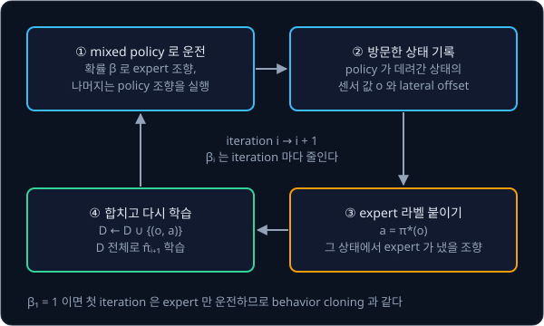
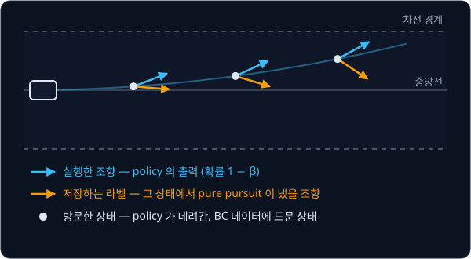

# DAgger

## 배경

### expert 시연으로 채울 수 없는 상태

[Behavior Cloning](../behavior-cloning/README.md) 과제의 policy 는 expert 가 실제로 지나간 상태 분포 $d_{\pi^*}$ 에서 모은
데이터로만 학습한다. 그런데 policy 가 운전하면 작은 오차로 차가 중앙에서 조금씩 밀려나고, expert 라면 가지 않았을 상태,
즉 policy 가 운전할 때의 상태 분포 $d_{\hat\pi}$ 에만 있는 상태에 들어선다. 이 상태들은 expert 시연을 아무리 늘려도 거의 나오지 않아서, policy 는 그곳에서 어떻게 해야
하는지 배운 적이 없다.

Ross·Gordon·Bagnell 의 DAgger(Dataset Aggregation, 2011)는 이 상태를 데이터에 넣는 방법이다. 학습 중인 policy 에게 직접
운전을 맡겨 policy 가 실제로 가는 상태를 모으고, 그 상태마다 expert 에게 "여기서는 어떻게 했어야 하는지" 정답 action 을
물어 dataset 에 계속 합친다.

### DAgger 의 반복

iteration $i$ 하나는 네 단계다.

1. expert $\pi^*$ 와 지금의 policy $\hat\pi_i$ 를 섞은 $\pi_i$ 로 운전한다
2. 그동안 방문한 상태의 관측 $o$ (센서 값 15 개)를 기록한다
3. 각 $o$ 에 expert 가 그 상태에서 냈을 action $\pi^*(o)$ 를 라벨로 붙인다
4. 새 쌍을 누적 dataset $\mathcal{D}$ 에 합치고, $\mathcal{D}$ 전체로 다음 policy $\hat\pi_{i+1}$ 을 학습한다

$$
\pi_i = \beta_i\,\pi^* + (1-\beta_i)\,\hat\pi_i, \qquad
\mathcal{D} \leftarrow \mathcal{D} \cup \{(o,\ \pi^*(o)) : o \sim d_{\pi_i}\}, \qquad
\hat\pi_{i+1} = \arg\min_{\pi} \sum_{(o,\,a)\in\mathcal{D}} \ell\big(\pi(o), a\big)
$$

$d_{\pi_i}$ 는 $\pi_i$ 로 운전할 때 방문하는 상태의 분포이고, $\ell$ 은 behavior cloning 과 같은 MSE 다. 학습 방법은 BC 와
같고 데이터를 모으는 방법만 다르다.



### β 로 섞는 운전

$\pi_i = \beta_i\,\pi^* + (1-\beta_i)\,\hat\pi_i$ 는 두 조향을 평균내라는 뜻이 아니라, 매 step 확률 $\beta_i$ 로 expert 의 조향을,
나머지 확률로 policy 의 조향을 골라 실행하라는 뜻이다. $\beta_1 = 1$ 이면 첫 iteration 은 expert 만 운전하므로 behavior
cloning 과 같고, $\beta_i$ 를 줄여 갈수록 policy 가 운전대를 더 많이 잡는다. 논문이 다룬 schedule 두 가지는 아래와 같다.

| schedule | $\beta_1, \beta_2, \beta_3, \beta_4, \ldots$ |
| --- | --- |
| $\beta_i = p^{\,i-1}$, $p = 0.5$ | 1, 0.5, 0.25, 0.125, … |
| $\beta_i = \mathbb{1}[i = 1]$ | 1, 0, 0, 0, … |

어느 쪽이 실행되든 저장하는 라벨은 늘 그 상태에서 expert 가 냈을 조향이다. 그래서 DAgger 에는 차의 정확한 위치로 언제든
조향을 계산할 수 있는 pure pursuit 같은 expert 가 필요하다.



### 오차 bound 비교

Behavior Cloning 에서는 step 당 실수 확률이 $\epsilon$ 이어도 길이 $T$ 인 episode 의 비용이 최악의 경우 expert 보다
$T^2\epsilon$ 까지 늘어날 수 있었다. 논문은 DAgger 를 no-regret online learning 으로 보고, iteration 을 충분히 돌리면 그동안
얻은 policy 들 가운데 아래를 만족하는 policy 가 있다는 것을 보였다.

$$
J(\hat\pi) \le J(\pi^*) + uT\epsilon_N + O(1)
$$

$\epsilon_N$ 은 $N$ 번의 iteration 에서 모은 상태들 위에서 가장 좋은 policy 가 내는 평균 오차이고, $u$ 는 expert 와 다른 action
을 한 번 했을 때 남은 비용이 늘어날 수 있는 상한이다. 예를 들어 $T = 100$, 오차 0.01 이면 BC 의 상한은 $T^2\epsilon = 100$ 이지만,
한 번 실수해도 몇 step 안에 복구되어 $u = 2$ 정도인 문제라면 DAgger 의 상한은 $uT\epsilon_N = 2$ 에 상수항을 더한 정도다. 오차가
$T$ 에 제곱이 아니라 선형으로 쌓인다.

이번 과제에서는 Behavior Cloning 의 env·expert·학습 코드를 그대로 import 하고 DAgger 루프만 새로 짜서, iteration 마다 이탈률이
줄어드는지 확인한다.

## 목표

- Behavior Cloning 의 env·expert·MLP 를 재사용해 DAgger 루프를 짠다
- $\beta$ schedule 로 expert 와 policy 를 섞어 몰면서 방문한 상태에 expert 라벨을 붙인다
- iteration 마다 데이터 크기·validation loss·이탈률을 기록한다
- 같은 샘플 수를 expert 시연만으로 모은 BC 와 이탈률을 비교한다

**직접 짤 것**: DAgger 루프, $\beta$ mixing, 데이터 aggregation, iteration 별 기록.
**가져다 써도 되는 것**: [Behavior Cloning](../behavior-cloning/README.md) 에서 만든 env·expert·학습 코드 전부.
`imitation` 라이브러리의 DAgger 는 결과 비교용.

## 준비물

- Python 3.12, numpy, torch, matplotlib, pytest
- Behavior Cloning 과제의 `lane_env.py`·`pure_pursuit.py`·`collect_demos.py`·`train_bc.py`·`lane_eval.py` —
  `dagger.py`·`compare.py` 가 `../behavior-cloning` 폴더에서 import 한다
- (선택) `imitation` — 결과 비교용. 의존 패키지가 많아 `pyproject.toml` 에는 없고, 비교할 때 이 폴더에서
  `uv add imitation` 으로 더한다. gymnasium 0.29 와 stable-baselines3 가 함께 설치된다
- GPU 불필요

## 진행 순서

1. Behavior Cloning 의 BC policy 를 iteration 0 으로 두고, 같은 noise 조건에서 이탈률을 다시 잰다
2. `dagger.py` 의 `mixed_action` 을 짠다. 확률 $\beta$ 로 expert 조향을, 나머지 경우에는 policy 조향을 실행 조향으로 고르고,
   라벨로는 늘 expert 조향을 돌려준다. $\beta = 1$ 이면 실행 조향과 라벨이 같아야 한다
3. `collect_on_policy` 를 짠다. mixed policy 로 rollout 하면서 방문한 상태의 센서 값, 그 상태의 expert 조향, lateral offset 을
   기록한다. 이탈하는 순간 episode 를 끊는다
4. `run_dagger` 에서 새 데이터를 누적 dataset 에 합치고 `train_bc` 로 policy 를 다시 학습한다
5. 3–4 를 10 iteration 반복하며 iteration 별 이탈률·데이터 수·validation loss 와 그 iteration 에 모은 데이터의 lateral
   offset 을 기록하고, `main` 에서 이 기록을 `results/` 에 저장한다
6. `compare.py` 의 `expert_only_bc` 로 iteration 마다 누적 샘플 수와 같은 양의 expert-only 데이터로 BC 를 학습해 이탈률을
   비교한다
7. `plots.py` 로 iteration 별 이탈률 곡선과 iteration 별 학습 데이터의 lateral offset 히스토그램을 겹쳐 그려 `results/` 에
   저장하고 커밋한다

## 시작점

아래 파일은 모두 리포에 들어 있다.

```text
dagger/
├── pyproject.toml   # 이 과제의 Python 버전과 패키지
├── uv.lock
├── dagger.py        # mixed_action, collect_on_policy, run_dagger
├── compare.py       # expert_only_bc: 같은 샘플 수의 expert-only BC 와 비교
└── plots.py         # iteration 별 이탈률, offset 히스토그램
```

함수는 몸통이 `raise NotImplementedError` 인 stub 이고, 이름과 signature 는 그대로 둔 채 몸통을 채운다. env·expert·BC 학습
코드는 복사하지 않는다. `dagger.py` 와 `compare.py` 첫머리에서 `../behavior-cloning` 폴더를 `sys.path` 에 더해, Behavior
Cloning 과제에서 짠 `lane_env`·`pure_pursuit`·`train_bc`·`lane_eval`(`compare.py` 는 `collect_demos` 도)을 그대로 import 한다.
채점용 test 는 없어서 평가 기준은 `results/` 에 저장한 iteration 별 기록과 그림으로 확인한다. 패키지는 `pyproject.toml` 에 있고, 이 폴더에서 `uv run` 을 처음 실행할 때 `.venv/` 에 설치된다.

```bash
cd projects/dagger
uv run python dagger.py
uv run python compare.py
uv run python plots.py
```

## 평가 기준

- [ ] iteration 이 늘수록 이탈률이 대체로 줄고, 10 iteration 뒤 이탈률이 iteration 0 (BC) 의 절반 이하다
- [ ] 같은 샘플 수에서 DAgger policy 의 이탈률이 expert-only BC 보다 낮다
- [ ] 후반 iteration 데이터의 offset 히스토그램이 BC 데이터보다 넓게 퍼져 있다
- [ ] expert 라벨 대신 실행한 조향을 저장하도록 일부러 바꾸면 iteration 이 늘어도 이탈률이 거의 줄지 않는다
- [ ] (선택) `imitation` 라이브러리의 DAgger 를 같은 env 에 붙여 iteration 별 이탈률 곡선이 비슷한 모양인지 본다

## 생각해 볼 질문

1. expert 가 직접 몬 데이터를 아무리 늘려도 채울 수 없는 상태는 어떤 상태이고, DAgger 는 그 상태를 어떻게 데이터에 넣는가?
2. 사람이 expert 일 때 DAgger 식 라벨링이 어려운 이유는? 운전대를 잡지 않은 채 "지금 얼마나 꺾었어야 했는지" 를 답해야
   하는 상황을 떠올려 본다
3. DAgger 의 이론은 마지막 policy 가 좋다고 보장하지 않고, iteration 마다 얻은 policy 들 가운데 좋은 policy 가 하나
   있다고만 보장한다. 실제로는 어떤 policy 를 골라 써야 하는가?

## 힌트

<details>
<summary>라벨과 실행 action 의 구분</summary>

rollout 에서 실제로 실행한 조향이 무엇이든, 저장할 라벨은 그 상태에서 expert 가 냈을 조향이다. 실행한 조향을 그대로
저장하면 policy 가 자기 출력을 다시 배우게 되어 새 정보가 들어오지 않는다.

</details>

<details>
<summary>이탈한 뒤의 상태</summary>

차가 차선 밖으로 크게 벗어난 뒤에는 expert 도 복구하지 못하는 경우가 있고, 그 구간의 라벨은 학습에 방해가 된다. 이탈하는
순간 episode 를 끊되, BC 데이터에 가장 부족했던 이탈 직전 구간은 남긴다.

</details>

<details>
<summary>$\beta$ schedule</summary>

논문은 $\beta_1 = 1$ 로 시작해 $\beta_i = p^{i-1}$ 처럼 지수로 줄이는 방식과, 첫 iteration 만 1 이고 이후 0 인
$\beta_i = \mathbb{1}[i = 1]$ 을 함께 다루고 후자가 실제로 가장 잘 될 때가 많다고 적었다. 둘 다 돌려 iteration 별 이탈률
곡선을 비교한다.

</details>

## 참고 자료

- Stéphane Ross, Geoffrey J. Gordon, J. Andrew Bagnell, [A Reduction of Imitation Learning and Structured Prediction to No-Regret Online Learning](https://arxiv.org/abs/1011.0686) (2011) —
  Algorithm 3.1 이 DAgger 이고, Section 3 에 bound 정리가 있다. [AISTATS 판](https://proceedings.mlr.press/v15/ross11a.html)
- UC Berkeley CS 285, [Supervised Learning of Behaviors 강의 슬라이드](https://rail.eecs.berkeley.edu/deeprlcourse/static/slides/lec-2.pdf) —
  "DAgger: Dataset Aggregation" 슬라이드가 알고리즘과 사람이 라벨을 붙이기 어려운 이유를 그림으로 설명한다
- Michael Kelly et al., [HG-DAgger: Interactive Imitation Learning with Human Experts](https://arxiv.org/abs/1810.02890) (2019) —
  사람이 위험할 때만 운전을 넘겨받아 라벨을 모으는 변형
- Jiakai Zhang, Kyunghyun Cho, [Query-Efficient Imitation Learning for End-to-End Autonomous Driving](https://arxiv.org/abs/1605.06450) (2016) —
  SafeDAgger. policy 가 틀릴 것 같은 상태에서만 expert 에게 묻는다
- `imitation` 라이브러리 [DAgger 문서](https://imitation.readthedocs.io/en/latest/algorithms/dagger.html)와 [소스](https://github.com/HumanCompatibleAI/imitation) —
  막혔을 때만 연다
- LeRobot, [Human-In-the-Loop Data Collection](https://huggingface.co/docs/lerobot/hil_data_collection) — 실물 팔에서 사람이
  개입해 데이터를 모으는 방식

## 남은 한계

DAgger 는 아무 상태에서나 바로 라벨을 내는 expert 를 전제하는데, 실물 로봇에서 사람은 그런 expert 가 되기 어렵다. 대안으로는
사람이 위험할 때만 조종을 넘겨받는 HG-DAgger 와 LeRobot 의 human-in-the-loop 수집(`lerobot-rollout --strategy.type=dagger`)이
있고, [Real Robot](../real-robot/README.md) 에서 학습한 policy 에 이 방식을 붙여 볼 수 있다.
