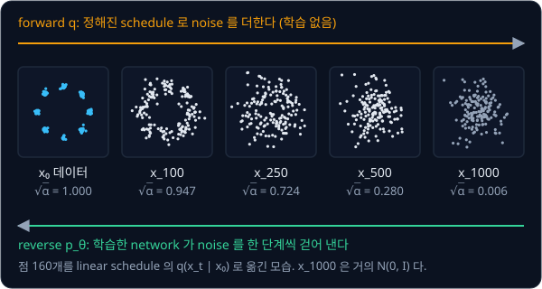
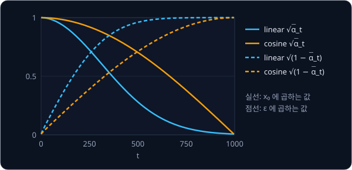
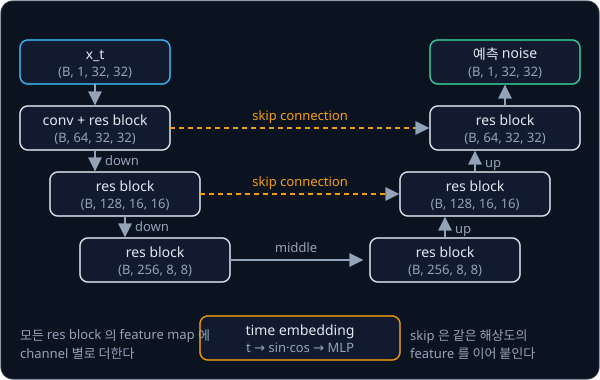

# DDPM

## 배경

### 생성을 작은 단계로 나누기

[VAE](../vae/README.md) 는 latent 하나에서 decoder 한 번으로 이미지를 만들어서, pixel 끼리의 세밀한 상관관계를 담지 못하고
샘플이 흐릿해진다. DDPM(denoising diffusion probabilistic model)은 데이터에 Gaussian noise 를 $T$ 단계에 걸쳐 조금씩 더해 순수한
noise 로 만드는 forward process 를 고정해 두고, 그 반대로 noise 를 한 단계씩 걷어 내는 reverse process 를 학습한다. 한 단계의
변화가 작으면 reverse 한 단계도 Gaussian 으로 근사할 수 있어서, 어려운 생성 문제가 쉬운 denoising 문제 $T$ 개로 쪼개진다.

### forward process

forward process 의 한 단계는 이전 값을 조금 줄이고 작은 noise 를 더한다.

$$
x_t = \sqrt{1-\beta_t}\,x_{t-1} + \sqrt{\beta_t}\,\epsilon,\qquad \epsilon \sim \mathcal N(0, I)
$$

$\beta_t$ 는 $t$ 번째 단계에서 더하는 noise 의 분산이고, $\beta_1, \dots, \beta_T$ 를 noise schedule 이라고 한다. 이전 값에
$\sqrt{1-\beta_t}$ 를 곱해 줄이므로, $x_{t-1}$ 의 분산이 1 이면 $x_t$ 의 분산도 $(1-\beta_t) + \beta_t = 1$ 로 유지된다. 이 단계를
여러 번 이어 붙여도 결과는 Gaussian 이라서, 어느 $t$ 의 $x_t$ 든 $x_0$ 에서 한 번에 sampling 할 수 있다.

$$
q(x_t\mid x_0) = \mathcal N\big(\sqrt{\bar\alpha_t}\,x_0,\ (1-\bar\alpha_t)I\big), \qquad
\alpha_t = 1-\beta_t,\quad \bar\alpha_t = \prod_{s=1}^{t}\alpha_s
$$

$\bar\alpha_t$ 는 $\alpha_1$ 부터 $\alpha_t$ 까지의 곱이다. [VAE](../vae/README.md) 의 reparameterization 처럼 쓰면
$x_t = \sqrt{\bar\alpha_t}\,x_0 + \sqrt{1-\bar\alpha_t}\,\epsilon$ 이고, $\sqrt{\bar\alpha_t}$ 는 원래 데이터가 남은 비율,
$\sqrt{1-\bar\alpha_t}$ 는 noise 의 크기다. $t$ 가 $T$ 에 가까워지면 $\bar\alpha_t \to 0$ 이 되어 $x_T$ 는 거의 $\mathcal N(0, I)$ 다.



### noise schedule

Ho 등은 $T = 1000$ 에 $\beta_t$ 를 $10^{-4}$ 에서 $0.02$ 까지 선형으로 늘리는 linear schedule 을 썼다. Nichol 과 Dhariwal 은 이
schedule 이 뒤쪽 단계에서 데이터를 너무 일찍 지운다고 보고, $\bar\alpha_t$ 를 직접 cosine 곡선으로 정하는 cosine schedule 을
제안했다.

$$
\bar\alpha_t = \frac{f(t)}{f(0)},\qquad f(t) = \cos^2\!\left(\frac{t/T + s}{1 + s}\cdot\frac{\pi}{2}\right),\qquad
\beta_t = \min\!\left(1 - \frac{\bar\alpha_t}{\bar\alpha_{t-1}},\ 0.999\right)
$$

$s = 0.008$ 은 $t = 0$ 근처의 $\beta_t$ 가 너무 작아지지 않게 하는 작은 offset 이고, 끝 근처에서 $\beta_t$ 가 1 로 튀지 않도록
0.999 로 자른다. $T = 1000$ 에서 두 schedule 의 계수를 비교하면 아래와 같다.

| $t$ | linear $\sqrt{\bar\alpha_t}$ | linear $\sqrt{1-\bar\alpha_t}$ | cosine $\sqrt{\bar\alpha_t}$ | cosine $\sqrt{1-\bar\alpha_t}$ |
| --- | --- | --- | --- | --- |
| 1 | 1.000 | 0.010 | 1.000 | 0.006 |
| 100 | 0.947 | 0.321 | 0.986 | 0.167 |
| 250 | 0.724 | 0.690 | 0.920 | 0.391 |
| 500 | 0.280 | 0.960 | 0.703 | 0.711 |
| 750 | 0.058 | 0.998 | 0.380 | 0.925 |
| 1000 | 0.006 | 1.000 | 0.000 | 1.000 |



논문은 $t$ 를 1 부터 $T$ 까지 세고, 코드의 배열 index 는 0 부터 $T-1$ 까지다. 표의 $t = 500$ 은 배열의 499 번째 값이다.

### noise 를 맞히는 loss

network $\epsilon_\theta$ 는 $x_t$ 와 $t$ 를 받아 $x_0$ 에 섞여 들어간 noise $\epsilon$ 을 맞히도록 학습한다. 학습 한 step 은 아래와
같다.

1. 데이터에서 $x_0$ 를 뽑는다
2. $t$ 를 $\{1, \dots, T\}$ 에서 고르게 하나 뽑는다
3. $\epsilon \sim \mathcal N(0, I)$ 를 뽑아 $x_t = \sqrt{\bar\alpha_t}\,x_0 + \sqrt{1-\bar\alpha_t}\,\epsilon$ 을 만든다
4. 아래 loss 로 gradient descent 를 한다

$$
\mathcal L = \mathbb E_{x_0,\,t,\,\epsilon}\Big[\big\lVert \epsilon - \epsilon_\theta\big(\sqrt{\bar\alpha_t}\,x_0 + \sqrt{1-\bar\alpha_t}\,\epsilon,\ t\big)\big\rVert^2\Big]
$$

이 loss 는 ELBO 를 정리한 뒤 항별 weight 를 떼어 내면 나오므로, DDPM 은 encoder 를 고정된 noising 과정으로 바꾼 여러 층짜리 VAE 로
볼 수도 있다.

### reverse step 과 sampling

sampling 은 $x_T \sim \mathcal N(0, I)$ 에서 시작해 $t = T, T-1, \dots, 1$ 순서로 아래 식을 $T$ 번 적용한다.

$$
x_{t-1} = \frac{1}{\sqrt{\alpha_t}}\Big(x_t - \frac{\beta_t}{\sqrt{1-\bar\alpha_t}}\,\epsilon_\theta(x_t, t)\Big) + \sigma_t z,\qquad z\sim\mathcal N(0, I)
$$

괄호 안은 $x_t$ 에서 network 가 예측한 noise 를 덜어 낸 평균이고, $\sigma_t z$ 는 새로 더하는 작은 noise 다. 마지막 단계 $t = 1$
에서는 $z$ 를 더하지 않는다. $\sigma_t^2$ 로는 $\beta_t$ 를 쓰거나 아래의 posterior variance $\tilde\beta_t$ 를 쓰는데, Ho 등은 둘의
결과가 비슷하다고 보고했고 diffusers `DDPMScheduler` 의 기본값(`variance_type="fixed_small"`)은 $\tilde\beta_t$ 다.

$$
\tilde\beta_t = \frac{1-\bar\alpha_{t-1}}{1-\bar\alpha_t}\,\beta_t
$$

### time embedding

같은 network 가 모든 $t$ 를 처리하므로 지금 몇 번째 단계인지를 입력으로 알려 줘야 한다. 정수 $t$ 를 [Transformer](../transformer/README.md)
의 positional encoding 과 같은 sin·cos feature 로 바꾼다.

$$
\mathrm{emb}(t) = \big[\sin(t\,\omega_0), \dots, \sin(t\,\omega_{d/2-1}),\ \cos(t\,\omega_0), \dots, \cos(t\,\omega_{d/2-1})\big],\qquad
\omega_k = 10000^{-k/(d/2)}
$$

$d$ 는 embedding 차원이다. 이 vector 를 작은 MLP 에 통과시킨 뒤 2D toy 의 MLP 에서는 입력과 함께 넣고, U-Net 에서는 각 block 의
feature map 에 channel 별로 더한다.

### U-Net

U-Net 은 입력과 같은 크기의 출력을 내는 conv network 다. 앞쪽은 해상도를 줄여 가며 넓은 범위의 모양을 보고, 뒤쪽은 해상도를 다시
키워 원래 크기로 돌아온다. 이때 앞쪽에서 같은 해상도로 계산한 feature 를 뒤쪽에 이어 붙이는 skip connection 이 세밀한 위치 정보를
전달한다. [CNN](../cnn/README.md) 과제의 conv 와 pooling 을 쓰고, normalization 은 batch 크기와 상관없는 `nn.GroupNorm`(channel 을
몇 묶음으로 나눠 묶음마다 평균 0·분산 1 로 맞춘다)을 쓴다.



### 8 gaussians 와 MMD

8 gaussians 는 반지름 2 인 원 위에 45° 간격으로 놓인 중심 8개에, 표준편차 0.1 인 Gaussian 을 하나씩 둔 2D 분포다. 2차원이라
생성 결과를 그림으로 바로 볼 수 있고, 덩어리(mode)가 8개로 떨어져 있어서 모델이 일부 mode 만 생성하는지 쉽게 드러난다.

MMD(maximum mean discrepancy)는 두 샘플 집합이 같은 분포에서 나왔는지를 kernel 로 재는 값이다. 생성 샘플 $x_1, \dots, x_n$ 과
실제 샘플 $y_1, \dots, y_m$ 에 대해 아래처럼 계산한다.

$$
\mathrm{MMD}^2 = \frac{1}{n^2}\sum_{i,j} k(x_i, x_j) + \frac{1}{m^2}\sum_{i,j} k(y_i, y_j) - \frac{2}{nm}\sum_{i,j} k(x_i, y_j),
\qquad k(a, b) = \exp\!\left(-\frac{\lVert a - b\rVert^2}{2h^2}\right)
$$

$k$ 는 두 점이 가까울수록 1, 멀수록 0 에 가까운 RBF kernel 이고 $h$ 는 bandwidth 다. 두 분포가 같으면 MMD 는 0 에 가깝지만, 샘플
수가 유한해서 같은 분포끼리도 0 이 되지는 않는다. 그래서 실제 샘플 두 묶음 사이의 MMD 를 함께 재어 기준선으로 쓴다.

### DDPM 과 로봇 action

Diffusion Policy 는 같은 수식으로 이미지 대신 로봇의 action sequence 를 생성하는데, Nichol & Dhariwal 의 square cosine schedule 로
100 step 학습하고 실물에서는 DDIM 10 step 으로 sampling 한다.

## 목표

- linear·cosine noise schedule 과 forward noising 을 짜고 diffusers `DDPMScheduler` 와 값을 맞춘다
- 2D toy 분포(8 gaussians)에서 MLP denoiser 를 학습시켜 ancestral sampling 으로 샘플을 만든다
- 생성 샘플과 실제 샘플의 거리를 MMD 로 잰다
- MNIST 에서 time embedding 을 받는 작은 conv U-Net 으로 숫자를 생성한다
- reverse process 가 진행되는 모습을 $t$ 별 snapshot 으로 그린다

**직접 짤 것**: schedule, `q_sample`, loss, reverse step 과 sampling loop, sinusoidal time embedding, U-Net, MMD.
**가져다 써도 되는 것**: `nn.Conv2d`·`nn.GroupNorm`·`nn.ConvTranspose2d`, torchvision 의 MNIST loader, diffusers
`DDPMScheduler`(비교용으로만).

## 준비물

- Python 3.12, `torch`, `torchvision`, `matplotlib`, `diffusers`(schedule 비교용), `pytest`
- 직접 만드는 8 gaussians 데이터, MNIST
- 2D toy 는 CPU 로 충분하고, MNIST U-Net 은 8 GB GPU 나 Colab T4 면 된다

## 진행 순서

1. `noise_schedule.py` 의 `make_betas` 와 `NoiseSchedule` 을 채운다. linear·cosine 의 `alphas_cumprod` 가 `T` = 1000, 100 에서 diffusers 와
   1e-6 이내로 같은지 `test_schedule.py` 에서 확인하고, 위 표의 값(linear `t = 500` 에서 $\sqrt{\bar\alpha_t} = 0.280$)도 맞춰 본다
2. `toy_data.py` 의 `eight_gaussians` 와 `ddpm.py` 의 `q_sample` 을 채우고, 여러 $t$ 의 $x_t$ 를 그려
   `results/forward.png` 로 저장한다
3. `denoisers.py` 의 `timestep_embedding`·`MLPDenoiser` 와 `ddpm.py` 의 `ddpm_loss` 를 채우고, `train_toy.py` 에서 2D 데이터에 학습시킨다
4. `p_sample` 과 `sample` 을 채워 10,000개를 생성하고, 실제 분포와 겹쳐 그린 그림을 `results/toy_samples.png` 로 저장한다. mode 별
   비율과 중심에서 0.3 넘게 벗어난 비율을 출력한다
5. `mmd.py` 의 `mmd_rbf` 를 채워 생성 2,000개와 실제 2,000개, 실제 2,000개 두 묶음의 MMD 를 `results/mmd.txt` 에 함께 기록한다
6. `denoisers.py` 의 `UNet` 을 채우고, `(B, 1, 32, 32)` 입력에 같은 shape 의 출력이 나오는지 본다
7. `train_mnist.py` 에서 MNIST 를 $[-1, 1]$ 로 바꾸고 32×32 로 padding 해 학습시킨 뒤, 64장을 `results/mnist_samples.png` 로, 몇 개
   $t$ 의 중간 결과를 `results/reverse_snapshots.png` 로 저장한다
8. 같은 $x_t$·model 출력·seed 에서 `p_sample` 한 step 이 `DDPMScheduler(clip_sample=False).step(...).prev_sample` 과 1e-5 이내로 같은지
   `test_schedule.py` 에서 확인한다
9. `results/` 의 기록과 그림을 커밋한다

## 시작점

아래 파일은 모두 리포에 들어 있다.

```text
ddpm/
├── pyproject.toml     # 이 과제의 Python 버전과 패키지
├── uv.lock
├── noise_schedule.py  # make_betas, NoiseSchedule 의 stub
├── ddpm.py            # q_sample, ddpm_loss, p_sample, sample 의 stub
├── denoisers.py       # timestep_embedding, MLPDenoiser, UNet 의 stub
├── toy_data.py        # eight_gaussians 의 stub
├── mmd.py             # mmd_rbf 의 stub
├── train_toy.py       # 8 gaussians 학습·생성·MMD
├── train_mnist.py     # MNIST U-Net 학습·생성
└── test_schedule.py   # diffusers 와의 비교를 직접 쓰는 test
```

함수와 class 는 몸통이 `raise NotImplementedError` 인 stub 이고, 이름과 signature 는 그대로 둔 채 몸통을 채운다.
`ddpm.py` 는 `from noise_schedule import NoiseSchedule` 처럼 같은 폴더의 파일을 불러 쓴다. 채점용 test 는 없어서 평가 기준은
[test_schedule.py](test_schedule.py) 에 직접 쓴 test 와 `results/` 의 기록·그림으로 확인한다. 패키지는 `pyproject.toml` 에 있고, 이
폴더에서 `uv run` 을 처음 실행할 때 `.venv/` 에 설치된다.

```bash
cd projects/ddpm
uv run pytest
uv run python train_toy.py
uv run python train_mnist.py
```

## 평가 기준

- [ ] 내 linear·cosine schedule 의 `alphas_cumprod` 가 `DDPMScheduler(beta_schedule="linear")`·`DDPMScheduler(beta_schedule="squaredcos_cap_v2")` 와 1e-6 이내로 같다($T$ = 1000, 100 둘 다)
- [ ] 같은 $x_t$·model 출력·seed 의 `torch.Generator` 를 넣은 내 `p_sample` 이 `DDPMScheduler(clip_sample=False).step(...).prev_sample` 과 1e-5 이내로 같다
- [ ] 8 gaussians 에서 생성한 10,000개가 mode 8개에 각각 12.5% ± 3%p 씩 나뉘고, 가장 가까운 중심에서 0.3(3σ) 넘게 벗어난 샘플이 5% 미만이다
- [ ] 생성 2,000개와 실제 2,000개의 MMD 를, 실제 2,000개 두 묶음 사이의 MMD 와 나란히 기록했다
- [ ] MNIST 생성 64장의 대부분이 어떤 숫자인지 알아볼 수 있다
- [ ] (선택) [CNN](../cnn/README.md) 과제의 LeNet-5 로 생성 샘플 1,000장을 분류해 10개 class 가 고르게 나오는지 본다

## 생각해 볼 질문

1. 학습할 때는 $t$ 를 하나 골라 한 단계만 보는데 sampling 은 $T$ 단계를 모두 거친다. 학습이 한 단계만으로 가능한 이유는?
2. $T$ 를 10 으로 줄이고 $\beta_t$ 를 그만큼 키우면 같은 방식으로는 왜 잘 안 되는가? reverse 한 단계를 Gaussian 으로 놓는 가정과 연결해 설명할 수 있는가?
3. 같은 관측에서 시연자가 장애물을 왼쪽으로도 오른쪽으로도 돌아갔다면, MSE regression policy 와 diffusion policy 는 각각 무엇을 출력하는가?

## 힌트

<details>
<summary>diffusers 와 값이 맞지 않을 때</summary>

`DDPMScheduler` 는 `clip_sample=True` 가 기본값이라 예측한 $x_0$ 를 $[-1, 1]$ 로 잘라 낸다. 8 gaussians 처럼 범위가 넓은
데이터와 비교할 때는 꺼야 한다. diffusers 의 timestep index 는 0 부터 $T-1$ 까지고 논문의 $t$ 는 1 부터 $T$ 까지라서, 배열을
어느 쪽 기준으로 쓸지 한 곳에서 정해 둔다.

</details>

<details>
<summary>time embedding 과 U-Net 크기</summary>

$t$ 는 Transformer 의 positional encoding 과 같은 sin·cos feature 로 바꾼 뒤 작은 MLP 를 거쳐, 각 residual block 의 feature map
에 channel 별로 더한다. MNIST 는 28×28 이라 32×32 로 padding 하면 down 두 번(32→16→8)이 깔끔하게 떨어지고, channel 64 에서
시작하는 작은 망으로 충분하다.

</details>

<details>
<summary>MMD 의 bandwidth</summary>

RBF kernel 의 bandwidth 는 두 샘플을 합친 집합의 pairwise 거리 중앙값으로 잡는 median heuristic 이 무난하다. 서로 비교할 모든
실험에서 같은 bandwidth 를 써야 숫자끼리 비교할 수 있다.

</details>

## 참고 자료

- Jonathan Ho, Ajay Jain, Pieter Abbeel, [Denoising Diffusion Probabilistic Models](https://arxiv.org/abs/2006.11239) — 4쪽의
  Algorithm 1(학습)과 Algorithm 2(sampling), 3.2절의 $\sigma_t$ 선택
- Alex Nichol, Prafulla Dhariwal, [Improved Denoising Diffusion Probabilistic Models](https://arxiv.org/abs/2102.09672) — 3.2절
  식 (17)의 cosine schedule 과 그림 5 의 $\bar\alpha_t$ 비교
- Calvin Luo, [Understanding Diffusion Models: A Unified Perspective](https://arxiv.org/abs/2208.11970) — VAE 에서 출발해 ELBO 와
  DDPM loss 를 한 줄씩 유도하는 tutorial
- MIT 6.S184, [Flow Matching and Diffusion Models](https://diffusion.csail.mit.edu/) — 강의 노트([arXiv](https://arxiv.org/abs/2506.02070))와 [lab](https://github.com/eje24/iap-diffusion-labs) 이 diffusion 을 ODE·SDE 부터 차례로 설명한다
- Lilian Weng, [What are Diffusion Models?](https://lilianweng.github.io/posts/2021-07-11-diffusion-models/) — forward·reverse 식 유도
- Olaf Ronneberger, Philipp Fischer, Thomas Brox, [U-Net: Convolutional Networks for Biomedical Image Segmentation](https://arxiv.org/abs/1505.04597) —
  그림 1 이 U-Net 구조와 skip connection
- Arthur Gretton 등, [A Kernel Two-Sample Test](https://jmlr.org/papers/v13/gretton12a.html) — MMD 의 정의와 성질
- Hugging Face, [The Annotated Diffusion Model](https://huggingface.co/blog/annotated-diffusion) — U-Net 까지 포함한 PyTorch 구현 해설. 막혔을 때만 열기
- diffusers, [`DDPMScheduler` 문서](https://huggingface.co/docs/diffusers/api/schedulers/ddpm)와 [소스](https://github.com/huggingface/diffusers/blob/main/src/diffusers/schedulers/scheduling_ddpm.py) — schedule·step 비교 대상
- Ho 등의 [공식 구현](https://github.com/hojonathanho/diffusion)(TensorFlow)

## 남은 한계

DDPM 은 샘플 하나를 얻는 데 network 를 $T$ 번(여기서는 1000번) 돌려야 해서, 초당 수십 번 action 을 내야 하는 로봇 제어에는
느리다. 다음 과제는 같은 문제를 거의 직선인 경로로 바꿔 적은 step 으로 sampling 하는 [Flow Matching](../flow-matching/README.md) 과,
이 수식으로 action sequence 를 생성하는 [Diffusion Policy](../diffusion-policy/README.md) 다.
