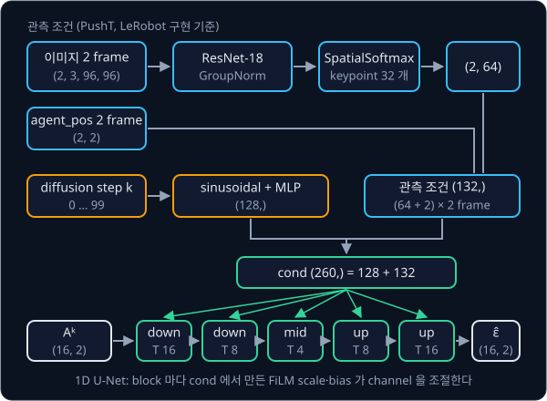
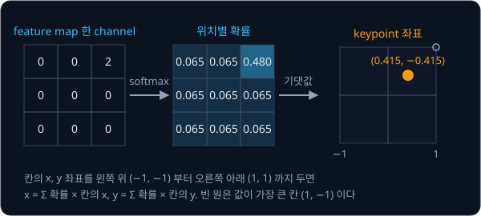
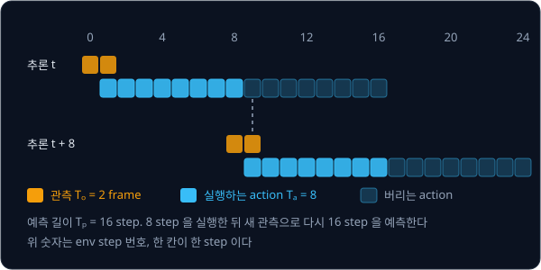

# Diffusion Policy

## 배경

### 한 번에 action 하나를 고르는 방식의 한계

[RT-1](../rt1/README.md) 의 256 bin 분류는 multimodal 시연을 평균으로 뭉개지 않았지만 세 가지 한계가 남는다. 첫째, bin 폭보다
정밀하게 움직일 수 없다. PushT 의 action 은 0~512 px 범위의 2D 목표 위치라서 전체 범위를 256 칸으로 나누면 한 칸이 2 px 다.
둘째, x 와 y 를 따로 뽑아서 두 차원 사이의 상관을 담지 못한다. 셋째, 한 번에 action 하나만 낸다.

Chi 등의 Diffusion Policy(2023)는 앞으로 $T_p$ step 동안의 action sequence $A_t = (a_t, \dots, a_{t+T_p-1})$ 전체를 연속값
샘플 하나로 보고, 최근 $T_o$ 개 관측 $O_t$ 를 조건으로 하는 DDPM 으로 생성한다. PushT 설정은 $T_o = 2$, $T_p = 16$ 이고
action 은 2 차원이라 $A_t$ 는 (16, 2) 모양의 숫자 32 개다.

### action sequence 에 쓰는 DDPM

[DDPM](../ddpm/README.md) 에서 이미지에 하던 일을 (16, 2) action sequence 에 그대로 한다. 깨끗한 시연 sequence $A^0_t$ 에
diffusion step $k$ 만큼 Gaussian noise $\epsilon$ 을 섞어 $A^k_t$ 를 만들고, 망 $\epsilon_\theta$ 가 관측 $O_t$ 와 $A^k_t$, $k$ 를
받아 섞인 noise 를 맞히도록 학습한다.

$$
A^k_t = \sqrt{\bar\alpha_k}\,A^0_t + \sqrt{1-\bar\alpha_k}\,\epsilon, \qquad
\mathcal{L} = \mathbb{E}_{k,\,\epsilon}\Big[\big\lVert \epsilon - \epsilon_\theta\big(O_t,\ A^k_t,\ k\big)\big\rVert^2\Big]
$$

$\epsilon$ 은 $A^0_t$ 와 같은 (16, 2) 모양의 표준 정규분포 noise 이고, $\bar\alpha_k$ 는 step $k$ 까지 신호가 얼마나 남는지를 정하는
schedule 이다. 공식 구현과 LeRobot 은 $K = 100$ step 의 cosine schedule(diffusers 의 `squaredcos_cap_v2`)을 쓰는데, 이 schedule
에서 두 계수는 아래처럼 바뀐다.

| $k$ | 1 | 25 | 50 | 75 | 100 |
| --- | --- | --- | --- | --- | --- |
| $\sqrt{\bar\alpha_k}$ (시연의 비중) | 1.000 | 0.920 | 0.703 | 0.380 | 0.000 |
| $\sqrt{1-\bar\alpha_k}$ (noise 의 비중) | 0.025 | 0.391 | 0.711 | 0.925 | 1.000 |

추론 때는 순수 Gaussian noise 에서 시작해 학습된 $\epsilon_\theta$ 로 noise 를 조금씩 빼는 denoising 을 $K$ 번 되풀이해
action sequence 를 얻는다. 시연의 scale 이 noise 와 비슷해야 하므로 action 과 agent_pos 는 학습 데이터의 최솟값·최댓값으로
[-1, 1] 에 맞춰 넣고, 마지막에 env 단위로 되돌린다.

### 관측 조건과 FiLM

관측은 두 frame 의 96×96 이미지와 agent 위치(agent_pos, 2 차원)다. 이미지 한 장은 image encoder 를 거쳐 숫자 64 개가 되고,
agent_pos 2 개를 붙인 66 개가 두 frame 이라 관측 조건은 132 차원이다. diffusion step $k$ 는 sinusoidal embedding 과 작은 MLP
를 거쳐 128 차원이 되고, 둘을 이어 붙인 260 차원 벡터가 noise 예측망의 조건 cond 다. 이 숫자는 LeRobot 구현의 PushT
설정(keypoint 32 개, step embedding 128)으로 계산한 값이다.

cond 는 FiLM(Feature-wise Linear Modulation)으로 망에 들어간다. FiLM 은 linear layer 하나로 cond 에서 channel 마다 scale
$\gamma$ 와 bias $\beta$ 를 만들어, 중간 feature $h$ 의 각 channel 을 $\gamma \odot h + \beta$ 로 바꾸는 방식이다. feature 가
(B, 256, T) 이면 linear 의 출력은 $256 \times 2 = 512$ 차원이고, 앞 256 개가 $\gamma$, 뒤 256 개가 $\beta$ 가 되어 시간축 $T$
전체에 같은 값으로 곱해지고 더해진다. 같은 noisy sequence 라도 관측과 $k$ 가 바뀌면 모든 block 의 feature 가 달라진다.

### 시간축 1D convolution U-Net

noise 예측망 $\epsilon_\theta$ 는 action sequence 를 (B, action_dim, $T_p$) 로 바꿔 시간축을 따라 1D convolution 을 하는
U-Net 이다. down 경로에서 시간 길이를 16 → 8 → 4 로 줄이며 channel 을 늘리고, up 경로에서 다시 4 → 8 → 16 으로 늘리면서
같은 길이의 down 출력을 skip connection 으로 이어 붙인다. 출력은 입력과 같은 (B, 16, 2) 모양의 noise 예측이다. 공식 구현의
channel 폭 `down_dims` 는 (512, 1024, 2048) 이고, `unet1d.py` 의 기본값 (256, 512, 1024) 는 그 절반이다.



### image encoder

image encoder 는 사전학습 없는 ResNet-18 에서 두 군데를 고친다. 첫째, 마지막의 global average pooling 을 spatial softmax 로
바꾼다. global average pooling 은 feature map 의 공간 평균만 남겨 "어디에" 있는지를 잃는데, spatial softmax 는 channel 마다
feature map 전체에 softmax 를 취해 확률 지도로 만들고 그 확률로 좌표의 기댓값 $(x, y)$ 를 구한다. channel 하나가 keypoint
하나의 위치가 되므로 keypoint 32 개면 숫자 64 개가 나온다.



둘째, BatchNorm 을 GroupNorm 으로 바꾼다. BatchNorm 은 batch 의 평균·분산으로 정규화하고 평가 때는 학습 중 모은 이동 평균을
쓰는데, Diffusion Policy 는 parameter 의 EMA(exponential moving average, 학습 중 parameter 를 지수 이동 평균한 사본)로 평가해서
BatchNorm 의 통계와 EMA parameter 가 어긋나 학습이 흔들릴 수 있다. GroupNorm 은 샘플 하나 안에서 channel 을 묶어 정규화해
batch 통계를 쓰지 않는다. 공식 구현은 96×96 이미지를 84×84 로 random crop 해서 넣는다.

### receding horizon 실행

추론 한 번에 16 step 을 예측하지만 앞 $T_a = 8$ 개만 실행하고, 8 step 뒤의 새 관측으로 다시 16 step 을 예측한다. 이렇게
예측 구간을 계속 앞으로 밀며 일부만 실행하는 방식을 receding horizon 이라 한다. simulation 실험에서는 학습과 추론 모두
denoising 100 step 을 썼다.



이번 과제에서는 [DDPM](../ddpm/README.md) 에서 만든 scheduler 와 [ResNet](../resnet/README.md) 의 ResNet-18 을 고쳐 써서 이
구조를 짜고, 같은 데이터와 같은 step 으로 학습한 LeRobot 의 diffusion policy 와 PushT coverage 를 비교한다.

## 목표

- 내 DDPM scheduler 를 $(T_p, \text{action\_dim})$ 모양의 action sequence 에 맞게 쓴다
- FiLM 으로 관측을 받는 1D conv U-Net noise 예측망을 만든다
- 내 ResNet-18 을 GroupNorm·spatial softmax 로 고친 image encoder 를 만든다
- 앞 $T_a$ 개만 실행하고 다시 추론하는 receding horizon rollout 을 만든다
- LeRobot diffusion policy 를 같은 조건으로 학습해 평균 max coverage 를 비교한다

**직접 짤 것**: 1D U-Net, FiLM block, spatial softmax, 학습 루프, sampling 루프, receding horizon 실행.
**가져다 써도 되는 것**: 앞 과제에서 만든 DDPM scheduler 와 ResNet-18, `LeRobotDataset`, gym-pusht, 비교용
`lerobot-train --policy.type=diffusion`.

## 준비물

- Python 3.12, torch, torchvision, matplotlib, pytest
- `lerobot[pusht]` — `LeRobotDataset`, gym-pusht, 비교용 `lerobot-train` 명령이 함께 설치된다
- dataset: `lerobot/pusht` (206 episode, 96×96 이미지, 2 차원 action)
- DDPM 과제의 scheduler 와 ResNet 과제의 ResNet-18 코드
- 8 GB GPU 로 충분하다. 다만 LeRobot 의 공개 모델처럼 batch 64 로 수십만 step 을 돌리면 하루 단위의 시간이 걸리므로, 두 쪽 모두
  같은 짧은 step 으로 맞춰 비교한다

## 진행 순서

1. `data.py` 에서 `delta_timestamps` 로 관측 2 frame 과 action 16 step 을 한 샘플로 묶고, action·state 를 [-1, 1] 로 정규화한다.
   batch 하나의 action 이 (B, 16, 2), 이미지가 (B, 2, 3, 96, 96) 인지 확인한다
2. `vision.py` 의 `SpatialSoftmax` 를 짜고 위 3×3 예시를 넣어 (0.415, −0.415) 가 나오는지 확인한다. 이어서 `make_encoder` 에서
   ResNet-18 의 BatchNorm 을 GroupNorm 으로, global pooling 을 `SpatialSoftmax` 로 바꾼 encoder 를 만든다
3. `unet1d.py` 의 `ConditionalResBlock1D` 에 diffusion step embedding 과 관측 feature 를 이어 붙인 조건 벡터로 FiLM 을 적용한다
4. down·up 경로와 skip connection 을 갖춘 `ConditionalUnet1D` 로 조립하고 출력 shape 이 입력과 같은지 확인한다
5. `diffusion_policy.py` 의 `compute_loss` 에서 DDPM scheduler 로 noise 를 섞어 $\epsilon$ 예측 MSE 를 내고, `train.py` 로 학습한다
6. `sample` 에서 순수 noise 로 시작해 $K$ step denoising 하고 [-1, 1] 로 clip 한 뒤 env 단위로 되돌린다
7. `eval_pusht.py` 에서 앞 8 step 만 실행하고 다시 추론하는 rollout 으로 gym-pusht 50 episode 의 평균 max coverage 와 성공률을
   재고, 결과 표를 `results/` 에 저장한다
8. 같은 데이터·step·horizon 으로 LeRobot diffusion policy 를 학습하고 같은 50 episode 로 평가해 `results/` 의 표에 더한다

## 시작점

아래 파일은 모두 리포에 들어 있다.

```text
diffusion-policy/
├── pyproject.toml       # 이 과제의 Python 버전과 패키지
├── uv.lock
├── data.py              # LeRobotDataset + delta_timestamps, 정규화
├── vision.py            # SpatialSoftmax, GroupNorm ResNet-18 encoder
├── unet1d.py            # ConditionalResBlock1D, ConditionalUnet1D
├── diffusion_policy.py  # DiffusionPolicy: compute_loss, sample
├── train.py             # 학습
└── eval_pusht.py        # receding horizon rollout, coverage
```

class 와 method 는 몸통이 `raise NotImplementedError` 인 stub 이고, 이름과 signature 는 그대로 둔 채 몸통을 채운다.
`data.py` 에는 정해진 signature 가 없어서 dataset 과 정규화 함수를 직접 정한다. 앞 과제에서 짠 코드는 stub 첫머리에서
그 과제 폴더를 `sys.path` 에 더해 import 해 두었다. [vision.py](vision.py) 는 `../resnet` 의 `resnet18` 을,
[diffusion_policy.py](diffusion_policy.py) 는 `../ddpm` 의 `NoiseSchedule`·`make_betas`·`q_sample`·`p_sample` 을 가져오고,
ResNet-18 의 normalization 과 pooling 만 이 과제에서 바꾼다. 채점용 test 는 없어서 평가 기준은 직접 쓴 shape test 와 `results/` 에 저장한 rollout 결과 표로 확인한다.
패키지는 `pyproject.toml` 에 있고, 이 폴더에서 `uv run` 을 처음 실행할 때 `.venv/` 에 설치된다.

```bash
cd projects/diffusion-policy
uv run python train.py
uv run python eval_pusht.py
uv run lerobot-train --policy.type=diffusion --policy.push_to_hub=false \
  --dataset.repo_id=lerobot/pusht --env.type=pusht \
  --policy.horizon=16 --policy.n_action_steps=8 \
  --steps=<내 학습과 같은 step 수> --batch_size=<내 학습과 같은 batch> --output_dir=outputs/lerobot_diffusion
```

## 평가 기준

- [ ] 길이 16 인 sequence 를 U-Net 에 넣으면 같은 shape 이 나오고, `k` 나 `obs_cond` 만 바꿔도 출력이 달라진다
- [ ] 같은 50 episode 초기 상태에서 내 policy 의 평균 max coverage 가 같은 데이터·step·horizon 으로 학습한 LeRobot diffusion policy 의 80% 이상이다
- [ ] RT-1 과제에서 고른 multimodal 상태에서 같은 관측으로 50 번 sampling 하면 두 갈래 궤적이 모두 나온다
- [ ] $T_a$ 를 1, 8, 16 으로 바꾼 rollout 의 coverage 와 궤적 떨림을 표로 남긴다
- [ ] (선택) DDIM 식 sampling 으로 denoising step 을 100 에서 10 으로 줄였을 때 coverage 변화와 추론 시간을 잰다

## 생각해 볼 질문

1. multimodal 시연에서 Behavior Cloning 의 MLP 는 실패했고 RT-1 의 분류는 일부만 다뤘다. diffusion 은 이런 시연을 어떻게 처리하는가?
2. $T_a$ 를 $T_p$ 와 같게 두면 반응이 늦어지고 1 로 두면 동작이 흔들린다. 각각 왜 그런가?
3. 추론에 denoising 100 step 이 필요하면 실물 로봇 제어 주기에 어떤 제약이 생기는가?

## 힌트

<details>
<summary>FiLM block 안쪽</summary>

조건 벡터를 linear 하나로 $2C$ 차원으로 펴서 scale 과 bias 로 나누고, 첫 conv·GroupNorm·Mish 다음에
`x * scale + bias` 를 적용한다. diffusion step $k$ 는 sinusoidal embedding 과 작은 MLP 를 거친 뒤 관측 feature 와 이어
붙여 하나의 조건 벡터로 만든다.

</details>

<details>
<summary>정규화와 clip</summary>

DDPM 은 데이터가 Gaussian noise 와 비슷한 scale 이라고 가정한다. action 과 agent_pos 를 학습 데이터의 min·max 로 [-1, 1]
에 맞추고, sampling 마지막에 [-1, 1] 로 clip 한 뒤 env 단위로 되돌린다.

</details>

<details>
<summary>LeRobot 과 조건을 맞추는 법</summary>

LeRobot diffusion policy 의 현재 기본값은 horizon 64·실행 32 step 이라 그대로 두면 비교가 어긋난다.
`--policy.horizon=16 --policy.n_action_steps=8` 로 맞추고, crop 크기·GroupNorm 여부·`down_dims` 같은 나머지 값은
`lerobot/diffusion_pusht` 의 `config.json` 을 보고 내 모델과 같게 둔다. `--steps`·`--batch_size` 도 두 쪽이 같아야 한다.

</details>

## 참고 자료

- Cheng Chi et al., [Diffusion Policy: Visuomotor Policy Learning via Action Diffusion](https://arxiv.org/abs/2303.04137) (2023) —
  Figure 2 의 구조 개요(FiLM, receding horizon)와 Figure 3 의 PushT multimodal 행동, 본문의 spatial softmax·GroupNorm 설명
- [Diffusion Policy project page](https://diffusion-policy.cs.columbia.edu/) — 영상과 PushT multimodality 그림
- Michael Janner et al., [Planning with Diffusion for Flexible Behavior Synthesis](https://arxiv.org/abs/2205.09991) (2022) —
  궤적 전체를 diffusion 으로 만드는 앞선 연구. 시간축 1D U-Net 이 여기서 나왔다
- Ethan Perez et al., [FiLM: Visual Reasoning with a General Conditioning Layer](https://arxiv.org/abs/1709.07871) (2017) —
  조건 벡터로 channel 마다 scale·bias 를 만드는 FiLM 의 원 논문
- Sergey Levine et al., [End-to-End Training of Deep Visuomotor Policies](https://arxiv.org/abs/1504.00702) (2016) — spatial softmax 로
  이미지에서 keypoint 좌표를 뽑는 구조가 처음 나온 논문
- Yuxin Wu, Kaiming He, [Group Normalization](https://arxiv.org/abs/1803.08494) (2018) — BatchNorm 과 GroupNorm 의 차이
- Alex Nichol, Prafulla Dhariwal, [Improved Denoising Diffusion Probabilistic Models](https://arxiv.org/abs/2102.09672) (2021) —
  cosine noise schedule 의 출처
- Jiaming Song et al., [Denoising Diffusion Implicit Models](https://arxiv.org/abs/2010.02502) (2020) — 선택 평가 기준의 DDIM sampling
- 공식 구현 [real-stanford/diffusion_policy](https://github.com/real-stanford/diffusion_policy) 의 [`conditional_unet1d.py`](https://github.com/real-stanford/diffusion_policy/blob/main/diffusion_policy/model/diffusion/conditional_unet1d.py) 와 [vision Colab](https://colab.research.google.com/drive/18GIHeOQ5DyjMN8iIRZL2EKZ0745NLIpg?usp=sharing) — 막혔을 때만 연다
- LeRobot [diffusion policy 구현](https://github.com/huggingface/lerobot/tree/main/src/lerobot/policies/diffusion) — 막혔을 때만 연다
- [lerobot/diffusion_pusht](https://huggingface.co/lerobot/diffusion_pusht) model card — 학습 명령과 500 episode 평가 결과(평균 max overlap 0.955, 성공률 65.4%)

## 남은 한계

action chunk 하나를 얻는 데 denoising 을 수십~수백 번 돌려야 하고, 언어 지시를 받지 못하며 과제마다 처음부터 학습한다. [π0](../pi0/README.md) 의
action expert 는 같은 action chunk 생성을 적은 step 의 flow matching 으로 바꾸고 사전학습된 VLM 에 붙였다. Diffusion Policy 를
실물 팔에서 돌려 보려면 [Real Robot](../real-robot/README.md) 에서 ACT 대신 골라 쓰면 된다.
