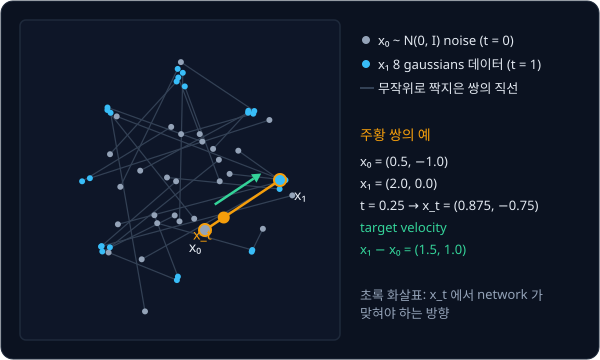
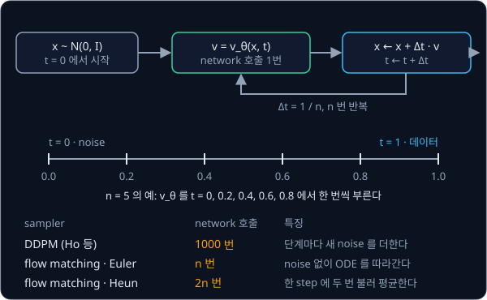

# Flow Matching

## 배경

### DDPM 의 step 수

[DDPM](../ddpm/README.md) 의 reverse process 는 작은 Gaussian 단계를 수백~천 번 거쳐야 하고, noise 에서 데이터로 가는 경로도
구불구불하다. Diffusion Policy 는 DDIM 으로 inference step 을 10 번까지 줄이지만, 학습한 수식은 그대로 둔 채 sampling 단계만
건너뛸 뿐이다. flow matching 은 처음부터 noise 와 데이터를 잇는 경로를 직선으로 정의하고, 그 경로를 따라 움직이는 velocity
field 를 regression 으로 배운다.

### ODE 와 velocity field

velocity field $v(x, t)$ 는 시각 $t$ 에 위치 $x$ 에 있는 점이 어느 방향으로 얼마나 빠르게 움직이는지를 정하는 함수다. 점은 이
속도를 따라 움직이고, 이 관계를 적은 식이 ODE(ordinary differential equation, 상미분방정식)다.

$$
\frac{dx}{dt} = v(x, t)
$$

ODE 를 컴퓨터로 푸는 가장 단순한 방법은 Euler 법이다. 지금 위치의 속도를 구해 짧은 시간 $\Delta t$ 동안 그 속도로 직진하는 일을
반복한다.

$$
x_{t+\Delta t} = x_t + \Delta t\; v(x_t, t)
$$

예를 들어 1차원에서 $x_0 = -1$ 이고 $v = 3$ 으로 일정하면 $\Delta t = 0.5$ 로 두 번 직진해 $-1 \to 0.5 \to 2$ 가 된다. flow matching
은 $t = 0$ 에 noise 분포에서 뽑은 점을 학습한 $v_\theta$ 의 ODE 로 $t = 1$ 까지 옮겨 데이터를 만든다. 이 과제에서는 $t = 0$ 을
noise, $t = 1$ 을 데이터로 두는 Lipman 등의 관례를 따른다.

### 직선 경로와 target velocity

noise $x_0 \sim \mathcal N(0, I)$ 와 데이터 $x_1$ 을 하나씩 뽑아 직선으로 잇는다.

$$
x_t = (1-t)\,x_0 + t\,x_1,\qquad \frac{d x_t}{dt} = x_1 - x_0
$$

직선 위의 점은 일정한 속도 $x_1 - x_0$ 로 움직이므로, 이 방향이 $x_t$ 에서의 target velocity 다. $x_0 = (0.5, -1.0)$,
$x_1 = (2.0, 0.0)$ 이면 아래와 같다.

| $t$ | $x_t$ | target velocity |
| --- | --- | --- |
| 0 | $(0.5, -1.0)$ | $(1.5, 1.0)$ |
| 0.25 | $(0.875, -0.75)$ | $(1.5, 1.0)$ |
| 0.5 | $(1.25, -0.5)$ | $(1.5, 1.0)$ |
| 1 | $(2.0, 0.0)$ | $(1.5, 1.0)$ |



### flow matching loss

network $v_\theta(x, t)$ 는 직선 위의 점 $x_t$ 와 시각 $t$ 를 받아 target velocity 를 맞히도록 학습한다. 학습 한 step 은 데이터
$x_1$ 과 noise $x_0$ 를 뽑고, $t$ 를 $[0, 1]$ 에서 고르게 하나 뽑아 $x_t$ 를 만든 뒤 아래 MSE 로 gradient descent 를 하는 것이다.

$$
\mathcal L = \mathbb E_{t,\,x_0,\,x_1}\Big[\big\lVert v_\theta(x_t, t) - (x_1 - x_0)\big\rVert^2\Big],\qquad t\sim\mathcal U[0, 1]
$$

$\mathcal U[0, 1]$ 은 0 과 1 사이의 uniform 분포다. DDPM 의 loss 가 noise $\epsilon$ 을 맞혔다면, flow matching 의 loss 는 noise 에서
데이터로 가는 방향을 맞힌다. network 는 DDPM 과제의 `MLPDenoiser`·`UNet` 을 출력의 뜻만 바꿔 그대로 쓴다.

정답 $x_1 - x_0$ 는 쌍마다 다른데, Lipman 등은 이 loss 를 최소화한 $v_\theta$ 가 같은 $x_t$ 를 지나는 모든 쌍의 평균 방향
(marginal velocity field)이 되고, 그 ODE 를 따라가면 noise 분포가 정확히 데이터 분포로 옮겨진다는 것을 보였다. 쌍 하나
$(x_0, x_1)$ 을 조건으로 정한 경로에 거는 이 loss 를 논문은 conditional flow matching(CFM) loss 라고 부르고, 이 과제의
loss 와 sampler 는 `cfm.py` 에 짠다.

### sampling 과 network 호출 횟수

sampling 은 $x \sim \mathcal N(0, I)$ 에서 출발해 $\Delta t = 1/n$ 로 Euler step 을 $n$ 번 밟는다. step 수 $n$ 이 곧 network 를
부르는 횟수다. 경로가 거의 직선이라 Euler step 몇 번으로도 오차가 작다.



Heun 법은 한 step 에 network 를 두 번 불러 앞뒤 속도의 평균으로 움직인다.

$$
\tilde x = x_t + \Delta t\, v_\theta(x_t, t),\qquad
x_{t+\Delta t} = x_t + \frac{\Delta t}{2}\big(v_\theta(x_t, t) + v_\theta(\tilde x, t + \Delta t)\big)
$$

Heun $n$ step 은 Euler $2n$ step 과 network 호출 횟수가 같으므로, 두 sampler 는 호출 횟수를 맞춰 비교한다.

### 궤적의 곧은 정도

궤적은 sampling 하는 동안 점이 지나간 위치 $x^{(0)}, x^{(1)}, \dots, x^{(n)}$ 을 이은 선이다. 궤적이 얼마나 곧은지는 시작점과
끝점의 직선거리를 실제로 지나간 길이로 나눈 비율로 잰다.

$$
\text{곧은 정도} = \frac{\lVert x^{(n)} - x^{(0)}\rVert}{\sum_{k=0}^{n-1}\lVert x^{(k+1)} - x^{(k)}\rVert}
$$

직선이면 1 이고 구부러질수록 작아진다. $(0, 0) \to (1, 0) \to (1, 1)$ 로 꺾인 경로는 지나간 길이가 2, 직선거리가 $\sqrt 2$ 라서
약 0.707 이다. DDPM 의 궤적은 [DDPM](../ddpm/README.md) 과제의 reverse step 마다 $x_t$ 를 기록해 같은 식으로 잰다.

### reflow

reflow 는 학습을 마친 flow matching 모델로 noise $x_0$ 에서 샘플 $x_1'$ 을 생성한 뒤, 무작위 짝 대신 이 $(x_0, x_1')$ 쌍으로 같은
loss 를 한 번 더 학습하는 방법이다. 2022년 Liu 등의 rectified flow 에서 제안했다.

### 로봇 action 생성

π0 의 action expert 는 이 loss 로 action 50개짜리 chunk 를 생성하고, 공개 구현(openpi)은 기본 10 step 으로 적분한다.

## 목표

- 직선 경로와 target velocity, flow matching loss, Euler·Heun sampler 를 짠다
- DDPM 과제와 같은 network·같은 8 gaussians 로 학습시켜 sampling step 수별 MMD 를 DDPM 과 비교한다
- 같은 초기 noise 에서 출발한 FM 과 DDPM 의 궤적을 한 그림에 그린다
- DDPM 과제의 U-Net 이 velocity 를 내도록 다시 학습시켜 MNIST 를 20 step 이하로 생성한다
- (선택) reflow 를 한 번 해서 1~2 step sampling 이 나아지는지 본다

**직접 짤 것**: 경로 보간, loss, Euler·Heun sampler, step 수 sweep, reflow.
**가져다 써도 되는 것**: DDPM 과제의 network·데이터·MMD 코드, (선택) adaptive ODE solver 비교용 `torchdiffeq`, 결과 비교용
facebookresearch `flow_matching` 라이브러리.

## 준비물

- Python 3.12, `torch`, `torchvision`, `matplotlib`, `pytest`, (선택) `torchdiffeq`, (선택) facebookresearch `flow_matching`
- DDPM 과제의 코드와 학습된 모델, 8 gaussians, MNIST
- 2D toy 는 CPU 로 충분하고, MNIST 는 8 GB GPU 나 Colab T4 로 돌릴 수 있다

## 진행 순서

1. `cfm.py` 의 `interpolate` 를 채운다. $t = 0, 1$ 에서 양 끝이 나오고, $t$ 에 대한 유한 차분이 target velocity 와 1e-4 이내로
   같은지 `test_cfm.py` 에서 확인한다. 위 표의 예($t = 0.25$ 에서 $(0.875, -0.75)$)도 맞춰 본다
2. `fm_loss` 를 채우고, `train_toy.py` 에서 DDPM 과제와 같은 `MLPDenoiser` 를 8 gaussians 에 학습시킨다
3. `euler_sample` 을 채워 Euler 20 step 으로 10,000개를 생성하고, DDPM 과제와 같은 기준(각 mode 12.5% ± 3%p, 중심에서 0.3 넘게
   벗어난 샘플 5% 미만)으로 확인한다
4. `compare.py` 에서 step 수 1·2·5·10·20·50 의 FM 과 DDPM 의 MMD 를 한 그래프에 그려 `results/mmd_vs_steps.png` 로 저장한다
5. `trajectory` 를 채우고, 같은 초기 noise 200개에서 출발한 FM·DDPM 궤적을 나란히 그려 `results/trajectories.png` 로 저장한다. 두
   궤적의 곧은 정도 평균을 함께 기록한다
6. `train_mnist.py` 에서 DDPM 과제의 `UNet` 을 velocity 출력용으로 다시 학습시키고, Euler 20 step 으로 생성한 64장을
   `results/mnist_euler20.png` 로 저장한다
7. (선택) `heun_sample` 을 채워 같은 network 호출 횟수에서 Heun 과 Euler 를 비교한다
8. (선택) 학습된 FM 으로 (noise, 생성 샘플) 쌍을 만들어 reflow 학습을 한 번 하고, 1 step·2 step MMD 를 reflow 전과 비교한다
9. `results/` 의 그림과 기록을 커밋한다

## 시작점

아래 파일은 모두 리포에 들어 있다.

```text
flow-matching/
├── pyproject.toml   # 이 과제의 Python 버전과 패키지
├── uv.lock
├── cfm.py           # interpolate, fm_loss, euler_sample, heun_sample, trajectory 의 stub
├── train_toy.py     # 8 gaussians 학습
├── train_mnist.py   # MNIST U-Net 을 velocity 출력으로 학습·생성
├── compare.py       # step 수 대비 MMD, FM 과 DDPM 의 궤적
└── test_cfm.py      # interpolate 검사를 직접 쓰는 test
```

[cfm.py](cfm.py) 의 함수는 몸통이 `raise NotImplementedError` 인 stub 이고, 이름과 signature 는 그대로 둔 채 몸통을 채운다.
채점용 test 는 없어서 평가 기준은 [test_cfm.py](test_cfm.py) 에 직접 쓴 test 와 `results/` 의 그림·기록으로 확인한다. 패키지는
`pyproject.toml` 에 있고, 이 폴더에서 `uv run` 을 처음 실행할 때 `.venv/` 에 설치된다.

network·데이터·MMD 와 DDPM sampler 는 [DDPM](../ddpm/README.md) 과제의 코드를 그대로 쓴다. `train_toy.py`·`train_mnist.py`·
`compare.py` 첫머리에서 `../ddpm` 폴더를 `sys.path` 뒤쪽에 더하고 `denoisers.py`·`toy_data.py`·`mmd.py`·`noise_schedule.py`·`ddpm.py`
에서 쓸 것을 import 해 두었다. 뒤쪽에 더하므로 `train_toy.py` 처럼 두 폴더에 다 있는 이름은 이 폴더의 파일이 먼저 잡힌다.

```bash
cd projects/flow-matching
uv run pytest
uv run python train_toy.py
uv run python compare.py
uv run python train_mnist.py
```

## 평가 기준

- [ ] `interpolate` 가 $t=0$ 에서 $x_0$, $t=1$ 에서 $x_1$ 을 내고, $t$ 에 대한 유한 차분이 target velocity 와 1e-4 이내로 같다
- [ ] 8 gaussians 에서 FM 이 Euler 20 step 이하로 DDPM 과제의 기준(각 mode 12.5% ± 3%p, 3σ 밖 샘플 5% 미만)을 통과한다
- [ ] step 수 대비 MMD 그래프에서 FM 이 DDPM 1000 step 의 MMD 수준에 도달하는 step 수가 DDPM 보다 적다
- [ ] 궤적 그림에서 FM 의 경로가 DDPM 보다 눈에 띄게 곧고, 경로 길이 대비 시작–끝 직선거리 비율을 둘 다 기록했다
- [ ] MNIST 에서 Euler 20 step 으로 생성한 64장을 DDPM 1000 step 샘플만큼 숫자로 알아볼 수 있다
- [ ] (선택) reflow 후 1 step·2 step 샘플의 MMD 가 reflow 전보다 낮다

## 생각해 볼 질문

1. 같은 2D 분포에서 flow matching 이 DDPM 보다 적은 step 으로 sampling 되는 이유는? Euler 적분의 오차가 경로의 어떤 성질에 좌우되는지와 연결해 설명할 수 있는가?
2. 학습 target $x_1 - x_0$ 는 직선인데 학습된 ODE 의 궤적은 완전한 직선이 아니다. 왜 그런가? reflow 는 이를 어떻게 고치는가?
3. π0 는 action 을 token 으로 하나씩 내는 대신 flow matching 으로 action chunk 를 한꺼번에 생성한다. 고주파 연속 제어에서 이 선택이 주는 이점은?

## 힌트

<details>
<summary>논문마다 다른 t 의 방향</summary>

Lipman 등은 $t=0$ 을 noise, $t=1$ 을 데이터로 두지만, diffusion 쪽 관례를 따르는 openpi(π0)는 $t=1$ 을 noise 로 두고 target 도
$\epsilon - x$ 로 뒤집어 $t=1$ 에서 0 으로 적분한다. 코드를 읽거나 옮길 때는 어느 쪽 관례인지 먼저 확인하고, 한 프로젝트
안에서는 하나로 통일한다.

</details>

<details>
<summary>DDPM 을 적은 step 으로 돌려 비교하는 법</summary>

학습한 1000개 timestep 중 $n$ 개만 골라, 고른 timestep 사이의 $\bar\alpha$ 로 reverse step 하나의 평균과 분산을 다시 계산한다.
noise 를 넣지 않는 DDIM update 로도 같은 network 를 돌릴 수 있는데, FM 과 같은 deterministic sampler 끼리 비교하는 편이 더
공정하다.

</details>

<details>
<summary>time 입력의 크기</summary>

DDPM 과제의 time embedding 이 0~999 정수를 가정했다면 $t\in[0, 1]$ 을 그대로 넣을 때 sin·cos feature 가 거의 변하지 않는다.
$t$ 에 1000 을 곱해 넣거나 embedding 의 주파수를 다시 잡는다. π0 처럼 $t$ 를 uniform 대신 noise 쪽에 치우친 Beta 분포에서 뽑는
방법도 있다.

</details>

## 참고 자료

- Yaron Lipman 등, [Flow Matching for Generative Modeling](https://arxiv.org/abs/2210.02747) — 3절이 conditional path 로 marginal
  velocity field 를 배우는 원리(정리 1·2)
- Xingchao Liu, Chengyue Gong, Qiang Liu, [Flow Straight and Fast](https://arxiv.org/abs/2209.03003) — 직선 경로의 rectified flow 와 reflow
- Michael S. Albergo, Eric Vanden-Eijnden, [Building Normalizing Flows with Stochastic Interpolants](https://arxiv.org/abs/2209.15571) — 같은 시기에 나온 interpolant 관점의 정리
- Yaron Lipman 등, [Flow Matching Guide and Code](https://arxiv.org/abs/2412.06264) — 표기와 관례를 한데 정리한 긴 tutorial 과 코드
- MIT 6.S184, [Flow Matching and Diffusion Models](https://diffusion.csail.mit.edu/) — 2강이 flow matching. 강의 노트([arXiv](https://arxiv.org/abs/2506.02070))와 [lab](https://github.com/eje24/iap-diffusion-labs) 이 flow matching 을 먼저 설명하고 diffusion 은 SDE 로 확장해 다룬다
- Cambridge MLG, [An introduction to Flow Matching](https://mlg.eng.cam.ac.uk/blog/2024/01/20/flow-matching.html) — conditional velocity 와 marginal velocity 의 관계를 그림으로 설명한다
- Wikipedia, [Euler method](https://en.wikipedia.org/wiki/Euler_method)·[Heun's method](https://en.wikipedia.org/wiki/Heun%27s_method) — 두 적분법의 정의와 그림
- facebookresearch, [`flow_matching`](https://github.com/facebookresearch/flow_matching) 라이브러리의 [2D 예제 노트북](https://github.com/facebookresearch/flow_matching/blob/main/examples/2d_flow_matching.ipynb) — 막혔을 때만 열기
- Physical Intelligence, [openpi `pi0.py`](https://github.com/Physical-Intelligence/openpi/blob/main/src/openpi/models/pi0.py) — π0 가 action chunk 에 flow matching loss 를 거는 부분과 10 step sampling loop

## 남은 한계

여기서 만든 flow matching 은 조건 없이 숫자나 2D 점을 생성할 뿐, 카메라 이미지나 언어 지시를 받아 그에 맞는 action 을 내지는
못한다. [π0](../pi0/README.md) 는 VLM 이 읽은 이미지·언어를 조건으로 받아 flow matching 으로 action chunk 를 생성한다.
