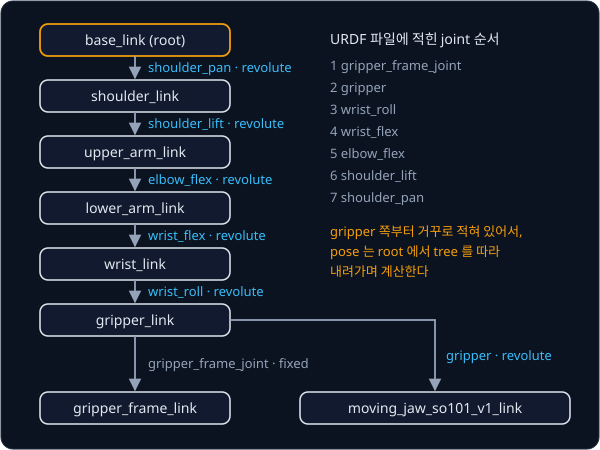

# Forward Kinematics

## 배경

[Rigid Transforms](../transforms/README.md) 에서는 frame 사이의 변환을 다뤘지만, 그 변환이 joint angle 에 따라 어떻게
바뀌는지는 다루지 않았다. 로봇 팔은 link 가 joint 로 이어진 구조라서, joint 마다 그 joint 가 붙은 자리까지의 고정 변환과
joint angle 만큼의 움직임을 차례로 곱하면 끝에 달린 gripper(end-effector)의 pose 가 나온다. joint angle 에서 pose 를 구하는
이 계산이 forward kinematics(FK)다.

### link 와 joint

link 는 로봇을 이루는 단단한 부품 하나이고, joint 는 두 link 를 이어 그 사이의 움직임 하나를 허용한다. joint 가 움직인 양을
joint value $q$ 라고 부르며, URDF 는 joint 를 네 종류로 나눈다.

| type | 움직임 | $q$ 의 단위 |
| --- | --- | --- |
| revolute | axis 를 중심으로 한 회전. `lower`·`upper` 한계가 있다 | rad |
| continuous | 한계 없는 회전 | rad |
| prismatic | axis 방향으로 미끄러지는 이동 | m |
| fixed | 움직이지 않고 두 link 를 붙여 둔다 | 없음 |

joint 마다 parent link 와 child link 가 정해져 있어서, link 를 node 로, joint 를 parent 에서 child 로 가는 edge 로 보면 로봇
전체가 tree 가 된다. 어떤 joint 의 child 도 아닌 link 가 tree 의 root 다. SO-101 URDF 에는 link 8개와 joint 7개(revolute 6,
fixed 1)가 있고 root 는 `base_link` 다. `gripper_link` 에서 gripper 끝점을 나타내는 `gripper_frame_link` 와 움직이는 집게
`moving_jaw_so101_v1_link` 두 갈래로 나뉘므로, 한 줄짜리 chain 이 아니라 tree 다.



### URDF 의 joint 기술

URDF(Unified Robot Description Format)는 로봇의 link 와 joint 를 적은 XML 파일이고, ROS 를 비롯한 대부분의 로봇 소프트웨어가
이 형식으로 로봇 모양을 주고받는다. SO-101 의 `shoulder_lift` joint 는 다음과 같이 적혀 있다.

```xml
<joint name="shoulder_lift" type="revolute">
  <origin xyz="-0.0303992 -0.0182778 -0.0542" rpy="-1.5708 -1.5708 0"/>
  <parent link="shoulder_link"/>
  <child link="upper_arm_link"/>
  <axis xyz="0 0 1"/>
  <limit effort="10" velocity="10" lower="-1.74533" upper="1.74533"/>
</joint>
```

`<origin>` 은 parent link frame 에서 본 joint frame 의 pose 다. `xyz` 는 위치(m)이고 `rpy` 는 transforms 에서 다룬
roll-pitch-yaw(rad)라서, 둘을 합치면 4×4 homogeneous transform $T^{\text{origin}}$ 이 된다. `<axis>` 는 joint frame 에서 잰 회전축
unit vector $\hat a$ 이고, `<limit>` 의 `lower`·`upper` 는 $q$ 의 범위(rad)다. SO-101 의 joint 는 모두 axis 가 $(0, 0, 1)$ 이라
joint frame 의 z 축을 중심으로 돌고, joint 마다 다른 방향은 `rpy` 에 담겨 있다.

### joint 하나의 변환

joint 하나가 parent link frame 에서 child link frame 으로 가는 변환은 두 단계다. 먼저 고정된 $T^{\text{origin}}$ 으로 joint frame
까지 옮기고, 그 frame 에서 joint value $q$ 만큼 움직인다. $q = 0$ 이면 child link frame 은 joint frame 과 겹친다.

$$
T_{\text{parent},\,\text{child}}(q) = T^{\text{origin}}\; T^{\text{motion}}(q), \qquad
T^{\text{motion}}(q) =
\begin{cases}
\begin{bmatrix} \exp([\hat a]\,q) & 0 \\ 0 & 1 \end{bmatrix} & \text{revolute, continuous} \\[6pt]
\begin{bmatrix} I & \hat a\,q \\ 0 & 1 \end{bmatrix} & \text{prismatic} \\[6pt]
I & \text{fixed}
\end{cases}
$$

$\exp([\hat a]\,q)$ 는 transforms 의 Rodrigues 공식, 곧 `exp_so3(axis * q)` 다.


axis 가 실제로 어느 쪽을 향하는지는 `<axis>` 만이 아니라 `rpy` 까지 함께 봐야 정해진다. `shoulder_pan` 의 origin 은
`rpy="3.14159 0 -3.14159"` 라서 joint frame 의 z 축이 base 의 $-z$, 곧 아래를 향한다. 그래서 `shoulder_pan` 을 $+90°$ 돌리면
위에서 내려다볼 때 팔이 시계 방향으로 돌고, gripper 끝점이 $(0.391, 0, 0.226)$ 에서 $(0.039, -0.353, 0.226)$ 으로 옮겨 간다.

### tree 를 따라 내려가는 FK

root 에서 어떤 link 까지 가는 길에 놓인 joint 를 차례로 $1, \dots, n$ 이라 하면, 그 link 의 pose 는 joint 변환을 차례로 곱한
것이다.

$$
T_{0n}(q) = \prod_{i=1}^{n} T^{\text{origin}}_{i}\; T^{\text{motion}}_{i}(q_i)
$$

모든 link 의 pose 를 한 번에 채우려면 root 의 pose 를 단위행렬로 두고, pose 가 정해진 link 에서 자식 joint 로 내려가며
$T_{0,\text{child}} = T_{0,\text{parent}}\,T^{\text{origin}}\,T^{\text{motion}}(q)$ 를 계산한다. parent 의 pose 가 child 보다 먼저
정해져야 하므로, 계산 순서는 파일에 적힌 순서가 아니라 tree 를 따른다.

SO-101 은 모든 joint 가 0 일 때 위팔이 위로 서고 아래팔부터 앞쪽(+x)으로 수평하게 뻗은 자세다. 이때 각 link 원점의 위치는
아래와 같다(pinocchio 로 계산, 단위 m).

| link | x | y | z |
| --- | --- | --- | --- |
| `shoulder_link` | 0.039 | 0.000 | 0.062 |
| `upper_arm_link` | 0.069 | −0.018 | 0.117 |
| `lower_arm_link` | 0.097 | −0.018 | 0.229 |
| `wrist_link` | 0.232 | −0.018 | 0.234 |
| `gripper_link` | 0.293 | 0.000 | 0.234 |
| `gripper_frame_link` | 0.391 | 0.000 | 0.226 |

### DH parameter 와 product of exponentials

1955년 Denavit 과 Hartenberg 는 joint 축을 z 축으로, 이웃한 두 축의 공통 수선을 x 축으로 두는 규칙으로 frame 을 다시 잡은 뒤
joint 하나를 숫자 4개 $(a, \alpha, d, \theta)$ 로 적는 규약(DH parameter)을 만들었고, 지금도 많은 교과서가 이 규약을 쓴다.
URDF 는 joint 마다 임의의 6D origin 을 허용하므로 DH 로 바꿀 필요 없이 파일을 그대로 따라가면 된다.

Brockett(1984)의 product of exponentials(PoE)는 같은 FK 를 다르게 적는다. 모든 joint 가 0 인 zero configuration 에서 joint
$i$ 의 screw axis $S_i$ 를 base frame 기준으로 한 번 적어 두고, end-effector 의 zero configuration pose 를 $M$ 이라 하면 다음과
같다. Modern Robotics 가 이 방식을 쓴다.

$$
T(q) = e^{[S_1] q_1}\, e^{[S_2] q_2} \cdots e^{[S_n] q_n}\, M
$$

## 목표

- URDF 의 link·joint 를 읽어 parent → child tree 를 만든다
- joint angle 을 받아 모든 link 의 world pose 를 내는 FK 를 짠다
- pinocchio 가 같은 URDF 로 계산한 결과와 숫자로 비교한다
- 팔을 3D stick figure 로 그려 configuration 이 그럴듯한지 눈으로 확인한다
- (선택) PoE 로 같은 FK 를 다시 짜서 비교한다

**직접 짤 것**: URDF parser(`xml.etree.ElementTree` 로), joint 변환, tree 순회. rotation 변환은 transforms 과제의 코드를 쓴다.
**가져다 써도 되는 것**: 비교용 pinocchio, 그림용 matplotlib.

## 준비물

- Python 3.12, numpy, matplotlib, `pin`(pinocchio 의 pip 패키지), pytest
- (선택) `mujoco` — MuJoCo Menagerie 의 [`robotstudio_so101`](https://github.com/google-deepmind/mujoco_menagerie/tree/main/robotstudio_so101)
  모델과 비교할 때 쓴다
- SO-101 URDF — [SO-ARM100 리포](https://github.com/TheRobotStudio/SO-ARM100/tree/main/Simulation/SO101) 의
  `so101_new_calib.urdf`. FK 에는 mesh 가 필요 없어서 이 파일 하나면 되고, 시작점의 `curl` 명령으로 과제 폴더에 받는다
- GPU 불필요

## 진행 순서

1. 시작점의 `curl` 명령으로 URDF 를 받고, `parse_urdf` 를 짜기 전에 `xml.etree.ElementTree` 로 모든 joint 의 `type`·`parent`·
   `child`·`origin`·`axis`·`limit` 를 표로 출력한다. revolute 6개와 fixed 1개가 나와야 한다
2. `urdf.py` 의 `parse_urdf` 를 짠다. 어떤 joint 의 child 도 아닌 root link 를 찾고 link → 자식 joint 목록(`Robot.children`)을
   채운다. SO-101 의 root 는 `base_link` 다
3. `fk.py` 의 `joint_transform` 에 joint type(revolute·continuous·prismatic·fixed)별 움직임 변환을 짠다
4. `forward_kinematics` 에서 root 부터 tree 를 따라 내려가며 모든 link 의 pose 를 채운다. 모든 joint 가 0 이면 배경의 표와
   같은 위치가 나와야 한다
5. [test_fk.py](test_fk.py) 에 joint limit 안의 무작위 joint angle 1,000세트로 pinocchio 와 비교하는 test 와, joint 순서를
   섞어 저장한 URDF 로 같은 결과가 나오는지 보는 test 를 쓴다
6. `viz.py` 의 `main` 에서 몇 가지 configuration 을 3D stick figure 로 그려 `results/stick_figures.png` 로 저장한다
7. (선택) zero configuration 의 screw axis 를 뽑아 PoE FK 를 짜고 비교한다

## 시작점

아래 파일은 모두 리포에 들어 있다.

```text
forward-kinematics/
├── pyproject.toml   # 이 과제의 Python 버전과 패키지
├── uv.lock
├── urdf.py          # Joint, Robot, parse_urdf 의 stub
├── fk.py            # joint_transform, forward_kinematics 의 stub
├── viz.py           # stick figure 그림
└── test_fk.py       # pinocchio 와 비교하는 test 를 직접 쓴다
```

[urdf.py](urdf.py)·[fk.py](fk.py) 의 함수는 몸통이 `raise NotImplementedError` 인 stub 이고, 이름과 signature 는 그대로 둔 채
몸통을 채운다. `Joint`·`Robot` 은 field 까지 정해 둔 dataclass 다. 채점용 test 는 없어서 평가 기준은 [test_fk.py](test_fk.py) 에
직접 쓴 test 로 확인한다. 패키지는 `pyproject.toml` 에 있고, 이 폴더에서 `uv run` 을 처음 실행할 때 `.venv/` 에 설치된다.

rpy 와 axis-angle 의 rotation 변환은 [Rigid Transforms](../transforms/README.md) 과제에서 짠 `so3.py` 를 쓴다. 두 stub
첫머리에서 transforms 과제 폴더를 `sys.path` 에 더해 `urdf.py` 는 `rpy_to_matrix` 를, `fk.py` 는 `exp_so3` 를 import 해 둔다.
[Inverse Kinematics](../inverse-kinematics/README.md) 가 `urdf.py`·`fk.py` 를 import 해서 쓰므로 signature 를 바꾸지 않는다.

```bash
cd projects/forward-kinematics
curl -LO https://raw.githubusercontent.com/TheRobotStudio/SO-ARM100/main/Simulation/SO101/so101_new_calib.urdf
uv run pytest
uv run python viz.py
```

## 평가 기준

- [ ] 무작위 joint angle 1,000세트에서 모든 link 의 위치가 pinocchio 와 1e-9 m, orientation 이 1e-9 rad 안에서 같다
- [ ] URDF 의 `<joint>` 원소 순서를 무작위로 섞어 저장한 파일로도 같은 결과가 나온다
- [ ] (선택) PoE FK 가 URDF chain FK 와 1e-9 안에서 같다
- [ ] (선택) MuJoCo Menagerie 의 `so101.xml` 을 불러 같은 joint angle 을 넣으면 대응하는 body 의 위치가 0.1 mm 안에서 같다

## 생각해 볼 질문

1. DH parameter 는 joint 하나를 숫자 4개로 적는데 URDF 의 origin 은 6개를 쓴다. 남는 2개로 무엇을 얻고 무엇을 잃는가?
2. PoE 에서는 각 joint 의 screw axis 를 zero configuration 에서 한 번만 적어 두면 된다. 앞쪽 joint 가 움직여도 그 값을 고칠
   필요가 없는 이유는?
3. FK 계산이 정확해도 실물 SO-101 의 end-effector 가 FK 결과와 몇 mm 씩 어긋나는 이유로는 무엇이 있는가?

## 힌트

<details>
<summary>joint 순서와 tree</summary>

SO-101 URDF 는 joint 가 gripper 쪽부터 거꾸로 적혀 있어서, 파일에 나온 순서대로 곱하면 틀린다. root link 에서 출발해 parent
→ child 방향으로 순회하고, 각 link 의 pose 는 parent link 의 pose 가 정해진 뒤에 계산한다.

</details>

<details>
<summary>&lt;transmission&gt; 안의 &lt;joint&gt;</summary>

SO-101 URDF 에는 `<transmission>` 원소 안에도 이름만 가진 `<joint>` 원소가 있다. `root.iter("joint")` 처럼 모든 깊이를 훑으면
이것까지 joint 로 읽히므로, `<robot>` 바로 아래의 `<joint>` 만 읽는다(`root.findall("joint")`).

</details>

<details>
<summary>pinocchio 와의 비교 방법</summary>

`pin.buildModelFromUrdf(path)` 로 model 을 만들고 `pin.framesForwardKinematics(model, data, q)` 를 부른 뒤,
`data.oMf[model.getFrameId("wrist_link")]` 처럼 link 이름으로 frame 을 찾는다. pinocchio 의 `q` 는 `model.names` 에 나오는
joint 순서(첫 항목 `universe` 제외)를 따르고, orientation 차이는 $\lVert \log(R_{\text{mine}}^\top R_{\text{pin}}) \rVert$ 로 잰다.

</details>

<details>
<summary>MuJoCo 와의 비교</summary>

Menagerie 의 body 이름은 URDF link 이름에서 `_link` 를 뗀 꼴(`shoulder`, `upper_arm` …)이다. MJCF 는 URDF 의 숫자를 반올림해
옮긴 것이라 완전히 같지는 않다. end-effector 의 `gripperframe` site 는 URDF 의 `gripper_frame_link` 와 2 cm 쯤 떨어진 다른
점이니, 비교는 body 끼리 한다.

</details>

## 참고 자료

- ROS wiki 의 URDF XML 명세 [`<joint>`](http://wiki.ros.org/urdf/XML/joint) · [`<link>`](http://wiki.ros.org/urdf/XML/link) —
  `origin`·`axis`·`rpy` 의 정확한 정의
- ROS 2 tutorial, [Building a visual robot model from scratch](https://docs.ros.org/en/rolling/Tutorials/Intermediate/URDF/Building-a-Visual-Robot-Model-with-URDF-from-Scratch.html)
  — link 와 joint 를 하나씩 붙여 가며 URDF 를 쓰는 예제
- Lynch & Park, [Modern Robotics](https://hades.mech.northwestern.edu/index.php/Modern_Robotics) 4장 forward kinematics —
  space frame 과 body frame 두 가지 PoE. 손으로 따라 하는 예제는 강의 영상
  [Chapter 4: Forward Kinematics Example](https://www.youtube.com/watch?v=cKHsil0V6Qk) 에 있다
- Russ Tedrake, [Robotic Manipulation — Ch. 3](https://manipulation.csail.mit.edu/pick.html) 의 "Forward kinematics"·"The
  kinematic tree" 절
- [TheRobotStudio/SO-ARM100](https://github.com/TheRobotStudio/SO-ARM100/tree/main/Simulation/SO101) — SO-101 의 URDF 와 MJCF
- [pinocchio 문서](https://stack-of-tasks.github.io/pinocchio/) — 비교 기준으로 쓰는 `buildModelFromUrdf`·`framesForwardKinematics`
- 막혔을 때만 열기: [pinocchio](https://github.com/stack-of-tasks/pinocchio) 의 URDF parser,
  [NxRLab/ModernRobotics](https://github.com/NxRLab/ModernRobotics/tree/master/packages/Python) 의 `FKinSpace`·`FKinBody`

## 남은 한계

joint angle 에서 end-effector pose 는 구할 수 있지만, 물체를 집을 때 필요한 것은 반대 방향, 곧 "cube 위 5 cm 에 gripper 를
두려면 joint angle 이 얼마여야 하나" 다. 이 역문제를 푸는 과제가 [Inverse Kinematics](../inverse-kinematics/README.md) 다.
