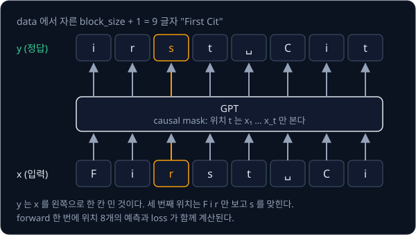
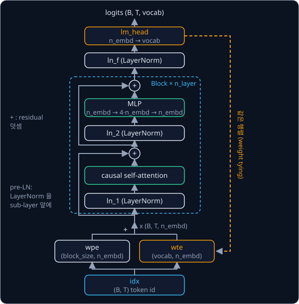
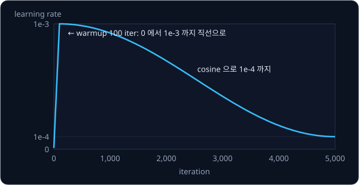

# GPT-2

## 배경

### next-token prediction

[Transformer](../transformer/README.md) 과제의 encoder-decoder 는 (입력, 정답) 쌍이 있어야 학습된다. GPT 는 encoder 와
cross-attention 을 떼어 낸 decoder 만 쌓고, text 자체에서 다음 token 을 맞히게 한다. 정답이 text 안에 이미 들어 있으므로
사람이 단 label 없이 웹 text 전체를 데이터로 쓸 수 있다.

Tiny Shakespeare 는 `First Citizen:` 으로 시작한다. 여기서 9 글자 `First Cit` 를 잘라 앞 8 글자를 입력 $x$, 뒤 8 글자를
정답 $y$ 로 쓰면 $y$ 는 $x$ 를 왼쪽으로 한 칸 민 것이 된다. causal mask 때문에 위치 $t$ 는 $x_1, \dots, x_t$ 만 보므로, 길이
$T$ 인 조각 하나에서 위치마다 하나씩 $T$ 개의 예측을 forward 한 번으로 학습한다.



$$
\mathcal{L}(\theta) = -\frac{1}{T}\sum_{t=1}^{T} \log p_\theta(x_t \mid x_{<t})
$$

$x_t$ 는 $t$ 번째 token, $x_{<t}$ 는 그 앞의 token 전부, $p_\theta$ 는 parameter $\theta$ 인 모델이 logits 에 softmax 를 해서 낸
확률이다. 위치마다 정답 token 의 확률에 $-\log$ 를 씌워 평균한 값이라서, [PyTorch Training Loop](../pytorch-mlp/README.md) 에서
짠 cross entropy 를 위치마다 계산해 평균한 것과 같다.

학습 전의 모델은 65 글자에 거의 같은 확률을 주므로 정답의 확률이 약 $1/65$ 이고, loss 는 $-\ln(1/65) = \ln 65 \approx 4.17$
근처에서 시작한다. 첫 loss 가 이보다 훨씬 크면 초기 weight 가 너무 커서 모델이 처음부터 몇 글자에 확률을 몰아주고 있다는 뜻이다.

### character-level vocabulary

Tiny Shakespeare 는 1,115,394 글자이고 서로 다른 글자는 65개다. 이 65 글자를 정렬해 0 부터 64 까지 id 를 붙이면 text 전체가
길이 1,115,394 인 id 열이 된다. 앞 90% 를 학습(train)에, 뒤 10% 를 검증(val)에 쓴다. val loss 는 학습에 쓰지 않은 text 에서 잰
loss 라서, train loss 는 계속 내려가는데 val loss 가 올라가기 시작하면 모델이 학습 text 를 외우고 있다(overfit)는 신호다.

### GPT 의 구조

GPT 의 block 은 Transformer 과제의 decoder layer 에서 cross-attention 을 뺀 것이고, 몇 군데가 다르다.

| 항목 | Transformer 과제 | GPT-2 |
| --- | --- | --- |
| 구성 | encoder + decoder | decoder 만, cross-attention 없음 |
| 위치 정보 | sinusoidal positional encoding | 학습되는 position embedding `wpe` |
| FFN activation | ReLU | GELU |
| LayerNorm 위치 | Post-LN 또는 Pre-LN | Pre-LN, 마지막 block 뒤에 `ln_f` 하나 더 |
| 출력 층 | 따로 둔 Linear | token embedding 행렬 `wte` 를 다시 씀 |

학습되는 position embedding 과 GELU 는 GPT-1 이, LayerNorm 을 sub-layer 앞으로 옮기고 `ln_f` 를 더한 것은 GPT-2 가 바꾼 부분이다.
block 하나는 아래 두 줄이다.

$$
x \leftarrow x + \mathrm{attn}(\mathrm{ln}_1(x)), \qquad x \leftarrow x + \mathrm{mlp}(\mathrm{ln}_2(x))
$$

$x$ 는 `(B, T, n_embd)` 이고, attn 은 causal mask 를 쓰는 multi-head self-attention, mlp 는 `n_embd → 4·n_embd → n_embd` 의
두 Linear 사이에 GELU 를 둔 FFN 이다. GPT-2 의 attention 은 Q·K·V 를 Linear 하나(`c_attn`, `n_embd → 3·n_embd`)로 한꺼번에
만든 뒤 셋으로 나눈다.



GELU(Gaussian Error Linear Unit)는 $\mathrm{GELU}(x) = x\,\Phi(x)$ 이고, $\Phi$ 는 표준 정규분포의 누적분포함수다. ReLU 처럼
음수 쪽을 0 가까이 누르지만 0 근처에서 꺾이지 않고 매끄럽게 이어진다. GPT-2 는 이를 tanh 로 근사한 식으로 학습됐다.

$$
\mathrm{GELU}(x) \approx 0.5\,x\left(1 + \tanh\!\left(\sqrt{2/\pi}\,(x + 0.044715\,x^3)\right)\right)
$$

weight tying 은 출력 층 `lm_head` 의 weight 를 token embedding `wte` 와 같은 tensor 로 두는 것이다. `wte` 는 `(vocab, n_embd)`
라서 id 로 행을 꺼내면 token vector 가 되고, 마지막 hidden vector $h$ 에 $\mathrm{wte}^\top$ 을 곱하면 vocab 개의 logits 가
나온다. 2016년 Press 와 Wolf 가 제안했다.

### GPT-2 small 의 크기

가장 작은 GPT-2 는 12 layer·12 head·768 차원·context 1,024·vocabulary 50,257 이고, `lm_head` 를 `wte` 와 묶어 한 번만 세면
parameter 가 124,439,808 개다. Hugging Face `GPT2LMHeadModel` 의 state_dict 에는 block 마다 아래 tensor 가 있다.

| Hugging Face 이름 (block 0) | shape |
| --- | --- |
| `transformer.wte.weight` | (50257, 768) |
| `transformer.wpe.weight` | (1024, 768) |
| `transformer.h.0.ln_1.weight`·`.bias` | (768,) |
| `transformer.h.0.attn.c_attn.weight` | (768, 2304) |
| `transformer.h.0.attn.c_proj.weight` | (768, 768) |
| `transformer.h.0.ln_2.weight`·`.bias` | (768,) |
| `transformer.h.0.mlp.c_fc.weight` | (768, 3072) |
| `transformer.h.0.mlp.c_proj.weight` | (3072, 768) |
| `transformer.ln_f.weight`·`.bias` | (768,) |
| `lm_head.weight` | (50257, 768), `wte` 와 같은 tensor |

`c_attn`·`c_proj`·`c_fc` 에는 출력 크기와 같은 bias 도 있다. block 은 `h.0` 부터 `h.11` 까지 12개다.

### AdamW 와 learning rate schedule

AdamW 는 Adam 에 weight decay 를 gradient 와 따로 적용하는 optimizer 다. learning rate 는 처음 $w$ iter 동안 0 에서
$\eta_{\max}$ 까지 직선으로 올리고(warmup), 그 뒤 $D$ iter 까지 cosine 곡선으로 $\eta_{\min}$ 까지 내린다.

$$
\eta(it) =
\begin{cases}
\eta_{\max} \cdot \dfrac{it + 1}{w + 1} & it < w \\[6pt]
\eta_{\min} + \dfrac{1}{2}\left(1 + \cos\!\left(\pi\,\dfrac{it - w}{D - w}\right)\right)(\eta_{\max} - \eta_{\min}) & w \le it \le D
\end{cases}
$$

nanoGPT 의 `shakespeare_char` 설정은 아래와 같고, 평가 기준의 val loss 는 이 설정으로 잰다. A100 한 장에서 약 3분 걸리고,
nanoGPT README 에 적힌 가장 낮은 val loss 는 1.4697 이다.

| 설정 | 값 |
| --- | --- |
| model | 6 layer, 6 head, 384 차원, context(`block_size`) 256, dropout 0.2 |
| batch | 64 조각 |
| learning rate | $\eta_{\max}$ 1e-3, $\eta_{\min}$ 1e-4, warmup $w$ 100, decay $D$ 5,000 |
| 학습 길이 | 5,000 iter, 250 iter 마다 val loss 를 200 batch 로 평균 |
| AdamW | $\beta_2 = 0.99$ |



GPU 가 없으면 nanoGPT README 의 CPU 설정(4 layer, 4 head, 128 차원, context 64, batch 12, dropout 0, 2,000 iter)으로 줄여 돌려 볼
수 있는데, 이때 val loss 는 약 1.88 이다.

### sampling 과 temperature·top-k

생성은 마지막 위치의 logits 로 다음 token 하나를 뽑아 뒤에 붙이고, 늘어난 sequence 로 다시 forward 하기를 반복한다. sequence
가 `block_size` 보다 길어지면 뒤쪽 `block_size` 개만 넣는다. 뽑기 전에 logits 를 temperature $\tau$ 로 나누면 분포의 날카로운
정도가 바뀌고, top-k 는 가장 큰 $k$ 개만 남기고 나머지 logits 를 $-\infty$ 로 바꾼다.

| logits `[2.0, 1.0, 0.5, −1.0]` 의 처리 | softmax 확률 |
| --- | --- |
| $\tau = 1$ | 0.609, 0.224, 0.136, 0.030 |
| $\tau = 0.5$ | 0.842, 0.114, 0.042, 0.002 |
| $\tau = 2$ | 0.434, 0.263, 0.205, 0.097 |
| $\tau = 1$, top-k $= 2$ | 0.731, 0.269, 0, 0 |

$\tau$ 가 1 보다 작으면 가장 큰 후보에 확률이 몰리고, 1 보다 크면 고르게 퍼진다. 확률에 따라 하나를 뽑는 데는
`torch.multinomial` 을 쓴다.

### GPT-2 weight 와 BPE tokenizer

GPT-2 weight 는 tiktoken `gpt2` 의 BPE vocabulary 로 바꾼 id 열로 학습됐다. 그래서 GPT-2 weight 로 문장을 이어 쓰려면 prompt 를
[BPE Tokenizer](../tokenizer/README.md) 과제에서 만든 `Tokenizer` 에 GPT-2 vocabulary 를 넣어 같은 id 로 encode 하고, 모델이
낸 id 를 같은 tokenizer 로 decode 해야 한다.

## 목표

- causal self-attention, pre-LN block, GPT 모델을 짠다
- Tiny Shakespeare 로 character-level GPT 를 학습시키고 temperature·top-k sampling 으로 text 를 생성한다
- Hugging Face GPT-2(124M) weight 를 내 모델에 옮겨 넣고 logits 를 비교한다
- 내 BPE tokenizer 로 prompt 를 encode 해 GPT-2 weight 로 문장을 이어 쓴다

**직접 짤 것**: GPT 모델 전체, batch sampling, 학습 loop(warmup + cosine lr), 생성 함수, weight 이름 mapping.
**가져다 써도 되는 것**: 앞 과제의 내 attention·tokenizer, `nn.Linear`·`nn.Embedding`·`nn.LayerNorm`, `torch.optim.AdamW`,
weight 를 내려받고 정답 logits 를 내는 `transformers`, 비교용 `tiktoken`.

## 준비물

- Python 3.12, torch, numpy, transformers, tiktoken, regex(tokenizer 과제의 `bpe.py` 가 쓴다), pytest
- [Tiny Shakespeare](https://raw.githubusercontent.com/karpathy/char-rnn/master/data/tinyshakespeare/input.txt) — 1,115,394 글자, 서로 다른 글자 65개
- GPT-2 weight — Hugging Face [`openai-community/gpt2`](https://huggingface.co/openai-community/gpt2) (약 550 MB)
- 8 GB GPU 로 충분하다. nanoGPT `shakespeare_char` 설정(6 layer·6 head·384 차원·context 256)은 A100 에서 약 3분이면 학습이 끝난다.
  GPU 가 없으면 4 layer·128 차원·context 64 정도로 줄여 CPU 에서 돌린다

## 진행 순서

1. Tiny Shakespeare 를 `data/input.txt` 로 받고, `data.py` 의 `build_vocab` 을 채워 글자가 65개인지 확인한다. 앞 90% 와 뒤
   10% 를 train·val id 열로 나눈다. `data/` 는 `.gitignore` 에 걸려 있다

   ```bash
   cd projects/gpt
   curl -L --create-dirs -o data/input.txt https://raw.githubusercontent.com/karpathy/char-rnn/master/data/tinyshakespeare/input.txt
   ```

2. `get_batch` 를 채운다. 무작위 위치에서 길이 `block_size + 1` 조각을 잘라 만든 `y` 가 `x` 를 한 칸 민 것인지 출력해 본다
3. `gpt.py` 의 `CausalSelfAttention`·`MLP`·`Block`·`GPT` 를 채우고 `lm_head` 를 `wte` 와 묶는다. 학습 전 첫 batch 의 loss 가 4.17
   근처인지, `GPT(GPTConfig())` 의 parameter 수가 124,439,808 인지 `test_gpt2_logits.py` 에서 확인한다. `model.parameters()` 는 같은
   tensor 를 한 번만 돌려준다
4. `train.py` 에 AdamW 와 warmup·cosine schedule 을 넣고 위 `shakespeare_char` 설정으로 학습시킨다. 250 iter 마다 val loss 를
   기록하고, 그 기록을 `results/train_log.txt` 로 저장해 커밋한다
5. `GPT.generate` 를 채우고 `sample.py` 에서 temperature·top-k 를 바꿔 가며 text 를 sampling 한다
6. `load_gpt2.py` 의 `load_hf_gpt2` 를 채워 `GPTConfig()` 크기의 내 모델에 Hugging Face state_dict 를 이름 mapping 으로 옮겨 넣는다
7. 같은 token id 를 넣어 내 모델과 `GPT2LMHeadModel` 의 logits 가 float32 에서 최대 절대 오차 1e-3 미만인지 `test_gpt2_logits.py`
   에서 확인한다
8. `sample.py` 에서 GPT-2 vocabulary 를 넣은 내 tokenizer 로 prompt 를 encode 해 tiktoken `gpt2` 와 id 가 같은지 보고, GPT-2 weight
   로 이어 쓴 id 를 decode 한다

## 시작점

아래 파일은 모두 리포에 들어 있다.

```text
gpt/
├── pyproject.toml        # 이 과제의 Python 버전과 패키지
├── uv.lock
├── data.py               # build_vocab, get_batch 의 stub
├── gpt.py                # GPTConfig, CausalSelfAttention, MLP, Block, GPT 의 stub
├── train.py              # character-level GPT 학습과 val loss 기록
├── sample.py             # temperature·top-k sampling, GPT-2 weight 로 이어 쓰기
├── load_gpt2.py          # load_hf_gpt2 의 stub
└── test_gpt2_logits.py   # parameter 수와 HF logits 비교를 직접 쓰는 test
```

[data.py](data.py)·[gpt.py](gpt.py)·[load_gpt2.py](load_gpt2.py) 의 함수와 class 는 몸통이 `raise NotImplementedError` 인
stub 이고, 이름과 signature 는 그대로 둔 채 몸통을 채운다. 채점용 test 는 없어서 평가 기준은
[test_gpt2_logits.py](test_gpt2_logits.py) 에 직접 쓴 test 와 `train.py`·`sample.py` 의 출력, `results/` 의 학습 기록으로
확인한다. [sample.py](sample.py) 첫머리에서 [BPE Tokenizer](../tokenizer/README.md) 과제 폴더를 `sys.path` 에 더해 `bpe.py` 의
`Tokenizer` 를 import 해 두었다. 패키지는 `pyproject.toml` 에 있고, 이 폴더에서 `uv run` 을 처음 실행할 때 `.venv/` 에 설치된다.

```bash
cd projects/gpt
uv run pytest
uv run python train.py
uv run python sample.py
```

## 평가 기준

- [ ] 학습 전 첫 batch 의 loss 가 $\ln 65 \approx 4.17$ 근처다
- [ ] nanoGPT `shakespeare_char` 와 같은 설정으로 5,000 iter 학습한 val loss 가 1.55 이하다(nanoGPT README 에 적힌 값은 1.4697)
- [ ] GPT-2 small 크기로 만든 내 모델의 parameter 수가 124,439,808 개다(`lm_head` 를 token embedding 과 묶어 한 번만 셀 때)
- [ ] HF weight 를 옮겨 넣은 내 모델과 `GPT2LMHeadModel` 의 logits 가 float32 에서 최대 절대 오차 1e-3 미만으로 같다
- [ ] GPT-2 vocabulary 를 넣은 내 tokenizer 가 낸 prompt id 가 tiktoken `gpt2` 와 같다
- [ ] (선택) CS336 assignment1-basics 의 `test_model.py` 를 adapter 로 연결해 통과시킨다. 이 test 는 RMSNorm·SwiGLU·RoPE 를 쓰는 Llama 식 block 을 요구하므로 GPT-2 block 과 별도로 하나 더 짠다

## 생각해 볼 질문

1. 출력 층이 token embedding 행렬을 다시 쓰면 GPT-2 small 의 parameter 가 얼마나 줄고, 그렇게 묶어도 되는 이유는 무엇인가?
2. pre-LN 과 post-LN 은 residual 경로에 무엇이 남는지가 다르다. 층이 깊을 때 어느 쪽이 learning rate warmup 없이도 안정적으로 학습되는지 설명할 수 있는가?
3. character-level 모델과 BPE 모델의 val loss 는 숫자를 그대로 비교할 수 없다. 공정하게 비교하려면 어떤 단위로 바꿔야 하는가?

## 힌트

<details>
<summary>HF GPT-2 weight 를 옮길 때 shape 가 안 맞으면</summary>

`transformers` 의 GPT-2 는 Linear 대신 `Conv1D` 를 써서 `attn.c_attn`·`attn.c_proj`·`mlp.c_fc`·`mlp.c_proj` 의 weight 를
`(in, out)` 으로 저장한다. `nn.Linear` 는 `(out, in)` 이므로 이 네 종류만 transpose 해서 넣는다. `c_attn` 은 Q·K·V 를 이어
붙인 `(768, 2304)` 행렬이다. 버전에 따라 state_dict 에 `attn.bias`·`attn.masked_bias` 가 섞여 있을 수 있는데, 이 둘은 weight 가 아니라
mask buffer 라서 건너뛴다.

</details>

<details>
<summary>logits 차이가 0.1 근처에서 멈출 때</summary>

GPT-2 는 tanh 로 근사한 GELU(`gelu_new`)로 학습됐다. 정확한 erf GELU 를 쓰면 argmax 는 대부분 같아도 logits 가 0.1 가량
어긋난다. LayerNorm 의 `eps`(1e-5)도 확인한다.

</details>

<details>
<summary>val loss 가 어느 순간부터 다시 올라갈 때</summary>

Tiny Shakespeare 는 100만 글자 남짓이라 6 layer 모델도 금방 overfit 한다. dropout 을 넣거나 val loss 가 가장 낮았던
checkpoint 를 남긴다.

</details>

## 참고 자료

- Alec Radford 등, [Language Models are Unsupervised Multitask Learners](https://cdn.openai.com/better-language-models/language_models_are_unsupervised_multitask_learners.pdf) —
  2.3절 Model 이 GPT-1 에서 바꾼 LayerNorm 위치와 초기화, 표 2 가 네 가지 모델 크기
- Alec Radford 등, [Improving Language Understanding by Generative Pre-Training](https://cdn.openai.com/research-covers/language-unsupervised/language_understanding_paper.pdf) —
  GPT-1. 학습되는 position embedding 과 GELU 를 쓴 decoder-only 모델
- Ofir Press, Lior Wolf, [Using the Output Embedding to Improve Language Models](https://arxiv.org/abs/1608.05859) — weight tying 을 제안한 논문
- Dan Hendrycks, Kevin Gimpel, [Gaussian Error Linear Units (GELUs)](https://arxiv.org/abs/1606.08415) — GELU 의 정의와 tanh 근사식
- Andrej Karpathy, [Let's build GPT: from scratch, in code, spelled out.](https://www.youtube.com/watch?v=kCc8FmEb1nY) — Tiny
  Shakespeare 로 character-level GPT 를 처음부터 짜는 영상. 1~5단계와 같은 흐름이다
- Andrej Karpathy, [Let's reproduce GPT-2 (124M)](https://www.youtube.com/watch?v=l8pRSuU81PU) — HF weight 이식과 학습 설정
- Jay Alammar, [The Illustrated GPT-2](https://jalammar.github.io/illustrated-gpt2/) — decoder-only 구조와 생성 과정을 그림으로 따라가는 글
- nanoGPT, [`config/train_shakespeare_char.py`](https://github.com/karpathy/nanoGPT/blob/master/config/train_shakespeare_char.py) —
  평가 기준이 쓰는 학습 설정
- Stanford CS336, [assignment1-basics](https://github.com/stanford-cs336/assignment1-basics) — Transformer LM 을 처음부터 짜는 handout 과 test
- Andrej Karpathy, [microgpt](https://karpathy.github.io/2026/02/12/microgpt/) — 의존성 없는 순수 Python 파일 하나로 쓴 GPT 의 학습·sampling
- Hugging Face, [`modeling_gpt2.py`](https://github.com/huggingface/transformers/blob/main/src/transformers/models/gpt2/modeling_gpt2.py) — logits 비교 대상 구현
- [karpathy/nanoGPT](https://github.com/karpathy/nanoGPT)·[karpathy/build-nanogpt](https://github.com/karpathy/build-nanogpt) — 막혔을 때만 열기

## 남은 한계

text 만 읽고 쓰는 모델이라 카메라 영상을 보지도, 로봇 action 을 내지도 못한다. 이 한계는 이미지와 text 를 한 공간에 놓는
[CLIP](../clip/README.md) 과, language model 의 token 으로 로봇 action 을 내는 [RT-2 → OpenVLA](../vla-tokens/README.md) 에서
다룬다.
