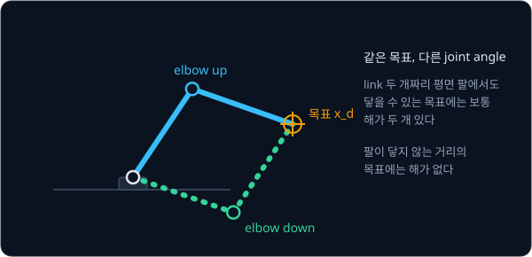
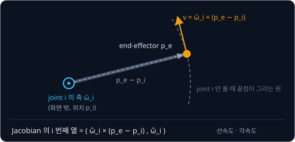
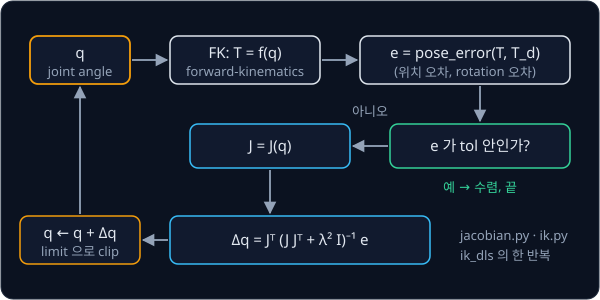

# Inverse Kinematics

## 배경

[Forward Kinematics](../forward-kinematics/README.md) 는 joint angle $q$ 에서 end-effector pose $x = f(q)$ 를 계산하지만, 물체를
집으려면 원하는 pose $x_d$ 에서 거꾸로 $q$ 를 찾아야 한다. 이 역문제가 inverse kinematics(IK)다. 이번 과제에서는 현재 $q$
근처에서 $f$ 를 선형으로 근사하고 조금씩 다가가는 differential IK(Whitney 1969)를 짠다.

### IK 가 어려운 이유

$f$ 는 삼각함수가 겹겹이 들어간 비선형 함수라서, joint 가 많은 팔에는 $q$ 를 바로 구하는 일반적인 closed-form 해가 없다. 해가
하나로 정해지지도 않는다. link 두 개짜리 평면 팔도 닿을 수 있는 목표에는 보통 팔꿈치를 위로 든 자세(elbow up)와 아래로 내린
자세(elbow down) 두 해가 있고, 팔이 닿지 않는 거리의 목표에는 해가 없다.



목표의 자유도와 joint 수도 맞지 않을 수 있다. 3D pose 는 위치 3개와 orientation 3개, 모두 6개의 숫자인데 SO-101 은 gripper 를
뺀 팔의 joint 가 5개라서, 임의의 6D pose 를 다 만들 수는 없다. FK 로 만든 목표에는 그 목표를 만든 $q$ 가 있으므로 도달할 수
있지만, 아무렇게나 고른 6D 목표에서는 IK 가 위치와 orientation 사이의 타협점을 낸다.

### Jacobian

joint angle 이 조금 바뀌면 end-effector 도 조금 움직인다. 그 관계를 선형으로 적은 것이 Jacobian $J(q)$ 다.

$$
\dot x = J(q)\,\dot q, \qquad \Delta x \approx J(q)\,\Delta q
$$

$\dot q$ 는 joint 속도($n$ 개), $\dot x$ 는 end-effector 의 선속도 3개와 각속도 3개를 이어 붙인 6차원 벡터라서 $J$ 는 $6 \times n$
행렬이다. $J$ 의 $i$ 번째 열은 joint $i$ 하나만 1 rad/s 로 돌고 나머지는 멈춰 있을 때 end-effector 가 움직이는 속도다. revolute
joint 이면 end-effector 는 joint 축을 중심으로 원을 그리므로, 그 열은 다음과 같다.

$$
J_i = \begin{bmatrix} \hat\omega_i \times (p_e - p_i) \\ \hat\omega_i \end{bmatrix}
$$

$\hat\omega_i$ 는 world frame 에서 잰 joint $i$ 의 회전축 unit vector, $p_i$ 는 그 축 위의 한 점(joint frame 의 원점), $p_e$ 는
end-effector 의 위치다. 윗칸은 선속도, 아랫칸은 각속도이고, 둘 다 world frame 의 축 방향으로 적는다(world-aligned). FK 가
돌려주는 parent link 의 pose 에 joint 의 origin 을 곱하면 joint frame 의 pose 가 나오고, 그 rotation 에 URDF 의 `<axis>` 를
곱한 것이 $\hat\omega_i$ 다. end-effector 까지 가는 길에 없는 joint(SO-101 의 `gripper`)의 열은 0 이다.



SO-101 의 zero configuration 에서 `shoulder_pan` 의 축은 world 의 $-z$ 방향 $(0, 0, -1)$ 이고, 축 위의 점은
$p_i = (0.039, 0, 0.062)$, gripper 끝점은 $p_e = (0.391, 0, 0.226)$ 이다. 반올림하기 전 값으로 빼면
$p_e - p_i = (0.353, 0, 0.164)$ 이므로 선속도는 $(0, 0, -1) \times (0.353, 0, 0.164) = (0, -0.353, 0)$ 이고, 이 열은
$(0, -0.353, 0, 0, 0, -1)$ 이다. `shoulder_pan` 을 1 rad/s 로 돌리면 끝점이 $-y$ 방향으로 0.353 m/s 로 움직인다는 뜻이고,
pinocchio 의 `LOCAL_WORLD_ALIGNED` Jacobian 과 같은 값이다.

### pose 오차와 반복

목표와의 차이는 위치 오차와 rotation 오차를 이어 붙인 6차원 벡터 $e$ 로 적는다. rotation 오차는 지금 rotation $R$ 에서 목표
$R_d$ 까지 더 돌아야 하는 rotation $R_d R^\top$ 을 transforms 의 log 로 axis-angle 로 바꾼 값이다.

$$
e = \begin{bmatrix} p_d - p \\ \log(R_d R^\top) \end{bmatrix}
$$

$J\,\Delta q \approx e$ 를 만족하는 $\Delta q$ 로 $q$ 를 고치고, 바뀐 $q$ 에서 FK·오차·Jacobian 을 다시 계산하기를 오차가
충분히 작아질 때까지 되풀이한다. $J$ 는 보통 정사각행렬이 아니라서 $\lVert J\Delta q - e\rVert^2$ 를 최소로 하는 least squares 해를
쓰고, 그 해가 pseudo-inverse $J^+ e$ 다. 위치만 맞출 때는 $J$ 의 윗칸 3행과 위치 오차만 쓴다.



### singularity 와 damped least squares

$J$ 를 singular value decomposition 하면 $J = U \Sigma V^\top$ 이고, singular value $\sigma_k$ 는 joint 를 $V$ 의 $k$ 번째 방향으로
단위만큼 움직일 때 end-effector 가 $U$ 의 $k$ 번째 방향으로 움직이는 양이다. 팔을 쭉 펴서 더 바깥으로는 뻗을 수 없는
configuration 처럼 어떤 방향의 $\sigma_k$ 가 0 에 가까워지는 자리를 singularity 라고 부른다. pseudo-inverse 는 그 방향의 오차
$e_k$ 를 $\sigma_k$ 로 나눠 $\Delta q$ 를 만들기 때문에, $\sigma_k$ 가 작아질수록 $\Delta q$ 가 한없이 커진다.

damped least squares(DLS)는 오차와 함께 $\Delta q$ 의 크기에도 벌점 $\lambda^2\lVert\Delta q\rVert^2$ 를 매긴다
(Nakamura·Hanafusa 1986, Wampler 1986).

$$
\min_{\Delta q}\ \lVert J\Delta q - e\rVert^2 + \lambda^2\lVert\Delta q\rVert^2
\quad\Rightarrow\quad
\Delta q = J^\top \left(J J^\top + \lambda^2 I\right)^{-1} e
$$

singular value 하나의 방향만 보면, pseudo-inverse 는 오차에 $1/\sigma$ 를 곱하고 DLS 는 $\sigma/(\sigma^2 + \lambda^2)$ 를 곱한다.
오차 $e = 0.01$, $\lambda = 0.05$ 일 때 두 방법이 내는 step 크기는 아래와 같다.

| $\sigma$ | pseudo-inverse $e/\sigma$ | DLS $\sigma e/(\sigma^2 + \lambda^2)$ |
| --- | --- | --- |
| 1 | 0.01 | 0.00998 |
| 0.1 | 0.1 | 0.08 |
| 0.01 | 1 | 0.0385 |
| 0.001 | 10 | 0.0040 |

$\sigma$ 가 $\lambda$ 보다 충분히 크면 두 방법이 거의 같고, singularity 에 가까워질수록 pseudo-inverse 의 step 만 급격히 커진다.

### joint limit 과 random restart

DLS 의 반복은 시작 configuration $q_0$ 근처에서 오차를 줄이는 방향으로만 움직이므로, joint limit 에 걸리거나 오차가 더 줄지 않는
자리에서 목표에 닿지 못하고 멈출 수 있다. 그럴 때 joint limit 안의 무작위 $q_0$ 에서 다시 시작하는 것이 random restart 다.
매 반복의 $q$ 는 joint limit 범위로 잘라(clip) 실제 로봇이 갈 수 없는 각도를 답으로 내지 않게 한다.

## 목표

- 내 FK 위에서 geometric Jacobian 을 계산한다
- finite difference 와 pinocchio 로 Jacobian 을 검증한다
- pseudo-inverse IK 와 DLS IK 를 짜서 singularity 근처에서 두 방법이 어떻게 다른지 비교한다
- joint limit 과 random restart 를 넣고 무작위 목표로 성공률을 잰다
- (선택) 위치와 orientation 에 서로 다른 weight 를 주는 IK 를 만든다

**직접 짤 것**: Jacobian, pose error, IK 반복, restart. FK 와 SO(3) log 는 앞 과제의 코드를 쓴다.
**가져다 써도 되는 것**: 비교용 pinocchio, `np.linalg.solve`·`np.linalg.svd`.

## 준비물

- Python 3.12, numpy, `pin`, matplotlib, pytest
- forward-kinematics 과제의 URDF parser·FK 와 SO-101 URDF(`../forward-kinematics/so101_new_calib.urdf`), transforms 과제의
  `log_so3`
- GPU 불필요

## 진행 순서

1. `jacobian.py` 의 `movable_joints` 로 `q` 의 칸 순서를 정하고, FK 결과(link pose)와 각 joint 의 origin·axis 로 joint 마다
   world 기준 축 $\hat\omega_i$ 와 위치 $p_i$ 를 구한다. SO-101 에서 `movable_joints` 가 `shoulder_pan` 부터 `gripper` 까지
   6 개를 내야 한다
2. `geometric_jacobian` 을 짜고, [test_ik.py](test_ik.py) 에서 central difference 로 구한 Jacobian 과 비교한다. zero
   configuration 의 `gripper_frame_link` 에서 `shoulder_pan` 열이 $(0, -0.353, 0, 0, 0, -1)$ 이어야 한다
3. `ik.py` 의 `pose_error` 를 짜고, 위치만 맞추는 IK 를 pseudo-inverse 로 먼저 짠다
4. 같은 IK 를 DLS(`ik_dls`)로 바꿔, 팔을 쭉 편 configuration 근처에서 두 방법의 $\lVert\Delta q\rVert$ 를 비교하는 그림을
   `results/` 에 저장한다
5. rotation 오차를 더해 6D pose IK(`position_only=False`)로 넓힌다
6. joint limit clipping 과 `solve_with_restarts` 를 넣는다
7. `bench.py` 의 `main` 에서 FK 로 만든 무작위 목표 1,000개로 성공률과 반복 횟수 분포를 재고, 결과 표와 그림을 `results/` 에
   저장한다

## 시작점

아래 파일은 모두 리포에 들어 있다.

```text
inverse-kinematics/
├── pyproject.toml   # 이 과제의 Python 버전과 패키지
├── uv.lock
├── jacobian.py      # movable_joints, geometric_jacobian 의 stub
├── ik.py            # pose_error, ik_dls, solve_with_restarts 의 stub
├── bench.py         # 무작위 목표에서 성공률 측정
└── test_ik.py       # Jacobian·IK 를 검사하는 test 를 직접 쓴다
```

[jacobian.py](jacobian.py)·[ik.py](ik.py) 의 함수는 몸통이 `raise NotImplementedError` 인 stub 이고, 이름과 signature 는 그대로
둔 채 몸통을 채운다. 채점용 test 는 없어서 평가 기준은 [test_ik.py](test_ik.py) 에 직접 쓴 test 와 `bench.py` 의 결과로
확인한다. 패키지는 `pyproject.toml` 에 있고, 이 폴더에서 `uv run` 을 처음 실행할 때 `.venv/` 에 설치된다.

두 stub 첫머리는 forward-kinematics 과제 폴더를 `sys.path` 에 더해 그 과제의 `Robot`·`forward_kinematics` 를, `ik.py` 는
transforms 과제 폴더도 더해 `log_so3` 를 import 해 둔다. URDF 는 forward-kinematics 과제 폴더에 받아 둔
`so101_new_calib.urdf` 를 그대로 읽는다.

joint 값 배열 `q` 의 칸 순서는 `movable_joints(robot)` 가 정한다. root 에서 tree 를 따라 내려가며 만나는 movable joint(fixed
제외) 순서라서, joint 가 gripper 쪽부터 거꾸로 적힌 SO-101 URDF 의 파일 순서와 다르다. SO-101 에서는 `shoulder_pan`,
`shoulder_lift`, `elbow_flex`, `wrist_flex`, `wrist_roll`, `gripper` 순서이고, pinocchio 의 `model.names[1:]` 와 MuJoCo 모델의
`qpos` 순서도 같다. FK 에 넘길 dict 는 `dict(zip(movable_joints(robot), q))` 로 만든다. [MuJoCo Simulation](../mujoco-sim/README.md)
과 [Classical Pick & Place](../classical-pick/README.md) 가 `ik.py` 를 import 해서 쓰므로 signature 를 바꾸지 않는다.

```bash
cd projects/inverse-kinematics
uv run pytest
uv run python bench.py
```

## 평가 기준

- [ ] Jacobian 이 central difference($\epsilon = 10^{-6}$)와 1e-6 안, pinocchio `getFrameJacobian(..., pin.LOCAL_WORLD_ALIGNED)`
      와 1e-9 안에서 같다
- [ ] $J$ 의 smallest singular value 에 따라 그린 그림에서, 팔을 쭉 편 configuration 에 가까워질수록 pseudo-inverse 의
      $\lVert\Delta q\rVert$ 는 커지고 DLS 의 $\lVert\Delta q\rVert$ 는 유한하게 남는다
- [ ] FK 로 만든 무작위 목표 1,000개에서 위치만 맞추는 IK 가 restart 10번 안에 95% 이상 1 mm 안으로 수렴한다
- [ ] 같은 조건에서 6D pose IK 가 90% 이상 1 mm · 1° 안으로 수렴한다
- [ ] (선택) 아무렇게나 고른 6D 목표에서 orientation weight 를 바꾸면 위치 오차와 orientation 오차 가운데 한쪽이 줄 때 다른
      쪽이 커지는 것을 그림으로 보인다

## 생각해 볼 질문

1. $\lambda$ 를 키우면 무엇을 얻고 무엇을 잃는가? $\lambda$ 가 아주 클 때 DLS 의 한 step 은 어떤 방법의 step 과 비슷해지는가?
2. 같은 목표인데 시작 configuration 에 따라 다른 해가 나오는 이유는? 이 차이가 이어지는 trajectory 를 만들 때 문제가 되는
   상황은?
3. 위치 오차(m)와 rotation 오차(rad)를 한 벡터에 넣으면 단위가 섞이는데, 그러면 수렴과 결과가 어떻게 달라지는가?

## 힌트

<details>
<summary>rotation 오차와 Jacobian 의 기준 frame</summary>

$\log(R_d R^\top)$ 는 world frame 으로 표현한 rotation 오차라서 world-aligned Jacobian 과 짝이 맞는다. $\log(R^\top R_d)$ 를
쓰려면 Jacobian 의 angular 부분도 end-effector frame 으로 돌려야 한다. 두 쪽이 어긋나면 어떤 목표에서는 수렴하고 어떤
목표에서는 수렴하지 않아서 원인을 찾기 어렵다.

</details>

<details>
<summary>λ 와 step 크기</summary>

$J$ 의 smallest singular value $\sigma_{\min}$ 이 클 때는 $\lambda$ 를 작게, singularity 에 가까워질수록 크게 두는 adaptive
방식이 흔하다. 한 step 의 $\lVert\Delta q\rVert$ 에 상한을 두는 것도 발산을 막는 데 도움이 된다.

</details>

<details>
<summary>pinocchio Jacobian 을 읽는 순서</summary>

`pin.computeJointJacobians(model, data, q)` 와 `pin.updateFramePlacements(model, data)` 를 먼저 부르고
`pin.getFrameJacobian(model, data, frame_id, pin.LOCAL_WORLD_ALIGNED)` 를 읽는다. 행 순서는 (linear, angular)다.

</details>

## 참고 자료

- Samuel R. Buss, [Introduction to Inverse Kinematics with Jacobian Transpose, Pseudoinverse and Damped Least Squares methods](https://mathweb.ucsd.edu/~sbuss/ResearchWeb/ikmethods/iksurvey.pdf)
  — 세 방법을 한 문서에서 비교하고, singular value 로 DLS 를 설명하는 절이 이 과제의 표와 같은 관점이다
- Lynch & Park, [Modern Robotics](https://hades.mech.northwestern.edu/index.php/Modern_Robotics) 5장(velocity kinematics)·
  6장(numerical inverse kinematics) — space Jacobian·body Jacobian 과 Newton-Raphson IK
- Russ Tedrake, [Robotic Manipulation — Ch. 3](https://manipulation.csail.mit.edu/pick.html) 의 "Differential inverse
  kinematics"·"Are kinematic singularities real?" 절 — pseudo-inverse 가 singularity 근처에서 어떻게 되는지 그림으로 보여 준다
- 막혔을 때만 열기: [mink](https://github.com/kevinzakka/mink)(MuJoCo 기반 differential IK),
  [pink](https://github.com/stephane-caron/pink)(pinocchio 기반 differential IK)

## 남은 한계

joint angle 은 구했지만 그 값까지 실제로 움직이려면 mass·gravity·friction 이 있는 팔을 torque 로 밀어야 하고, 움직이는 동안
주변 물체와 부딪히기도 한다. 이 IK 를 PD 제어와 함께 physics simulator 위에 올리는 과제가 [MuJoCo Simulation](../mujoco-sim/README.md) 이다.
