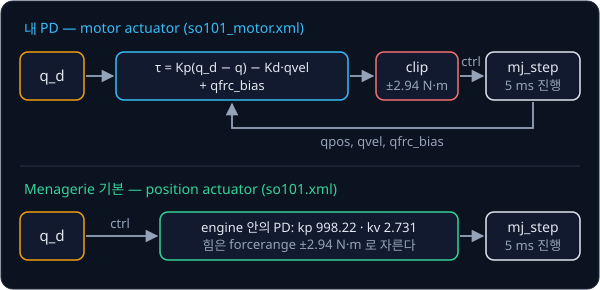
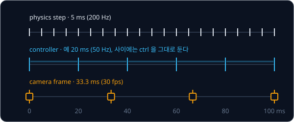

# MuJoCo Simulation

## 배경

[PID Control](../pid-control/README.md) 의 pendulum 은 equation of motion 을 손으로 쓸 수 있었지만, joint 다섯 개짜리 팔은 각
joint 의 inertia 와 gravity 가 configuration 에 따라 서로 얽히고 gripper 가 물체에 닿으면 contact force 까지 생긴다. 이런 계산을
대신해 주는 프로그램이 physics engine 이다. 이번 과제에서는 MuJoCo 위에 SO-101 을 올리고, pid-control 의 controller 와
[Inverse Kinematics](../inverse-kinematics/README.md) 의 IK 를 이어 붙여 팔을 원하는 곳으로 움직인다.

### 여러 joint 의 equation of motion

physics engine 은 팔 전체의 움직임을 generalized coordinate $q$ 로 적은 식 하나로 다룬다. SO-101 이면 $q$ 는 joint angle 6개다.

$$
M(q)\,\ddot q + c(q, \dot q) = \tau + J_c^\top f_c
$$

| 기호 | 크기 | 뜻 |
| --- | --- | --- |
| $M(q)$ | $n_v \times n_v$ | mass matrix. pendulum 의 $m l^2$ 에 해당하고, 대각선 밖의 값은 한 joint 를 가속할 때 다른 joint 에 미치는 영향이다 |
| $c(q, \dot q)$ | $n_v$ | bias force. Coriolis·centrifugal 항과 gravity 항의 합으로, pendulum 의 $m g l \sin\theta$ 가 여기에 든다 |
| $\tau$ | $n_v$ | actuator 가 joint 에 주는 torque |
| $J_c^\top f_c$ | $n_v$ | contact force $f_c$ 가 joint 에 주는 힘. $J_c$ 는 contact 지점의 Jacobian 이다 |

MuJoCo(2012)는 이 식을 contact 까지 포함해 빠르고 안정적으로 푸는 engine 으로, robot learning 에서 가장 널리 쓰이는
simulator 가운데 하나다. 매 step 마다 $M$ 을 `data.qM` 에, $c$ 를 `data.qfrc_bias` 에 계산해 둔다. joint 의 damping 과 friction 은
`qfrc_bias` 에 들지 않고 따로 계산된다.

### MJCF 와 MjModel·MjData

MuJoCo 의 모델은 MJCF 라는 XML 로 적는다. `<body>` 가 tree 를 이루고, body 마다 `<joint>`(움직임), `<geom>`(충돌·질량 형상),
`<site>`(이름 붙은 점), `<camera>` 를 달며, `<actuator>` 가 어느 joint 를 어떻게 미는지 정한다. Python 에서는 이 파일을 두
객체로 읽는다.

| 객체 | 담는 것 | 예 |
| --- | --- | --- |
| `mujoco.MjModel` | 시뮬레이션 동안 바뀌지 않는 구조와 parameter | `nq`, `nv`, `nu`, `jnt_range`, `actuator_gainprm`, `opt.timestep` |
| `mujoco.MjData` | 매 step 바뀌는 상태와 계산 결과 | `qpos`, `qvel`, `ctrl`, `qfrc_bias`, `site_xpos` |

`nq` 는 `qpos` 의 길이, `nv` 는 `qvel` 의 길이, `nu` 는 actuator 수다. hinge joint 는 셋 다 하나씩이지만, 공중에 떠 있는 물체에
붙이는 freejoint 는 위치 3개와 quaternion 4개로 `qpos` 7칸을 쓰고 속도는 선속도 3개와 각속도 3개로 `qvel` 6칸을 쓴다. 그래서
cube 가 하나 더 있는 scene 에서는 `nq` 와 `nv` 가 달라진다. 시뮬레이션은 `data.ctrl` 에 명령을 넣고 `mujoco.mj_step(model, data)`
를 부를 때마다 `opt.timestep` 만큼 진행한다. Menagerie 의 SO-101 은 timestep 이 5 ms 다.

### position actuator 와 motor actuator

MuJoCo Menagerie 의 SO-101 모델은 actuator 가 `position` 형식이다. `ctrl` 에 목표 각도를 넣으면 engine 안에서 PD 가 돌아,
$\tau = k_p(\text{ctrl} - q) - k_v\dot q$ 를 `forcerange` 로 자른 torque 가 joint 에 들어간다. SO-101 의 STS3215 servo 에 맞춘
값은 $k_p = 998.22$ N·m/rad, $k_v = 2.731$ N·m·s/rad, `forcerange` ±2.94 N·m 다. `motor` 형식으로 바꾸면 `ctrl` 이 곧 torque(N·m)
가 되므로, PD 를 바깥에서 직접 짤 수 있다. 이번 과제에서는 `motor` 로 바꾼 사본 위에 PD 를 짜고, 그 결과를 원래의 `position`
actuator 와 비교한다.



### PD 와 gravity compensation

pid-control 에서 본 것처럼 PD 만으로 팔을 붙잡으면, 멈춘 상태에서는 P 항 혼자 gravity 를 버텨야 해서 steady-state error 가
남는다. physics engine 이 계산해 둔 bias force $c(q, \dot q)$ 를 그대로 더하면 gravity 와 속도에 따른 힘이 상쇄되어, PD 는 목표와의
차이만 고치면 된다. 이것이 gravity compensation 이다.

$$
\tau = K_p\,(q_d - q) - K_d\,\dot q + c(q, \dot q)
$$

SO-101 의 모든 joint 가 0 일 때 `qfrc_bias` 는 `shoulder_lift` 0.573 N·m, `elbow_flex` 0.483 N·m, `wrist_flex` 0.130 N·m
크기다(부호는 모두 음). 이 자세를 $K_p = 10$ N·m/rad 의 PD 만으로 잡으면 `shoulder_lift` 하나만 봐도 대략 $0.573 / 10 \approx 0.057$
rad(약 3.3°)만큼 처지는 셈이고, 실제 처짐은 joint 끼리의 영향 때문에 이 어림값과 조금 다르다.

### 제어 주기, physics step, 카메라 frame

physics 는 5 ms 마다 한 step 씩 진행하지만 controller 가 그때마다 torque 를 새로 계산할 필요는 없다. controller 가 `control_dt`
마다 `ctrl` 을 정하면, 그 사이의 physics step 들은 같은 `ctrl` 로 진행한다. 30 fps 영상은 33.3 ms 마다 한 frame 이 필요하므로,
렌더링은 시뮬레이션 시간이 다음 frame 시각을 넘을 때만 한다.



카메라 영상은 `mujoco.Renderer(model, height, width)` 를 만들고 `update_scene(data, camera=이름)` 뒤 `render()` 를 부르면
`(H, W, 3)` uint8 배열로 나온다. Menagerie 모델에는 손목 카메라 `wrist_cam` 이 들어 있고, 작업 공간을 보는 고정 카메라는 scene 에
`<camera>` 를 더해 만든다.

## 목표

- Menagerie 의 SO-101 scene 을 불러 joint·actuator·camera 구성을 확인한다
- actuator 를 `motor` 로 바꾼 사본 위에 PD + gravity compensation 을 짠다
- inverse-kinematics 과제의 IK 로 목표 joint angle 을 구하고 minimum-jerk trajectory 로 따라간다
- 고정 카메라와 손목 카메라(`wrist_cam`) 영상을 렌더링해 mp4 로 저장한다
- 내 PD 와 Menagerie 기본 `position` actuator 의 추종 결과를 비교한다

**직접 짤 것**: PD + gravity compensation, trajectory 추종 loop, IK 연결, 렌더링 loop.
**가져다 써도 되는 것**: MuJoCo 의 적분·contact 계산, `mujoco.viewer`, `mujoco.Renderer`, mp4 저장용 `imageio`·`mediapy`.

## 준비물

- Python 3.12, `mujoco`, numpy, `imageio[ffmpeg]`(또는 `mediapy`), matplotlib, pytest
- [MuJoCo Menagerie](https://github.com/google-deepmind/mujoco_menagerie) 의 `robotstudio_so101/` — mesh 가 들어 있는 폴더째로
  쓰고, 시작점의 명령으로 `assets/` 에 받는다
- GPU 불필요. 화면 없는 Linux 에서는 `MUJOCO_GL=egl`(GPU 가 있을 때)이나 `MUJOCO_GL=osmesa` 로 offscreen 렌더링을 한다
- macOS 에서 `mujoco.viewer.launch_passive` 를 쓰려면 `uv run python` 대신 `uv run mjpython` 으로 실행한다

## 진행 순서

1. 시작점의 명령으로 Menagerie 의 `robotstudio_so101/` 을 `assets/` 에 받는다. `mj_control.py` 의 `load` 를 짜고 `assets/scene.xml`
   의 `nq`·`nv`·`nu`, joint 이름과 range, actuator 의 gain·`forcerange`, `opt.timestep` 을 출력한다. `nq = nv = nu = 6`,
   timestep 0.005 가 나와야 한다
2. viewer 를 띄우고 기본 `position` actuator 의 `ctrl` 에 목표 각도를 넣어 팔이 움직이는지 본다
3. `assets/so101.xml` 을 `assets/so101_motor.xml` 로 복사해 `position` actuator 를 같은 torque 범위의 `motor` actuator 로
   바꾸고, `scene.xml` 도 이 파일을 include 하는 사본을 만든다
4. `mj_control.py` 의 `pd_gravity` 를 짜서, 팔을 수평으로 뻗은 configuration 을 PD 만으로 잡을 때와 `qfrc_bias` 를 더했을 때의
   처짐을 비교한다
5. `reach.py` 의 `track` 과 `main` 을 짠다. end-effector 목표 위치를 inverse-kinematics 과제의 IK 로 joint angle 로 바꾸고,
   pid-control 과제의 `min_jerk` 로 만든 trajectory 를 `track` 으로 추종한다
6. 무작위 목표 20개의 도달 오차와 걸린 시간을 표로 만들어 `results/` 에 저장한다
7. scene 사본에 작업 공간을 보는 고정 카메라를 추가하고, `render.py` 의 `render_cameras`·`main` 으로 고정 카메라와 `wrist_cam`
   영상을 30 fps mp4 로 `results/` 에 저장한다

## 시작점

아래 파일은 모두 리포에 들어 있다.

```text
mujoco-sim/
├── pyproject.toml   # 이 과제의 Python 버전과 패키지
├── uv.lock
├── mj_control.py    # load, pd_gravity 의 stub
├── reach.py         # track 의 stub 과 IK + trajectory 추종 demo
├── render.py        # render_cameras 의 stub 과 mp4 저장
└── test_sim.py      # 모델 구성과 제어 결과를 검사하는 test 를 직접 쓴다
```

함수는 몸통이 `raise NotImplementedError` 인 stub 이고, 이름과 signature 는 그대로 둔 채 몸통을 채운다. 채점용 test 는 없어서
평가 기준은 [test_sim.py](test_sim.py) 에 직접 쓴 test 와 `results/` 에 남긴 표·영상으로 확인한다. 패키지는 `pyproject.toml` 에
있고, 이 폴더에서 `uv run` 을 처음 실행할 때 `.venv/` 에 설치된다.

MuJoCo 모델은 리포에 들어 있지 않아서 Menagerie 에서 `robotstudio_so101/` 폴더만 받아 `assets/` 로 옮긴다. `so101_motor.xml`
같은 수정본은 이 `assets/` 안에 만든다. `reach.py` 첫머리는 inverse-kinematics·forward-kinematics·pid-control 과제 폴더를
`sys.path` 에 더해 IK 의 `solve_with_restarts`, URDF 를 읽는 `parse_urdf`, `min_jerk` 를 import 해 둔다. IK 에 쓰는 URDF 는
forward-kinematics 과제 폴더에 받아 둔 `so101_new_calib.urdf` 다.
[Classical Pick & Place](../classical-pick/README.md) 가 `mj_control.py`·`reach.py` 를 import 해서 쓰므로 signature 를 바꾸지
않는다.

```bash
cd projects/mujoco-sim
git clone --depth 1 --filter=blob:none --sparse https://github.com/google-deepmind/mujoco_menagerie.git menagerie
git -C menagerie sparse-checkout set robotstudio_so101
cp -r menagerie/robotstudio_so101 assets && rm -rf menagerie
uv run pytest
uv run python reach.py
uv run python render.py
```

## 평가 기준

- [ ] `so101.xml` 만 불렀을 때 `nq = nv = nu = 6` 이고, cube 가 든 `scene_box.xml` 은 freejoint 때문에 `nq = 13`, `nv = 12` 다
- [ ] 같은 gain 에서 `qfrc_bias` 를 더하면 수평 configuration 의 steady-state error 가 PD 만 쓸 때의 1/5 아래로 준다
- [ ] self-collision 이 없는 무작위 목표 20개 중 18개 이상에서 end-effector 가 2초 안에 목표 5 mm 안으로 들어간다
- [ ] 내 PD 와 기본 `position` actuator 의 최종 도달 오차가 둘 다 5 mm 안이다
- [ ] 고정 카메라와 `wrist_cam` 의 640×480 영상이 30 fps mp4 로 저장되고, 영상 속 움직임이 기록한 joint trajectory 와 시점이
      맞는다
- [ ] (선택) 제어 주기를 500 Hz 에서 20 Hz 까지 낮추며 같은 gain 의 tracking error 와 안정성을 비교한다

## 생각해 볼 질문

1. physics timestep(5 ms), controller 주기, 카메라 frame 주기를 서로 다르게 두는 이유는? 셋이 맞물려야 하는 경우는 언제인가?
2. `qfrc_bias` 를 그대로 더하는 gravity compensation 이 실물 로봇에서도 같은 효과를 내려면 무엇이 필요한가? 무엇이 틀릴 수
   있는가?
3. Menagerie 의 `position` actuator 는 `kp` 가 1000 가까이인데 `forcerange` 는 ±2.94 N·m 다. 목표가 멀리 있을 때 이
   actuator 는 사실상 어떻게 움직이는가?

## 힌트

<details>
<summary>actuator 의 motor 전환</summary>

`<position class="sts3215" name="..." joint="..." ctrlrange="..."/>` 를 `<motor name="..." joint="..." ctrlrange="-2.94 2.94"/>`
꼴로 바꾸면 `ctrl` 이 torque(N·m)가 된다. joint 의 `damping`·`frictionloss`·`armature` 는 default class 에 그대로 남아 있어서
내 $K_d$ 와 joint damping 이 함께 작용한다.

</details>

<details>
<summary>IK 의 end-effector 와 MuJoCo 의 end-effector</summary>

Menagerie 의 `gripperframe` site 는 URDF 의 `gripper_frame_link` 와 2 cm 쯤 떨어진 다른 점이다. IK 는 URDF 로 풀고 오차는
MuJoCo 로 재면 그만큼 어긋나니, 한쪽에 맞춰 같은 점을 쓴다. 두 모델의 zero configuration 은 같고, IK 가 돌려주는 `q` 는
`movable_joints` 순서(`shoulder_pan` 부터 `gripper` 까지)라 MuJoCo 의 `qpos`·`ctrl` 순서와 같아서 그대로 넣는다.

</details>

<details>
<summary>렌더링 크기와 MuJoCo 카메라 축</summary>

`mujoco.Renderer` 의 크기는 model 의 offscreen buffer(`<visual><global offwidth offheight>`)를 넘을 수 없다. MuJoCo 카메라는
자기 frame 의 $-z$ 를 바라보고 $+y$ 가 화면 위쪽이라서, $+z$ 를 바라보고 $+y$ 가 아래쪽인 OpenCV 규약과 x 축 기준으로 180°
돌아 있다. physics 는 5 ms 마다 돌고 영상은 33 ms 마다 필요하니, 렌더링은 sim 시간이 다음 frame 시각을 넘을 때만 한다.

</details>

## 참고 자료

- [MuJoCo Python bindings 문서](https://mujoco.readthedocs.io/en/stable/python.html) 와 공식
  [tutorial notebook](https://colab.research.google.com/github/google-deepmind/mujoco/blob/main/python/tutorial.ipynb)(Colab
  에서 바로 열린다) — model 불러오기, `mj_step`, `Renderer` 를 차례로 따라 해 볼 수 있다
- MuJoCo 문서 [Overview](https://mujoco.readthedocs.io/en/stable/overview.html) — MJCF 의 구성 요소와 `mjModel`·`mjData` 의 역할
- MuJoCo 문서 [Computation](https://mujoco.readthedocs.io/en/stable/computation/index.html) — 위 equation of motion 과 bias force
  의 정의
- [MJCF XML reference](https://mujoco.readthedocs.io/en/stable/XMLreference.html) — actuator·camera·option 속성
- Menagerie [robotstudio_so101](https://github.com/google-deepmind/mujoco_menagerie/tree/main/robotstudio_so101) — README 에
  원본 MJCF 에서 바꾼 점이 적혀 있다
- [mediapy](https://github.com/google/mediapy) — numpy 배열 목록을 mp4 로 쓰는 `write_video`
- 막혔을 때만 열기: [mink](https://github.com/kevinzakka/mink) — MuJoCo model 위에서 바로 도는 differential IK

## 남은 한계

팔은 원하는 곳에 가지만 무엇을 집을지는 아직 모르고, 사람이 보여 준 동작을 기록할 방법도 없다. 카메라로 물체를 찾아 집는 모듈
파이프라인은 [Classical Pick & Place](../classical-pick/README.md), 시연 데이터 수집은 [Teleop Dataset](../teleop-dataset/README.md),
같은 simulator 로 하는 locomotion policy 학습은 [Sim-to-Real Locomotion](../sim2real-locomotion/README.md) 에서 이어진다.
