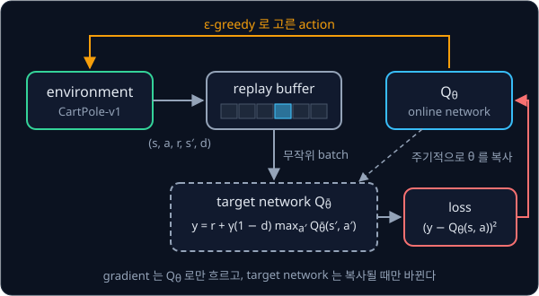
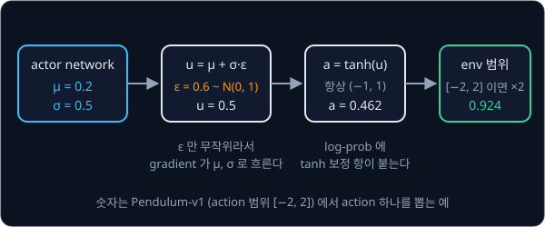

# DQN → SAC

## 배경

[Bandits & MDPs](../bandit-mdp/README.md) 의 Q-learning 은 $Q$ 를 state 마다 칸이 하나씩 있는 표에 담았다. 이 과제는 같은
아이디어를 state 가 연속값인 환경으로 옮기면서, 표 대신 [PyTorch Training Loop](../pytorch-mlp/README.md) 의 neural network
를 쓸 때 생기는 문제를 하나씩 푼다. 이산 action 의 DQN 에서 시작해 연속 action 의 SAC 까지 간다.

### network 로 근사한 Q

`CartPole-v1` 은 수레 위에 세운 막대가 쓰러지지 않게 수레를 왼쪽이나 오른쪽으로 미는 환경이다. state 는 수레 위치, 수레
속도, 막대 각도, 막대 각속도의 연속값 4 개이고, action 은 왼쪽(0)·오른쪽(1) 둘이다. 막대가 서 있는 step 마다 reward 1 을
받고, 막대가 12° 넘게 기울거나 수레가 가운데에서 2.4 넘게 벗어나면 episode 가 끝나며, 500 step 이 되면 시간 제한으로
끊긴다. 연속값 state 는 셀 수 없이 많아서 칸마다 $Q$ 를 적어 둘 표를 만들 수 없다.

DQN(Deep Q-Network)은 표 대신 weight 가 $\theta$ 인 network $Q_\theta$ 를 쓴다. state 를 넣으면 action 마다 Q 값을 하나씩
내므로, CartPole 에서는 batch $B$ 개의 state `(B, 4)` 를 넣어 `(B, 2)` 를 받는다. 학습은 Q-learning 의 target 을 정답처럼
두고 [NumPy Warm-up](../warmup/README.md) 의 MSE 처럼 차이의 제곱을 줄이는 regression 이다.

$$
\mathcal L(\theta) = \mathbb E_{(s,a,r,s',d)\sim\mathcal D}\Big[\big(\underbrace{r + \gamma(1-d)\max_{a'} Q_{\bar\theta}(s',a')}_{\text{target } y} - Q_\theta(s,a)\big)^2\Big]
$$

| 기호 | 뜻 |
| --- | --- |
| $\mathcal D$ | 지금까지 모은 transition 을 담아 둔 replay buffer |
| $(s, a, r, s', d)$ | state, action, reward, 다음 state, episode 가 진짜로 끝났으면 1 인 done 표시 |
| $\gamma$ | discount factor |
| $Q_{\bar\theta}$ | target 계산에만 쓰는 target network. weight $\bar\theta$ 는 $\theta$ 를 늦게 따라간다 |
| $\mathbb E$ | buffer 에서 무작위로 뽑은 batch 에 대한 평균 |

$(1-d)$ 는 episode 가 끝난 transition 에서 미래 항을 지운다. 표와 달리 network 는 한 state 의 Q 를 고치면 비슷한 다른 state
의 Q 도 함께 바뀌어서, 아무 장치 없이 Q-learning 을 그대로 옮기면 학습이 쉽게 발산한다. DQN 은 이 문제를 replay buffer(2013)와
target network(2015)로 막았다.

### replay buffer

CartPole 에서 연달아 들어오는 transition 은 수레 위치와 막대 각도가 조금씩만 바뀌어 서로 거의 같다. 이런 transition 을
들어오는 순서대로 학습하면 batch 하나가 비슷한 상황으로만 채워지고, network 는 방금 겪은 상황에 맞춰 크게 흔들린다.
replay buffer 는 transition 을 정해진 개수(capacity)까지 쌓아 두고, 학습할 때마다 그 안에서 무작위로 batch 를 뽑아 서로
다른 시점의 transition 을 섞는다.

buffer 가 꽉 차면 가장 오래된 칸부터 덮어쓴다. 배열 하나에 쓰기 위치를 한 칸씩 돌려 가며 쓰는 이런 구조를 ring buffer
라고 하는데, capacity 가 5 이면 6 번째 transition 은 0 번 칸에, 7 번째는 1 번 칸에 들어간다.

### target network

target $y$ 를 지금 학습 중인 $Q_\theta$ 로 계산하면 $\theta$ 를 한 번 고칠 때마다 정답 역할인 target 도 함께 움직여서, 학습이
진동하거나 발산하기 쉽다. target network 는 $\theta$ 의 복사본 $\bar\theta$ 를 따로 두고 target 을 이것으로만 계산한다.
$\bar\theta$ 는 정해진 step 마다 $\theta$ 를 통째로 복사하거나(hard update), 매 step 조금씩 따라가게 한다(soft update).

$$
\bar\theta \leftarrow \tau\,\theta + (1-\tau)\,\bar\theta
$$

$\tau = 0.005$ 이면 매 step $\theta$ 쪽으로 0.5% 만 다가가므로, $\bar\theta$ 는 최근 수백 step 동안의 $\theta$ 를 평균한 값처럼
천천히 움직인다. CleanRL `dqn.py` 의 기본값은 500 step 마다 통째로 복사하는 hard update 다.



### ε 을 줄여 가는 탐색

DQN 도 bandit 과 같은 ε-greedy 로 탐색한다. 학습 초반에는 Q 가 엉터리라 거의 무작위로 움직이는 편이 낫고, 뒤로 갈수록
배운 Q 를 믿어도 되므로 ε 을 처음에는 크게 두고 점점 줄인다. CleanRL `dqn.py` 의 기본값은 전체 500k step 의 앞쪽 절반
동안 ε 을 1.0 에서 0.05 까지 선형으로 줄이고, 그 뒤로는 0.05 로 둔다.

### 연속 action 과 actor-critic

`Pendulum-v1` 은 아래로 늘어진 진자를 돌려 세운 뒤 위에서 버티게 하는 환경이다. action 은 −2 부터 2 사이의 토크 값 하나라서
가능한 action 이 셀 수 없이 많고, target 의 $\max_{a'} Q(s', a')$ 를 action 을 하나씩 넣어 보며 구할 수 없다. step 마다
reward 는 진자가 위에서 벗어난 각도의 제곱, 각속도 제곱의 0.1 배, 토크 제곱의 0.001 배를 더해 음수로 만든 값이라 최대 0,
최소 −16.27 이고, episode 는 200 step 이다.

그래서 Q 를 크게 만드는 action 을 바로 내는 network 를 따로 학습한다. action 을 내는 network 를 actor, $(s, a)$ 를 받아
Q 값을 내는 network 를 critic 이라 하고, 둘을 함께 학습하는 구조를 actor-critic 이라고 한다. DDPG(2015)는 결정적인 actor 에
noise 를 더해 탐색했고, TD3(2018)는 critic 을 두 개 두는 등의 장치로 DDPG 의 불안정을 줄였다.

### SAC 와 maximum entropy

SAC(Soft Actor-Critic)는 reward 와 함께 policy 의 entropy 도 키우도록 목표를 바꾼다. entropy 는 확률분포가 얼마나 고르게
퍼져 있는지 재는 값이다.

$$
\mathcal H\big(\pi(\cdot\mid s)\big) = -\sum_a \pi(a\mid s)\log\pi(a\mid s)
$$

action 이 둘일 때 0.5 씩 고르면 entropy 는 0.693, 0.9 와 0.1 로 고르면 0.325 이고, 한 action 만 고르면 0 이다. 연속 action 의
Gaussian policy 는 표준편차 $\sigma$ 가 클수록 entropy 가 크다. SAC 는 아래 maximum entropy objective 를 키우고, temperature
$\alpha$ 가 클수록 무작위로 움직이는 쪽을 더 쳐준다. 그래서 탐색을 ε 같은 별도 규칙이 아니라 policy 자체가 맡는다.

$$
J(\pi) = \sum_t \mathbb E\Big[\, r_t + \alpha\,\mathcal H\big(\pi(\cdot\mid s_t)\big) \,\Big]
$$

이 objective 에 맞춰 critic 의 target 에도 다음 action 의 log-prob 항이 붙는다.

$$
y = r + \gamma(1-d)\Big(\min_{i=1,2} Q_{\bar\theta_i}(s',a') - \alpha\log\pi_\phi(a'\mid s')\Big),\qquad a'\sim\pi_\phi(\cdot\mid s')
$$

$\pi_\phi$ 는 weight 가 $\phi$ 인 actor 이고, $a'$ 는 다음 state $s'$ 에서 지금 actor 로 새로 뽑은 action 이다. critic 은 두
개($Q_{\theta_1}, Q_{\theta_2}$)를 따로 학습하고 target 에는 두 target critic 가운데 작은 값을 쓰는데, 이를 clipped double Q
라고 한다.

### tanh-squashed Gaussian actor

SAC 의 actor 는 state 를 받아 Gaussian 의 평균 $\mu$ 와 표준편차 $\sigma$ 를 내고, 거기서 action 을 뽑는다. Gaussian 에서
뽑은 값은 범위가 없으므로 $\tanh$ 로 $(-1, 1)$ 안에 묶은 뒤 env 의 action 범위로 늘린다. 뽑을 때는
$u \sim \mathcal N(\mu, \sigma^2)$ 를 직접 뽑지 않고 $\varepsilon \sim \mathcal N(0, 1)$ 을 뽑아 $u = \mu + \sigma\varepsilon$ 로
만든다. 이렇게 하면
무작위성이 $\varepsilon$ 에만 있어서 action 에서 $\mu$ 와 $\sigma$ 로 gradient 가 흐르는데, 이 방법을 reparameterization
trick 이라고 한다.



$\tanh$ 는 $u$ 축의 구간을 늘이거나 줄여서 옮기므로, action 의 log-prob 는 Gaussian 의 log-prob 그대로가 아니라 보정 항을
붙여 계산한다(힌트 참고). 평가 기준은 이 log-prob 를 `torch.distributions` 의
`TransformedDistribution(Normal(μ, σ), TanhTransform())` 과 맞춰 본다.

### temperature 자동 조정

$\alpha$ 를 손으로 정하면 환경마다 다시 맞춰야 해서, SAC 의 후속 논문(2018)은 $\alpha$ 도 학습한다. policy entropy 의 목표값
$\bar{\mathcal H}$ 를 정해 두고 아래 loss 를 줄이면, entropy 가 목표보다 낮을 때 $\alpha$ 가 커지고 높을 때 작아진다.

$$
J(\alpha) = \mathbb E_{a\sim\pi_\phi(\cdot\mid s)}\big[-\alpha\,\big(\log\pi_\phi(a\mid s) + \bar{\mathcal H}\big)\big]
$$

목표값은 보통 $-\dim\mathcal A$ 로 두므로 action 이 1 차원인 Pendulum 은 −1, 6 차원인 HalfCheetah 는 −6 이다. SAC 의
update 한 번은 아래 순서로 네 가지를 고친다.


### sample efficiency 와 실물 로봇

이 계열은 한 번 모은 transition 을 버리지 않고 학습에 여러 번 쓰므로 같은 성능에 필요한 환경 step 이 적다. 실물 로봇에서는
step 하나가 곧 실제로 흐르는 시간이라 step 을 아껴야 하고, 그래서 시연 데이터를 buffer 에 섞어 실물에서 바로 학습하는
RLPD·SERL·HIL-SERL 같은 sample-efficient robot RL 이 모두 SAC 를 바탕으로 한다.

## 목표

- replay buffer 와 target network 를 갖춘 DQN 으로 `CartPole-v1` 을 푼다
- target network 와 replay buffer 를 하나씩 빼는 ablation 으로 둘의 역할을 확인한다
- 같은 코드에 tanh-squashed Gaussian actor 와 twin critic 을 붙여 SAC 를 짜고 `Pendulum-v1` 을 푼다
- SAC 를 HalfCheetah 로 옮겨 CleanRL `sac_continuous_action.py` 와 같은 step 에서 비교한다

**직접 짤 것**: replay buffer, Q-network·actor·critic, TD target, soft target update, tanh-squashed Gaussian 의 log-prob,
temperature 자동 조정.
**가져다 써도 되는 것**: gymnasium 환경과 `RecordEpisodeStatistics` 같은 wrapper, `torch.optim`, tensorboard 같은 logging 도구.

## 준비물

- Python 3.12, numpy, `torch`, `gymnasium[classic_control,mujoco]`(MuJoCo 가 함께 설치된다), `tensorboard`, matplotlib, pytest
- CleanRL 비교용 가상환경을 따로 둔다. CleanRL 은 Python 3.11 미만과 gymnasium 0.29.1 에 맞춰져 있어서 `uv venv -p 3.10` 으로
  만든 환경에 CleanRL README 대로 `".[mujoco]"` extra 를 설치한다. CleanRL 의 기본 env 가 v4 이므로 내 코드도 `HalfCheetah-v4` 로 맞춘다
  (gymnasium 1.x 에도 deprecated 경고와 함께 남아 있다)
- `CartPole-v1`·`Pendulum-v1` 은 CPU 로 충분하다. HalfCheetah 는 network 가 작아 8 GB GPU 로 넉넉하지만 환경 step 마다
  update 를 하므로 수십만 step 에 몇 시간이 걸린다

## 진행 순서

1. `buffer.py` 의 `ReplayBuffer` 를 채운다. capacity 크기의 numpy 배열에 ring buffer 로 쓰고, `sample(batch_size)` 는 무작위
   index 로 뽑은 `Batch` 를 device 의 tensor 로 돌려준다. capacity 보다 많이 넣었을 때 가장 오래된 것부터 덮어쓰는지
   `test_off_policy.py` 에서 확인한다
2. `nets.py` 의 `QNetwork` 를 채우고, `dqn.py` 의 `train_dqn` 안에 ε 을 선형으로 줄여 가는 ε-greedy 행동 선택을 짠다
3. `dqn.py` 의 `dqn_loss` 와 `train_dqn` 의 학습 루프를 채워 CartPole 을 풀고, `evaluate.py` 의 `evaluate` 로 greedy policy 의
   10 episode 평균 return 을 잰다
4. target network 를 매 step 동기화한 판과 buffer 를 batch 크기로 줄인 판을 3 seed 씩 돌리고, `plot.py` 에서 원래 DQN 과
   겹친 학습 곡선을 `results/dqn_ablation.png` 로 저장한다
5. `nets.py` 의 `SquashedGaussianActor` 와 `TwinCritic` 을 채우고, actor 의 log-prob 를
   `TransformedDistribution(Normal(μ, σ), TanhTransform())` 과 비교하는 test 를 `test_off_policy.py` 에 쓴다
6. `sac.py` 의 `soft_update` 와 `train_sac` 을 critic → actor → temperature → soft target 순서로 채워 `Pendulum-v1` 을 푼다
7. 같은 `train_sac` 으로 `HalfCheetah-v4` 를 300k step 학습한다
8. 따로 만든 CleanRL 환경에서 `sac_continuous_action.py --env-id HalfCheetah-v4` 를 같은 step·seed 3 개로 돌리고, `plot.py`
   에서 두 쪽의 평가 return 을 비교한 그림을 `results/halfcheetah.png` 로 저장한다

## 시작점

아래 파일은 모두 리포에 들어 있다.

```text
off-policy/
├── pyproject.toml       # 이 과제의 Python 버전과 패키지
├── uv.lock
├── buffer.py            # Batch, ReplayBuffer 의 stub
├── nets.py              # QNetwork, TwinCritic, SquashedGaussianActor 의 stub
├── dqn.py               # dqn_loss, train_dqn 의 stub
├── sac.py               # soft_update, train_sac 의 stub
├── evaluate.py          # evaluate 의 stub
├── plot.py              # DQN ablation 곡선과 HalfCheetah 비교 그림
└── test_off_policy.py   # buffer·log-prob·TD target 을 확인하는 test 를 직접 쓴다
```

[buffer.py](buffer.py)·[nets.py](nets.py)·[dqn.py](dqn.py)·[sac.py](sac.py)·[evaluate.py](evaluate.py) 의 함수와 method 는
몸통이 `raise NotImplementedError` 인 stub 이고, 이름과 signature 는 그대로 둔 채 몸통을 채운다. ablation 처럼 설정을 바꿔
돌려야 할 때는 keyword 인자를 뒤에 더해도 된다. 채점용 test 는 없어서 평가 기준은 [test_off_policy.py](test_off_policy.py) 에
직접 쓴 test 와 `evaluate` 의 평가 return, `plot.py` 의 그림으로 확인한다. 패키지는 `pyproject.toml` 에 있고, 이 폴더에서
`uv run` 을 처음 실행할 때 `.venv/` 에 설치된다.

```bash
cd projects/off-policy
uv run pytest
uv run python dqn.py
uv run python sac.py
uv run python plot.py
```

## 평가 기준

- [ ] DQN 의 greedy policy 가 500k step 안에 `CartPole-v1` 에서 10 episode 평균 return 475(환경의 `reward_threshold`) 이상을 낸다
- [ ] ablation 곡선을 원래 DQN 과 겹친 그림에서 seed 간 편차와 학습 후반의 성능 붕괴가 어느 판에서 커지는지 설명할 수 있다
- [ ] `SquashedGaussianActor` 의 log-prob 가 `TransformedDistribution(Normal(μ, σ), TanhTransform())` 로 계산한 값과
  env 범위로 scale 하기 전 기준 $10^{-4}$ 안에서 일치한다
- [ ] SAC 가 50k step 안에 `Pendulum-v1` 에서 10 episode 평균 return -200 이상에 도달한다
- [ ] `HalfCheetah-v4` 300k step 에서 내 SAC 의 평가 return 이 같은 step 의 CleanRL `sac_continuous_action.py`
  (`--env-id HalfCheetah-v4`) 대비 3 seed 평균 80% 이상이다
- [ ] (선택) temperature $\alpha$ 와 policy entropy 를 기록해 entropy 가 target 값 $-\dim\mathcal A$ 근처로 모이는 것을 확인한다

## 생각해 볼 질문

1. TD target 에 $\max_{a'} Q$ 를 쓰면 Q 추정에 noise 가 있을 때 value 가 실제보다 큰 쪽으로 치우친다. 그 이유는 무엇이고,
   SAC 의 $\min_{i} Q_{\bar\theta_i}$ 는 이 치우침을 어떻게 줄이는가?
2. Q-learning 의 update 식에는 그 transition 을 모은 policy 가 어디에도 들어가지 않는다. 이 점이 오래된 transition 을 계속
   써도 되는 이유와 어떻게 이어지는가? 그런데도 replay buffer 크기에 상한을 두는 이유는 무엇인가?
3. 실물 로봇 RL 이 simulator 에서 흔히 쓰는 on-policy 방법이 아니라 이 계열을 고르는 이유를 환경 step 하나의 비용으로 설명할 수 있는가?

## 힌트

<details>
<summary>terminated 와 truncated</summary>

gymnasium 은 episode 끝을 `terminated`(성공·실패로 진짜 끝남)와 `truncated`(시간 제한으로 끊김)로 나눠 준다. 시간 제한으로
끊긴 state 에는 미래가 남아 있으므로 TD target 에서 $\gamma Q(s', \cdot)$ 를 지우면 안 되고, `terminated` 일 때만 지운다.
`CartPole-v1` 은 500 step 에서 truncated 되므로 이 구분이 결과에 바로 드러난다.

</details>

<details>
<summary>tanh 를 거친 action 의 log-prob</summary>

$u\sim\mathcal N(\mu,\sigma^2)$ 를 $a=\tanh(u)$ 로 바꾸면 change of variables 로 $\log\pi(a) = \log\mathcal N(u) - \sum_j \log(1-\tanh^2 u_j)$
가 된다. $1-\tanh^2 u$ 가 0 에 가까워지면 log 가 발산하므로 작은 상수를 더하거나, 같은 식을 softplus 로 다시 쓴 꼴을 찾아본다.

</details>

<details>
<summary>SAC 가 Pendulum 에서 배우지 못할 때</summary>

critic loss 가 계속 커지면 target 계산이 `torch.no_grad()` 밖에 있지 않은지 본다. actor loss 에는 target network 가 아니라
현재 critic 을 쓴다. 학습 시작 전 몇천 step 동안 무작위 action 으로 buffer 를 채우는지도 확인한다.

</details>

## 참고 자료

- Volodymyr Mnih 외, [Playing Atari with Deep Reinforcement Learning](https://arxiv.org/abs/1312.5602) (2013)·[Human-level control
  through deep reinforcement learning](https://www.nature.com/articles/nature14236) (2015) — replay buffer 와 target network 를 처음
  쓴 DQN 논문. 2015 년 판의 Methods 에 hyperparameter 표가 있다
- Tuomas Haarnoja 외, [Soft Actor-Critic](https://arxiv.org/abs/1801.01290) (2018)·[Soft Actor-Critic Algorithms and Applications](https://arxiv.org/abs/1812.05905)
  (2018) — maximum entropy objective, tanh 보정이 붙은 log-prob(앞 논문의 부록 C), temperature 자동 조정(뒤 논문 5절)
- Scott Fujimoto 외, [Addressing Function Approximation Error in Actor-Critic Methods](https://arxiv.org/abs/1802.09477) (2018)
  — TD3. critic 두 개 가운데 작은 값을 쓰는 아이디어가 처음 나온 논문
- OpenAI Spinning Up, [DDPG](https://spinningup.openai.com/en/latest/algorithms/ddpg.html)·[TD3](https://spinningup.openai.com/en/latest/algorithms/td3.html)·[SAC](https://spinningup.openai.com/en/latest/algorithms/sac.html)
  — 같은 형식으로 정리한 세 알고리즘의 식, 의사코드, 구현상 주의점
- Lilian Weng, [A (Long) Peek into Reinforcement Learning](https://lilianweng.github.io/posts/2018-02-19-rl-overview/) — Q-learning 에서
  DQN 으로 넘어가는 이유와 deadly triad 설명
- CleanRL [DQN 문서](https://docs.cleanrl.dev/rl-algorithms/dqn/)·[SAC 문서](https://docs.cleanrl.dev/rl-algorithms/sac/)
  — 환경별 benchmark 곡선이 있어 비교 기준으로 쓴다
- CleanRL [`dqn.py`](https://github.com/vwxyzjn/cleanrl/blob/master/cleanrl/dqn.py)·[`sac_continuous_action.py`](https://github.com/vwxyzjn/cleanrl/blob/master/cleanrl/sac_continuous_action.py)
  — 파일 하나에 알고리즘 하나. 막혔을 때만 연다
- Gymnasium [CartPole](https://gymnasium.farama.org/environments/classic_control/cart_pole/)·[Pendulum](https://gymnasium.farama.org/environments/classic_control/pendulum/)·[HalfCheetah](https://gymnasium.farama.org/environments/mujoco/half_cheetah/)
  문서 — observation·action·reward·episode 종료 조건의 정의
- UC Berkeley CS 285, [Deep Reinforcement Learning](https://rail.eecs.berkeley.edu/deeprlcourse/) — Q-learning·actor-critic 강의
- [SERL](https://serl-robot.github.io/)·[HIL-SERL](https://hil-serl.github.io/) 프로젝트 페이지 — 이 계열을 실물 팔에서 돌린 시스템
- LeRobot, [HIL-SERL guide](https://huggingface.co/docs/lerobot/hilserl) — SO-101 같은 저가 팔에서 SAC 기반 실물 RL 을 돌리는 절차

## 남은 한계

지금 policy 는 state 벡터를 보고 simulator 안에서만 학습했다. 카메라 영상 입력, 시연을 buffer 에 섞는 RLPD 식 학습,
사람이 중간에 개입하는 실물 학습까지 가려면 LeRobot 의 HIL-SERL 구현을 SO-101 같은 팔에 붙여 보는 것이 다음 단계다.
off-policy 학습을 VLA 의 noise 공간에 쓰는 방법은 [VLA + RL](../vla-rl/README.md) 에서 다시 다룬다.
