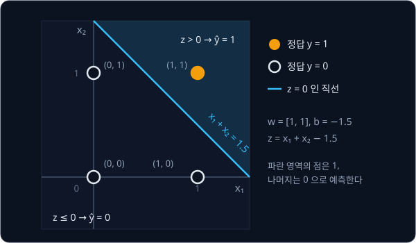

# Perceptron

## 배경

1958년 Rosenblatt 의 perceptron 은 입력에 weight 를 곱해 더한 값이 0 보다 크면 1, 아니면 0 을 내는 단순한 모델인데,
틀릴 때마다 weight 를 조금씩 고치는 학습 규칙이 붙어 있어서 "데이터로 스스로 배우는 기계" 의 첫 사례가 됐다.

### 입력과 진리표

이 과제의 입력은 0 또는 1 인 숫자 두 개 $x = [x_1, x_2]$ 이고, 정답 $y$ 는 두 입력에 AND·OR·XOR 같은 논리 연산을 한
결과다. 가능한 입력 네 개와 정답을 모은 표를 진리표(truth table)라고 하고, 이 네 줄이 학습 데이터 전부다.

| $x_1$ | $x_2$ | AND | OR | XOR |
| --- | --- | --- | --- | --- |
| 0 | 0 | 0 | 0 | 0 |
| 0 | 1 | 0 | 1 | 1 |
| 1 | 0 | 0 | 1 | 1 |
| 1 | 1 | 1 | 1 | 0 |

코드에서는 한 줄을 `(x, y)` tuple 로, 진리표 하나를 그 list 로 적는다. AND 라면
`[([0, 0], 0), ([0, 1], 0), ([1, 0], 0), ([1, 1], 1)]` 이다.

### 예측과 decision boundary

perceptron 은 입력마다 weight $w_i$ 를 곱해 더하고 bias $b$ 를 더한 값 $z = w_1 x_1 + w_2 x_2 + b$ 를 계산해, $z$ 가 0 보다
크면 1, 0 이하면 0 을 예측한다.

$$
\hat y = \mathbb{1}[\,w \cdot x + b > 0\,]
$$


$\hat y$ (y hat) 은 모델의 예측이고 $y$ 는 정답이다. $w \cdot x$ 는 내적 $w_1 x_1 + w_2 x_2$ 이고, $\mathbb{1}[\cdot]$ 은 괄호 안
조건이 참이면 1, 거짓이면 0 인 함수다. 예를 들어 $w = [1, 1]$, $b = -1.5$ 이면 네 입력의 $z$ 는 아래와 같다.

| $x$ | $z = x_1 + x_2 - 1.5$ | $\hat y$ | AND 정답 |
| --- | --- | --- | --- |
| $[0, 0]$ | $-1.5$ | 0 | 0 |
| $[0, 1]$ | $-0.5$ | 0 | 0 |
| $[1, 0]$ | $-0.5$ | 0 | 0 |
| $[1, 1]$ | $0.5$ | 1 | 1 |

네 예측이 모두 AND 의 정답과 같으므로, 이 $w, b$ 는 AND 를 푸는 perceptron 이다. 이 과제에서는 이런 $w, b$ 를 손으로
정하지 않고 데이터에서 찾는다.

$z = 0$ 인 점들, 즉 $w_1 x_1 + w_2 x_2 + b = 0$ 은 $(x_1, x_2)$ 평면 위의 직선이다. 이 직선 한쪽에서는 $z > 0$ 이라 1,
반대쪽에서는 0 을 예측하므로 이 직선을 decision boundary 라고 부른다. 위 예의 직선 $x_1 + x_2 = 1.5$ 는 $(1, 1)$ 만 한쪽에
두고 나머지 세 점을 반대쪽에 둔다.



$w$ 는 직선의 기울기를, $b$ 는 직선의 위치를 정한다. $b = 0$ 이면 원점 $(0, 0)$ 에서 $z = 0$ 이라 직선이 늘 원점을 지나는데,
AND 를 가르는 직선은 원점을 지날 수 없다. $b$ 가 있어야 직선을 원점에서 떼어 옮길 수 있다.

### 학습 규칙

$w = [0, 0]$, $b = 0$ 에서 시작해 진리표의 줄(sample)을 하나씩 보며, 예측이 틀린 sample 에서만 weight 를 고친다.

$$
w_i \leftarrow w_i + \eta\,(y - \hat y)\,x_i, \qquad b \leftarrow b + \eta\,(y - \hat y)
$$

$\eta$ (eta) 는 learning rate 로, 한 번에 얼마나 고칠지 정하는 작은 양수다. $y$ 와 $\hat y$ 가 모두 0 또는 1 이라
$y - \hat y$ 는 세 값만 나온다.

| 경우 | $y - \hat y$ | weight 의 변화 |
| --- | --- | --- |
| 맞힘 | 0 | 바뀌지 않는다 |
| 정답 1 을 0 으로 예측 | +1 | $w$ 에 $\eta x$ 를, $b$ 에 $\eta$ 를 더한다 |
| 정답 0 을 1 로 예측 | −1 | $w$ 에서 $\eta x$ 를, $b$ 에서 $\eta$ 를 뺀다 |

두 번째 경우에 고친 뒤 같은 입력의 $z$ 를 다시 계산하면 $\eta(x_1^2 + x_2^2 + 1)$ 만큼 커져 있다. 1 이어야 할 입력의
$z$ 는 키우고 0 이어야 할 입력의 $z$ 는 줄이는 쪽으로 직선을 조금씩 옮기는 셈이다.

### epoch 와 수렴

진리표 네 줄을 처음부터 끝까지 한 번 도는 것이 epoch 하나다. 한 epoch 동안 하나도 틀리지 않았다면 더 고칠 것이 없으므로
학습을 멈추는데, 이것을 수렴(converge)했다고 한다. 수렴하지 않는 데이터도 있어서 epoch 수에 상한(`max_epochs`)을 둔다.

### linearly separable 과 XOR

0 인 점과 1 인 점을 직선 하나로 가를 수 있는 데이터를 linearly separable 하다고 한다. AND·OR 는 그런 직선이 있고, 이때
perceptron 학습 규칙은 유한 번 안에 반드시 수렴한다는 것이 1962년 Novikoff 의 증명이다. XOR 는 $(0, 1)$·$(1, 0)$ 이 1 이고
$(0, 0)$·$(1, 1)$ 이 0 인데, 이 네 점은 직선 하나로 가를 수 없다. 1969년 Minsky 와 Papert 가 perceptron 은 이런 문제를
영영 풀지 못한다는 것을 보이면서 neural network 연구는 한동안 멈췄다. 이번 과제에서는 그 수렴과 실패를 둘 다 직접 확인한다.

## 목표

- perceptron 학습 규칙으로 AND·OR 를 학습시킨다
- 같은 코드로 XOR 를 학습시키면 끝까지 수렴하지 않는 것을 확인한다
- 학습된 decision boundary 를 네 점과 함께 2D 평면에 그린다

**직접 짤 것**: 예측, 학습 규칙, epoch 반복 전부. numpy 도 쓰지 않고 list 와 for 문만으로 짠다.
**가져다 써도 되는 것**: 그림을 그리는 matplotlib.

## 준비물

- Python 3.12, pytest, matplotlib
- GPU 불필요

## 진행 순서

1. `perceptron.py` 의 `predict` 를 채운다. `uv run pytest tests -x` 가 `test_train_epoch_...` 에서 멈추면 `predict` 는
   끝난 것이다
2. `train_epoch` 를 채운다. sample 을 순서대로 돌며 틀린 sample 에서 바로 weight 를 고치고, 다음 sample 은 고친 weight 로
   예측한다
3. `train` 을 채운다. 여기까지 하면 `uv run pytest tests` 가 모두 통과한다
4. `plot.py` 의 `main` 에 AND·OR·XOR 의 진리표를 적고, 셋 다 `train(data, lr=0.1, max_epochs=10_000)` 으로 학습시켜 몇
   epoch 에 수렴했는지 출력한다. AND 는 6 epoch, OR 는 4 epoch 에 수렴하고 XOR 는 수렴하지 않으면 맞다
5. 같은 `main` 에서 세 연산의 학습된 직선 $w_1 x_1 + w_2 x_2 + b = 0$ 을 네 점과 함께 나란히 그려
   `results/decision_boundary.png` 로 저장하고 커밋한다

## 시작점

아래 파일은 모두 리포에 들어 있다.

```text
perceptron/
├── pyproject.toml       # 이 과제의 Python 버전과 패키지
├── uv.lock
├── perceptron.py        # predict, train_epoch, train 의 stub
├── plot.py              # 세 진리표 학습, 수렴 epoch 출력, decision boundary 그림
└── tests/               # 채점용 test. 고치지 않는다
    ├── conftest.py
    └── test_perceptron.py
```

[perceptron.py](perceptron.py) 의 함수는 몸통이 `raise NotImplementedError` 인 stub 이고, docstring 에 수식과 변수의
대응, 손으로 따라 할 수 있는 숫자 예시가 있다. 함수 하나를 채울 때마다 test 를 돌리면 `-x` 가 처음 실패한 test 에서
멈추고 그 test 가 부른 함수를 보여 준다. `plot.py` 는 `perceptron.py` 와 같은 폴더에 있어서 `from perceptron import train`
으로 불러 쓸 수 있다.

패키지는 `pyproject.toml` 에 있고, 이 폴더에서 `uv run` 을 처음 실행할 때 `.venv/` 에 설치된다.

```bash
cd projects/perceptron
uv run pytest tests -x     # 1~3단계
uv run python plot.py      # 4~5단계
```

## 평가 기준

- [ ] `uv run pytest tests` 가 모두 통과한다. AND·OR 가 100 epoch 안에 수렴해 네 점을 모두 맞히는 것과 XOR 가
  `max_epochs` 10,000 에서도 수렴하지 않는 것을 이 test 가 확인한다
- [ ] `results/decision_boundary.png` 에서 AND·OR 의 직선은 두 class 를 가르고, XOR 에는 그런 직선이 없다는 것이 눈으로
  보인다
- [ ] (선택) 학습 순서를 섞어도 AND·OR 가 수렴하는지 확인하는 pytest 를 `tests/` 밖의 test 파일(예: `test_shuffle.py`)에 쓴다

## 생각해 볼 질문

1. XOR 를 직선 하나로 나눌 수 없다는 것을 종이에 그림으로 설명할 수 있는가?
2. learning rate 를 10배 키우면 수렴 epoch 수가 어떻게 되는가? 그 이유는?
3. perceptron 을 두 층으로 쌓으면 XOR 를 표현할 수 있다. 그런데 왜 1969년에는 그걸로 해결되지 않았는가?

## 힌트

<details>
<summary>train_epoch 에서 자주 틀리는 곳</summary>

- 틀린 수는 weight 를 고치기 전의 $\hat y$ 로 센다. 고친 뒤에 다시 예측해서 세면 같은 sample 을 맞힌 것으로 셀 수 있다
- weight 는 epoch 이 끝난 뒤 한꺼번에 고치지 않고 sample 마다 바로 고친다. 그래서 같은 epoch 안에서도 뒤의 sample 은
  앞에서 고친 weight 로 예측한다

</details>

<details>
<summary>decision boundary 직선 그리기</summary>

$w_2 \ne 0$ 이면 직선을 $x_2 = -(w_1 x_1 + b) / w_2$ 로 바꿔 쓸 수 있다. $x_1$ 을 −0.5 부터 1.5 까지 몇 개 잡아 $x_2$ 를
계산하고 `plt.plot` 으로 이으면 된다. $w_2 = 0$ 이면 직선이 $x_1 = -b / w_1$ 인 세로선이라 `plt.axvline` 을 쓰는데,
XOR 를 학습시키고 나면 실제로 $w_2 = 0$ 이 나온다. $w_1 = w_2 = 0$ 이면 그릴 직선이 없다.

점은 정답이 0 인 것과 1 인 것을 다른 색으로 `plt.scatter` 하고, 축 범위를 −0.5 ~ 1.5 로 고정하면 네 점과 직선이 모두
보인다. 세 그래프를 나란히 그리려면 `fig, axes = plt.subplots(1, 3)` 을 쓰고, `fig.savefig(...)` 로 저장한다.
`results/` 폴더가 없으면 먼저 만든다.

</details>

<details>
<summary>XOR 를 두 층으로 표현하는 weight</summary>

XOR = (x1 OR x2) AND NOT (x1 AND x2) 다. 첫 층에 OR 와 NAND 를 두고 둘째 층에서 AND 를 하면 된다.
다만 이 weight 는 손으로 정해야 하는데, 여러 층을 데이터로 학습시키는 방법은 다음 과제에서 다룬다.

</details>

## 참고 자료

- Frank Rosenblatt, [The Perceptron: A Probabilistic Model for Information Storage and Organization in the Brain](https://doi.org/10.1037/h0042519) (1958) —
  원문은 길고 생물학 용어가 많아서 학습 규칙만 찾아 읽어도 충분하다
- A. B. J. Novikoff, [On Convergence Proofs for Perceptrons](https://cs.uwaterloo.ca/~y328yu/classics/novikoff.pdf) (1962) —
  linearly separable 데이터에서 유한 번 안에 수렴한다는 증명. 두 쪽 남짓이다
- Cornell CS4780, [The Perceptron](https://www.cs.cornell.edu/courses/cs4780/2018fa/lectures/lecturenote03.html) — 학습 규칙이
  왜 직선을 옳은 쪽으로 옮기는지와 수렴 증명을 그림과 함께 풀어 쓴 강의 노트
- Michael Nielsen, [Neural Networks and Deep Learning — Chapter 1](http://neuralnetworksanddeeplearning.com/chap1.html) —
  perceptron 으로 NAND 를 만드는 예부터 sigmoid neuron 으로 넘어가는 이유까지
- 3Blue1Brown, [But what is a neural network?](https://www.youtube.com/watch?v=aircAruvnKk) — weight·bias 가 하는 일을 그림으로
  보여 주는 20분 영상
- [Wikipedia — Perceptron](https://en.wikipedia.org/wiki/Perceptron) — 역사, 학습 규칙, 수렴 정리 요약

## 남은 한계

층을 쌓으면 XOR 를 표현할 수 있지만 여러 층의 weight 를 한꺼번에 학습시킬 방법이 없었다.
그 방법이 [Backpropagation](../autograd/README.md) 이다.
