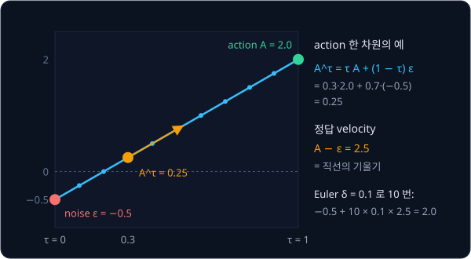
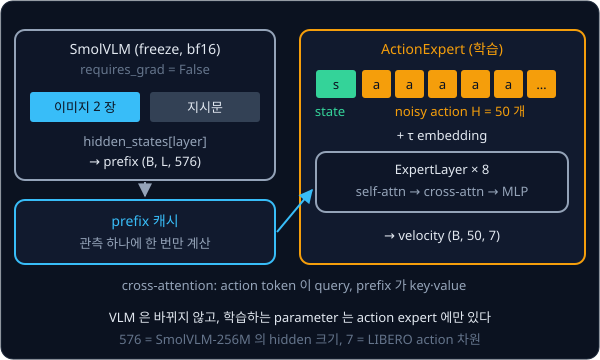
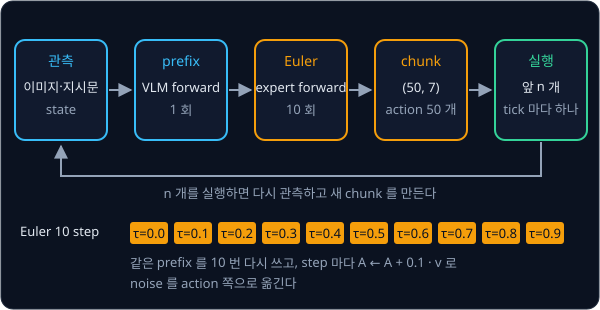

# π0

## 배경

[RT-2 → OpenVLA](../vla-tokens/README.md) 과제의 VLA 는 action 하나를 얻으려고 token 7 개를 차례로 생성했고, 256 bin 해상도
때문에 정밀한 고주파 제어가 어려웠다. Physical Intelligence 의 π0(2024) 는 VLM 이 action 을 token 으로 직접 출력하게 하지
않고, 별도의 action expert 가 앞으로 $H = 50$ step 의 연속 action chunk 를 [Flow Matching](../flow-matching/README.md) 으로 한
번에 생성하게 했다. 이 구조로 최대 50 Hz 제어까지 해냈다. 이 과제에서는 VLM 을 freeze 한 채 prefix feature 만 뽑고, 그 위에 내
action expert 를 붙여 flow matching 으로 학습한 뒤 같은 데이터로 fine-tune 한 SmolVLA 와 LIBERO 성공률을 비교한다.

### action chunk

action chunk 는 지금부터 앞으로 $H$ step 동안 보낼 action 을 한꺼번에 묶은 것이다. [ACT](../act/README.md) 과제에서 chunk 를
transformer decoder 로 한 번에 냈다면, π0 는 같은 chunk 를 noise 에서 출발해 조금씩 다듬어 만든다. LIBERO 의 action 은 7 차원
(end-effector 변위 6 + gripper 1)이라 $H = 50$ 이면 chunk $A_t$ 는 shape $(50, 7)$ 인 tensor 이고, batch 로 묶으면
$(B, 50, 7)$ 이다. 첨자 $t$ 는 chunk 를 만든 시점의 로봇 시간이다.

### flow matching 복습

flow matching 은 noise 와 데이터를 직선으로 잇고, 그 직선 위의 아무 점에서나 "데이터 쪽으로 가는 속도" 를 맞히도록 network 를
학습하는 생성 방법이다. π0 의 식은 아래와 같다.

$$
A^\tau_t = \tau A_t + (1-\tau)\,\epsilon, \qquad
\mathcal{L} = \mathbb{E}_{\tau,\,\epsilon}\Big[\big\lVert v_\theta(A^\tau_t, \tau, o_t) - (A_t - \epsilon) \big\rVert^2\Big], \qquad
A^{\tau+\delta}_t = A^\tau_t + \delta\, v_\theta(A^\tau_t, \tau, o_t)
$$

$\epsilon$ 은 $A_t$ 와 같은 shape 의 표준 정규분포 noise, $\tau \in [0, 1]$ 은 flow time 이다. $\tau = 0$ 이면 $A^\tau_t$ 가
순수 noise 이고, $\tau = 1$ 이면 시연의 action chunk 그대로다. $o_t$ 는 이미지·지시문·state 로 된 관측이고, $v_\theta$ 는 action
expert 가 낸 velocity 다. 직선 $A^\tau_t$ 를 $\tau$ 로 미분하면 $A_t - \epsilon$ 이므로, 이 값이 velocity 의 정답이다.

action 한 차원만 떼어 보면, 시연 값이 $A = 2.0$ 이고 뽑은 noise 가 $\epsilon = -0.5$ 일 때 $\tau = 0.3$ 의 점은
$0.3 \times 2.0 + 0.7 \times (-0.5) = 0.25$ 이고 정답 velocity 는 $2.0 - (-0.5) = 2.5$ 다.



추론 때는 $A^0_t \sim \mathcal{N}(0, I)$ 에서 출발해 $\delta = 0.1$ 로 Euler 적분을 10 번 한다. Euler 적분은 현재 점의 velocity 로
$\delta$ 만큼 직선으로 나아가기를 되풀이하는 가장 단순한 적분법이다. 위의 예처럼 velocity 를 정확히 맞히면
$-0.5 + 10 \times 0.1 \times 2.5 = 2.0$ 으로 시연 값에 도착한다.

학습 때 $\tau$ 는 $[0, 1]$ 에서 고르게 뽑지 않고, noise 쪽 값을 더 자주 뽑는 beta 분포에서 sampling 한다.

### π0 의 VLM 과 action expert

π0 는 같은 Transformer 층 안에서 이미지·지시문 token 은 PaliGemma(3B) 의 weight 로, state·action token 은 약 300M 짜리 action
expert weight 로 처리하되 attention 은 함께 계산한다. attention mask 는 [이미지·지시문], [state], [noisy action] 세 block 의
blockwise causal 구조라서 앞 block 은 뒤 block 을 보지 않는다. 그래서 관측 prefix 의 key·value 를 한 번만 계산해
캐시(KV cache)하고, 10 번의 적분 step 에서는 action expert 쪽만 다시 돌리면 된다.

### 이 과제의 구조

이 과제에서는 π0 의 구조를 더 단순하게 줄인다. SmolVLM 을 통째로 freeze 하고, 이미지·지시문을 넣었을 때 고른 층의
hidden state 를 prefix 로 쓴다. SmolVLM-256M 의 hidden 크기가 576 이므로 prefix 는 $(B, L, 576)$ 이다. $L$ 은 image token 과
지시문 token 수의 합인데, SmolVLM 은 512×512 이미지 한 장을 patch 1,024 개로 나눈 뒤 이웃 patch 16 개를 하나로 합쳐 image
token 64 개로 만든다. `prefix_pad_mask` 는 batch 안에서 지시문 길이가 달라 생긴 padding 자리를 표시한다.



action expert 의 입력은 state token 1 개와 noisy action token $H$ 개다. 각 token 에 flow time $\tau$ 를 나타내는 embedding 을
더하는데, [DDPM](../ddpm/README.md) 의 timestep embedding 처럼 sinusoidal 함수로 만든 vector 를 쓴다. 층마다 두 가지 attention
을 거친다.

| attention | query | key·value | 하는 일 |
| --- | --- | --- | --- |
| self-attention | state·action token | state·action token | chunk 안의 step 끼리 서로 맞춘다 |
| cross-attention | state·action token | prefix | 이미지·지시문에서 필요한 정보를 가져온다 |

[Transformer](../transformer/README.md) 과제의 encoder-decoder attention 과 같은 방식이다. prefix 는 576 차원이고 expert 는
`d_model` 432 차원이라, `ActionExpert` 가 첫 층에 들어가기 전에 linear layer 하나로 prefix 를 576 에서 432 로 한 번 투영하고
모든 층의 cross-attention 이 그 결과를 key·value 로 쓴다. 마지막 층의 action token 출력을 linear layer 로 7 차원에 보내면
velocity $(B, 50, 7)$ 이 된다.

### chunk 실행과 추론 시간

prefix 는 관측 하나에 한 번만 계산하고, 그 prefix 를 10 번의 Euler step 에서 다시 쓴다. 생성한 chunk 50 개 가운데 앞의 몇 개만
실행한 뒤 다시 관측해 새 chunk 를 만들면, 오래된 예측을 끝까지 따라가다 생기는 오차를 줄일 수 있다.



### FAST 와 SmolVLA

2025년의 FAST 는 autoregressive token 방식을 유지하되 action chunk 를 차원별 DCT 로 주파수 공간에 옮기고 양자화한 계수열을
BPE 로 압축해, 차원·step 마다 bin 하나씩 쓰던 방식보다 훨씬 적은 token 으로 고주파 chunk 를 표현했다. DCT(discrete cosine
transform)는 길이 $N$ 의 수열을 주파수가 다른 cosine $N$ 개의 합으로 다시 쓰는 변환이다. 부드럽게 변하는 궤적은 낮은 주파수
계수 몇 개에 값이 몰린다. 예를 들어 0 에서 0.7 까지 고르게 늘어나는 8 step 궤적의 DCT 계수에 10 을 곱해 반올림하면
$[10, -6, 0, -1, 0, 0, 0, 0]$ 이 되고, 이렇게 0 이 많은 수열은 [BPE Tokenizer](../tokenizer/README.md) 의 BPE 로 짧게 압축된다.

같은 해의 SmolVLA 는 π0 의 구조를 SmolVLM2-500M 위에 작게 옮겨 약 450M parameter 로 만들었다. VLM 은 32 층 가운데 앞쪽 16 층만
쓰고, action expert 는 VLM 출력을 cross-attention 으로 보는 층과 self-attention 층을 번갈아 쌓았다. 이 과제의 비교 대상이다.

## 목표

- freeze 한 SmolVLM 으로 이미지·지시문 prefix feature 를 뽑고 캐시한다
- state token, noisy action token $H$ 개, $\tau$ embedding 을 받아 velocity 를 내는 action expert 를 만든다
- flow matching loss 로 action expert 만 학습하고, prefix 한 번 + Euler 10 step 으로 chunk 를 생성한다
- RT-2 → OpenVLA 과제와 같은 LIBERO suite 에서 성공률과 chunk 당 추론 시간을 잰다
- 같은 데이터로 fine-tune 한 SmolVLA 및 vla-tokens 모델과 비교한다

**직접 짤 것**: action expert(self-attention + prefix cross-attention), $\tau$ embedding, flow matching loss 와 $\tau$ sampling,
Euler sampler, chunk 실행 루프.
**가져다 써도 되는 것**: transformers 의 SmolVLM(freeze), [Flow Matching](../flow-matching/README.md) 과제의 코드,
[RT-2 → OpenVLA](../vla-tokens/README.md) 의 데이터 파이프라인과 LIBERO eval 루프, [ACT](../act/README.md) 의 chunk 실행
코드, 비교용 LeRobot SmolVLA(`lerobot-train --policy.type=smolvla`).

## 준비물

- Python 3.12, numpy, torch, torchvision, transformers, Pillow, matplotlib, pytest
- `lerobot[libero,smolvla]` — LeRobot 의 LIBERO env·`LeRobotDataset` 과 비교용 SmolVLA. LIBERO simulator(`hf-libero`)는
  Linux 에서만 설치되고, 화면 없는 서버에서는 `MUJOCO_GL=egl`
- (선택) FAST 식 tokenizer 에 쓰는 `scipy`(DCT)와 `regex`
- dataset: `lerobot/libero` 에서 RT-2 → OpenVLA 과제와 같은 suite 의 episode
- VLM: `HuggingFaceTB/SmolVLM-256M-Instruct`, 또는 SmolVLA 와 같은 `HuggingFaceTB/SmolVLM2-500M-Video-Instruct`
- 내 모델은 VLM 을 bf16 으로 freeze 하고 action expert 만 학습하므로 8 GB GPU 로 충분하다. SmolVLA fine-tune 은 LeRobot
  hardware guide 기준 batch 8 에서 10–16 GB 라서, 8 GB GPU 에서는 batch 를 줄이고 그래도 부족하면 24 GB 급 cloud GPU 를 빌린다

## 진행 순서

1. vla-tokens 과제의 `libero_data.py` 를 바탕으로, action token 대신 길이 $H$ 의 연속 action chunk $(H, 7)$ 와 state 를 내는
   데이터 파이프라인을 `train.py` 에 만든다. episode 끝을 넘는 chunk 는 마지막 action 으로 채우고, 채운 자리를 mask 로 표시해
   `flow_matching_loss` 의 `action_pad_mask` 로 넘긴다
2. `prefix.py` 의 `FrozenPrefix` 를 채운다. `test_flow.py` 에 VLM 의 모든 parameter 가 `requires_grad=False` 인지 보는 test 를
   쓰고, prefix 의 shape 이 $(B, L, 576)$ 인지 확인한다
3. `action_expert.py` 의 `ExpertLayer`·`ActionExpert` 를 채운다. 무작위 입력을 넣어 velocity 의 shape 이
   `noisy_actions` 와 같은지 확인한다
4. `flow.py` 의 `sample_tau`·`flow_matching_loss` 를 채운다. 학습 batch 하나에 overfit 시켜 loss 가 0 근처로 떨어지는지
   `test_flow.py` 에서 확인한 뒤, `train.py` 로 action expert 만 학습한다. 학습 전후 VLM weight 의 차이가 0 인지도 본다
5. `flow.py` 의 `euler_sample` 과 `pi0.py` 의 `Pi0Lite` 로 prefix 를 한 번 계산하고 Euler 10 step 으로 chunk 를 생성한다.
   overfit 한 batch 의 관측에서 생성한 chunk 가 시연 chunk 와 거의 겹치는지 그림으로 확인한다
6. `eval_pi0.py` 에서 vla-tokens 과제의 `evaluate_suite` 에 `policy_fn` 과 `reset_fn` 을 넘긴다. `policy_fn` 은 LIBERO 관측
   dict 에서 이미지 목록과 state 를 꺼내 `Pi0Lite.select_action` 을 부르고 결과를 numpy 로 바꾸는 함수이고, `reset_fn` 은
   `Pi0Lite.reset` 이다. `Pi0Lite` 가 chunk 의 앞 `n_action_steps` 개만 실행하고 다시 추론하는 루프로 LIBERO suite 의 10 task ×
   10 episode 성공률과 chunk 당 추론 시간을 잰다. `n_action_steps` 는 horizon 50 보다 작게 두고, 고른 값을 결과 표에 함께 적는다
7. 같은 episode 로 `uv run lerobot-train --policy.type=smolvla` 를 학습하고 `uv run lerobot-eval` 로 같은 suite 를 평가한다
8. 내 모델·SmolVLA·vla-tokens 모델의 성공률과 action 하나당 추론 시간, Euler step 10·3·1 의 성공률을 표로 `results/` 에
   정리한다

## 시작점

아래 파일은 모두 리포에 들어 있다.

```text
pi0/
├── pyproject.toml     # 이 과제의 Python 버전과 패키지
├── uv.lock
├── prefix.py          # FrozenPrefix: freeze 한 SmolVLM → prefix feature (+ 캐시)
├── action_expert.py   # ExpertLayer (self-attn + prefix cross-attn), ActionExpert
├── flow.py            # sample_tau, flow_matching_loss, euler_sample
├── pi0.py             # Pi0Lite: prefix + expert, 실행용 chunk queue
├── train.py           # action expert 학습
├── eval_pi0.py        # LIBERO 성공률과 chunk 당 추론 시간
└── test_flow.py       # VLM freeze, overfit loss 를 보는 test
```

[prefix.py](prefix.py)·[action_expert.py](action_expert.py)·[flow.py](flow.py)·[pi0.py](pi0.py) 의 함수는 몸통이
`raise NotImplementedError` 인 stub 이고, 이름과 signature 는 그대로 둔 채 몸통을 채운다. 채점용 test 는 없어서 평가 기준은
[test_flow.py](test_flow.py) 에 직접 쓴 test 와 `results/` 에 남긴 성공률·추론 시간 표로 확인한다. 데이터 파이프라인은
vla-tokens 과제의 `libero_data.py` 를 바탕으로 `train.py` 에 짠다. [eval_pi0.py](eval_pi0.py) 는 첫머리에서 vla-tokens 과제
폴더를 `sys.path` 에 더해 LIBERO 평가 루프 `evaluate_suite` 를 import 한다. 패키지는 `pyproject.toml` 에 있고, 이
폴더에서 `uv run` 을 처음 실행할 때 `.venv/` 에 설치된다. LIBERO 평가는 Linux 에서만 돈다.

```bash
cd projects/pi0
uv run pytest
uv run python train.py
MUJOCO_GL=egl uv run python eval_pi0.py   # Linux, 화면 없는 서버
```

## 평가 기준

- [ ] VLM 의 모든 parameter 가 `requires_grad=False` 이고, 학습 전후 VLM weight 의 차이가 정확히 0 이다
- [ ] 학습 데이터 batch 하나에 overfit 시키면 loss 가 0 근처로 떨어지고, 같은 관측에서 생성한 chunk 가 시연 chunk 와 거의 겹친다
- [ ] 같은 LIBERO suite 에서 내 모델의 평균 성공률이 같은 데이터로 fine-tune 한 SmolVLA 의 70% 이상이다
- [ ] 같은 GPU 에서 chunk 하나 생성 시간(prefix 1 회 + Euler 10 step)과 vla-tokens 모델의 action 하나 decode 시간을 재서 action 하나당 시간으로 비교한다
- [ ] Euler step 을 10 → 3 → 1 로 줄였을 때 성공률 변화를 기록한다
- [ ] (선택) LIBERO action chunk 에 DCT + 양자화 + [BPE Tokenizer](../tokenizer/README.md) 과제의 BPE 를 적용한 FAST 식 tokenizer 를 만들어, chunk 하나의 token 수를 256-bin 방식($H \times 7$ 개)과 비교한다

## 생각해 볼 질문

1. action expert 를 VLM 과 다른 weight 로 두는 이유는? VLM 의 weight 로 action token 까지 처리하면 무엇이 문제인가?
2. vla-tokens 모델은 action 하나에 forward 7 번이 필요했다. 이 모델은 action $H$ 개를 얻는 데 forward 가 몇 번 필요하고,
   그 차이는 어디서 오는가?
3. FAST 는 autoregressive token 방식을 유지하면서 고주파 제어 문제를 풀었다. flow matching action expert 와 비교했을 때
   각 방식이 유리한 상황은?

## 힌트

<details>
<summary>시간 규약과 부호</summary>

π0 논문은 $\tau = 0$ 을 noise 로 두고 0 에서 1 로 적분하지만, openpi 코드는 diffusion 문헌의 관례대로 $t = 1$ 을 noise 로
두고 1 에서 0 으로 적분한다. 다른 구현을 참고할 때는 noise 를 섞는 식과 velocity target 의 부호부터 확인하고, 내 코드 안에서는
한 가지 규약만 쓴다.

</details>

<details>
<summary>prefix 로 쓸 VLM 층</summary>

마지막 층 hidden state 는 다음 text token 예측에 맞춰져 있어서 action 에 필요한 공간 정보가 덜 남아 있을 수 있다.
SmolVLA 는 VLM 의 앞 16 층까지만 쓰고(`num_vlm_layers=16`) 나머지는 버린다. `layer` 를 바꿔 가며 성공률을 비교해
볼 만하다.

</details>

<details>
<summary>SmolVLA 와 조건을 맞추는 법</summary>

LeRobot LIBERO 문서의 SmolVLA 학습 예시는 `--policy.type=smolvla --policy.load_vlm_weights=true` 로 사전학습 VLM 만 불러와
action expert 를 새로 학습하고, SmolVLA 의 기본 설정은 vision encoder 를 freeze 하고 action expert 만 학습한다. 내 모델과
조건이 비슷하므로 같은 episode 목록을 `--dataset.episodes` 로 넘기고 `--steps` 를 같게 둔다. LeRobot 의 SmolVLA 설정은
`n_action_steps` 기본값이 `chunk_size` 와 같은 50 이라 chunk 를 끝까지 실행하므로, 평가할 때 `--policy.n_action_steps` 로 내
모델과 같은 값을 넘긴다.

</details>

## 참고 자료

- K. Black 외, [π0: A Vision-Language-Action Flow Model for General Robot Control](https://arxiv.org/abs/2410.24164) — IV 장이
  VLM 과 action expert, flow matching 학습식이고, 부록 B 에 attention mask 와 $\tau$ 분포, 부록 D 에 KV cache 를 쓴 추론이 있다.
  Physical Intelligence 의 [π0 blog](https://www.pi.website/blog/pi0) 에 실물 영상이 있다
- Y. Lipman 외, [Flow Matching for Generative Modeling](https://arxiv.org/abs/2210.02747) 과
  [Flow Matching Guide and Code](https://arxiv.org/abs/2412.06264) — flow matching 의 원 논문과, 식을 코드와 함께 처음부터
  설명하는 해설
- K. Pertsch 외, [FAST: Efficient Action Tokenization for Vision-Language-Action Models](https://arxiv.org/abs/2501.09747) — DCT·
  양자화·BPE 로 chunk 를 압축하는 방법. [FAST research page](https://www.pi.website/research/fast)
- M. Shukor 외, [SmolVLA: A Vision-Language-Action Model for Affordable and Efficient Robotics](https://arxiv.org/abs/2506.01844) —
  비교 대상인 SmolVLA 의 구조와 학습 설정. Hugging Face blog [SmolVLA](https://huggingface.co/blog/smolvla)
- Hugging Face blog, [π0 and π0-FAST](https://huggingface.co/blog/pi0) — 두 모델을 LeRobot 에서 쓰는 법
- LeRobot [SmolVLA 문서](https://huggingface.co/docs/lerobot/smolvla)·[π₀ 문서](https://huggingface.co/docs/lerobot/pi0)·
  [π₀-FAST 문서](https://huggingface.co/docs/lerobot/pi0fast)·[LIBERO 문서](https://huggingface.co/docs/lerobot/libero) — 학습·평가
  명령과 설정값
- Hugging Face blog, [KV Cache from scratch in nanoVLM](https://huggingface.co/blog/kv-cache) — prefix 의 key·value 를 캐시해
  다시 쓰는 원리
- openpi 의 [`pi0.py`](https://github.com/Physical-Intelligence/openpi/blob/main/src/openpi/models/pi0.py) 와 LeRobot 의
  [`smolvlm_with_expert.py`](https://github.com/huggingface/lerobot/blob/main/src/lerobot/policies/smolvla/smolvlm_with_expert.py)
  — 공식 구현이라 막혔을 때만 연다

## 남은 한계

여기서 만든 policy 는 시연을 따라 하는 것만 배워서 시연보다 잘할 수 없고, 시연에 없던 실패에서 스스로 회복하는 법도 모른다.
실제 시도에서 얻은 reward 로 이 policy 를 더 다듬는 방법은 [VLA + RL](../vla-rl/README.md) 에서 다룬다.
