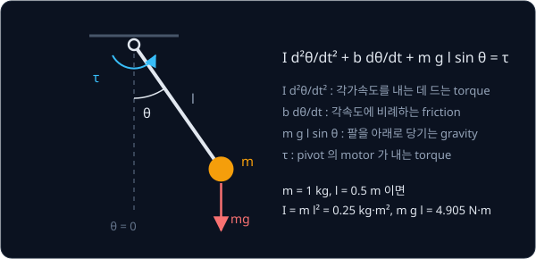
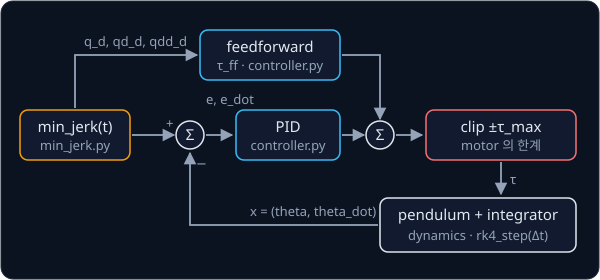

# PID Control

## 배경

[NumPy Warm-up](../warmup/README.md) 의 gradient descent 에는 시간 개념이 없었다. 로봇의 joint 는 torque 를 받아도 위치가 바로
바뀌지 않고 먼저 가속도가 생기며, 이 가속도가 쌓여 속도와 위치가 바뀐다. 이번 과제에서는 가장 단순한 예인 1-DOF pendulum 을
직접 적분하는 simulator 와, 그 pendulum 이 목표 각도를 따라가게 하는 controller 를 짠다.

### pendulum 의 equation of motion

pendulum 은 pivot 에 매달린 막대 끝에 질량 $m$ 이 달린 팔이다. 각도 $\theta$ 는 아래로 늘어진 자세를 0 으로 잰 값이고, pivot
의 motor 가 torque $\tau$ 를 낸다. Newton 의 법칙을 회전에 쓰면 equation of motion(EOM)은 다음과 같다.

$$
m l^2\,\ddot\theta + b\,\dot\theta + m g l \sin\theta = \tau
$$

$\dot\theta$ 는 각속도(rad/s), $\ddot\theta$ 는 각가속도(rad/s²)다. 첫째 항의 $I = m l^2$ 은 moment of inertia 로, 같은
각가속도를 내는 데 드는 torque 가 질량과 길이의 제곱에 비례한다는 뜻이다. 둘째 항은 속도에 비례하는 viscous friction 이고
$b$ 가 그 계수다. 셋째 항은 gravity 가 팔을 아래로 당기는 torque 로, 팔이 수평($\theta = 90°$)일 때 가장 크다.



stub 의 기본값 $m = 1$ kg, $l = 0.5$ m, $b = 0.1$ 을 넣으면 $I = 0.25$ kg·m², $m g l = 4.905$ N·m 다. 팔을 수평으로 멈춰 두려면
$\ddot\theta = \dot\theta = 0$ 이므로 $\tau = m g l \sin 90° = 4.905$ N·m 가 필요하다. 반대로 torque 없이 60° 에서 놓으면 그 순간의
각가속도는 $\ddot\theta = -m g l \sin 60° / I \approx -16.99$ rad/s² 다.

### numerical integration

EOM 은 상태 $x = (\theta, \dot\theta)$ 의 변화율을 알려 준다. $\dot x = f(x, \tau) = \big(\dot\theta,\ (\tau - b\dot\theta - m g l \sin\theta)/I\big)$
인데, 이 변화율로 작은 시간 간격 $\Delta t$ 뒤의 상태를 차례로 계산하는 것이 numerical integration 이다.

| 방법 | 한 step 의 계산 |
| --- | --- |
| explicit Euler | $\theta_{k+1} = \theta_k + \Delta t\,\dot\theta_k$, $\ \dot\theta_{k+1} = \dot\theta_k + \Delta t\,\ddot\theta_k$ |
| semi-implicit Euler | 속도를 먼저 $\dot\theta_{k+1} = \dot\theta_k + \Delta t\,\ddot\theta_k$ 로 고치고, 그 새 속도로 $\theta_{k+1} = \theta_k + \Delta t\,\dot\theta_{k+1}$ |
| RK4 | step 안의 네 지점에서 기울기 $f$ 를 계산해 가중 평균한 기울기로 한 번에 진행 |

60° 에서 정지 상태로 놓고 $\Delta t = 1$ ms 로 한 step 을 가면, 두 Euler 모두 $\dot\theta_1 = -0.01699$ rad/s 가 된다. 각도는 explicit
Euler 에서는 이전 속도 0 을 써서 그대로 60° 이고, semi-implicit Euler 에서는 새 속도를 써서 $1.7 \times 10^{-5}$ rad 줄어든다.
한 step 에서는 이만큼 작은 차이지만, 수천 step 이 쌓이면 결과가 크게 갈린다.

적분이 정확한지는 energy 로 확인한다. friction 과 torque 가 없으면($b = 0$, $\tau = 0$) 운동 energy 와 위치 energy 의 합
$E = \tfrac12 I \dot\theta^2 + m g l (1 - \cos\theta)$ 가 시간이 지나도 변하지 않아야 하는데, 60° 에서 놓은 pendulum 은
$E = 4.905 \times 0.5 = 2.4525$ J 이다. 적분 방법에 따라 이 값이 저절로 늘거나 줄어드는 오차가 생긴다.

### PID 와 steady-state error

목표 각도 $\theta_d$ 와 지금 각도의 차이 $e = \theta_d - \theta$ 로 torque 를 정하는 가장 흔한 controller 가 PID 다.

$$
\tau = K_p e + K_i \!\int_0^t\! e\,dt' + K_d\,\dot e + \tau_{ff}
$$

P 항은 오차에 비례해 목표 쪽으로 밀고, D 항은 오차가 줄어드는 속도에 맞서 overshoot 를 누르며, I 항은 오차가 남아 있는 동안
계속 쌓여 torque 를 키운다. $\tau_{ff}$ 는 아래의 feedforward 다.

PD 만으로 팔을 90° 에 멈추려 하면, 멈춘 상태에서는 $\dot e = 0$ 이라 P 항 혼자 gravity 를 버텨야 한다. 그래서
$K_p e = m g l \sin(\theta_d - e)$ 를 만족하는 오차 $e$ 가 남는데, 이것이 steady-state error 다. $K_p = 50$ N·m/rad 이면
$e \approx 0.098$ rad(약 5.6°)이고, $K_p$ 를 키우면 줄지만 0 이 되지는 않는다. I 항은 오차가 남아 있는 한 계속 쌓이므로 이
오차를 없앤다.

motor 의 torque 에는 한계 $\tau_{\max}$ 가 있어서, feedforward 까지 더한 torque 를 $[-\tau_{\max}, \tau_{\max}]$ 로 자른다(clip). torque 가 한계에
걸려 있는 동안에도 I 항이 계속 쌓이는 현상을 integral windup 이라 하고, 이를 막는 처리가 anti-windup 이다.

### feedforward

feedback 은 오차가 생긴 뒤에야 반응한다. model 을 알고 있으면 목표 trajectory 를 따라가는 데 필요한 torque 를 EOM 에 목표값을
넣어 미리 계산할 수 있고, 이것이 feedforward 다.

$$
\tau_{ff} = m l^2\,\ddot\theta_d + b\,\dot\theta_d + m g l \sin\theta_d
$$

gravity 항 $m g l \sin\theta_d$ 만 쓰는 gravity feedforward 와 세 항을 다 쓰는 full feedforward 가 있고, feedforward 를 더하면
feedback 은 model 이 틀린 만큼만 고치면 된다.

### minimum-jerk trajectory

목표 각도를 계단처럼 한 번에 바꾸는 대신, 출발과 도착에서 속도와 가속도가 모두 0 인 매끄러운 곡선으로 옮긴다. 가속도의 변화율인
jerk 의 제곱을 적분한 값을 가장 작게 하는 곡선이 minimum-jerk 다항식이고, 사람 팔의 움직임을 연구한 Flash·Hogan(1985)이
널리 알렸다.

$$
\theta_d(t) = \theta_0 + (\theta_f - \theta_0)\,(10s^3 - 15s^4 + 6s^5), \qquad s = t/T
$$

$T$ 는 이동 시간이고 $t > T$ 에서는 $\theta_f$ 를 유지한다. 0° 에서 90° 로 $T = 1$ 초에 가면 중간 지점 $t = 0.5$ 초에 45° 를
지나고, 그때 속도가 가장 커서 $90° \times 1.875 / T = 168.75$ °/s 다.



### 저수준 controller 의 자리

학습한 policy 는 보통 10–50 Hz 로 목표 joint position 을 내고, 그 사이를 이런 저수준 controller 가 메운다. SO-101 의 STS3215
servo 도 안에서 position PID 를 돌리며, LeRobot 은 팔을 연결할 때 그 P·I·D 계수를 servo 에 써 넣는다.

## 목표

- explicit Euler, semi-implicit Euler, RK4 로 pendulum 을 적분하고 energy 변화를 비교한다
- torque 한계와 anti-windup 이 들어간 PID controller 를 만든다
- gravity feedforward 와 full model feedforward 를 붙여 steady-state error 와 tracking error 를 비교한다
- minimum-jerk trajectory 를 만들고 추종 결과를 plot 으로 남긴다

**직접 짤 것**: integrator, PID, feedforward, trajectory 생성 전부.
**가져다 써도 되는 것**: integrator 검증용 `scipy.integrate.solve_ivp`, 그림용 matplotlib.

## 준비물

- Python 3.12, numpy, scipy, matplotlib, pytest
- GPU 불필요

## 진행 순서

1. `pendulum.py` 의 `dynamics`·`energy` 를 짠다. 60° 정지 상태에서 torque 0 이면 $\ddot\theta \approx -16.99$ rad/s², energy 는
   2.4525 J 이어야 한다
2. `integrators.py` 의 `euler_step`·`semi_implicit_step`·`rk4_step` 을 짠다
3. `run_tracking.py` 의 `main` 에서 $b = 0$, torque 0 으로 60° 에서 놓고 10초 동안 적분한 세 방법의 energy 곡선을 한 그림에
   그린다. [test_pid.py](test_pid.py) 에는 RK4 결과를 `solve_ivp(rtol=1e-10, atol=1e-10)` 와 비교하는 test 를 쓴다
4. `controller.py` 의 `PID` 를 짜고 P → PD → PID 순서로 항을 하나씩 더하며, 90° 에서 멈추라는 목표를 줬을 때의 응답을 그린다.
   PD 의 steady-state error 는 $K_p e = m g l \sin(\theta_d - e)$ 의 해와 비교한다
5. torque 한계를 건 상태에서 anti-windup 이 있을 때와 `PID(..., anti_windup=False)` 로 끈 때의 overshoot 를 비교한다
6. `min_jerk.py` 의 `min_jerk` 를 짜고 위치·속도·가속도를 그린다. 0° → 90°, $T = 1$ 초이면 $t = 0.5$ 초의 값이 45°,
   168.75 °/s, 0 °/s² 이어야 한다
7. `feedforward` 를 짜고, 0° → 90° 를 1초에 가는 trajectory 를 PD, PD + gravity feedforward, PD + full feedforward 로 추종해
   tracking error 를 비교한다. feedforward torque 는 `PID` 의 `tau_ff` 로 넘겨, PID torque 와 더한 합이 한계로 잘리게 한다

그림은 모두 `results/` 에 저장한다.

## 시작점

아래 파일은 모두 리포에 들어 있다.

```text
pid-control/
├── pyproject.toml     # 이 과제의 Python 버전과 패키지
├── uv.lock
├── pendulum.py        # PendulumParams, dynamics, energy 의 stub
├── integrators.py     # euler_step, semi_implicit_step, rk4_step 의 stub
├── controller.py      # PID, feedforward 의 stub
├── min_jerk.py        # min_jerk 의 stub
├── run_tracking.py    # simulation loop 와 그림
└── test_pid.py        # 적분·controller 를 검사하는 test 를 직접 쓴다
```

함수와 method 는 몸통이 `raise NotImplementedError` 인 stub 이고, 이름과 signature 는 그대로 둔 채 몸통을 채운다.
`PendulumParams`·`PID` 는 field 까지 정해 둔 dataclass 다. [MuJoCo Simulation](../mujoco-sim/README.md) 과
[Classical Pick & Place](../classical-pick/README.md) 가 `min_jerk.py` 의 `min_jerk` 를 import 해서 쓰므로 signature 를
바꾸지 않는다. 채점용 test 는 없어서 평가 기준은 [test_pid.py](test_pid.py) 에 직접
쓴 test 와 `run_tracking.py` 의 그림으로 확인한다. 패키지는 `pyproject.toml` 에 있고, 이 폴더에서 `uv run` 을 처음 실행할 때
`.venv/` 에 설치된다.

```bash
cd projects/pid-control
uv run pytest
uv run python run_tracking.py
```

## 평가 기준

- [ ] RK4(dt = 1 ms)로 10초 적분한 energy 의 상대 변화가 1e-8 아래이고, 같은 dt 의 explicit Euler 는 energy 가 계속 늘어난다
- [ ] RK4 의 10초 뒤 각도가 `solve_ivp(rtol=1e-10, atol=1e-10)` 결과와 1e-6 rad 안에서 같다
- [ ] PD 로 90° 를 잡을 때 남는 steady-state error $e$ 가 $K_p e = m g l \sin(\theta_d - e)$ 의 해와 0.01° 안에서 일치하고,
      I 항을 넣으면 0 으로 줄어든다
- [ ] PD + gravity feedforward 는 도착 뒤의 steady-state error 가 0 에 가깝지만 움직이는 동안의 tracking error 는 남고, full
      feedforward 를 더하면 torque 한계가 충분할 때 최대 tracking error 가 1° 아래로 준다
- [ ] (선택) feedforward model 의 mass 를 20% 틀리게 넣어도 PID 가 결국 steady-state error 를 없앤다

## 생각해 볼 질문

1. semi-implicit Euler 는 RK4 보다 훨씬 부정확한데도 energy 가 오르내리기만 할 뿐 계속 늘지 않는다. explicit Euler 와 무엇이
   다르기 때문인가?
2. 목표 각도가 계단처럼 갑자기 바뀔 때 D 항을 오차의 미분으로 계산하면 어떤 일이 생기는가? 측정값의 미분으로 바꾸면 무엇이
   달라지는가?
3. 출발점과 도착점을 일정 속도로 잇는 trajectory 대신 minimum-jerk 를 쓰는 이유를 필요한 torque 관점에서 설명할 수 있는가?

## 힌트

<details>
<summary>gain 을 고르는 출발점</summary>

gravity 와 $b$ 를 빼고 보면 오차가 $I\ddot e + K_d \dot e + K_p e = 0$ ($I = m l^2$) 꼴의 2차 시스템이 되므로, natural
frequency $\omega_n$ 과 damping ratio $\zeta$ 로 $K_p = I\omega_n^2$, $K_d = 2\zeta\omega_n I$ 를 잡을 수 있다. $\zeta = 1$ 에서
시작해 $\omega_n$ 을 키워 가되, $\omega_n \Delta t$ 가 커지면 controller 가 아니라 적분 자체가 불안정해진다.

</details>

<details>
<summary>integral windup</summary>

torque 가 한계에 걸려 있는 동안에도 integral 이 계속 쌓이면, 목표에 도착한 뒤에도 쌓인 값이 다 빠질 때까지 목표 너머로
계속 밀어서 overshoot 가 커진다. 포화된 동안 적분을 멈추거나 integral 값 자체에 상한을 두는 방법이 흔하다. 포화 여부는
feedforward 까지 더한 합으로 판단해야, feedforward 가 한계의 대부분을 쓰는 구간에서도 windup 을 막는다.

</details>

<details>
<summary>semi-implicit Euler</summary>

explicit Euler 는 위치와 속도를 모두 이전 값으로 갱신한다. 속도를 먼저 갱신한 뒤 그 새 속도로 위치를 갱신하도록 순서만
바꾸면 semi-implicit(symplectic) Euler 가 된다.

</details>

## 참고 자료

- Russ Tedrake, [Underactuated Robotics — Ch. 2 The Simple Pendulum](https://underactuated.mit.edu/pend.html) — 같은
  pendulum 의 phase portrait 와 energy 관점
- Glenn Fiedler, [Integration Basics](https://gafferongames.com/post/integration_basics/) — explicit Euler, semi-implicit Euler,
  RK4 를 spring 예제로 비교하는 짧은 글
- MATLAB, [Understanding PID Control, Part 1: What Is PID Control?](https://www.youtube.com/watch?v=wkfEZmsQqiA) — P·I·D 세 항이
  각각 하는 일을 그림으로 보여 주는 영상 연재의 첫 편
- Brett Beauregard, [Improving the Beginner's PID](http://brettbeauregard.com/blog/2011/04/improving-the-beginners-pid-introduction/) —
  derivative kick, windup, 실행 중 gain 변경 같은 실전 문제를 하나씩 고쳐 가는 연재
- Åström & Murray, [Feedback Systems (PDF)](http://www.cds.caltech.edu/~murray/books/AM08/pdf/am08-complete_22Feb09.pdf)
  10장 PID control
- Flash & Hogan, [The coordination of arm movements](https://doi.org/10.1523/JNEUROSCI.05-07-01688.1985) (1985) — minimum-jerk
  다항식이 사람 팔의 움직임과 맞는다는 것을 보인 논문
- Lynch & Park, [Modern Robotics](https://hades.mech.northwestern.edu/index.php/Modern_Robotics) 11장 robot control —
  feedforward 와 computed torque 를 여러 joint 로 넓히는 방법
- scipy [`solve_ivp`](https://docs.scipy.org/doc/scipy/reference/generated/scipy.integrate.solve_ivp.html) — integrator 검증 기준

## 남은 한계

joint 하나는 다룰 수 있지만, 여러 joint 가 서로의 inertia 와 gravity 를 주고받고 물체와 부딪히기도 하는 팔은 equation of
motion 을 손으로 쓸 수 없다. physics engine 위에서 이 controller 를 여러 joint 로 넓히는 과제가
[MuJoCo Simulation](../mujoco-sim/README.md) 이다.
