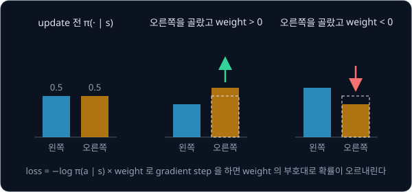
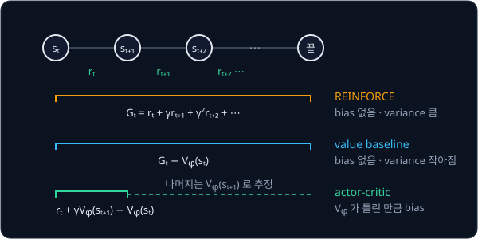

# Policy Gradient

## 배경

[Bandits & MDPs](../bandit-mdp/README.md) 의 방법은 value 를 먼저 배우고, policy 는 value 가 가장 큰 action 을 고르는
$\arg\max$ 로 뽑았다. action 이 연속이면 이 $\arg\max$ 를 구하기 어렵고, 가위바위보처럼 일부러 무작위로 행동해야 하는
문제에서는 $\arg\max$ 가 늘 같은 action 만 내서 쓸 수 없다. policy gradient 는 policy 자체를 neural network 로 두고, 기대
return 이 커지는 쪽으로 그 weight 를 직접 고친다.

### 확률분포로 둔 policy

policy gradient 의 policy 는 parameter $\theta$ 를 가진 확률분포 $\pi_\theta(a\mid s)$ 다. action 이 몇 개로 정해진 문제에서는
network 가 action 마다 점수 $z_a$(logit)를 내고, softmax 로 확률을 만든다.

$$
\pi_\theta(a\mid s) = \frac{e^{z_a}}{\sum_b e^{z_b}}
$$

logit 이 $z = [1, 0, 0]$ 이면 확률은 $[0.576, 0.212, 0.212]$ 이다. CartPole 에서는 state `(B, 4)` 를 넣어 logit `(B, 2)` 를
받고, `torch.distributions.Categorical` 로 action 을 뽑거나 log-prob 를 계산한다. 같은 state 에서도 action 이 확률적으로
뽑히므로 ε-greedy 같은 탐색 규칙을 따로 두지 않는다.

### 기대 return 과 policy gradient

학습 목표는 policy 를 따라 episode 를 돌렸을 때 받는 return 의 기댓값 $J(\theta)$ 다.

$$
J(\theta) = \mathbb E_{\tau\sim\pi_\theta}\Big[\sum_t \gamma^t r_t\Big]
$$

$\tau = (s_0, a_0, r_0, s_1, a_1, r_1, \dots)$ 는 episode 하나의 기록(trajectory)이고, $\tau \sim \pi_\theta$ 는 그 기록을
$\pi_\theta$ 로 행동해서 얻었다는 뜻이다. $r_t$ 는 $s_t$ 에서 $a_t$ 를 한 뒤 받은 reward 다. $J$ 를 키우려면
$\nabla_\theta J$ 가 필요한데, trajectory 가 나올 확률에는 환경의 transition 확률이 끼어 있고 이것은 미분할 수 없다.

log-derivative trick 은 $\nabla_\theta \pi_\theta = \pi_\theta\,\nabla_\theta\log\pi_\theta$ 라는 항등식으로 이 문제를 비켜 간다.
이 식을 대입해 정리하면 transition 확률이 gradient 에서 빠지고 policy 의 log-prob 만 남아서, 실제로 돌려 본 episode 들의
평균으로 gradient 를 추정할 수 있다.

$$
\nabla_\theta J(\theta) = \mathbb E_{\tau\sim\pi_\theta}\Big[\sum_t \nabla_\theta \log\pi_\theta(a_t\mid s_t)\,\Psi_t\Big]
$$

$\nabla_\theta \log\pi_\theta(a_t\mid s_t)$ 는 state $s_t$ 에서 action $a_t$ 의 확률을 올리는 방향이고, weight $\Psi_t$ 는 그 방향으로
얼마나, 어느 부호로 움직일지 정한다. $\Psi_t$ 가 양수면 그 action 의 확률이 오르고 음수면 내린다. 코드에서는 $\Psi_t$ 를
상수로 두고 $-\frac{1}{N}\sum_t \log\pi_\theta(a_t\mid s_t)\,\Psi_t$ 를 loss 로 삼아 backward 하면, 그 gradient 가 위 추정에
음수를 붙인 값이 된다. optimizer 는 loss 를 줄이므로 결과적으로 $J$ 를 키우는 쪽으로 움직인다.



$\Psi_t$ 로 무엇을 쓰느냐에 따라 아래 세 estimator 가 갈린다.

| estimator | $\Psi_t$ |
| --- | --- |
| REINFORCE | reward-to-go $G_t$ |
| value baseline | $G_t - V_\phi(s_t)$ |
| actor-critic | $\hat A_t = r_t + \gamma V_\phi(s_{t+1}) - V_\phi(s_t)$ |

### REINFORCE 와 reward-to-go

Williams(1992)의 REINFORCE 는 episode 를 끝까지 돌린 뒤, step $t$ 부터 끝까지 받은 reward 를 discount 해서 더한 reward-to-go
를 weight 로 쓴다.

$$
G_t = \sum_{k\ge t}\gamma^{k-t} r_k
$$

$t$ 이전의 reward 를 빼는 이유는 $a_t$ 가 이미 받은 reward 를 바꿀 수 없기 때문이다. reward 가 1, 1, 1 이고 $\gamma = 0.99$ 면
$G = [2.9701,\ 1.99,\ 1]$ 이다. 이 추정은 평균을 내면 정확한 gradient 와 같아서(unbiased) 틀린 방향으로 치우치지 않지만,
episode 하나하나의 return 이 크게 들쭉날쭉해 variance 가 크다. CartPole 학습 초반에는 같은 policy 로도 episode 길이가 몇십
step 에서 몇백 step 까지 달라지므로, batch 마다 gradient 추정이 크게 흔들린다.

### baseline

CartPole 은 매 step reward 가 1 이라 $G_t$ 가 늘 양수다. 그러면 뽑힌 action 은 좋았든 나빴든 모두 확률이 올라가고, 오르는
폭만 다르다. action 과 상관없는 baseline $b(s_t)$ 를 $G_t$ 에서 빼면 weight 가 "평균보다 얼마나 나았나" 로 바뀐다. 같은
state 에서 두 episode 의 $G_t$ 가 30 과 50 이고 baseline 이 40 이면 weight 는 −10 과 +10 이 되어, 나았던 action 은 확률이 오르고
못했던 action 은 내린다.

baseline 을 빼도 gradient 의 기댓값은 그대로이고 variance 만 줄어든다. baseline 으로는 state 의 value 를 추정하는 network
$V_\phi(s)$ 를 쓰고, $V_\phi(s_t)$ 가 $G_t$ 를 맞히도록 MSE 로 함께 학습한다.

### actor-critic

actor-critic 은 reward-to-go 대신 reward 하나와 $V_\phi$ 의 추정으로 weight 를 만든다(bootstrap). policy 를 actor,
$V_\phi$ 를 critic 이라 부른다.

$$
\hat A_t = r_t + \gamma V_\phi(s_{t+1}) - V_\phi(s_t)
$$

$\hat A_t$ 는 action 을 한 뒤의 결과($r_t + \gamma V_\phi(s_{t+1})$)가 critic 이 원래 예상한 값($V_\phi(s_t)$)보다 얼마나 나았는지
재는 advantage 추정이다. $r_t = 1$, $\gamma = 0.99$, $V_\phi(s_t) = 10$, $V_\phi(s_{t+1}) = 9.5$ 면
$\hat A_t = 1 + 0.99 \times 9.5 - 10 = 0.405$ 라서 이 action 은 예상보다 조금 나았다. reward 하나만 쓰므로 variance 는 더 줄지만, $V_\phi$ 가 틀린 만큼
gradient 가 틀린 쪽으로 치우친다(bias). $s_{t+1}$ 이 종료 state 면 그 뒤가 없으므로 $V_\phi(s_{t+1})$ 을 0 으로 둔다.



### gradient variance 측정

세 estimator 의 차이를 숫자로 보려면 $\theta$ 를 고정한 채 batch 를 여러 번 새로 모아 gradient 를 다시 뽑고, 그 값들이
얼마나 흩어져 있는지 잰다. parameter 전체를 한 줄로 편 gradient 를 batch $i$ 마다 $g^{(i)}$ 라 하면, total variance 는
parameter 마다 batch 사이의 분산을 구해 모두 더한 값이다. parameter 가 2 개이고 batch 세 개의 gradient 가 $(1, 2)$, $(3, 2)$,
$(2, 5)$ 라면 평균은 $(2, 3)$, 첫 parameter 의 분산은 $(1 + 1 + 0)/3 = 0.667$, 둘째는 $(1 + 1 + 4)/3 = 2$ 라서 total variance
는 2.667 이다. 같은 $\theta$ 에서 이 값이 작을수록 batch 하나로 낸 gradient 를 믿을 만하다.

이번 과제에서는 세 estimator 를 같은 CartPole 에서 차례로 짜고, gradient 추정의 variance 를 직접 재서 그 차이를 숫자로 확인한다.

## 목표

- 작은 bandit 에서 REINFORCE gradient 추정이 해석적 gradient 와 맞는지 검산한다
- REINFORCE 로 `CartPole-v1` 을 푼다
- 학습한 value baseline 을 빼서 같은 $\theta$ 에서 gradient variance 가 줄어드는 것을 잰다
- one-step TD advantage 를 쓰는 actor-critic 을 짜고 세 방법의 학습 속도를 비교한다

**직접 짤 것**: categorical policy network, reward-to-go 계산, policy gradient loss, value baseline, actor-critic update,
gradient variance 측정.
**가져다 써도 되는 것**: gymnasium 환경, `torch.distributions.Categorical`, `torch.optim`.

## 준비물

- Python 3.12, `torch`, `gymnasium[classic_control]`, matplotlib, pytest
- GPU 불필요(CPU 로 실험 하나에 몇 분)

## 진행 순서

1. `bandit_check.py` 의 `analytic_grad` 를 채운다. arm 3 개짜리 bandit 에서 $J(\theta) = \sum_a \mathrm{softmax}(\theta)_a\, q_a$
   의 gradient 를 손으로 유도해 옮기고, `torch.autograd.grad` 로 $J$ 를 미분한 값과 같은지 본다
2. `reinforce_grad` 를 채운다. softmax 확률로 arm 을 뽑고 $q_a$ 에 noise 를 더한 reward 로 REINFORCE 추정을 내며, sample 수를
   늘릴수록 `analytic_grad` 와의 cosine similarity 가 1 에 가까워지는지 `test_policy_gradient.py` 에서 확인한다
3. `policy.py` 의 `CategoricalPolicy`·`ValueNet` 과 `rollout.py` 의 `collect_episodes`·`reward_to_go` 를 채운다.
   `reward_to_go(torch.tensor([1., 1., 1.]), 0.99)` 가 `[2.9701, 1.99, 1.0]` 인지 본다
4. `reinforce.py` 의 `pg_loss` 를 채우고, `main` 에서 $G_t$ 를 weight 로 쓰는 REINFORCE 로 CartPole 을 학습한다. 최근 100
   episode 평균 return 이 475 이상이면 푼 것이다
5. 같은 `main` 에 value baseline 판을 더한다. weight 는 $G_t - V_\phi(s_t)$ 이고 $V_\phi$ 는 $G_t$ 에 MSE 로 맞춘다
6. `grad_variance` 를 채우고, 학습 도중의 한 $\theta$ 에서 batch 100 개로 baseline 이 있을 때와 없을 때의 variance 를 잰다
7. `actor_critic.py` 의 `train_actor_critic` 을 $\hat A_t$ 를 weight 로 쓰는 actor-critic 으로 채운다
8. `plot.py` 에서 세 방법을 5 seed 씩 돌린 episode 수 대비 return 곡선을 겹쳐 `results/learning_curves.png` 로 저장하고,
   475 에 도달한 episode 수의 seed 중앙값을 표로 `results/` 에 남긴다

## 시작점

아래 파일은 모두 리포에 들어 있다.

```text
policy-gradient/
├── pyproject.toml            # 이 과제의 Python 버전과 패키지
├── uv.lock
├── bandit_check.py           # analytic_grad, reinforce_grad 의 stub
├── policy.py                 # CategoricalPolicy, ValueNet 의 stub
├── rollout.py                # collect_episodes, reward_to_go 의 stub
├── reinforce.py              # pg_loss, grad_variance 의 stub. 실행하면 REINFORCE 학습
├── actor_critic.py           # train_actor_critic 의 stub
├── plot.py                   # 세 방법의 학습 곡선과 도달 episode 수 표
└── test_policy_gradient.py   # bandit 검산·reward-to-go·variance 비교 test 를 직접 쓴다
```

[bandit_check.py](bandit_check.py)·[policy.py](policy.py)·[rollout.py](rollout.py)·[reinforce.py](reinforce.py)·[actor_critic.py](actor_critic.py)
의 함수와 method 는 몸통이 `raise NotImplementedError` 인 stub 이고, 이름과 signature 는 그대로 둔 채 몸통을 채운다. 채점용
test 는 없어서 평가 기준은 [test_policy_gradient.py](test_policy_gradient.py) 에 직접 쓴 test 와 학습 기록, `plot.py` 의 그림과
표로 확인한다. 패키지는 `pyproject.toml` 에 있고, 이 폴더에서 `uv run` 을 처음 실행할 때 `.venv/` 에 설치된다.

```bash
cd projects/policy-gradient
uv run pytest
uv run python reinforce.py
uv run python actor_critic.py
uv run python plot.py
```

## 평가 기준

- [ ] bandit 검산에서 sample 10만 개로 낸 REINFORCE gradient 와 해석적 gradient 의 cosine similarity 가 0.99 이상이다
- [ ] REINFORCE 가 `CartPole-v1` 에서 최근 100 episode 평균 return 475 이상에 도달한다(도달하지 못한 seed 가 있으면 그 비율도 적는다)
- [ ] 같은 $\theta$ 에서 value baseline 을 뺀 gradient 의 variance 가 빼지 않은 것보다 작다
- [ ] 475 에 도달하기까지 걸린 episode 수를 세 방법별 5 seed 중앙값으로 표에 정리했고, baseline 판이 REINFORCE 보다 빠르다
- [ ] (선택) reward-to-go 를 episode 전체 return 으로 바꿔 모든 step 에 곱한 판을 만들어 같은 방법으로 variance 를 비교한다

## 생각해 볼 질문

1. $\mathbb E_{a\sim\pi_\theta}\big[\nabla_\theta\log\pi_\theta(a\mid s)\big] = 0$ 에서 출발해 baseline 을 빼도 gradient 의 기댓값이 변하지
   않는 이유를 설명할 수 있는가? baseline 이 action 에도 의존하면 무엇이 깨지는가?
2. REINFORCE 는 batch 하나로 gradient step 을 한 번만 하고 그 데이터를 버린다. 같은 batch 로 update 를 여러 번 하면 왜 안 되는가?
3. actor-critic 에서 critic 의 추정이 크게 틀리면 actor 는 어느 쪽으로 끌려가는가? REINFORCE 에는 왜 그런 위험이 없는가?

## 힌트

<details>
<summary>loss 부호와 normalize</summary>

optimizer 는 loss 를 줄이므로 기대 return 을 키우려면 $-\log\pi\cdot G$ 를 loss 로 둔다. batch 안에서 weight 를 평균 0·표준편차 1
로 normalize 하면 learning rate 를 잡기가 훨씬 쉬워지는데, 평균을 빼는 것 자체도 일종의 baseline 이다.

</details>

<details>
<summary>critic target 으로 흐르는 gradient</summary>

$r_t + \gamma V_\phi(s_{t+1})$ 는 critic 학습에서 상수로 다뤄야 한다. 여기로 gradient 가 흐르면 critic 이 target 자체를 움직여
loss 를 줄이려 한다. advantage 를 actor loss 에 곱할 때도 critic 쪽 gradient 를 끊고(`detach`), `terminated` 인 step 에서는
$V_\phi(s_{t+1})$ 을 0 으로 둔다.

</details>

## 참고 자료

- OpenAI Spinning Up, [Part 3: Intro to Policy Optimization](https://spinningup.openai.com/en/latest/spinningup/rl_intro3.html)
  — log-derivative trick, reward-to-go, baseline 의 유도를 짧게 정리한 글. 이 과제의 배경을 식으로 따라가려면 이것부터 읽는다
- Ronald J. Williams, [Simple Statistical Gradient-Following Algorithms for Connectionist Reinforcement Learning](https://doi.org/10.1007/BF00992696)
  (1992) — REINFORCE 원 논문
- Richard S. Sutton 외, [Policy Gradient Methods for Reinforcement Learning with Function Approximation](https://papers.nips.cc/paper/1999/hash/464d828b85b0bed98e80ade0a5c43b0f-Abstract.html)
  (1999) — policy gradient theorem 과 critic 을 붙여도 되는 조건
- Volodymyr Mnih 외, [Asynchronous Methods for Deep Reinforcement Learning](https://arxiv.org/abs/1602.01783) (2016) — n-step
  advantage 를 쓰는 actor-critic(A3C)
- Richard S. Sutton, Andrew G. Barto, [Reinforcement Learning: An Introduction (2nd edition)](http://incompleteideas.net/book/the-book-2nd.html)
  — 13장이 REINFORCE, baseline, actor-critic 을 같은 기호로 정리한다
- Lilian Weng, [Policy Gradient Algorithms](https://lilianweng.github.io/posts/2018-04-08-policy-gradient/) — REINFORCE 에서
  A3C·PPO·SAC 까지 한 기호 체계로 이어 본 글
- Andrej Karpathy, [Deep Reinforcement Learning: Pong from Pixels](http://karpathy.github.io/2016/05/31/rl/) — numpy 로 짠 policy
  gradient 와 "확률을 올리고 내린다" 는 직관
- PyTorch [`torch.distributions`](https://docs.pytorch.org/docs/stable/distributions.html) 문서 — `Categorical` 의 `sample`·
  `log_prob`·`entropy` 와 score function 예시
- UC Berkeley CS 285, [Deep Reinforcement Learning](https://rail.eecs.berkeley.edu/deeprlcourse/) — policy gradient·actor-critic 강의
- Spinning Up [`1_simple_pg.py`](https://github.com/openai/spinningup/blob/master/spinup/examples/pytorch/pg_math/1_simple_pg.py)·[`2_rtg_pg.py`](https://github.com/openai/spinningup/blob/master/spinup/examples/pytorch/pg_math/2_rtg_pg.py)
  — 파일 하나 130 줄 안팎의 REINFORCE. 막혔을 때만 연다

## 남은 한계

batch 하나를 gradient step 한 번에 쓰고 버려서 sample efficiency 가 낮고, step size 를 조금만 키워도 policy 의 성능이 한 번에
크게 떨어진다. 같은 데이터로 여러 번 update 하면서도 policy 가 크게 바뀌지 않게 제한하는 방법이 [PPO](../ppo/README.md) 이고, 환경의 model 을 따로
배워 실제 상호작용을 아끼는 방향은 [World Model](../world-model/README.md) 로 이어진다.
