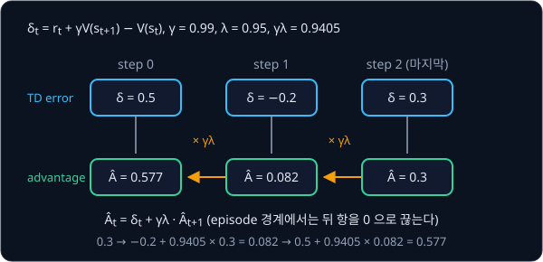
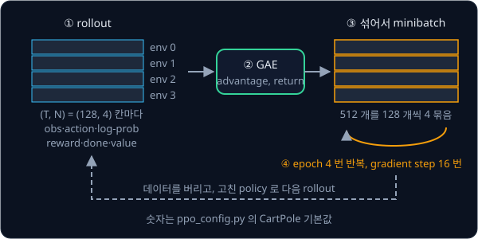

# PPO

## 배경

[Policy Gradient](../policy-gradient/README.md) 의 actor-critic 은 rollout 한 번으로 gradient step 을 한 번만 하고 데이터를 버린다.
환경과 주고받는 데 시간이 드는 만큼 같은 데이터로 여러 번 학습하고 싶지만, 그러면 policy 가 너무 크게 바뀌어 학습이 무너지기
쉽다. PPO(Proximal Policy Optimization)는 한 번의 update 로 policy 가 바뀌는 폭을 제한해서, 같은 batch 를 여러 epoch 동안
안전하게 쓰게 만든 방법이다.

### 같은 batch 를 여러 번 쓸 때의 문제

policy gradient 의 추정은 "지금 policy 로 모은 데이터" 를 전제로 한다. 한 batch 로 update 를 한 번 하면 policy 가 조금 바뀌고,
같은 batch 로 또 update 하면 이제는 데이터를 모은 policy 와 학습 중인 policy 가 달라서 gradient 추정이 틀어진다. 틀어진 채로
여러 번 밀면 policy 가 한 번에 크게 바뀔 수 있는데, 성능이 한 번 크게 떨어진 policy 는 나쁜 데이터만 모으게 되어 회복하기
어렵다. supervised learning 과 달리 데이터를 모으는 주체가 학습하는 모델 자신이라서 생기는 문제다.

### probability ratio

데이터를 모은 policy 를 $\pi_{\theta_\text{old}}$, 학습 중인 policy 를 $\pi_\theta$ 라 하면 둘의 차이를 sample 마다 probability ratio 로
잰다.

$$
r_t(\theta)=\frac{\pi_\theta(a_t\mid s_t)}{\pi_{\theta_\text{old}}(a_t\mid s_t)}
$$

데이터를 모을 때 0.5 였던 $a_t$ 의 확률이 update 뒤 0.65 가 되면 $r_t = 1.3$ 이고, update 전에는 $\theta = \theta_\text{old}$ 라
모든 sample 의 ratio 가 1 이다. ratio 에 advantage 를 곱한 $r_t(\theta)\hat A_t$ 의 평균을 surrogate objective 라고 하는데, 이 값을
$\theta = \theta_\text{old}$ 에서 미분하면 policy gradient 와 같아진다. 그래서 surrogate 를 키우는 것이 policy gradient 방향으로 가는
것과 같고, ratio 덕분에 $\theta$ 가 $\theta_\text{old}$ 에서 조금 벗어난 뒤에도 옛 데이터로 계산을 이어 갈 수 있다. 다만 아무
제한이 없으면 surrogate 는 ratio 를 끝없이 키우거나 줄이는 쪽으로 policy 를 밀어낸다.

### TRPO 의 KL 제약

TRPO(2015)는 update 전후 policy 사이의 KL divergence 가 작은 값 이하가 되도록 제약을 걸었다. KL divergence 는 두 확률분포가
얼마나 다른지 재는 값으로, 같은 분포면 0 이고 다를수록 커진다.

$$
\mathrm{KL}(p \,\|\, q) = \sum_a p(a)\log\frac{p(a)}{q(a)}
$$

action 둘의 확률이 $[0.5, 0.5]$ 에서 $[0.6, 0.4]$ 로 바뀌었다면 $\mathrm{KL} = 0.5\log\frac{0.5}{0.6} + 0.5\log\frac{0.5}{0.4} = 0.0204$ 다.
TRPO 는 이 제약을 지키는 update 방향을 구하려고 conjugate gradient 같은 2차 최적화를 써서 구현이 복잡했다.

### clipped surrogate

PPO 는 KL 제약 대신 ratio 를 $[1-\epsilon, 1+\epsilon]$ 범위로 자른 값을 함께 써서, 같은 효과를 일반적인 Adam 한 가지로 얻는다.

$$
L^{\text{CLIP}}(\theta)=\mathbb E_t\Big[\min\big(r_t(\theta)\hat A_t,\ \operatorname{clip}(r_t(\theta),1-\epsilon,1+\epsilon)\,\hat A_t\big)\Big]
$$

$\operatorname{clip}(x, l, h)$ 는 $x$ 가 $l$ 보다 작으면 $l$, $h$ 보다 크면 $h$, 그 사이면 $x$ 그대로인 함수다. $\epsilon = 0.2$ 면
ratio 는 $[0.8, 1.2]$ 로 잘려서, $\operatorname{clip}(1.3) = 1.2$, $\operatorname{clip}(0.9) = 0.9$, $\operatorname{clip}(0.7) = 0.8$
이다. 경계 밖에서는 ratio 가 더 바뀌어도 잘린 값이 그대로라서 그 항으로는 gradient 가 흐르지 않는다. $\min$ 이 두 항 가운데
어느 쪽을 고르는지는 $\hat A_t$ 의 부호에 따라 달라지며, 이것은 생각해 볼 질문 1 에서 직접 그려 본다.


### GAE

advantage $\hat A_t$ 는 GAE(Generalized Advantage Estimation)로 추정한다. Policy Gradient 의 one-step TD error 를 다시 쓰면

$$
\delta_t=r_t+\gamma V(s_{t+1})-V(s_t)
$$

이고, GAE 는 이 TD error 를 뒤로 갈수록 $\gamma\lambda$ 배씩 줄여 가며 더한다.

$$
\hat A_t=\sum_{l\ge 0}(\gamma\lambda)^l\,\delta_{t+l} = \delta_t + \gamma\lambda\,\hat A_{t+1}
$$

$\lambda$ 는 0 과 1 사이의 값으로 얼마나 먼 미래의 TD error 까지 반영할지 정한다. 오른쪽 꼴로 보면 rollout 의 마지막 step 에서
시작해 거꾸로 한 번 훑는 것으로 모든 step 의 advantage 가 나오고, episode 가 끝난 지점에서는 다음 episode 의 값이 섞이지 않게
뒤 항을 0 으로 끊는다. 마지막 step 의 $V(s_{t+1})$ 에는 rollout 뒤의 다음 state 로 계산한 `next_value` 를 쓴다. value network 를
학습할 target 인 return 은 $\hat R_t = \hat A_t + V(s_t)$ 다.



### PPO 의 한 iteration

PPO 는 아래 iteration 을 정해진 step 수만큼 되풀이한다.

1. `SyncVectorEnv` 로 같은 환경을 $N$ 개 띄우고 각각 $T$ step 씩 돌려 `(T, N)` 모양의 rollout buffer 를 채운다. 칸마다 obs, action,
   그 action 의 log-prob($\pi_{\theta_\text{old}}$), reward, done, value 를 저장한다
2. 마지막 state 의 value 로 GAE 와 return 을 계산한다
3. `(T, N)` 을 한 줄로 펴서 섞고 minibatch 로 나눈 뒤, minibatch 마다 아래 loss 로 gradient step 을 한다. 이것을 `update_epochs` 번
   되풀이한다
4. 데이터를 버리고 바뀐 policy 로 다음 rollout 을 모은다

$$
\mathcal L(\theta) = -L^{\text{CLIP}}(\theta) + c_v\,\mathbb E_t\big[(V_\theta(s_t) - \hat R_t)^2\big] - c_e\,\mathbb E_t\big[\mathcal H(\pi_\theta(\cdot\mid s_t))\big]
$$

둘째 항은 value loss 이고, 셋째 항은 policy 의 entropy 가 너무 빨리 줄지 않게 하는 entropy bonus 다. $c_v$ 와 $c_e$ 는
`PPOConfig` 의 `vf_coef`(0.5)와 `ent_coef`(0.01)이고, gradient 의 전체 크기는 `max_grad_norm`(0.5)으로 자른다.



### 학습 상태 지표

PPO 는 return 곡선만으로는 학습이 왜 흔들리는지 알기 어려워서, update 마다 아래 값을 함께 기록한다.

| 지표 | 계산 | 읽는 법 |
| --- | --- | --- |
| approx KL | $\mathbb E\big[(r_t - 1) - \log r_t\big]$ | update 전후 policy 가 얼마나 달라졌는지 sample 로 추정한 KL. 갑자기 크게 튀면 그 update 가 policy 를 많이 바꾼 것이다 |
| clip fraction | $\lvert r_t - 1\rvert > \epsilon$ 인 sample 의 비율 | 0.3 이면 sample 의 30% 가 clip 경계 밖까지 밀렸다는 뜻이다 |
| explained variance | $1 - \mathrm{Var}(\hat R - V) / \mathrm{Var}(\hat R)$ | value network 가 return 을 얼마나 맞히는지. 1 이면 완벽하고, 0 이면 평균값을 찍는 것과 같다 |

approx KL 의 식은 John Schulman 의 글 [Approximating KL Divergence](http://joschu.net/blog/kl-approx.html) 에 나온 추정량이다.

### 연속 action 의 Gaussian policy

HalfCheetah 의 action 은 관절 6 개의 토크라 각각 −1 과 1 사이의 연속값이고, observation 은 17 개의 연속값이다. 연속 action
에서는 network 가 action 차원마다 Gaussian 의 평균 $\mu_\theta(s)$ 를 내고, 표준편차는 state 와 상관없는 parameter $\log\sigma$
(shape `(act_dim,)`)로 따로 둔다. action 6 개의 log-prob 는 차원마다 구한 Gaussian log-prob 를 모두 더한 값이고 entropy 도
차원별 값을 더한다. Gaussian 에서 뽑은 action 은 범위를 넘을 수 있어서 env 에 넣을 때는 `ClipAction` wrapper 로 자르되,
log-prob 는 자르기 전의 action 으로 계산한다.

### 구현 세부와 비교 기준

식은 짧지만 성능의 상당 부분이 구현 세부에서 나온다(Engstrom et al. 2020, Huang et al. 2022). CleanRL 의
`ppo_continuous_action.py` 는 아래 세부를 모두 갖추고 있다.

- observation normalization: 차원마다 지금까지 본 값의 평균과 표준편차를 이어서 갱신하고 그것으로 obs 를 표준화한다
  (`NormalizeObservation`, 그 뒤 ±10 으로 자른다)
- reward normalization: discount 한 return 의 표준편차로 reward 를 나눠 크기를 맞춘다(`NormalizeReward`, 그 뒤 ±10 으로 자른다)
- orthogonal init: weight 를 orthogonal matrix 로 초기화하고, 숨은 층은 gain $\sqrt 2$, policy 의 마지막 층은 0.01, value 의 마지막
  층은 1 로 둔다
- learning rate annealing: iteration 이 지날수록 learning rate 를 0 까지 선형으로 줄인다
- advantage normalization: minibatch 안에서 advantage 를 평균 0·표준편차 1 로 바꾼다

그래서 이번 과제의 비교 기준은 논문 속 숫자가 아니라 같은 세부를 갖춘 CleanRL 구현을 같은 step 만큼 돌린 결과다. CleanRL 의
HalfCheetah 기본값은 env 1 개, rollout 2048 step, minibatch 32 개, epoch 10 번, learning rate 3e-4, entropy 계수 0 으로
CartPole 용 `PPOConfig` 기본값과 다르다. sim 에서 보행 policy 를 학습할 때도 PPO 를 많이 쓰고, legged_gym 과 MuJoCo
Playground 의 기본 학습 알고리즘도 PPO 다.

## 목표

- GAE 와 clipped surrogate 를 쓰는 PPO 를 짜서 `CartPole-v1` 을 푼다
- 같은 코드에 Gaussian policy 를 붙여 연속 action 의 HalfCheetah 로 옮긴다
- CleanRL `ppo_continuous_action.py` 를 같은 환경·같은 step 으로 돌려 학습 곡선을 겹쳐 그린다
- clipping 을 끈 ablation 에서 approx KL 과 return 이 어떻게 달라지는지 기록한다

**직접 짤 것**: rollout buffer, GAE, clipped policy loss, value loss, entropy bonus, minibatch epoch 루프, 연속 action 용 Gaussian policy.
**가져다 써도 되는 것**: `gymnasium.vector.SyncVectorEnv`, `RecordEpisodeStatistics`·`NormalizeObservation`·`NormalizeReward`·`ClipAction`
같은 gymnasium wrapper, tensorboard.

## 준비물

- Python 3.12, `torch`, `gymnasium[classic_control,mujoco]`(MuJoCo 가 함께 설치된다), `tensorboard`, matplotlib, pytest
- CleanRL 비교용 가상환경을 따로 둔다. CleanRL 은 Python 3.11 미만과 gymnasium 0.29.1 에 맞춰져 있어서 `uv venv -p 3.10` 으로
  만든 환경에 CleanRL README 대로 `".[mujoco]"` extra 를 설치한다. `ppo_continuous_action.py` 의 기본값이 `HalfCheetah-v4`·1M step
  이므로 내 코드도 v4 로 맞춘다(gymnasium 1.x 에도 deprecated 경고와 함께 남아 있다)
- CPU 로 충분하다. HalfCheetah 1M step 은 CPU 에서 수십 분에서 한두 시간 걸리고, network 가 작아서 GPU 가 있어도 크게 빨라지지 않는다

## 진행 순서

1. `ppo_config.py` 의 `PPOConfig` 는 이미 채워져 있다. `ppo.py` 의 `train` 에서 `SyncVectorEnv` 로 CartPole 4 개를 띄우고
   `(num_steps, num_envs)` 모양의 rollout buffer 를 채운다. `make_env` 가 주어지면 `cfg.env_id` 대신 그 함수로 env 를 만들고,
   `async_envs=True` 면 `AsyncVectorEnv` 를 쓴다. 이 두 인자는 wrapper 를 씌운 env 를 넘기는
   [Sim-to-Real Locomotion](../sim2real-locomotion/README.md) 과제가 쓴다
2. `gae.py` 의 `compute_gae` 를 채운다. $\lambda = 0$ 일 때 one-step TD error, $\lambda = 1$ 일 때 Monte Carlo return 에서 value 를
   뺀 값이 나오는지 `test_ppo.py` 에 pytest 로 쓴다
3. `ppo_agent.py` 의 `DiscreteAgent` 와 `ppo.py` 의 `ppo_loss` 를 채우고, `train` 에서 buffer 를 minibatch 로 섞어 clipped policy
   loss·value loss·entropy 를 `update_epochs` 동안 최적화한다. 첫 epoch 의 첫 minibatch 에서 ratio 가 모두 1 인지 확인한다
4. approx KL·clip fraction·explained variance 를 update 마다 tensorboard 에 기록하면서 `CartPole-v1` 을 학습하고, 두 지표가 머문
   범위와 approx KL 이 튄 순간의 return 곡선을 `results/` 에 정리한다. tensorboard 기록이 쌓이는 `runs/` 는 `.gitignore` 에
   걸려 있어 커밋되지 않는다
5. `ppo_agent.py` 의 `GaussianAgent` 를 채운다. 평균은 network 가 내고 log std 는 state 와 무관한 `nn.Parameter` 다
6. observation·reward normalization wrapper 를 씌워 `HalfCheetah-v4` 를 1M step 학습한다
7. 따로 만든 CleanRL 환경에서 `ppo_continuous_action.py --env-id HalfCheetah-v4` 를 같은 step·seed 3 개로 돌린다
8. `compare_cleanrl.py` 에서 두 구현의 episode return 곡선을 step 축에 겹쳐 `results/halfcheetah.png` 로 저장한다

## 시작점

아래 파일은 모두 리포에 들어 있다.

```text
ppo/
├── pyproject.toml       # 이 과제의 Python 버전과 패키지
├── uv.lock
├── ppo_config.py        # PPOConfig. 채워져 있는 hyperparameter
├── gae.py               # compute_gae 의 stub
├── ppo_agent.py         # DiscreteAgent, GaussianAgent 의 stub
├── ppo.py               # ppo_loss, train 의 stub
├── compare_cleanrl.py   # 내 PPO 와 CleanRL 의 HalfCheetah 곡선 그림
└── test_ppo.py          # GAE·ratio 를 확인하는 test 를 직접 쓴다
```

[gae.py](gae.py)·[ppo_agent.py](ppo_agent.py)·[ppo.py](ppo.py) 의 함수와 method 는 몸통이 `raise NotImplementedError` 인 stub 이고,
이름과 signature 는 그대로 둔 채 몸통을 채운다. [ppo_config.py](ppo_config.py) 의 `PPOConfig` 는 CartPole 용 기본값이 들어 있는 dataclass
라서 HalfCheetah 에서는 값을 바꿔 넘긴다. 채점용 test 는 없어서 평가 기준은 [test_ppo.py](test_ppo.py) 에 직접 쓴 test 와
tensorboard 기록, `compare_cleanrl.py` 의 그림으로 확인한다. 패키지는 `pyproject.toml` 에 있고, 이 폴더에서 `uv run` 을 처음
실행할 때 `.venv/` 에 설치된다.

```bash
cd projects/ppo
uv run pytest
uv run python ppo.py
uv run tensorboard --logdir runs
uv run python compare_cleanrl.py
```

## 평가 기준

- [ ] 500k step 안에 `CartPole-v1` 의 최근 episode 평균 return 이 475 이상에 도달한다
- [ ] `compute_gae` 에 $\lambda=0$ 을 넣으면 one-step TD error 가, $\lambda=1$ 을 넣으면 Monte Carlo return 에서 value 를 뺀 값이 나온다
  (pytest 로 확인)
- [ ] `HalfCheetah-v4` 1M step 에서 내 PPO 의 최종 episode return 이 같은 step 의 CleanRL `ppo_continuous_action.py`
  (`--env-id HalfCheetah-v4`) 대비 3 seed 평균 80% 이상이다
- [ ] 학습 중 approx KL 과 clip fraction 이 어느 범위에 머무는지 기록했고, 한 update 에서 approx KL 이 튀는 순간 return 곡선에
  무슨 일이 생기는지 설명할 수 있다
- [ ] (선택) `clip_eps` 를 아주 크게 하고 `update_epochs` 를 10 으로 늘린 ablation 에서 approx KL 이 커지고 return 이 흔들리는 것을
  원래 설정과 나란히 그린다

## 생각해 볼 질문

1. advantage 가 양수일 때와 음수일 때 clipped surrogate 가 각각 $r_t(\theta)$ 의 어느 쪽 변화만 막는지 그래프로 그릴 수 있는가?
   양쪽을 모두 막지 않는 이유는 무엇인가?
2. GAE 의 $\lambda$ 를 0 에서 1 로 올리면 advantage 추정의 bias 와 variance 는 각각 어떻게 변하는가?
3. 같은 데이터를 여러 epoch 쓰는데도 PPO 를 off-policy 가 아니라 on-policy 라고 부르는 이유는 무엇인가? 데이터를 몇 번까지
   재사용할 수 있는지는 무엇이 정하는가?

## 힌트

<details>
<summary>gymnasium 1.x vector env 의 autoreset</summary>

gymnasium 1.x 의 vector env 는 기본값이 next-step autoreset 이라서, 한 env 가 끝난 바로 다음 `step()` 호출은 그 env 를 reset 하는 데
쓰이고 그때 넣은 action 은 무시된다. 이 transition 을 그대로 buffer 에 넣으면 GAE 계산에 엉뚱한 값이 섞인다. 그 step 을 mask 하거나,
`autoreset_mode` 를 same-step 으로 바꿔 끝난 step 에서 바로 reset obs 를 받는 방식 중 하나를 고른다. 두 모드의 차이는 Farama 의
[Autoreset Modes 글](https://farama.org/Vector-Autoreset-Mode)에 정리돼 있다.

</details>

<details>
<summary>ratio 가 처음부터 1 이 아닐 때</summary>

첫 epoch 의 첫 minibatch 에서는 $\theta = \theta_\text{old}$ 이므로 ratio 가 정확히 1 이어야 한다. 1 이 아니면 rollout 때 저장한
log-prob 와 update 때 다시 계산한 log-prob 사이에서 action 이나 normalization 상태가 달라졌다. Gaussian policy 에서는 action
차원별 log-prob 를 합쳤는지도 확인한다.

</details>

<details>
<summary>HalfCheetah 에서 CleanRL 보다 한참 낮을 때</summary>

[37 Implementation Details](https://iclr-blog-track.github.io/2022/03/25/ppo-implementation-details/) 의 continuous action 항목을
하나씩 대조한다. observation·reward normalization, 마지막 layer 의 작은 init, learning rate annealing, advantage normalization
가운데 빠진 것이 있는지부터 본다.

</details>

## 참고 자료

- John Schulman 외, [Proximal Policy Optimization Algorithms](https://arxiv.org/abs/1707.06347) (2017) — clipped surrogate 와 전체
  알고리즘. 3절의 그림 1 이 생각해 볼 질문 1 의 답이므로 직접 그려 본 뒤에 연다
- John Schulman 외, [High-Dimensional Continuous Control Using Generalized Advantage Estimation](https://arxiv.org/abs/1506.02438)
  (2015) — GAE 의 정의와 $\lambda$ 의 역할
- John Schulman 외, [Trust Region Policy Optimization](https://arxiv.org/abs/1502.05477) (2015) — KL 제약을 거는 이유와 surrogate
  objective 의 유도
- OpenAI Spinning Up, [Proximal Policy Optimization](https://spinningup.openai.com/en/latest/algorithms/ppo.html) — 의사코드와 PPO-clip 해설
- Huang 외, [The 37 Implementation Details of Proximal Policy Optimization](https://iclr-blog-track.github.io/2022/03/25/ppo-implementation-details/)
  — CleanRL 저자들이 원래 구현의 세부를 하나씩 재현한 글
- Logan Engstrom 외, [Implementation Matters in Deep Policy Gradients](https://arxiv.org/abs/2005.12729) (2020) — 구현 세부를 뺐을 때
  성능이 얼마나 달라지는지 잰 논문
- John Schulman, [Approximating KL Divergence](http://joschu.net/blog/kl-approx.html) — approx KL 추정량의 유도
- Farama, [Vector Autoreset Mode](https://farama.org/Vector-Autoreset-Mode)·Gymnasium [Vector API](https://gymnasium.farama.org/api/vector/)
  — `SyncVectorEnv` 의 autoreset 동작
- CleanRL [PPO 문서](https://docs.cleanrl.dev/rl-algorithms/ppo/) — 환경별 benchmark 곡선
- CleanRL [`ppo.py`](https://github.com/vwxyzjn/cleanrl/blob/master/cleanrl/ppo.py)·[`ppo_continuous_action.py`](https://github.com/vwxyzjn/cleanrl/blob/master/cleanrl/ppo_continuous_action.py)
  — 비교 기준이자 참고 구현. 막혔을 때만 연다
- UC Berkeley CS 285, [Deep Reinforcement Learning](https://rail.eecs.berkeley.edu/deeprlcourse/) — advanced policy gradient 강의
- [legged_gym](https://github.com/leggedrobotics/legged_gym)·[MuJoCo Playground](https://github.com/google-deepmind/mujoco_playground)
  — PPO 로 보행 policy 를 학습하는 대표 코드베이스

## 남은 한계

이 policy 는 학습한 바로 그 simulator parameter 에서만 잘 달린다고 보장되고, mass 나 friction 이 조금만 달라져도 넘어질 수 있다.
dynamics 를 바꿔 가며 학습해 robust 한 보행을 얻는 과제가 [Sim-to-Real Locomotion](../sim2real-locomotion/README.md) 이고, PPO 로
시연 기반 VLA 를 reward 로 다듬는 과제가 [VLA + RL](../vla-rl/README.md) 이다.
