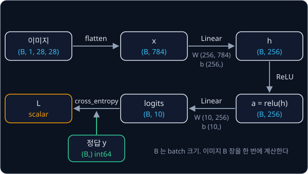
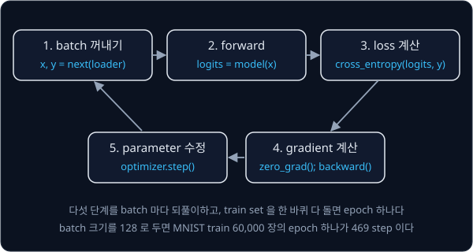

# PyTorch Training Loop

## 배경

[Backpropagation](../autograd/README.md) 과제의 `Value` 는 숫자 하나마다 Python 객체를 만들어서, 784×256 weight 행렬 하나만
거쳐도 샘플 하나에 곱셈 200,704 번이 각각 graph node 가 된다. PyTorch 는 같은 reverse-mode autodiff 를 tensor 단위로 한다.
행렬 곱 하나가 graph 의 node 하나가 되고 실제 계산은 C++·CUDA kernel 이 맡기 때문에, `loss.backward()` 한 줄이 이전 과제의
`backward()` 와 같은 일을 훨씬 빠르게 한다. 이번 과제에서는 autodiff 는 PyTorch 에 맡기고 그 바깥의 layer·loss·optimizer 를
직접 짠다.

### MNIST 와 tensor 의 모양

MNIST 는 손으로 쓴 숫자 0–9 의 28×28 흑백 이미지 모음이다. pixel 값은 0(검정)부터 1(흰색) 사이로 바꿔 쓰고, 이미지마다
정답 숫자 하나(label)가 붙어 있다. 이 과제의 MLP 는 이미지를 784(= 28×28) 개 숫자의 벡터로 펴서 받는다.

학습은 이미지를 한 장씩이 아니라 B 장씩 묶어서 한다. 이 묶음이 batch 이고, tensor 의 첫 번째 축이 batch 축이다. 아래 그림은
batch 하나가 MLP 를 지나며 바뀌는 모양을 보여 준다.



### Linear layer 와 ReLU

Linear layer 는 입력 벡터에 weight 행렬을 곱하고 bias 를 더한다. batch 로 쓰면

$$
h = x W^\top + b, \qquad x: (B, n_{\text{in}}),\ \ W: (n_{\text{out}}, n_{\text{in}}),\ \ b: (n_{\text{out}},),\ \ h: (B, n_{\text{out}})
$$

이다. $W$ 의 행 하나가 [Backpropagation](../autograd/README.md) 의 neuron 하나의 weight 이고, $n_{\text{out}}$ 개 neuron 을
행렬 곱 한 번으로 한꺼번에 계산한다. 첫 Linear 는 $n_{\text{in}} = 784$, $n_{\text{out}} = 256$ 이라 weight 가
200,704 개, bias 가 256 개이고, 둘째 Linear(256 → 10)까지 합치면 이 MLP 의 parameter 는 203,530 개다.

PyTorch 에서 학습할 값은 `nn.Parameter` 로 감싸 `nn.Module` 의 속성으로 둔다. 그러면 `model.parameters()` 가 그 값들을 모아
주고, `loss.backward()` 가 각 parameter 의 `.grad` 를 채운다.

weight 의 처음 값은 He et al. 2015 의 Kaiming 초기화를 따라 평균 0, 분산 $2 / n_{\text{in}}$ 인 정규분포 $\mathcal N(0,\, 2/n_{\text{in}})$
에서 뽑고 bias 는 0 으로 둔다. 첫 Linear 라면 표준편차가 $\sqrt{2/784} \approx 0.0505$ 다.

두 Linear 사이의 ReLU 는 원소마다 $\mathrm{relu}(h) = \max(0, h)$ 를 계산한다. 음수는 0 으로, 양수는 그대로 내보낸다. ReLU 가
없으면 Linear 두 개를 이어도 행렬 곱 하나로 합쳐져서 Linear 한 개와 표현력이 같다.

### softmax 와 cross-entropy

마지막 Linear 의 출력 $z$ (logits) 는 class 10 개에 대한 점수다. softmax 는 이 점수를 합이 1 인 확률로 바꾼다.

$$
\mathrm{softmax}(z)_j = \frac{e^{z_j}}{\sum_k e^{z_k}}
$$

cross-entropy loss 는 정답 class $y$ 의 확률에 log 를 씌우고 부호를 바꾼 값이다. 정답 확률이 1 에 가까울수록 0 에 가깝고,
0 에 가까울수록 커진다. 식을 정리하면 log-sum-exp 꼴이 되고, logits 로 미분하면 softmax 확률에서 one-hot 정답을 뺀 값이
된다. one-hot 은 정답 class 자리만 1 이고 나머지는 0 인 벡터다.

$$
L = -\log \frac{e^{z_y}}{\sum_j e^{z_j}} = -z_y + \log \sum_j e^{z_j}, \qquad
\frac{\partial L}{\partial z} = \mathrm{softmax}(z) - \mathrm{onehot}(y)
$$

class 3 개짜리 예로 $z = [2.0, 1.0, 0.1]$, $y = 0$ 이면 아래와 같다.

| class $j$ | $z_j$ | $\mathrm{softmax}(z)_j$ | $\mathrm{onehot}(y)_j$ | $\partial L / \partial z_j$ |
| --- | --- | --- | --- | --- |
| 0 (정답) | 2.0 | 0.659 | 1 | −0.341 |
| 1 | 1.0 | 0.242 | 0 | 0.242 |
| 2 | 0.1 | 0.099 | 0 | 0.099 |

loss 는 $-\log 0.659 \approx 0.417$ 이다. gradient 는 정답 logit 을 올리고 나머지를 내리는 방향을 가리킨다. batch 에서는
샘플마다 이 loss 를 구해 평균한다.

$e^{z}$ 는 금방 커진다. float32 가 담을 수 있는 가장 큰 수는 약 $3.4 \times 10^{38}$ 인데 $e^{89}$ 가 이미 $4.5 \times 10^{38}$
이라, 식을 그대로 옮기면 logits 가 100 근처만 되어도 `inf` 가 나온다. 평가 기준의 "logits 에 1000 을 더해도 `nan` 이
나오지 않는다" 는 이 문제를 피했는지 확인하는 항목이다.

### SGD 와 momentum

gradient descent 는 [NumPy Warm-up](../warmup/README.md) 에서처럼 parameter $\theta$ 를 gradient $g$ 의 반대 방향으로
learning rate $\eta$ 만큼 옮긴다. 60,000 장 전체의 gradient 대신 batch 하나의 gradient 로 이 update 를 하는 것이 SGD
(stochastic gradient descent)다. 1951년 Robbins·Monro 의 stochastic approximation 이 그 출발점이다.

$$
\theta \leftarrow \theta - \eta\, g
$$

momentum 은 지난 gradient 들을 buffer $b$ 에 쌓아 두고 그 방향으로 움직인다. PyTorch 의 `torch.optim.SGD` 는 아래 꼴을 쓴다.
$\mu$ 는 momentum 계수(보통 0.9)다.

$$
b \leftarrow \mu\, b + g, \qquad \theta \leftarrow \theta - \eta\, b
$$

gradient 가 계속 1 이고 $\mu = 0.9$, $\eta = 0.1$ 이면 $b$ 는 1, 1.9, 2.71 로 커지고, 한 step 에 움직이는 거리도 0.1, 0.19,
0.271 로 늘어난다. 같은 방향의 gradient 가 이어지면 점점 빨라지고, 방향이 오락가락하면 서로 상쇄된다.

### Adam

2014년의 Adam 은 gradient 의 moving average $m$ 과 gradient 제곱의 moving average $v$ 를 parameter 마다 따로 두고, step 크기를
$\sqrt{\hat v}$ 로 나눠 맞춘다.

$$
m_t = \beta_1 m_{t-1} + (1-\beta_1)\, g_t, \qquad v_t = \beta_2 v_{t-1} + (1-\beta_2)\, g_t^2, \qquad
\theta_t = \theta_{t-1} - \eta\,\frac{m_t / (1-\beta_1^t)}{\sqrt{v_t / (1-\beta_2^t)} + \epsilon}
$$

| 기호 | 뜻 | 기본값 |
| --- | --- | --- |
| $t$ | 지금까지 한 step 수. 1 부터 센다 | |
| $g_t$ | 이번 step 의 gradient | |
| $m_t$, $v_t$ | gradient 와 gradient 제곱의 moving average. 0 에서 시작한다 | |
| $\beta_1$, $\beta_2$ | moving average 가 이전 값을 얼마나 남기는지 | 0.9, 0.999 |
| $1/(1-\beta^t)$ | bias correction | |
| $\epsilon$ | 0 으로 나누지 않게 더하는 작은 수 | $10^{-8}$ |

$g_t^2$ 와 나눗셈은 모두 원소별 연산이라, gradient 가 크게 흔들리는 parameter 는 작게, 작고 꾸준한 parameter 는 상대적으로
크게 움직인다.

### training loop

학습은 batch 하나마다 같은 다섯 단계를 되풀이한다. gradient 는 `.grad` 에 더해지므로 backward 전에 0 으로 되돌린다.
train set 을 한 바퀴 다 돌면 epoch 하나이고, 평가는 학습에 쓰지 않은 test set 10,000 장에서 가장 큰 logit 의 class 가 정답과
같은 비율, 즉 정확도로 잰다.



## 목표

- `nn.Linear` 없이 `nn.Parameter` 로 Linear layer 를 만들고 초기화한다
- overflow 하지 않는 softmax cross-entropy 를 짜서 `F.cross_entropy` 와 비교한다
- momentum SGD 와 Adam 을 짜서 `torch.optim` 결과와 parameter 값을 비교한다
- 784 → 256 → 10 MLP 를 MNIST 에 학습시키고 test 정확도를 잰다

**직접 짤 것**: Linear(초기화 포함), ReLU, cross-entropy, SGD·Adam, 학습·평가 loop.
**가져다 써도 되는 것**: torch tensor 연산과 `loss.backward()`, `torchvision.datasets.MNIST`, `DataLoader`, 비교용
`F.cross_entropy`·`torch.optim`.

## 준비물

- Python 3.12, torch, torchvision, matplotlib, pytest
- MNIST — `torchvision.datasets.MNIST(download=True)` 가 28×28 흑백 숫자 이미지 train 60,000장·test 10,000장을 받아 온다.
  받은 파일은 `data/` 에 두면 `.gitignore` 에 걸려 커밋되지 않는다
- GPU 불필요 — 이 크기의 MLP 는 CPU 에서도 epoch 하나가 수십 초 안에 끝난다

## 진행 순서

1. `train.py` 에서 MNIST 를 받아 이미지 몇 장과 label 을 matplotlib 로 찍어 본다
2. `layers.py` 의 `Linear` 를 `nn.Module` 로 짜고 weight 를 Kaiming 방식 $\mathcal N(0,\, 2/n_{\text{in}})$ 으로 초기화한다.
   `Linear(784, 256)` 의 weight 표준편차가 0.05 근처면 맞다
3. log-sum-exp 로 `cross_entropy(logits, y)` 를 짜고, `test_against_torch.py` 에서 `F.cross_entropy` 와 값·gradient 를 비교한다.
   위 표의 예에서 loss 0.417 이 나오는지도 손으로 확인해 본다
4. `optim.py` 에 momentum SGD 를 짜서 `torch.optim.SGD(momentum=0.9)` 와 같은 초기값·같은 batch 로 100 step 돌려 비교하는
   test 를 쓴다
5. Adam 을 짜서 `torch.optim.Adam` 과 같은 방식으로 비교하는 test 를 쓴다
6. `train.py` 에 이미지를 784 차원 벡터로 펴서 넣는 train loop 와 test 정확도를 재는 eval 함수를 짠다
7. 784 → 256 → 10 MLP 를 내 SGD 와 내 Adam 으로 각각 5 epoch 학습시키고 test 정확도를 출력한다
8. 두 optimizer 의 train loss curve 를 한 그림에 겹쳐 그려 `results/loss_curves.png` 로 저장하고 커밋한다

## 시작점

아래 파일은 모두 리포에 들어 있다.

```text
pytorch-mlp/
├── pyproject.toml          # 이 과제의 Python 버전과 패키지
├── uv.lock
├── layers.py               # Linear, relu, cross_entropy 의 stub
├── optim.py                # SGD, Adam 의 stub
├── train.py                # MNIST 학습·평가, loss curve 그림
└── test_against_torch.py   # F.cross_entropy·torch.optim 과 비교하는 test 를 직접 쓴다
```

[layers.py](layers.py)·[optim.py](optim.py) 의 함수와 method 는 몸통이 `raise NotImplementedError` 인 stub 이고, 이름과
signature 는 그대로 둔 채 몸통을 채운다. 채점용 test 는 없어서 평가 기준은 [test_against_torch.py](test_against_torch.py) 에
직접 쓴 test 와 `train.py` 가 출력하는 test 정확도로 확인한다. 패키지는 `pyproject.toml` 에 있고, 이 폴더에서 `uv run` 을
처음 실행할 때 `.venv/` 에 설치된다.

```bash
cd projects/pytorch-mlp
uv run pytest
uv run python train.py
```

## 평가 기준

- [ ] 내 `cross_entropy` 가 `F.cross_entropy` 와 값·logits gradient 모두 1e-6 이내로 같고, logits 에 1000 을 더해도 `nan` 이 나오지 않는다
- [ ] 같은 초기값·같은 batch 로 100 step 돌린 뒤 내 SGD(momentum)·Adam 의 parameter 가 `torch.optim` 결과와 float32 에서 1e-6 이내로 같다
- [ ] 내 Adam 으로 5 epoch 학습한 MLP 의 MNIST test 정확도가 97% 이상이다
- [ ] (선택) Linear 의 backward 를 `torch.autograd.Function` 으로 직접 짜고 `torch.autograd.gradcheck` 를 통과시킨다
- [ ] (선택) decoupled weight decay 를 넣은 AdamW 를 짜서 `torch.optim.AdamW` 와 비교한다

## 생각해 볼 질문

1. weight 를 $\mathcal N(0, 1)$ 로 초기화하면 784 개 입력을 더한 첫 층 출력의 크기가 어떻게 되고, 그것이 학습에 어떤 문제를 일으키는가?
2. Adam 에서 bias correction $1/(1-\beta^t)$ 을 빼면 학습 초기 몇 step 의 update 크기가 어떻게 되는가?
3. softmax 를 먼저 구한 뒤 log 를 씌우는 방식이 log-sum-exp 방식보다 위험한 이유는?

## 힌트

<details>
<summary>log-sum-exp 가 overflow 하지 않게</summary>

$\log \sum_j e^{z_j} = c + \log \sum_j e^{z_j - c}$ 는 어떤 $c$ 에서도 성립한다. $c$ 를 row 별 최댓값으로 고르면 지수에
들어가는 값이 모두 0 이하가 된다.

</details>

<details>
<summary>torch.optim 과 값이 조금씩 어긋날 때</summary>

PyTorch 의 momentum SGD 는 learning rate 를 buffer 밖에서 곱한다($b \leftarrow \mu b + g,\ \theta \leftarrow \theta - \eta b$).
교과서에 흔한 $v \leftarrow \mu v - \eta g$ 꼴과는 lr 이 고정이면 같지만, 학습 중에 lr 을 바꾸면 결과가 달라진다. Adam 은 $\epsilon$ 을 bias
correction 한 $\sqrt{\hat v}$ 에 더하는지, correction 전의 $\sqrt{v}$ 에 더하는지에 따라 값이 달라진다.

</details>

## 참고 자료

- Herbert Robbins, Sutton Monro, [A Stochastic Approximation Method](https://doi.org/10.1214/aoms/1177729586) (1951) — noise 가
  섞인 gradient 로도 수렴하는 조건을 처음 보인 SGD 의 출발점
- Diederik P. Kingma, Jimmy Ba, [Adam: A Method for Stochastic Optimization](https://arxiv.org/abs/1412.6980) (2014) — 2쪽의
  Algorithm 1 이 이 과제의 Adam 식이고, 3절이 bias correction 을 다룬다
- Kaiming He et al., [Delving Deep into Rectifiers](https://arxiv.org/abs/1502.01852) (2015) — 2.2절에서 ReLU network 의
  초기화 분산 $2/n$ 을 유도한다
- PyTorch 문서, [torch.optim.SGD](https://docs.pytorch.org/docs/stable/generated/torch.optim.SGD.html)·[torch.optim.Adam](https://docs.pytorch.org/docs/stable/generated/torch.optim.Adam.html)
  — 문서의 algorithm 박스가 비교 기준이다. momentum buffer 와 $\epsilon$ 의 위치를 여기서 맞춘다
- PyTorch 문서, [torch.nn.functional.cross_entropy](https://docs.pytorch.org/docs/stable/generated/torch.nn.functional.cross_entropy.html)
  — 입력이 logits 이고 class index 를 정답으로 받는다는 약속을 확인한다
- PyTorch tutorial, [What is torch.nn really?](https://docs.pytorch.org/tutorials/beginner/nn_tutorial.html) — MNIST 를 tensor
  연산만으로 학습시킨 뒤 `nn.Module`·`DataLoader` 로 하나씩 바꿔 가는 과정. 이 과제의 뼈대와 같은 순서다
- Stanford CS231n, [Linear classification](https://cs231n.github.io/linear-classify/) — softmax classifier 와 cross-entropy,
  수치 안정성 절
- Stanford CS231n, [Neural Networks Part 3: Learning and Evaluation](https://cs231n.github.io/neural-networks-3/) — SGD·momentum·Adam
  을 같은 표기로 비교한다
- Sebastian Ruder, [An overview of gradient descent optimization algorithms](https://www.ruder.io/optimizing-gradient-descent/)
  — momentum 부터 Adam 까지 update 식을 한곳에 정리한 글
- Andrej Karpathy, [Building makemore Part 3: Activations & Gradients, BatchNorm](https://www.youtube.com/watch?v=P6sfmUTpUmc)
  — 초기화에 따라 activation 분포가 어떻게 바뀌는지 직접 찍어 보는 영상
- Andrej Karpathy, [A Recipe for Training Neural Networks](https://karpathy.github.io/2019/04/25/recipe/) — 학습이 안 될 때 점검할
  순서
- PyTorch 소스, [torch/optim/adam.py](https://github.com/pytorch/pytorch/blob/main/torch/optim/adam.py) — 막혔을 때만 연다

## 남은 한계

이미지를 784 차원 벡터로 펴서 넣기 때문에 pixel 사이의 위치 관계를 쓰지 못하고, 입력 길이가 정해져 있어 sequence 를
다룰 수 없다. [CNN](../cnn/README.md)·[Transformer](../transformer/README.md)·[VAE](../vae/README.md)·
[Behavior Cloning](../behavior-cloning/README.md)·[Policy Gradient](../policy-gradient/README.md)·[DQN → SAC](../off-policy/README.md)
는 모두 이 training loop 를 바탕으로 한다.
