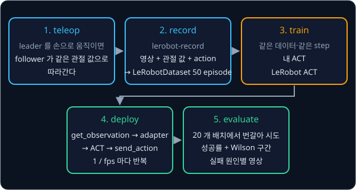
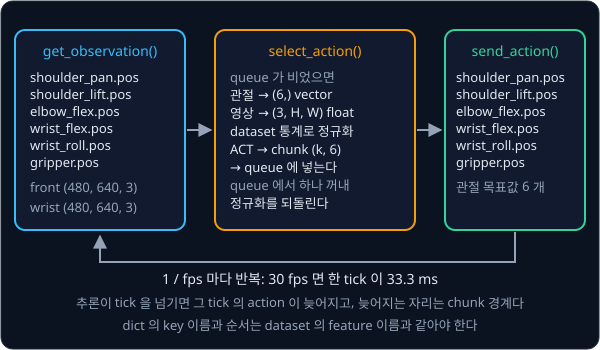
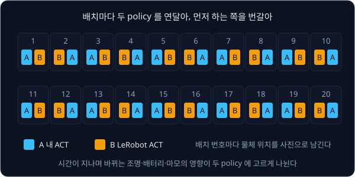

# Real Robot

## 배경

지금까지의 과제는 모두 simulation 안에서 끝났다. ACT 는 처음부터 저가 하드웨어를 겨냥해 나온 방법이라, 논문에서도 과제당 10 분
분량의 시연으로 실물 정밀 조작 과제 6 개를 배웠고 배터리 끼우기 같은 과제에서 80–90% 성공률을 냈다. 이 과제에서는 LeRobot 과
SO-101 팔로 한 가지 과제의 시연 50 개를 모으고, [ACT](../act/README.md) 에서 짠 내 ACT 를 실물에 배포해 같은 데이터로 학습한
LeRobot ACT 와 20 회씩 시도해 비교한다.



### simulation 과 실물의 차이

simulation 은 상태를 정확히 알려 주고 같은 장면을 똑같이 렌더하며 성공 여부까지 판정해 준다. 실물에서는 이 가운데 어느 것도
저절로 얻을 수 없다.

| 항목 | simulation | 실물 |
| --- | --- | --- |
| 관절 값 | 정확한 값 | encoder 의 noise, 기어 사이의 유격(backlash) |
| 카메라 | 같은 장면이면 같은 영상 | 조명에 따라 노출과 색이 바뀐다 |
| 명령 반영 | 다음 step 에 그대로 | servo 의 지연과 overshoot |
| 성공 판정 | 코드가 계산 | 사람이 보고 기록 |
| 초기 상태 | `reset()` 한 줄 | 사람이 물체를 다시 놓는다 |

calibration 도 시간이 지나며 조금씩 어긋나서, 같은 policy 라도 어제와 오늘의 성공률이 다를 수 있다.

### SO-101 과 leader-follower teleoperation

SO-101 은 Feetech STS3215 servo 6 개로 움직이는 저가 팔이다. joint 는 `shoulder_pan`, `shoulder_lift`, `elbow_flex`,
`wrist_flex`, `wrist_roll`, `gripper` 이고, servo 는 목표 위치를 받으면 내장 제어기로 그 위치를 따라간다.

teleoperation 은 사람이 로봇을 원격으로 조종하는 것이다. SO-101 은 같은 모양의 팔을 두 대 쓰는데, 사람이 손으로 움직이는
leader 팔의 관절 값을 읽어 follower 팔에 목표 위치로 보내면 follower 가 그대로 따라간다. calibration 은 servo 가 읽는 raw
값(encoder tick)을 각 joint 의 실제 범위에 맞춰 두는 작업이고, LeRobot 은 이 결과를 robot `id` 이름의 파일로 저장해 teleop·
기록·추론에서 같은 `id` 로 다시 읽는다.

### LeRobotDataset

teleop 하는 동안 `lerobot-record` 가 정해진 fps 마다 관측과 action 을 한 frame 으로 기록하고, 시연 하나가 episode 하나가
된다. frame 하나에는 아래 값이 들어간다.

| feature | shape | 내용 |
| --- | --- | --- |
| `observation.state` | (6,) | follower 의 관절 값 |
| `observation.images.<카메라 이름>` | (3, H, W) | 그 순간의 카메라 영상. 저장은 mp4 영상으로 한다 |
| `action` | (6,) | 그 순간 follower 에 보낸 목표 위치, 즉 leader 의 관절 값 |
| `timestamp`, `episode_index`, `task` | | 시각, 몇 번째 시연인지, 과제 문장 |

30 fps 로 20 초짜리 시연을 50 개 모으면 frame 은 $30 \times 20 \times 50 = 30{,}000$ 개다. dataset 은 feature 이름과 함께
feature 별 평균·표준편차 같은 정규화 통계도 메타데이터로 담고, 학습과 추론은 모두 이 통계로 입력과 출력을 정규화한다.

### policy adapter

LeRobot 의 `robot.get_observation()` 은 `{"shoulder_pan.pos": 12.3, ..., "front": 영상}` 같은 dict 를 내고,
`robot.send_action()` 도 같은 key 의 dict 를 받는다. 내 ACT 는 tensor 를 받아 tensor 를 내므로 그 사이를 잇는 adapter 가
필요하다. adapter 는 dict 의 관절 값을 dataset 의 feature 순서대로 (6,) vector 로 모으고, 영상을 (3, H, W) float tensor 로
바꾼 뒤 dataset 통계로 정규화한다. 모델이 낸 action 은 정규화를 되돌린 뒤 다시 key 이름을 붙여 dict 로 만든다.



key 의 순서나 카메라 이름이 학습 때와 하나라도 다르면 모델은 오류 없이 엉뚱한 값을 받는다. 그래서 adapter 는 이름을 직접
적지 않고 dataset 메타데이터에서 읽는다.

### 고정 주기 제어 루프와 action chunk

시연을 30 fps 로 기록했다면 policy 도 33.3 ms 마다 action 을 하나씩 보내야 기록 때와 같은 속도로 움직인다. 이렇게 일정한
간격(tick)마다 관측 → action → 전송을 되풀이하고 남은 시간은 기다리는 loop 를 고정 주기 제어 루프라고 한다.

ACT 는 한 번 추론할 때 앞으로의 action $k$ 개(action chunk)를 한꺼번에 낸다. chunk 를 queue 에 넣어 두고 tick 마다 하나씩
꺼내 보내면, 추론은 queue 가 빌 때만 한다. 예를 들어 30 fps 에서 $k = 100$ 이면 추론 한 번이 3.3 초 분량의 움직임이 된다.
추론에 33.3 ms 보다 오래 걸리면 그 tick 의 action 이 늦어지는데, 이런 지연은 queue 가 비는 chunk 경계에서만 생긴다.
[ACT](../act/README.md) 의 temporal ensembling 을 쓰면 tick 마다 추론해 겹치는 chunk 를 평균하므로 이 경계가 부드러워지지만
tick 마다 추론 시간이 든다.

### 성공률과 Wilson 구간

실물 평가는 시도 횟수가 적어서 성공률의 불확실성이 크다. $n$ 번 중 $k$ 번 성공했을 때 성공률의 추정값은 $\hat p = k / n$
이고, 참 성공률이 95% 확률로 들어갈 범위는 Wilson score interval 로 구한다.

$$
\hat p = \frac{k}{n}, \qquad
\frac{\hat p + \frac{z^2}{2n} \pm z\sqrt{\frac{\hat p(1-\hat p)}{n} + \frac{z^2}{4n^2}}}{1 + \frac{z^2}{n}}, \qquad z = 1.96
$$

$z = 1.96$ 은 정규분포에서 가운데 95% 를 덮는 폭이다. 20 회 중 15 회 성공이면 $\hat p = 75\%$ 이지만 구간은 약 53–89% 에
걸친다. 흔히 쓰는 $\hat p \pm z\sqrt{\hat p(1-\hat p)/n}$ 은 $n$ 이 작거나 $\hat p$ 가 0·1 에 가까우면 구간이 0 아래나 1
위로 넘어가는데, Wilson 구간은 늘 0 과 1 사이에 머문다.

물체를 어디에 두느냐에 따라 난이도가 달라서, 두 policy 를 다른 배치에서 시도하면 배치 운이 결과에 섞인다. 그래서 초기 배치
20 개를 미리 정해 사진으로 남기고, 배치마다 두 policy 를 연달아 시도하되 먼저 하는 쪽을 번갈아 바꾼다.



## 목표

- SO-101 follower·leader 를 calibration 하고, teleop 으로 해 볼 과제 하나(예: 큐브를 집어 상자에 넣기)를 정한다
- 물체 위치 5 곳 × 10 회로 시연 50 개를 기록한다
- 내 ACT 를 이 dataset 에 학습하고 실물 제어 루프에 붙인다
- 같은 데이터·step 으로 학습한 LeRobot ACT 와 같은 20 개 초기 배치에서 성공률을 비교한다
- 실패 사례를 영상으로 남기고 원인별로 분류한다

**직접 짤 것**: 내 policy 를 로봇 관측·action 형식에 맞추는 adapter, 고정 주기 제어 루프, 20 회 시도 protocol 과 기록,
실패 분석. ACT 대신 [Diffusion Policy](../diffusion-policy/README.md) 나 [π0](../pi0/README.md) 과제의 모델을 올려도 된다.
**가져다 써도 되는 것**: LeRobot 의 motor driver·calibration·teleop·기록(`lerobot-record`)·dataset 형식, 비교용
`lerobot-train --policy.type=act` 와 `lerobot-rollout`.

## 준비물

- SO-101 follower 와 leader 한 쌍(kit 구매 또는 3D 프린트 + servo 조립), USB 카메라 1–2 개(정면·손목), 고정된 작업대와 물체
- Python 3.12, `lerobot[core-scripts,feetech,training]` — Feetech servo driver 와 `lerobot-calibrate`·`lerobot-teleoperate`·
  `lerobot-record`·`lerobot-replay`·`lerobot-train`·`lerobot-rollout` 명령이 함께 설치된다. sim fallback 용 `mujoco`, 내 ACT 를
  돌릴 torch·torchvision, 결과 표와 그래프용 numpy·matplotlib, test 용 pytest 도 들어 있다
- 학습은 8 GB GPU 로 충분하다 (LeRobot hardware guide 기준 ACT batch 8 에서 2–6 GB). 추론은 학습한 GPU 머신에 팔을 USB 로
  연결해 돌리는 것이 가장 단순하다
- 하드웨어가 없으면: [mujoco_menagerie 의 SO-101 모델](https://github.com/google-deepmind/mujoco_menagerie/tree/main/robotstudio_so101) 을
  [Teleop Dataset](../teleop-dataset/README.md) 과제의 sim teleop 흐름에 올려 같은 protocol(시연 50 개, 20 회 시도)로 진행한다.
  이때 카메라 noise·조명 변화·제어 지연을 일부러 넣어 실물에서 생길 문제를 흉내 낸다

## 진행 순서

1. `configs/task.yaml` 에 follower·leader 의 port 와 `id`, 카메라, fps 를 적는다. 이 파일은 `run_trials.py` 가 읽고, LeRobot
   명령에는 같은 값을 `--robot.port`·`--robot.id`·`--teleop.port`·`--teleop.id`·`--robot.cameras` 인자로 넘긴다. LeRobot 문서대로 `uv run lerobot-setup-motors`
   로 motor id 를, `uv run lerobot-calibrate` 로 calibration 을 끝내고, `uv run lerobot-teleoperate` 가 기록할 fps 그대로 끊김
   없이 도는지 확인한다
2. 카메라 위치를 고정하고, 사람이 카메라 영상만 보고도 과제를 할 수 있는지 확인한다
3. 물체 위치 5 곳 × 10 회로 시연 50 개를 `uv run lerobot-record` 로 기록하고, Dataset Visualizer 로 영상과 관절 궤적의 시간이
   맞는지 본다
4. 기록한 episode 하나를 `uv run lerobot-replay` 로 재생해 같은 동작이 재현되는지 확인한다
5. 내 ACT 를 이 dataset 의 feature 이름·정규화 통계에 맞춰 학습하고, 같은 데이터·step 으로 LeRobot ACT 도
   `uv run lerobot-train --policy.type=act` 로 학습한다
6. `policy_adapter.py` 의 `MyPolicyAdapter` 를 채운다. dataset 의 frame 하나로 observation dict 를 만들어 넣고, 나온 action
   dict 의 key 가 로봇의 action key 와 같고 값이 그 frame 의 `action` 과 비슷한 범위인지 확인한다
7. 학습에 쓴 위치 5 곳과 새 위치를 섞은 초기 배치 20 개를 `configs/task.yaml` 의 `layouts` 에 적고, 사진을
   `results/layouts/` 에 남긴다
8. `run_trials.py` 의 `run_trial`·`main` 으로 두 policy 를 배치마다 번갈아 시도하며 성공 여부·실패 단계를
   `results/trials.csv` 에, 영상을 `results/videos/` 에 기록한다
9. `analyze.py` 의 `wilson_interval`·`main` 으로 성공률과 Wilson 구간, 실패 원인 표를 낸다. 실패 원인 하나를 골라 고친 뒤
   다시 20 회를 잰다

## 시작점

아래 파일은 모두 리포에 들어 있다.

```text
real-robot/
├── pyproject.toml         # 이 과제의 Python 버전과 패키지
├── uv.lock
├── configs/
│   └── task.yaml          # robot port·id, 카메라, fps, 과제 문장, 초기 배치 20 개
├── policy_adapter.py      # MyPolicyAdapter: 내 ACT ↔ LeRobot observation·action dict
├── run_trials.py          # Trial, run_trial, 번갈아 20 회 시도와 기록·영상
├── analyze.py             # wilson_interval, 성공률·실패 원인 표
└── sim_fallback/
    └── sim_follower.py    # 하드웨어가 없을 때 쓰는 MuJoCo SO-101 follower
```

[policy_adapter.py](policy_adapter.py)·[run_trials.py](run_trials.py)·[analyze.py](analyze.py)·
[sim_fallback/sim_follower.py](sim_fallback/sim_follower.py) 의 함수는 몸통이 `raise NotImplementedError` 인 stub 이고, 이름과
signature 는 그대로 둔 채 몸통을 채운다. [configs/task.yaml](configs/task.yaml) 은 예시 값을 내 장비에 맞게 고친다. 채점용
test 는 없어서 평가 기준은 Dataset Visualizer, replay 결과, `results/` 의 시도 기록과 영상으로 확인한다.
`policy_adapter.py` 첫머리는 act 과제 폴더를 `sys.path` 에 더해 내 `ACTPolicy` 를, `sim_follower.py` 첫머리는 teleop-dataset
과제 폴더를 더해 `SimSO101` 을 import 해 둔다. 패키지는 `pyproject.toml` 에 있고, 이 폴더에서 `uv run` 을 처음 실행할 때
`.venv/` 에 설치된다.

```bash
cd projects/real-robot
uv run lerobot-find-port
uv run lerobot-record --help
uv run python run_trials.py
uv run python analyze.py
```

## 평가 기준

- [ ] [LeRobot Dataset Visualizer](https://huggingface.co/spaces/lerobot/visualize_dataset) 로 50 episode 를 열어 모든 episode 에서 카메라 영상과 관절 궤적의 시간이 맞는다
- [ ] 물체를 기록 때와 같은 자리에 두고 `lerobot-replay` 로 episode 를 재생하면 기록 때와 같은 결과가 나온다
- [ ] 같은 20 개 배치에서 내 ACT 의 성공률이 LeRobot ACT 의 80% 이상이다
- [ ] 결과 표에 성공률과 함께 Wilson 95% 구간을 적는다
- [ ] 실패를 3 개 이상의 원인으로 분류하고 원인마다 영상을 하나씩 남긴다
- [ ] (선택) 학습에 없던 위치의 성공률을 따로 계산해 학습 위치와 비교한다

## 생각해 볼 질문

1. sim 에서 잘 되던 policy 가 실물에서 떨리거나 멈추는 원인을 세 가지 이상 들 수 있는가? 각각은 어떻게 확인하는가?
2. 20 회 시도로 성공률 75% 와 60% 인 두 policy 를 구별할 수 있는가? 구별하려면 무엇을 바꿔야 하는가?
3. 시연 50 개를 한 위치에서 모두 모은 경우와 위치 5 곳에 나눠 모은 경우, policy 는 각각 무엇을 배우는가?

## 힌트

<details>
<summary>fps 와 제어 주기</summary>

ACT 의 chunk 는 기록 fps 를 기준으로 한 시간 간격의 action 열이다. 추론 루프가 기록 fps 보다 느리게 돌면 같은 chunk 가
느리게 재생되고 빠르면 빨리 감기처럼 재생되므로, 루프의 실제 주기를 재서 기록 fps 와 맞춘다. `lerobot-record` 도 실제로
도달한 주기를 보고한다.

</details>

<details>
<summary>calibration id 와 feature 이름</summary>

LeRobot 은 robot `id` 로 calibration 파일을 찾기 때문에 teleop·기록·추론에서 같은 `id` 를 써야 한다. 카메라 이름도
dataset 의 `observation.images.<name>` 과 정확히 같아야 정규화 통계와 입력이 맞물린다.

</details>

<details>
<summary>떨림 원인 구분</summary>

떨림이 chunk 경계마다 생기는지(추론 지연), 일정한 주파수로 계속되는지(servo gain), 특정 조명에서만 생기는지(카메라)를
먼저 나눈다. 같은 관측을 고정 입력으로 넣어 policy 출력만 기록해 보면 policy 쪽 문제인지 로봇 쪽 문제인지 갈린다.

</details>

## 참고 자료

- LeRobot [SO-101 문서](https://huggingface.co/docs/lerobot/so101) — 조립, motor id 설정, calibration 순서
- LeRobot [Imitation Learning on Real-World Robots](https://huggingface.co/docs/lerobot/il_robots) — teleop·기록·학습·
  `lerobot-rollout` 명령과 시연 수집 요령
- LeRobot [Cameras](https://huggingface.co/docs/lerobot/cameras) — 카메라 찾기, 해상도·fps 설정
- LeRobot [LeRobotDataset v3.0](https://huggingface.co/docs/lerobot/lerobot-dataset-v3) — dataset 의 파일 구조, feature 와
  정규화 통계가 어디에 있는지
- LeRobot [ACT](https://huggingface.co/docs/lerobot/act) — 비교에 쓰는 LeRobot ACT 의 학습·평가 명령
- LeRobot [Compute HW Guide](https://huggingface.co/docs/lerobot/hardware_guide) — policy 별 VRAM 과 학습 시간
- Hugging Face blog, [LeRobot Community Datasets](https://huggingface.co/blog/lerobot-datasets) — 좋은 dataset 의 조건과 흔한
  실수
- [SO-ARM100 저장소](https://github.com/TheRobotStudio/SO-ARM100) — SO-101 부품 목록과 3D 프린트 파일
- T. Zhao 외, [Learning Fine-Grained Bimanual Manipulation with Low-Cost Hardware](https://arxiv.org/abs/2304.13705) — ACT 논문.
  실물 과제 설정과 시연 수, 성공률 표. [프로젝트 페이지](https://tonyzhaozh.github.io/aloha/) 에 실물 영상이 있다
- F. Capuano 외, [Robot Learning: A Tutorial](https://arxiv.org/abs/2510.12403) — LeRobot 으로 데이터 수집부터 배포까지를
  이어서 설명하는 튜토리얼
- [Binomial proportion confidence interval](https://en.wikipedia.org/wiki/Binomial_proportion_confidence_interval) — Wilson
  score interval 이 정규 근사 구간보다 나은 이유

## 남은 한계

시연 50 개로 한 가지 과제만 배우는 policy 라서 언어 지시를 받지 못하고, 시연에 없던 상황에서 스스로 나아지지도 않는다. 같은
데이터에 언어 지시를 붙여 SmolVLA 를 fine-tune 하거나 [π0](../pi0/README.md) 의 모델을 올려 볼 수 있고, 실제 시도에서 얻은
reward 로 policy 를 더 다듬는 방법은 [VLA + RL](../vla-rl/README.md) 에서 다룬다.
