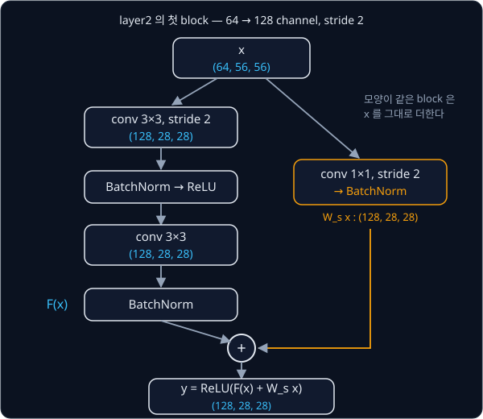
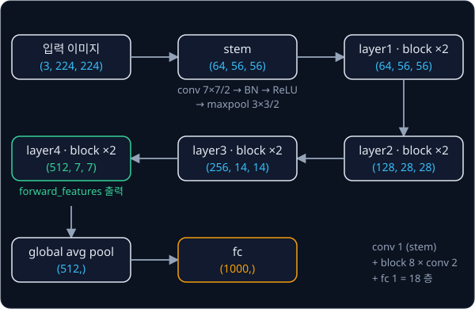

# ResNet

## 배경

[CNN](../cnn/README.md) 의 LeNet-5 는 conv 층이 둘뿐이다. 층을 더 쌓으면 표현력이 커지니 정확도도 오를 것 같지만, He 등은
BatchNorm 을 넣은 plain network 에서도 CIFAR-10 의 **training** error 가 20층보다 56층에서 더 높다는 것을 보였다. test 가
아니라 training error 가 높으니 overfitting 이 아니고, 깊은 망의 좋은 해를 optimizer 가 찾아가지 못하는 문제(degradation)다.
여기서 plain network 는 conv 층을 shortcut 없이 차례로 쌓기만 한 망을 말한다.

### residual learning

residual learning 에서는 block 이 출력 전체를 배우지 않고 입력과의 차이 $\mathcal F(x)$ 만 배운다.

$$
y = \mathcal F(x, \{W_i\}) + x
$$

$x$ 는 block 의 입력 feature map, $\{W_i\}$ 는 block 안 conv 들의 weight, $\mathcal F$ 는 그 conv 들이 계산하는 함수다. 입력 $x$ 를
conv 를 건너뛰어 출력에 그대로 더하는 길을 shortcut(또는 skip connection)이라고 한다. block 이 아무 일도 하지 않는 편이
낫다면 $\mathcal F$ 를 0 으로 만들기만 하면 되고, shortcut 을 따라 gradient 도 층을 건너 앞쪽까지 그대로 전달된다.

$\mathcal F(x) + x$ 는 원소별 덧셈이라 두 tensor 의 모양이 같아야 한다. channel 수나 해상도가 바뀌는 곳에서는 $x$ 대신 1×1 conv 로
모양을 맞춘 $W_s x$ 를 더한다. 1×1 conv 는 pixel 마다 channel 방향으로만 Linear 를 거는 conv 이고, stride 2 를 주면 해상도도 반으로
줄인다.

### BasicBlock

ResNet-18 의 block 은 3×3 conv 두 개로 된 BasicBlock 이다. conv 뒤마다 BatchNorm 이 붙고, 덧셈 뒤에 ReLU 를 한 번 더 거친다. 아래는
layer2 의 첫 block 처럼 channel 이 64 에서 128 로 늘고 해상도가 반으로 줄어드는 경우다.



### BatchNorm

BatchNorm 은 channel 마다 batch 안의 값들을 평균 0, 분산 1 로 맞춘 뒤 학습되는 크기 $\gamma$ 와 위치 $\beta$ 를 다시 입힌다.

$$
\hat x = \frac{x - \mu_{\mathcal B}}{\sqrt{\sigma_{\mathcal B}^2 + \epsilon}}, \qquad y = \gamma \hat x + \beta
$$

| 기호 | 뜻 | 모양 |
| --- | --- | --- |
| $x$ | 입력 feature map | $(N, C, H, W)$ |
| $\mu_{\mathcal B}$, $\sigma_{\mathcal B}^2$ | channel 마다 $N \times H \times W$ 개 값으로 구한 평균·분산 | $(C,)$ |
| $\epsilon$ | 0 으로 나누지 않게 더하는 작은 수, 기본 $10^{-5}$ | |
| $\gamma$, $\beta$ | 학습되는 parameter. 처음 값은 1 과 0 | $(C,)$ |

한 channel 의 값이 batch 안에서 $[1, 2, 3, 6]$ 이면 평균은 3, 분산은 $(4 + 1 + 0 + 9)/4 = 3.5$ 이고, $\hat x$ 는
$[-1.069, -0.535, 0, 1.604]$ 가 된다.

BatchNorm 은 학습 때 mini-batch 의 평균·분산을 쓰면서 running average 를 따로 쌓아 두고, 평가 때는 그 running 통계를 쓴다.
running average 는 `momentum` 이 0.1 이면 $\text{running} \leftarrow 0.9 \cdot \text{running} + 0.1 \cdot \mu_{\mathcal B}$ 처럼
갱신한다. 위 예에서 처음 0 이던 `running_mean` 은 한 번 갱신 뒤 0.3 이 된다. running 통계는 학습되는 parameter 가 아니라서
`nn.Module` 에 buffer 로 둔다.

### ResNet-18

ResNet-18 은 7×7 stem conv 뒤에 BasicBlock 두 개씩으로 된 stage 네 개(64·128·256·512 channel)를 쌓은 약 1,170만 parameter
짜리 망이다. stage 마다 첫 block 이 해상도를 반으로 줄이고 channel 을 두 배로 늘린다(layer1 은 stem 이 이미 줄였으므로 그대로다).
마지막 feature map 을 global average pooling 으로 channel 마다 평균 내 512 차원 vector 로 만들고, fc 하나로 ImageNet 1000 class 의
logits 를 낸다.



뒤에 나오는 [ACT](../act/README.md) 와 Diffusion Policy 도 이 망을 image backbone 으로 그대로 쓰는데, 그때는 fc 전의
$(512, 7, 7)$ feature map 을 꺼내 쓴다. `forward_features` 가 그 값을 돌려주는 함수다.

### pretrained weight 이식

PyTorch 모델의 `state_dict()` 는 parameter·buffer 이름과 tensor 를 짝지은 dict 다. torchvision 의 ResNet-18 은 122 개 tensor 를
담고 있고, 이름은 module 의 속성 이름을 점으로 이은 것이다.

| torchvision key | 모양 | 뜻 |
| --- | --- | --- |
| `conv1.weight` | (64, 3, 7, 7) | stem conv |
| `bn1.running_mean` | (64,) | stem BatchNorm 의 running 평균 |
| `layer2.0.conv1.weight` | (128, 64, 3, 3) | layer2 첫 block 의 첫 conv |
| `layer2.0.downsample.0.weight` | (128, 64, 1, 1) | 그 block 의 1×1 conv shortcut |
| `fc.weight` | (1000, 512) | 마지막 fc |

내 모델의 속성 이름이 달라도 모양과 순서만 맞으면 이 tensor 들을 그대로 옮겨 넣을 수 있고, 그러면 ImageNet 으로 학습한 결과를
처음부터 학습하지 않고 쓸 수 있다.

### CIFAR-10 용 망

논문 4.2절은 degradation 을 보이려고 CIFAR-10(32×32 컬러 이미지, 10 class)용 작은 망을 따로 쓴다. 3×3 conv 하나 뒤에 16·32·64
channel 의 stage 세 개를 두고, stage 마다 block 을 $n$ 개씩 쌓은 뒤 global average pooling 과 fc 10 으로 끝난다. 층 수는 conv
$1 + 2 \cdot 3n$ 개와 fc 1 개를 더한 $6n + 2$ 라서, $n = 3$ 이면 20층, $n = 9$ 면 56층이다. 같은 망에서 shortcut 을 빼면 plain 망이
된다.

## 목표

- `BatchNorm2d`, conv 두 개와 shortcut 으로 된 `BasicBlock`, ResNet-18 을 직접 조립한다
- torchvision 의 ImageNet pretrained weight(`ResNet18_Weights.IMAGENET1K_V1`)를 내 모델에 옮겨 넣고 logits 를 비교한다
- 논문 4.2절의 CIFAR-10 용 망을 깊이 20·56 으로 만들어 plain 과 residual 의 training loss 를 비교한다
- policy 가 쓸 수 있도록 마지막 stage 의 feature map 을 꺼내는 함수를 둔다

**직접 짤 것**: BatchNorm(train·eval 동작과 running 통계), BasicBlock, downsampling shortcut, ResNet-18 조립, weight 이식.
**가져다 써도 되는 것**: `nn.Conv2d`(앞 과제의 im2col conv 도 되지만 느리다), `nn.Linear`, 이미지 전처리
(`ResNet18_Weights.IMAGENET1K_V1.transforms()`), torchvision 의 `resnet18`(비교용).

## 준비물

- Python 3.12, `torch`, `torchvision`, `matplotlib`, `pillow`, `pytest`
- [Imagenette](https://github.com/fastai/imagenette)(ImageNet 의 10개 class 부분집합, 320 px 판이면 충분)의 val 이미지, CIFAR-10(torchvision 이 내려받는다).
  둘 다 `data/` 에 두면 `.gitignore` 에 걸려 커밋되지 않는다
- weight 이식과 비교는 CPU 로 충분하고, CIFAR-10 학습은 8 GB GPU 나 Colab T4 면 된다

## 진행 순서

1. `batchnorm.py` 에 train·eval 양쪽에서 `nn.BatchNorm2d` 와 같은 값을 내는 `BatchNorm2d` 를 짜고, `test_resnet.py` 에서 출력과
   running 통계를 비교한다
2. `resnet.py` 에 stride 나 channel 이 바뀔 때 1×1 conv shortcut 을 쓰는 `BasicBlock` 을 짠다
3. stem, stage 네 개, global average pooling, fc 로 `resnet18` 을 조립하고 parameter 수를 torchvision 과 비교한다
4. `load_resnet.py` 에서 torchvision `state_dict` 의 key 를 내 모델의 key 로 옮기는 대응표를 만든다
5. 같은 이미지에서 내 모델과 torchvision 모델의 eval logits 를 비교하고, Imagenette val 이미지 전체에서 top-1 예측을 비교한다
6. `resnet.py` 의 `cifar_net` 으로 논문 4.2절의 CIFAR-10 용 망(깊이 $6n+2$)을 `residual` flag 하나로 plain·residual 두 가지로 만든다
7. `train_cifar.py` 에서 20층·56층 각각의 plain·residual 망을 같은 epoch 수만큼 학습해 training loss curve 네 개를 한 그림에 그려
   `results/cifar_loss.png` 로 저장하고 커밋한다

## 시작점

아래 파일은 모두 리포에 들어 있다.

```text
resnet/
├── pyproject.toml   # 이 과제의 Python 버전과 패키지
├── uv.lock
├── batchnorm.py     # BatchNorm2d 의 stub
├── resnet.py        # BasicBlock, ResNet, resnet18, cifar_net 의 stub
├── load_resnet.py   # torchvision state_dict → 내 모델, load_torchvision_weights 의 stub
├── train_cifar.py   # plain vs residual 학습과 loss curve 그림
└── test_resnet.py   # BatchNorm·parameter 수·logits 를 torchvision 과 비교하는 test 를 직접 쓴다
```

[batchnorm.py](batchnorm.py)·[resnet.py](resnet.py)·[load_resnet.py](load_resnet.py) 의 함수와 method 는 몸통이
`raise NotImplementedError` 인 stub 이고, 이름과 signature 는 그대로 둔 채 몸통을 채운다. 채점용 test 는 없어서 평가 기준은
[test_resnet.py](test_resnet.py) 에 직접 쓴 test 와 `train_cifar.py` 의 loss curve 그림으로 확인한다. 패키지는
`pyproject.toml` 에 있고, 이 폴더에서 `uv run` 을 처음 실행할 때 `.venv/` 에 설치된다.

```bash
cd projects/resnet
uv run pytest
uv run python train_cifar.py
```

## 평가 기준

- [ ] 내 `BatchNorm2d` 가 train mode 에서 출력·`running_mean`·`running_var` 모두 `nn.BatchNorm2d` 와 1e-5 이내로 같다
- [ ] 내 ResNet-18 의 parameter 수가 torchvision 과 같은 11,689,512 개다
- [ ] weight 를 옮겨 넣은 뒤 eval logits 가 torchvision `resnet18` 과 최대 1e-4 이내로 같다(CPU, float32)
- [ ] Imagenette val 이미지 전체에서 1000-class top-1 예측이 torchvision 과 100% 같다
- [ ] CIFAR-10 training loss curve 에서 plain 은 56층의 training loss 가 20층보다 높게 남고, residual 은 학습이 진행될수록 56층이 20층을 따라잡거나 앞선다
- [ ] (선택) weight 를 옮겨 넣은 ResNet-18 을 Imagenette 10 class 로 fine-tune 해서 처음부터 학습한 경우와 정확도를 비교한다

## 생각해 볼 질문

1. 56층 plain 망은 이론상 20층 망에 identity layer 36개를 붙인 것을 표현할 수 있다. 그런데도 training error 가 더 높게 나오는 것을 overfitting 으로 설명할 수 없는 이유는?
2. BatchNorm 은 train 과 eval 에서 다르게 동작한다. batch 크기가 2~8 처럼 작으면 어떤 문제가 생기는가?
3. ACT 는 backbone 의 BatchNorm 을 학습 중에도 통계가 바뀌지 않는 FrozenBatchNorm 으로 바꾸고, Diffusion Policy 원 논문은 GroupNorm 으로 바꾼다. 두 선택이 피하려는 문제는 무엇인가?

## 힌트

<details>
<summary>state_dict 를 옮길 때 자주 막히는 곳</summary>

torchvision 의 BatchNorm 에는 weight·bias 말고도 `running_mean`·`running_var`·`num_batches_tracked` buffer 가 있다. 내
`BatchNorm2d` 가 running 통계를 `register_buffer` 로 두지 않았다면 `state_dict` 에 나타나지 않아 대응표에서 빠진다. key 이름을
하나씩 맞추는 것보다 모든 tensor 가 정확히 한 번씩 쓰였는지 세는 편이 실수를 빨리 잡는다.

</details>

<details>
<summary>running_var 만 조금 다를 때</summary>

PyTorch 는 정규화에는 $N$ 으로 나눈 분산을 쓰지만, `running_var` 를 갱신할 때는 $N-1$ 로 나눈 unbiased 분산을 쓴다.

</details>

<details>
<summary>logits 가 1e-3 정도 어긋날 때</summary>

GPU 에서는 cuDNN convolution 이 기본으로 TF32 를 쓸 수 있어서 float32 끼리도 1e-3 단위 차이가 난다. 비교는 CPU 에서 하거나
GPU 에서 TF32 를 끄고 한다(`torch.backends.cudnn.conv.fp32_precision = "ieee"`, 예전 버전은
`torch.backends.cudnn.allow_tf32 = False`). 그래도 어긋나면 두 모델 모두 `eval()` 을 불렀는지 본다.

</details>

## 참고 자료

- Kaiming He et al., [Deep Residual Learning for Image Recognition](https://arxiv.org/abs/1512.03385) (2015) — 그림 1 의 degradation,
  3절의 residual block, 4.2절의 CIFAR-10 실험이 이 과제의 뼈대다
- Sergey Ioffe, Christian Szegedy, [Batch Normalization](https://arxiv.org/abs/1502.03167) (2015) — Algorithm 1 이 학습 때의
  정규화, 3.1절이 평가 때 running 통계를 쓰는 방법이다
- Kaiming He et al., [Identity Mappings in Deep Residual Networks](https://arxiv.org/abs/1603.05027) (2016) — shortcut 이 왜
  gradient 를 그대로 전하는지 식으로 풀어 쓴 후속 논문
- Dive into Deep Learning, [Residual Networks (ResNet)](https://d2l.ai/chapter_convolutional-modern/resnet.html)·[Batch Normalization](https://d2l.ai/chapter_convolutional-modern/batch-norm.html)
  — 두 개념을 코드와 함께 설명한다
- Yannic Kilcher, [Deep Residual Learning for Image Recognition (Paper Explained)](https://www.youtube.com/watch?v=GWt6Fu05voI) —
  논문을 그림과 함께 읽어 주는 영상
- PyTorch 문서, [nn.BatchNorm2d](https://docs.pytorch.org/docs/stable/generated/torch.nn.BatchNorm2d.html) — `momentum` 의 뜻과
  running 통계의 갱신 식
- PyTorch tutorial, [Saving and Loading Models](https://docs.pytorch.org/tutorials/beginner/saving_loading_models.html) —
  `state_dict` 가 무엇을 담는지
- torchvision, [`resnet18` weight 문서](https://docs.pytorch.org/vision/stable/models/generated/torchvision.models.resnet18.html) —
  weight 별 전처리와 ImageNet 정확도
- torchvision, [`resnet.py`](https://github.com/pytorch/vision/blob/main/torchvision/models/resnet.py) — 대응표를 만들 때 key 구조를
  확인하는 용도. 구현은 막혔을 때만 연다
- LeRobot, [`modeling_diffusion.py`](https://github.com/huggingface/lerobot/blob/main/src/lerobot/policies/diffusion/modeling_diffusion.py)
  — torchvision ResNet-18 의 pooling 과 normalization 을 바꿔 policy 의 image encoder 로 쓰는 예

## 남은 한계

ResNet-18 은 이미지 한 장을 정해진 1000개 class 중 하나로 분류할 뿐이라, 로봇 action 을 내려면 이 feature 위에 policy 가 따로
있어야 한다. CNN feature map 을 token 으로 바꿔 transformer 로 action 을 내는 [RT-1](../rt1/README.md) 과
[ACT](../act/README.md) 가 이 과제의 ResNet-18 을 그 CNN 자리에 쓴다.
