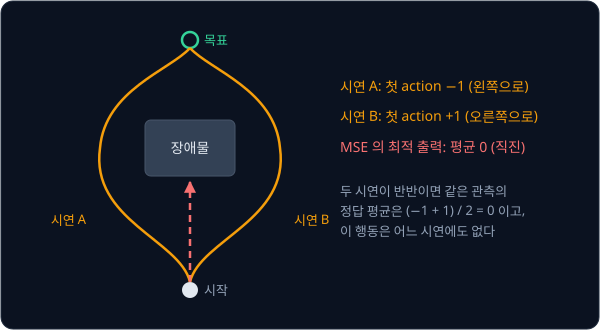
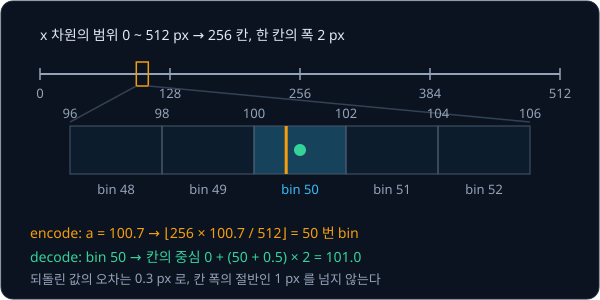
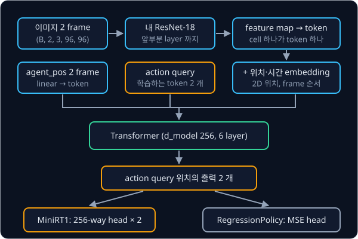

# RT-1

## 배경

### multimodal 시연과 MSE

[Behavior Cloning](../behavior-cloning/README.md) 의 MLP 는 MSE 로 학습했는데, MSE 를 최소로 만드는 출력은 그 관측에서 나온
정답들의 평균 $\mathbb{E}[a \mid o]$ 다. 같은 장면에서 시연자가 어떤 때는 물체 왼쪽으로, 어떤 때는 오른쪽으로 돌아갔다면
policy 는 그 가운데로 곧장 들어가는데, 그 가운데 경로는 어느 시연에도 없던 잘못된 행동이다. 왼쪽으로 도는 첫 action 을
−1, 오른쪽을 +1 이라 하고 두 시연이 반반이면 평균은 0 이다. 한 관측에 정답이 여럿인 이런 시연을 multimodal 하다고 부른다.



### action binning 과 분류

Google 의 RT-1(2022)은 action 을 regression 하지 않고 분류 문제로 바꿨다. action 의 각 차원 $d$ 를 범위
$[a^{(d)}_{\min}, a^{(d)}_{\max}]$ 안에서 균등한 256 개 구간(bin)으로 나누고, 연속값 $a^{(d)}$ 대신 그 값이 들어간 bin 번호
$b^{(d)}$ 를 정답으로 삼는다. 모델은 차원마다 256 개 점수(logits)를 내고, softmax 로 바꾼 256 개 확률 가운데 정답 bin 의
확률을 키우도록 cross-entropy 로 학습한다.

$$
b^{(d)} = \min\!\Big(255,\ \Big\lfloor 256\cdot\frac{a^{(d)} - a^{(d)}_{\min}}{a^{(d)}_{\max} - a^{(d)}_{\min}} \Big\rfloor\Big),
\qquad
\mathcal{L} = -\sum_{d} \log p_\theta\big(b^{(d)} \mid o\big)
$$

$\lfloor\cdot\rfloor$ 은 내림이고, $\min(255, \cdot)$ 은 범위 끝값 $a_{\max}$ 가 256 번이라는 없는 bin 으로 가지 않게 막는다.
$p_\theta(b \mid o)$ 는 관측 $o$ 에서 모델이 bin $b$ 에 준 확률이다. 실행할 때는 고른 bin 의 중심값을 action 으로 쓴다.
PushT 의 x 범위 0~512 px 를 256 칸으로 나누면 한 칸이 2 px 이고, $a = 100.7$ 은 $\lfloor 256 \times 100.7 / 512 \rfloor = 50$ 번
bin 이 되며 되돌리면 칸의 중심 101.0 이 된다.



softmax 는 서로 떨어진 두 bin 에 확률을 동시에 줄 수 있어서 두 갈래 시연을 평균으로 뭉개지 않는다.

### RT-1 의 구조

RT-1 은 이미지 6 장의 history 를 ImageNet 사전학습 EfficientNet-B3 에 넣어 장마다 9×9 feature map, 곧 81 개 token 을
얻는다. feature map 의 cell 하나는 이미지의 한 영역을 요약한 벡터라서 이것을 token 하나로 쓴다. 언어 지시는 FiLM 으로 이
encoder 에 섞는데, FiLM 은 지시 문장의 embedding 에서 channel 마다 scale 과 bias 를 만들어 feature 를 조절하는 방식이다.
TokenLearner 가 장마다 81 개 token 을 8 개로 줄여 총 48 개 token 이 8 층 decoder-only Transformer 로 들어가고, 출력은 11 개
action 차원의 bin 이다. 로봇 13 대로 17 개월 동안 모은 episode 13 만 개 이상으로 학습했다.

이번 과제의 mini RT-1 은 같은 생각을 줄인 모델이다. 언어 지시와 TokenLearner 는 빼고, [ResNet](../resnet/README.md) 에서 짠
ResNet-18 의 feature map cell 을 token 으로 쓴다. 여기에 agent 위치 token 과 학습하는 action query token 2 개를 붙여
[Transformer](../transformer/README.md) 에 넣고, query 자리의 출력 2 개에서 x·y 의 256 logits 를 각각 낸다. 같은 encoder 에
MSE head 를 단 모델이 비교 기준(regression baseline)이다.



### PushT 와 평가 지표

PushT 는 원형 end-effector 로 T 자 블록을 목표 위치로 밀어 넣는 2D 과제다. 관측은 96×96 이미지와 agent 위치 2 개이고,
action 은 agent 가 갈 목표 좌표 (x, y) 로 범위가 0~512 px 다. 블록이 목표 영역과 겹친 비율이 coverage 이고, gym-pusht 는
coverage 가 95% 를 넘으면 성공으로 친다. episode 마다 가장 높았던 coverage 를 max coverage 라 하고, 여러 episode 의 평균을
평균 max coverage 라 한다. `lerobot/pusht` dataset 은 사람이 10 fps 로 모은 206 episode, 25,650 frame 이고, 블록을 어느 쪽으로
돌아가 밀지가 시연마다 달라서 multimodal 하다.

## 목표

- 내 ResNet-18 의 feature map 을 그대로 image token 으로 쓰는 encoder 를 만든다
- 내 Transformer 위에 action 차원마다 256-way head 를 단 mini RT-1 을 만든다
- 같은 encoder 에 MSE head 를 단 regression baseline 을 만든다
- 두 policy 의 PushT 성공률과 평균 max coverage 를 비교한다
- multimodal 구간에서 두 policy 의 action 분포와 궤적을 비교한다

**직접 짤 것**: feature map → token 변환과 positional embedding, action binning 과 역변환, policy 모델, rollout·eval 루프.
**가져다 써도 되는 것**: [ResNet](../resnet/README.md) 과 [Transformer](../transformer/README.md) 에서 만든 모듈,
torchvision 의 ImageNet weight(내 ResNet-18 에 옮겨 넣기), gym-pusht, `LeRobotDataset`.

## 준비물

- Python 3.12, numpy, torch, torchvision, matplotlib, pytest
- `lerobot[pusht]` — gym-pusht 와 dataset loader 가 함께 설치된다
- dataset: Hugging Face Hub 의 `lerobot/pusht` (206 episode, 25,650 frame, 10 fps, 96×96 이미지, 2 차원 state·action)
- ResNet 과제의 ResNet-18 과 Transformer 과제의 Transformer 코드
- 8 GB GPU 로 충분

## 진행 순서

1. `data.py` 에서 `LeRobotDataset("lerobot/pusht")` 로 데이터를 읽고 action 범위와 episode 길이를 확인한 뒤, 최근 2 frame 의
   이미지·agent_pos 와 그 시점의 action 을 한 샘플로 묶는다
2. `binning.py` 의 `ActionBinner` 에 차원별 256 bin 의 `encode` 와 bin 중심값으로 되돌리는 `decode` 를 짠다. 위의 100.7 → 50
   → 101.0 예시가 그대로 나오고, 임의의 action 을 encode·decode 한 오차가 1 px 이하인지 `test_binning.py` 에 test 로 적는다
3. `rt1.py` 의 `ImageTokenizer` 로 최근 2 frame 의 이미지를 ResNet-18 feature map token 으로 바꾸고 위치·시간 embedding 을
   붙인다. 출력 shape 이 (B, 2·h·w, d_model) 인지 확인한다
4. `MiniRT1` 에서 image token 뒤에 agent_pos 를 Linear 로 옮긴 token 하나와 학습하는 action query token 2 개를 덧붙여
   Transformer 에 넣고, 각 query 출력에서 256 logits 를 내는 head 를 단다. `act` 는 argmax 나 sampling 으로 고른 bin 을 `ActionBinner.decode` 로 되돌린다
5. 같은 encoder 위에 MSE head 를 단 `RegressionPolicy` 를 만든다
6. `train.py` 로 두 모델을 같은 step·batch·optimizer 로 학습한다
7. `eval_pusht.py` 의 `evaluate` 로 gym-pusht 에서 모델마다 50 episode 를 돌려 성공률과 평균 max coverage 를 재고, 결과 표를
   `results/` 에 저장한다
8. 시연이 갈라지는 초기 상태 하나를 골라 두 모델의 action 분포와 반복 rollout 궤적을 그려 `results/` 에 저장하고 커밋한다

## 시작점

아래 파일은 모두 리포에 들어 있다.

```text
rt1/
├── pyproject.toml   # 이 과제의 Python 버전과 패키지
├── uv.lock
├── data.py          # LeRobotDataset + 2 frame history
├── binning.py       # ActionBinner
├── rt1.py           # ImageTokenizer, MiniRT1, RegressionPolicy
├── train.py         # 두 모델 학습
├── eval_pusht.py    # evaluate: 성공률, max coverage, multimodal 그림
└── test_binning.py  # ActionBinner 의 encode·decode 오차를 직접 쓰는 test
```

class·method·함수는 몸통이 `raise NotImplementedError` 인 stub 이고, 이름과 signature 는 그대로 둔 채 몸통을 채운다.
`data.py` 에는 정해진 signature 가 없어서 dataset 을 만드는 함수를 직접 정한다. [rt1.py](rt1.py) 첫머리에서 Transformer
과제 폴더를 `sys.path` 에 더해 `EncoderLayer` 를, [train.py](train.py) 첫머리에서 ResNet 과제 폴더를 더해 `resnet18`·
`load_torchvision_weights` 를 import 해 두었다. 채점용 test 는 없어서 평가 기준은 [test_binning.py](test_binning.py) 에 직접 쓴
test 와 `results/` 에 저장한 평가 표·그림으로 확인한다. 패키지는 `pyproject.toml` 에 있고, 이 폴더에서
`uv run` 을 처음 실행할 때 `.venv/` 에 설치된다.

```bash
cd projects/rt1
uv run pytest
uv run python train.py
uv run python eval_pusht.py
```

## 평가 기준

- [ ] `ActionBinner` 로 encode 후 decode 한 action 의 오차가 bin 폭의 절반 이하다 (PushT 범위 [0, 512] 이면 1 px)
- [ ] 두 모델을 같은 50 episode 초기 상태로 평가했을 때 mini RT-1 의 평균 max coverage 가 regression baseline 보다 높다
- [ ] 시연이 갈라지는 상태에서 classification head 의 softmax 가 두 봉우리를 보이고, regression 출력은 그 사이에 찍힌다
- [ ] 같은 초기 상태에서 sampling 으로 20 번 rollout 하면 mini RT-1 의 궤적이 두 갈래 이상으로 나뉜다
- [ ] (선택) LeRobot 이 공개한 `lerobot/diffusion_pusht` 를 같은 50 episode 로 평가해 기준선으로 함께 적는다
  (model card 의 500 episode 결과는 평균 max overlap 0.955, 성공률 65.4%)

## 생각해 볼 질문

1. MSE regression 이 multimodal 시연에서 평균을 내는 이유를 loss 의 최적해로 설명할 수 있는가?
2. x 와 y 를 각각 독립된 softmax 에서 뽑으면 왼쪽 갈래의 x 와 오른쪽 갈래의 y 가 섞인 action 이 나올 수 있다. 어떤
   경우에 그런가? 차원을 순서대로 뽑는 autoregressive 방식은 이 문제를 어떻게 피하고, RT-1 은 왜 그 방식을 뺐는가?
3. bin 을 16 개로 줄이거나 4096 개로 늘리면 각각 무엇을 잃는가?

## 힌트

<details>
<summary>feature map 의 token 변환</summary>

96×96 입력이면 ResNet-18 의 layer4 출력은 3×3 이라 token 이 9 개뿐이다. layer3 (6×6, 256 channel) 에서 끊고 linear 로
`d_model` 에 맞추면 공간 정보가 더 남는다. 각 cell 에 2D positional embedding 을, frame 마다 시간 embedding 을 더해야
Transformer 가 위치와 순서를 구분한다.

</details>

<details>
<summary>bin 경계와 정규화</summary>

PushT 의 action 은 [0, 512] 범위의 절대 좌표다. bin 경계를 데이터의 min·max 대신 env 범위로 고정하면 학습과 평가가 같은
binner 를 쓰기 쉽다. 입력 쪽 agent_pos 는 따로 [-1, 1] 로 정규화한다. 균등 bin 대신 action 을 k-means 로 묶고 묶음
중심 기준 offset 까지 regression 하는 Behavior Transformers 방식도 있어서, 시간이 남으면 같은 head 자리에 바꿔 끼워 본다.

</details>

<details>
<summary>argmax 와 sampling</summary>

argmax 로 고르면 같은 초기 상태에서 궤적이 늘 한 갈래로만 나온다. 다양성을 보려면 softmax 에서 sampling 하고, 성공률은
argmax 와 sampling 두 방식으로 모두 재 본다.

</details>

## 참고 자료

- Anthony Brohan et al., [RT-1: Robotics Transformer for Real-World Control at Scale](https://arxiv.org/abs/2212.06817) (2022) —
  "RT-1: Robotics Transformer" 절의 구조 설명(FiLM EfficientNet, TokenLearner, action tokenization)과 Figure 3 의 구조 그림
- [RT-1 project page](https://robotics-transformer1.github.io/) — 구조 그림과 데이터 규모
- Nur Muhammad Mahi Shafiullah et al., [Behavior Transformers: Cloning k modes with one stone](https://arxiv.org/abs/2206.11251) (2022) —
  action 을 k-means 로 묶어 분류하고 offset 을 regression 하는 방식. multimodal 시연에서 MSE 가 실패하는 예를 그림으로 보인다
- Pete Florence et al., [Implicit Behavioral Cloning](https://arxiv.org/abs/2109.00137) (2021) — 정답이 여럿이거나 불연속인
  action 에서 explicit regression 이 평균을 내는 문제를 다룬다
- Michael S. Ryoo et al., [TokenLearner: What Can 8 Learned Tokens Do for Images and Videos?](https://arxiv.org/abs/2106.11297) (2021) —
  RT-1 이 token 81 개를 8 개로 줄이는 데 쓴 모듈
- Mingxing Tan, Quoc V. Le, [EfficientNet](https://arxiv.org/abs/1905.11946) (2019) — RT-1 의 image encoder
- 공식 TensorFlow 구현 [google-research/robotics_transformer](https://github.com/google-research/robotics_transformer), PyTorch 구현 [lucidrains/robotic-transformer-pytorch](https://github.com/lucidrains/robotic-transformer-pytorch) — 막혔을 때만 연다
- [gym-pusht](https://github.com/huggingface/gym-pusht) — observation·action 정의와 성공 기준(coverage 95% 이상)
- [lerobot/pusht](https://huggingface.co/datasets/lerobot/pusht) dataset, 기준선 모델 [lerobot/diffusion_pusht](https://huggingface.co/lerobot/diffusion_pusht)

## 남은 한계

bin 해상도가 정밀도를 제한하고, 차원별로 독립된 softmax 는 차원 사이의 상관을 담지 못하며, policy 는 여전히 한 step 씩
action 을 낸다. [Diffusion Policy](../diffusion-policy/README.md) 는 연속 action sequence 의 분포를 직접 생성하고,
[RT-2 → OpenVLA](../vla-tokens/README.md) 는 이 action token 을 사전학습된 VLM 의 vocabulary 에 넣어 언어 지시와 web 지식을
함께 쓴다.
