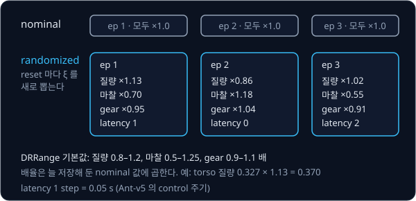
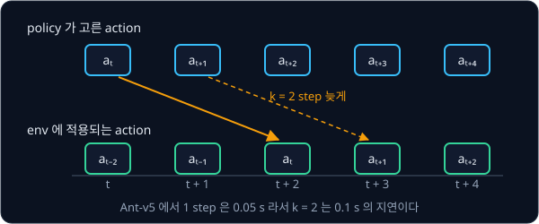
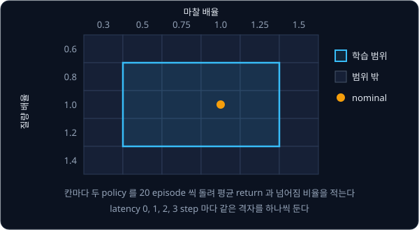

# Sim-to-Real Locomotion

## 배경

[PPO](../ppo/README.md) 로 학습한 HalfCheetah policy 가 잘 달린다는 보장은 학습에 쓴 바로 그 simulator parameter 에서만 성립한다.
실물 로봇으로 옮기면 그 보장이 깨지는데, 이 과제는 그 차이를 simulator 안에서 흉내 내고, 학습 방법을 바꿔 policy 가 차이를
견디게 만든다.

### reality gap

실물 로봇은 링크 질량, 바닥 마찰, 모터가 내는 힘, 센서 값을 읽고 명령을 내기까지의 지연(latency)이 simulator 와 조금씩 다르다.
이 차이를 reality gap 이라고 한다. sim 의 한 점에 과하게 맞춘 policy 는 이 차이 앞에서 쉽게 넘어진다. 예를 들어 sim 바닥의
마찰에 맞춰 발을 세게 밀어 나아가던 policy 는, 실물 바닥의 마찰이 sim 의 70% 뿐이면 미끄러져 균형을 잃는다.

### domain randomization

domain randomization 은 학습 중 episode 를 시작할 때마다 이 parameter 들을 정한 범위 안에서 무작위로 다시 뽑는다. policy 는 특정
값 하나가 아니라 범위 전체에서 return 이 높아지도록 학습되고, 실물의 값이 그 범위 안 어딘가에 있다면 실물에서도 버틸 가능성이
커진다.

$$
\max_\pi\ \mathbb E_{\xi\sim p(\xi)}\Big[\ \mathbb E_{\tau\sim\pi,\ \xi}\Big[\sum_t\gamma^t r_t\Big]\Big],
\qquad \xi=(\text{mass},\ \text{friction},\ \text{motor strength},\ \text{latency},\ \dots)
$$

$\xi$ 는 episode 하나의 dynamics 를 정하는 parameter 묶음이고, $p(\xi)$ 는 그것을 뽑는 분포다. 안쪽 기댓값은 그 dynamics 에서
policy 로 얻는 return, 바깥 기댓값은 여러 $\xi$ 에 대한 평균이다. 이 과제의 `DRRange` 기본값은 질량 0.8–1.2 배, 마찰 0.5–1.25 배,
actuator gear 0.9–1.1 배를 균등분포로 뽑는다. 질량 배율로 1.13 이 뽑히면 Ant 몸통의 질량 0.327 은 0.370 이 되는데, 배율은 늘
처음 저장해 둔 nominal 값에 곱해야 episode 마다 쌓이지 않는다.



Tobin et al. 2017 은 렌더링을 무작위화해 sim 에서만 학습한 object detector 를 실물 grasping 에 썼고, Peng et al. 2018 은
dynamics 를 무작위화해 sim 에서만 학습한 policy 를 실물 로봇 팔로 옮겼다. Tan et al. 2018 은 4족 보행에 latency 와 actuator model
까지 sim 에 넣었고, Rudin et al. 2021 은 GPU 한 장에서 수천 개 환경을 병렬로 돌려 평지 보행 학습을 4 분 안쪽으로 줄였다. 지금은
이런 GPU 병렬 sim 과 PPO, randomization 의 조합이 보행 학습의 표준 구성이다.

### Ant-v5 환경

`Ant-v5` 는 다리 4 개짜리 로봇을 앞으로 걷게 하는 gymnasium 의 MuJoCo 환경이다. 다리마다 엉덩이와 발목 관절이 있어서 action
은 관절 토크 명령 8 개이고, contact force 를 뺀 observation(`include_cfrc_ext_in_observation=False`)은 연속값 27 개다. reward 는
넘어지지 않은 step 마다 주는 healthy reward 와 앞으로 간 속도를 더하고, 토크와 접촉력이 클수록 조금씩 뺀다. 몸통 높이가
0.2–1.0 범위를 벗어나면 넘어진 것으로 보고 episode 가 terminated 되며, 넘어지지 않으면 1000 step 에서 끝난다. step 하나는 0.05 초라
1000 step 은 50 초다.

randomize 할 값은 [MuJoCo Sim](../mujoco-sim/README.md) 에서 다룬 MuJoCo model 에 있다.

| 값 | 자리 | Ant 의 nominal 값 |
| --- | --- | --- |
| 질량 | `model.body_mass` (body 마다 하나) | 몸통 0.327, 다리 조각 0.039·0.068 |
| 마찰 | `model.geom_friction` (geom 마다 sliding·torsional·rolling 세 값) | sliding 1.0 |
| actuator gear | `model.actuator_gear` 의 첫 열 (관절 토크 = gear × 명령) | 150 |

### latency 와 observation noise

latency 는 policy 가 action 을 고른 시점과 그 action 이 실제로 적용되는 시점 사이의 지연이다. `ActionLatency` 는 step $t$ 에서
고른 action 을 $k$ step 뒤에 env 에 넣는다. Ant-v5 에서 $k = 2$ 는 0.1 초의 지연이고, episode 첫 $k$ step 에는 아직 고른 action 이
없으므로 0 action 같은 정해 둔 값을 넣는다. `ObservationNoise` 는 observation 에 표준편차 `std` 의 Gaussian noise 를 더해 센서
noise 를 흉내 낸다.



### sim-to-sim 평가

이 과제는 실물 로봇 없이 sim-to-sim 으로 평가한다. 학습 때 쓰지 않은 dynamics 범위를 실물 대역으로 정해 두고, randomization 을
넣은 policy(DR policy)와 넣지 않은 policy(nominal policy)가 그 범위에서 얼마나 버티는지 비교한다. 평가 격자는 질량 배율과 마찰
배율의 조합에 latency 를 더한 3 차원 격자이고, 칸마다 episode 를 여러 번 돌려 평균 return 과 넘어짐 비율(1000 step 전에
terminated 된 episode 의 비율)을 적는다. 격자는 학습 범위보다 넓게 잡아야 학습 범위 밖에서의 차이가 드러난다.



robustness 에는 비용이 따를 수 있어서, nominal 조건에서 두 policy 의 return 차이도 함께 잰다.

## 목표

- reset 마다 질량·마찰·actuator gear 를 다시 뽑는 domain randomization wrapper 를 짠다
- action 을 정해진 step 만큼 늦게 적용하는 latency wrapper 와 observation noise wrapper 를 짠다
- 내 PPO 로 4족 `Ant-v5` 를 nominal dynamics 와 randomized dynamics 에서 각각 학습한다
- 학습에 쓰지 않은 질량·마찰·latency 격자에서 두 policy 의 return 과 넘어짐 비율을 heatmap 으로 비교한다

**직접 짤 것**: randomization·latency·noise wrapper, 평가 격자와 heatmap, (선택) Go1 용 velocity command 추종 reward.
**가져다 써도 되는 것**: [PPO](../ppo/README.md) 에서 짠 내 PPO, gymnasium `Ant-v5`, MuJoCo Menagerie 의 Unitree Go1 모델.

## 준비물

- Python 3.12, numpy, `torch`, `gymnasium[mujoco]`(MuJoCo 가 함께 설치된다), matplotlib, pytest. ppo 과제의 코드를 import 하므로 그
  과제의 `gymnasium[classic_control]`·`tensorboard` 도 함께 들어 있다
- [PPO](../ppo/README.md) 과제에서 채운 `projects/ppo/` 의 코드
- 기본 구성은 CPU MuJoCo 의 `Ant-v5` 를 `gymnasium.vector.AsyncVectorEnv` 로 8–16 개 띄우는 것이다. 수백만 step 이 필요해서
  CPU 코어 수에 따라 학습 한 번에 몇 시간이 걸리고, GPU 는 policy update 에만 쓰므로 8 GB 로 충분하다
- (선택) [MuJoCo Playground](https://github.com/google-deepmind/mujoco_playground) 의 `Go1JoystickFlatTerrain` 은 MJX(JAX) 로
  GPU 에서 수천 개 env 를 돌리는 구성이다. CUDA 용 JAX 를 따로 설치해야 하고 8 GB GPU 에서는 env 수를 줄여야 할 수 있어서,
  공식 [locomotion Colab notebook](https://github.com/google-deepmind/mujoco_playground/blob/main/learning/notebooks/locomotion.ipynb)
  으로 먼저 돌려 보는 편이 쉽다
- Isaac Sim·Isaac Gym 은 필요 없다

## 진행 순서

1. `train.py` 에서 ppo 과제의 `train` 으로 contact force 를 뺀 `Ant-v5`(`include_cfrc_ext_in_observation=False`)를 학습해
   nominal policy 를 얻는다. wrapper 를 씌운 env 는 `train` 의 `make_env` 로 넘기고, `AsyncVectorEnv` 는 `async_envs=True` 로
   켠다
2. `wrappers.py` 의 `DynamicsRandomization` 을 채운다. 처음에 nominal 값을 복사해 두고, `reset()` 때마다 body 질량·geom 마찰·
   actuator gear 에 새로 뽑은 배율을 곱한다
3. 같은 파일의 `ActionLatency` 와 `ObservationNoise` 를 채운다
4. `set_params(1, 1, 1)`·latency 0·noise 0 인 wrapper 환경이 같은 seed·같은 action 열에서 원래 `Ant-v5` 와 똑같은 observation 을
   내는지 `test_wrappers.py` 에 pytest 로 쓴다
5. 세 wrapper 를 씌운 환경에서 nominal policy 와 같은 step 수만큼 DR policy 를 학습한다
6. `evaluate.py` 의 `evaluate_grid` 를 채운다. 학습 범위 밖까지 걸치는 (질량 배율 × 마찰 배율) 격자와 latency 0–3 step 을 평가
   세트로 정하고, 칸마다 두 policy 를 20 episode 씩 돌려 평균 return 과 넘어짐 비율을 잰다
7. `plots.py` 에서 두 policy 의 결과를 칸별 heatmap 과 latency 곡선으로 나란히 그려 `results/` 에 저장하고, nominal 조건의 return
   차이를 % 로 함께 적는다
8. (선택) MuJoCo Menagerie 의 Go1 을 velocity command 추종 reward 로 감싼 환경에서 같은 실험을 반복한다

## 시작점

아래 파일은 모두 리포에 들어 있다.

```text
sim2real-locomotion/
├── pyproject.toml    # 이 과제의 Python 버전과 패키지
├── uv.lock
├── wrappers.py       # DRRange, DynamicsRandomization, ActionLatency, ObservationNoise 의 stub
├── train.py          # ppo 과제의 PPO 를 import 해 nominal·DR policy 를 학습한다
├── evaluate.py       # evaluate_grid 의 stub
├── plots.py          # 평가 격자 heatmap 과 latency 곡선
└── test_wrappers.py  # wrapper 가 nominal dynamics 를 건드리지 않는지 확인하는 test 를 직접 쓴다
```

[wrappers.py](wrappers.py)·[evaluate.py](evaluate.py) 의 함수와 method 는 몸통이 `raise NotImplementedError` 인 stub 이고, 이름과
signature 는 그대로 둔 채 몸통을 채운다. [train.py](train.py) 는 옆 폴더 `projects/ppo/` 를 `sys.path` 에 더해 ppo 과제의
`PPOConfig` 와 `train` 을 import 하므로, ppo 과제를 먼저 채워 둬야 한다. 채점용 test 는 없어서 평가 기준은
[test_wrappers.py](test_wrappers.py) 에 직접 쓴 test 와 `plots.py` 의 그림, 학습 기록으로 확인한다. 패키지는 `pyproject.toml` 에
있고, 이 폴더에서 `uv run` 을 처음 실행할 때 `.venv/` 에 설치된다.

```bash
cd projects/sim2real-locomotion
uv run pytest
uv run python train.py
uv run python plots.py
```

## 평가 기준

- [ ] nominal policy 가 nominal `Ant-v5` 에서 10 episode 모두 넘어지지 않고(terminated 없이) 1000 step 을 채우며 앞으로 나아간다
- [ ] `set_params(1, 1, 1)`·latency 0·noise 0 으로 둔 wrapper 환경이 같은 seed·같은 action 열에서 원래 `Ant-v5` 와 똑같은
  observation 을 낸다(wrapper 가 nominal dynamics 를 건드리지 않는다는 pytest)
- [ ] 평가 격자 중 학습 범위 밖 칸에서 DR policy 의 평균 return 이 nominal policy 보다 높은 칸이 더 많다
- [ ] 학습 때 latency 를 0–2 step 으로 섞었다면, latency 2 step 에서 DR policy 의 넘어짐 비율이 nominal policy 보다 낮다
- [ ] nominal 조건에서 DR policy 가 nominal policy 대비 return 을 몇 % 잃는지 기록해 robustness 의 비용을 숫자로 남긴다
- [ ] (선택) Go1 환경이나 MuJoCo Playground 의 `Go1JoystickFlatTerrain` 에서 같은 비교를 반복한다

## 생각해 볼 질문

1. randomization 범위를 아주 넓히면 nominal 조건의 성능은 어떻게 되고, 그 이유는 무엇인가? 범위는 무엇을 근거로 정해야 하는가?
2. latency 가 있는 환경에서 policy 가 현재 observation 만 보면 왜 부족한가? 직전 action 몇 개를 observation 에 넣으면 무엇이 달라지는가?
3. domain randomization 으로 학습한 policy 는 지금 바닥 마찰이 얼마인지 모른 채 모든 마찰에 무난한 행동을 고른다. RMA 처럼 최근
   state·action 이력으로 그 값을 추정해 policy 에 넣으면 무엇을 더 얻는가?

## 힌트

<details>
<summary>MuJoCo model 값을 바꾸는 자리</summary>

`env.unwrapped.model` 의 `body_mass`·`geom_friction`·`actuator_gear` 는 numpy view 라서 값을 바로 바꿀 수 있다. reset 마다 nominal
값에 배율을 곱해야 하므로, 처음에 원본을 복사해 두지 않으면 배율이 episode 마다 누적된다. 질량을 바꿀 때는 `body_inertia` 도
같은 배율로 바꾸는 편이 물리적으로 맞다.

</details>

<details>
<summary>AsyncVectorEnv 안의 wrapper</summary>

`AsyncVectorEnv` 는 env 마다 별도 process 를 띄우므로 randomization wrapper 는 env 생성 함수 안에서 씌우고 seed 도 env 마다 다르게
준다. 평가처럼 parameter 를 밖에서 고정해야 할 때는 단일 env 에서 `set_params` 를 부르는 편이 단순하다.

</details>

<details>
<summary>DR policy 가 아예 걷지 못할 때</summary>

처음부터 넓은 범위로 학습하면 PPO 가 걷는 법을 찾기 전에 막힌다. 범위를 0 에서 시작해 학습 진행에 따라 넓히는 curriculum 을 쓰거나,
nominal policy 에서 이어서 학습한다.

</details>

## 참고 자료

- Josh Tobin 외, [Domain Randomization for Transferring Deep Neural Networks from Simulation to the Real World](https://arxiv.org/abs/1703.06907)
  (2017) — 렌더링 randomization 으로 sim 에서만 학습한 detector 를 실물에 쓴 첫 사례
- Xue Bin Peng 외, [Sim-to-Real Transfer of Robotic Control with Dynamics Randomization](https://arxiv.org/abs/1710.06537) (2018) — 이
  과제와 같은 dynamics randomization. 무작위화한 parameter 와 범위 표가 범위를 정할 때 참고가 된다
- Jie Tan 외, [Sim-to-Real: Learning Agile Locomotion For Quadruped Robots](https://arxiv.org/abs/1804.10332) (2018) — latency 와
  actuator model 을 sim 에 넣은 4족 보행
- Nikita Rudin 외, [Learning to Walk in Minutes Using Massively Parallel Deep Reinforcement Learning](https://arxiv.org/abs/2109.11978)
  (2021) — GPU 병렬 sim 과 PPO, terrain curriculum
- Ashish Kumar 외, [RMA: Rapid Motor Adaptation for Legged Robots](https://arxiv.org/abs/2107.04034) (2021)·[프로젝트 페이지](https://ashish-kmr.github.io/rma-legged-robots/)
  — 최근 이력으로 dynamics 를 추정하는 adaptation module 과 실물 영상
- Lilian Weng, [Domain Randomization for Sim2Real Transfer](https://lilianweng.github.io/posts/2019-05-05-domain-randomization/)
  — randomization 의 종류와 범위 정하는 방법을 정리한 글
- Gymnasium [Ant](https://gymnasium.farama.org/environments/mujoco/ant/) 문서 — observation·reward·종료 조건과 생성자 인자
- Gymnasium [Wrappers](https://gymnasium.farama.org/api/wrappers/) 문서 — `gym.Wrapper`·`ObservationWrapper` 를 상속해 `reset`·`step`·
  `observation` 을 고치는 방법
- MuJoCo [XML reference](https://mujoco.readthedocs.io/en/stable/XMLreference.html)·[API types](https://mujoco.readthedocs.io/en/stable/APIreference/APItypes.html)
  — `body_mass`·`geom_friction`·`actuator_gear` 가 무엇을 뜻하는지
- MuJoCo Menagerie [unitree_go1](https://github.com/google-deepmind/mujoco_menagerie/tree/main/unitree_go1) — (선택) 실제 4족 로봇 모델
- [MuJoCo Playground](https://playground.mujoco.org/) — GPU 병렬 학습과 sim-to-real 사례
- [legged_gym](https://github.com/leggedrobotics/legged_gym)·[rsl_rl](https://github.com/leggedrobotics/rsl_rl) — Rudin et al. 의 보행 환경과
  PPO 구현. Isaac Gym 기반이라 실행보다 reward 항과 randomization 설정을 읽는 용도. 막혔을 때만 연다

## 남은 한계

sim-to-sim 평가는 reality gap 의 일부만 흉내 낸다. 실제 모터의 비선형 응답, 고르지 않은 지면, 센서 noise 까지 다루려면
actuator network(Hwangbo et al. 2019)나 RMA 같은 adaptation 을 붙이고, Unitree Go1·Go2 같은 실물 보행 로봇이나 MuJoCo Playground 의
sim-to-real 예제로 넘어가야 한다.
