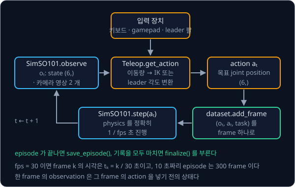
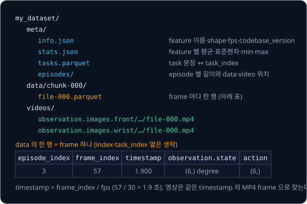

# Teleop Dataset

## 배경

### teleoperation 과 시연 데이터

[MuJoCo Simulation](../mujoco-sim/README.md) 의 팔은 사람이 짠 controller 를 따라 움직였다. imitation learning 은 그 controller 대신
사람이 보여 준 동작을 데이터로 삼는데, 그러려면 사람이 로봇을 실시간으로 움직이면서(teleoperation) 그때의 observation 과
명령을 일정한 주기로 남겨야 한다. RoboTurk(2018)은 스마트폰을 움직여 end-effector 를 조종하는 방식을 썼고, ALOHA(2023)는
똑같이 생긴 leader 팔을 손으로 움직이면 follower 팔이 joint angle 을 그대로 따라 하는 방식을 썼다. SO-101 도 leader·follower
한 쌍으로 쓰는 팔이다.

### 입력 장치별 명령 변환

입력 장치가 내는 값과 로봇이 받는 값이 다르므로 그 사이를 바꿔 주는 부분이 필요하다. 이 과제의 action 은 언제나 joint 6 개의
목표 위치이고, 장치마다 바꾸는 방법이 다르다.

| 장치 | 장치가 내는 값 | action 으로 바꾸는 방법 |
| --- | --- | --- |
| 키보드·gamepad | end-effector 를 x·y·z 로 얼마나 옮길지 | IK 로 joint 변화량을 구해 지금 joint 에 더한다 |
| leader 팔 | leader 의 joint 각도 6 개 | joint 마다 부호와 offset 을 맞춰 그대로 쓴다 |

IK(inverse kinematics)는 end-effector 를 원하는 만큼 옮기려면 joint 를 얼마나 돌려야 하는지 구하는 계산이다. 작은 움직임에서는
joint 변화량 $\Delta q$ 와 end-effector 변화량 $\Delta x$ 가 Jacobian $J$ 로 $\Delta x \approx J\,\Delta q$ 관계라서, 거꾸로
$\Delta q \approx J^{+}\Delta x$ 로 구한다. $J$ 는 (3, 관절 수) 행렬로 MuJoCo 의 `mj_jacSite` 가 계산해 주고, $J^{+}$ 는
pseudo-inverse 다. 자세한 원리는 [Inverse Kinematics](../inverse-kinematics/README.md) 에서 다룬다. 예를 들어 키를 누르고 있는
동안 frame 마다 end-effector 를 5 mm 씩 옮기게 하면 30 fps 에서 초당 15 cm 로 움직인다.

### 기록하는 데이터

기록하는 데이터는 episode 마다 observation 과 action 이 짝을 이룬 sequence 다.

$$
\mathcal{D} = \{(o_t, a_t)\}_{t=0}^{T-1}, \qquad
o_t = \big(s_t,\ I^{\text{front}}_t,\ I^{\text{wrist}}_t\big), \qquad
t_k = k / \text{fps}
$$

$s_t$ 는 joint position 6 개, $I_t$ 는 카메라 영상 (480, 640, 3), $a_t$ 는 그 시점에 보낸 목표 joint position 6 개다. $o_t$ 는
$a_t$ 를 넣기 전의 상태라서, policy 는 나중에 "이 관측에서 이 action 을 냈다" 를 배운다. $t_k$ 는 $k$ 번째 frame 의 시각으로,
30 fps 면 frame 1 이 0.033 초, 10 초짜리 episode 는 300 frame 이다. frame 마다 정확히 $1/\text{fps}$ 초만큼 sim 을 진행해야
영상·state·action 의 시각이 서로 맞는다.



### LeRobotDataset 형식

dataset 마다 형식이 다르면 policy 코드를 매번 고쳐야 해서, Open X-Embodiment(2023)는 21개 기관의 데이터를 한 형식(RLDS)으로
모았다. LeRobot 은 joint 값 같은 표 데이터를 Parquet 에, 영상을 MP4 에, schema·통계·episode 경계를 `meta/` 에 두는
LeRobotDataset 형식(현재 v3.0)을 쓴다. Parquet 은 열(column) 단위로 저장하는 표 파일 형식이고, 영상은 frame 을 하나씩 저장하지
않고 MP4 로 압축해 두었다가 timestamp 로 찾아 꺼낸다.



`meta/info.json` 의 `features` 가 각 열의 이름·shape·dtype 을 적는다. 실물 SO-101 로 모은
[lerobot/svla_so101_pickplace](https://huggingface.co/datasets/lerobot/svla_so101_pickplace) 는 30 fps 이고, `action` 과
`observation.state` 가 모두 shape (6,) 에 `shoulder_pan.pos` 부터 `gripper.pos` 까지 이름이 붙어 있다. sim 시연을 같은 이름·
shape·단위로 저장해 두면 실물 SO-101 데이터와 같은 코드로 학습할 수 있다.

### replay

replay 는 기록한 episode 와 같은 초기 상태에서 저장된 action 만 차례로 다시 넣는 것이다. policy 처럼 관측을 보고 action 을
고르지 않고, 기록된 action 을 시간 순서대로 그대로 넣는다. sim 은 같은 초기 상태와 같은 입력에 같은 결과를 내므로, replay 한
joint trajectory 와 기록된 `observation.state` 를 비교하면 기록이 빠짐없이 저장되었는지 확인할 수 있다.

## 목표

- 키보드·gamepad·leader 팔 가운데 하나로 sim SO-101 을 움직이는 teleop loop 를 만든다
- 정해진 fps 로 joint state, 카메라 두 대의 영상, action, task 문장을 기록한다
- `LeRobotDataset` 으로 episode 를 저장하고 다시 불러온다
- 기록한 action 을 같은 초기 상태에서 다시 넣어 시연을 replay 한다
- 성공한 시연을 20개 이상 모은다

**직접 짤 것**: teleop 입력을 목표 joint position 으로 바꾸는 부분(키보드·gamepad 면 IK 를 거친다), 고정 주기 기록 loop,
episode 초기화와 성공 판정, replay 와 비교.
**가져다 써도 되는 것**: `lerobot` 의 `LeRobotDataset`(저장 형식 자체를 다시 짤 필요는 없다), `pynput`·`pygame` 같은 입력
library, leader 팔이 있으면 LeRobot 의 `SO101Leader`.

## 준비물

- Python 3.12, `mujoco`, numpy, pytest
- `lerobot[dataset-viz,feetech]`(LeRobot 0.6 이상) — `LeRobotDataset`, `lerobot-dataset-viz`, SO-101 leader 팔을 읽는 feetech
  servo driver 가 함께 설치된다
- 입력 장치: 키보드면 `pynput`, gamepad 면 `pygame`, SO-101 leader 팔이면 LeRobot 의 `SO101Leader`. 세 가지 모두 이 과제
  환경에 들어 있다
- mujoco-sim 과제의 SO-101 scene 에 cube 와 고정 카메라를 더한 것(Menagerie 의 `scene_box.xml` 에서 시작해도 된다)
- GPU 불필요

## 진행 순서

1. `teleop/` 에서 쓸 입력 장치 하나를 골라, 장치를 읽어 end-effector 이동량(키보드·gamepad)이나 joint angle(leader 팔)을 내고
   `sim_so101.py` 의 `Teleop` protocol 대로 `get_action` 이 목표 joint position (6,) 을 돌려주는 class 를 짠다
2. `sim_so101.py` 의 `SimSO101` 에 `reset`·`step`·`observe` 를 짠다. `step` 한 번에 sim 시각이 정확히 $1/\text{fps}$ 초 늘어나는지
   `data.time` 으로 확인한다
3. `reset` 에서 cube 를 무작위 위치에 놓고, 성공 조건(cube 를 들어 목표 영역에 놓기)을 판정하는 `success` 를 짠다
4. `record.py` 의 `make_features` 에 `LeRobotDataset.create` 에 줄 feature 정의를 실물 SO-101 dataset 과 같은 이름·단위로 만든다
5. `record` 에 매 frame `add_frame`, episode 끝에 `save_episode`, 기록이 끝나면 `finalize` 를 부르는 기록 loop 를 짠다
6. `test_dataset.py` 에서 저장한 dataset 을 `LeRobotDataset(repo_id, root=...)` 로 다시 불러 episode 수·frame 수·feature 를
   확인한다
7. `replay.py` 의 `replay` 로 같은 초기 상태에서 기록한 action 만 다시 넣고, 그 결과를 기록한 joint trajectory 와 비교한다
8. 시연을 20개 이상 모으고 `lerobot-dataset-viz` 로 훑어본다

## 시작점

아래 파일은 모두 리포에 들어 있다.

```text
teleop-dataset/
├── pyproject.toml       # 이 과제의 Python 버전과 패키지
├── uv.lock
├── teleop/
│   ├── keyboard.py      # 키보드 → end-effector 이동량 → IK → 목표 joint
│   ├── gamepad.py       # gamepad → end-effector 이동량 → IK → 목표 joint
│   └── leader.py        # SO101Leader 각도 → sim 목표 joint
├── sim_so101.py         # JOINTS, Teleop, SimSO101: reset, step, observe, success
├── record.py            # make_features, record: teleop loop + LeRobotDataset 기록
├── replay.py            # replay: 기록과 재생의 joint 차이
└── test_dataset.py      # 저장한 dataset 을 검사하는 test
```

`sim_so101.py`·`record.py`·`replay.py` 의 함수와 method 는 몸통이 `raise NotImplementedError` 인 stub 이고, 이름과 signature 는
그대로 둔 채 몸통을 채운다. [Real Robot](../real-robot/README.md) 의 sim follower 가 `sim_so101.py` 의 `SimSO101` 을 import 해서
쓰므로 signature 를 바꾸지 않는다. `Teleop` 은 입력 장치 class 가 따를 protocol 이라 몸통이 `...` 이다. `teleop/` 의 세 파일에는 정해진
signature 가 없어서, 쓰려는 장치의 파일에 `get_action` 을 가진 class 를 직접 만든다. 채점용 test 는 없어서 평가 기준은
`test_dataset.py` 에 직접 쓴 test 와 replay 결과로 확인한다. 패키지는 `pyproject.toml` 에 있고, 이 폴더에서 `uv run` 을 처음
실행할 때 `.venv/` 에 설치된다.

```bash
cd projects/teleop-dataset
uv run python record.py
uv run python replay.py
uv run pytest
uv run lerobot-dataset-viz --repo-id <repo_id> --root <저장 폴더> --episode-index 0
```

## 평가 기준

- [ ] 저장한 dataset 의 `meta/info.json` 에서 `codebase_version` 이 `v3.0` 이고, `action`·`observation.state` 의 이름과
      shape 가 실물 SO-101 dataset [lerobot/svla_so101_pickplace](https://huggingface.co/datasets/lerobot/svla_so101_pickplace)
      와 같다
- [ ] 다시 불러온 dataset 의 `meta.total_episodes`, 전체 frame 수, episode 별 길이가 기록할 때 센 값과 같다
- [ ] replay 한 joint trajectory 가 기록된 `observation.state` 와 joint 마다 0.5° 안에서 겹치고, 성공한 시연은 replay 에서도
      성공한다
- [ ] 성공한 시연이 20개 이상이고, teleop loop 의 실제 주기가 목표 fps 의 ±10% 안이다
- [ ] (선택) `lerobot-dataset-viz --repo-id ... --root ... --episode-index 0` 으로 연 화면에서 영상과 joint 곡선의 시점이
      맞는다

## 생각해 볼 질문

1. action 을 다음 목표 joint position 으로 저장할 때와 joint velocity 나 end-effector 위치 변화량으로 저장할 때, 나중에
   학습한 policy 의 동작은 어떻게 달라지는가?
2. 같은 작업이라도 키보드로 모은 시연과 leader 팔로 모은 시연은 어떤 점이 다른가? 그 차이가 imitation learning 에 왜
   중요한가?
3. sim 에서는 replay 가 기록과 거의 그대로 겹치지만 실물 팔에서는 그렇지 않다. 이 차이는 시연을 그대로 replay 하지 않고
   observation 을 보고 action 을 내는 policy 를 학습해야 하는 이유와 어떻게 이어지는가?

## 힌트

<details>
<summary>LeRobotDataset 의 frame 추가</summary>

`add_frame` 에 주는 dict 에는 feature 로 정의한 key 전부와 `"task"` 문자열이 있어야 한다. `timestamp`·`frame_index` 는
LeRobot 이 `frame_index / fps` 로 채우므로 넣지 않는다. 영상은 `(H, W, 3)` uint8 배열이면 되고, feature 정의는
`{"dtype": "video", "shape": (480, 640, 3), "names": ["height", "width", "channels"]}` 꼴이다. 마지막에 `finalize()` 를
부르지 않으면 parquet 파일이 깨진 채로 남는다.

</details>

<details>
<summary>fps 와 physics timestep</summary>

Menagerie SO-101 의 timestep 은 5 ms 라서 30 fps 의 한 주기(33.3 ms)가 정수 step 으로 나뉘지 않는다. timestep 을 바꾸든 fps
를 바꾸든 frame 마다 같은 수의 physics step 이 돌게 맞춰야 영상·state·action 의 시각이 어긋나지 않는다.

</details>

<details>
<summary>단위, leader 팔, replay 재현성</summary>

LeRobot 0.6 의 SO-101 은 gripper 를 뺀 joint 를 degree 로, gripper 를 0–100 으로 기록한다. sim 의 radian 을 그대로 저장하면
실물 데이터와 같은 코드를 쓸 수 없으니 저장할 때 단위를 맞춘다. `SO101Leader` 가 주는 degree 의 0 은 calibration 때 기록한
joint range 의 가운데라서 URDF 의 0 rad 와 다르고, joint 마다 부호와 offset 을 한 번 재서 맞춰야 한다. replay 가 기록과
어긋나면 cube 를 포함한 초기 상태 전체를 저장했는지, 기록 때 sim 에 넣은 action 과 float32 로 저장된 action 이 같은
값인지부터 확인한다.

</details>

## 참고 자료

- LeRobot, [LeRobotDataset v3.0 문서](https://huggingface.co/docs/lerobot/lerobot-dataset-v3) — directory 구조, 기록·불러오기
  API, `finalize()` 가 필요한 이유
- LeRobot, [SO-101 문서](https://huggingface.co/docs/lerobot/so101) — 실물 leader·follower 의 calibration 과 기록 명령
- [lerobot/svla_so101_pickplace](https://huggingface.co/datasets/lerobot/svla_so101_pickplace) — 실물 SO-101 로 모은 v3.0
  dataset(30 fps, 50 episode, 카메라 두 대). `meta/info.json` 을 내 dataset 과 나란히 놓고 비교한다
- [visualize_dataset](https://huggingface.co/spaces/lerobot/visualize_dataset) Space — Hub 에 올린 dataset 을 브라우저에서 본다
- Remi Cadene et al., [LeRobot: An Open-Source Library for End-to-End Robot Learning](https://arxiv.org/abs/2602.22818) (2026) —
  LeRobotDataset 형식을 정한 이유와 데이터 수집 흐름
- Ajay Mandlekar et al., [RoboTurk](https://arxiv.org/abs/1811.02790) (2018) — 스마트폰으로 end-effector 를 조종해 시연을 모으는
  방식과 그 한계
- Tony Z. Zhao et al., [ALOHA](https://arxiv.org/abs/2304.13705) (2023) — leader·follower 팔로 시연을 모으는 하드웨어 구성
- Open X-Embodiment Collaboration, [Open X-Embodiment](https://arxiv.org/abs/2310.08864) (2023) — 여러 기관의 로봇 데이터를 한
  형식으로 모은 이유
- MuJoCo 문서의 [`mj_jacSite`](https://mujoco.readthedocs.io/en/stable/APIreference/APIfunctions.html#mj-jacsite) — 키보드·gamepad
  teleop 의 IK 에 쓰는 Jacobian, [Simulation 장](https://mujoco.readthedocs.io/en/stable/programming/simulation.html) — timestep 과
  `mj_step`
- [MuJoCo Menagerie robotstudio_so101](https://github.com/google-deepmind/mujoco_menagerie/tree/main/robotstudio_so101) — SO-101
  model 과 `scene_box.xml`
- 막혔을 때만 열기: [huggingface/lerobot](https://github.com/huggingface/lerobot) 의 `lerobot-record` 구현,
  [gym-hil](https://github.com/huggingface/gym-hil) — gamepad·키보드로 MuJoCo Panda 를 조종하는 LeRobot 용 환경

## 남은 한계

sim 시연은 깨끗하게 모이지만 실물의 카메라 noise, servo latency, contact 의 불확실성은 들어 있지 않다. 같은 형식으로 실물
SO-101 시연을 모아 학습한 policy 를 배포하는 과제가 [Real Robot](../real-robot/README.md) 이다.
