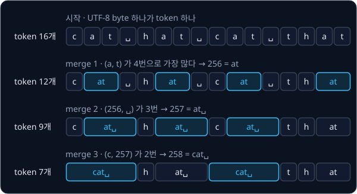

# BPE Tokenizer

## 배경

### token 과 vocabulary

language model 은 text 를 그대로 읽지 못하고 정수 열로 받는다. text 를 자르는 단위를 token, 가능한 token 을 모두 모은
목록을 vocabulary 라고 하며, model 은 token 마다 vocabulary 안의 번호(token id)를 받아 계산한다. 단위를 얼마나 크게
잡느냐에 따라 vocabulary 크기와 sequence 길이가 서로 반대로 움직인다.

| 단위 | vocabulary 크기 | `unbelievable` 을 자른 결과 | 문제 |
| --- | --- | --- | --- |
| 글자 | 글자 종류 수 (Tiny Shakespeare 는 65개) | `u` `n` `b` `e` `l` `i` `e` `v` `a` `b` `l` `e` (12개) | sequence 가 길어져 계산이 늘어난다 |
| 단어 | 단어 종류 수 (수만 ~ 수십만) | `unbelievable` (1개) | 학습 때 못 본 단어는 모두 `<unk>` 하나로 뭉개진다 |
| subword | 수만 | `un` `bel` `iev` `able` (4개, GPT-2) | 두 방식의 중간 |

BPE(byte pair encoding)는 subword 단위를 사람이 정하지 않고 데이터에서 찾는다. 1994년 Gage 가 data 압축 알고리즘으로
처음 냈고, 2016년 Sennrich 등이 번역 model 의 subword vocabulary 를 만드는 데 썼다. GPT-2 의 tokenizer 도 BPE 다.

### UTF-8 byte

컴퓨터는 글자를 byte 열로 저장한다. byte 하나는 0 부터 255 까지의 정수이고, UTF-8 은 글자 하나를 byte 1 ~ 4 개로 적는
규칙이다.

| 글자 | UTF-8 byte | byte 수 |
| --- | --- | --- |
| `h` | 104 | 1 |
| `안` | 236 149 136 | 3 |
| `🙂` | 240 159 153 130 | 4 |

Python 에서는 `"안".encode("utf-8")` 이 byte 열을, 그 결과에 `.decode("utf-8")` 을 하면 다시 문자열을 돌려준다. GPT-2 는
시작 vocabulary 를 Unicode 글자가 아닌 byte 256개(id 0 ~ 255)로 두었는데, 어떤 문자열이든 UTF-8 로 바꾸면 이 256개의
열이 되므로 `<unk>` 가 생기지 않는다.

### BPE 학습

BPE 학습은 byte 열에서 시작해 아래 세 단계를 정한 횟수만큼 반복한다.

1. 지금 sequence 에서 이웃한 두 token, 즉 pair 마다 몇 번 나오는지 센다
2. 가장 많이 나온 pair 에 새 id 를 붙인다. 새 id 는 256, 257, ... 순서로 늘어나고, 새 token 의 bytes 는 두 token 의
   bytes 를 이어 붙인 것이다
3. sequence 에서 그 pair 가 나오는 자리를 모두 새 id 하나로 바꾼다

`cat hat cat that` 은 16 byte 라서 처음에는 token 16개다. 첫 반복에서는 `a`(97) 다음에 `t`(116) 가 오는 pair 가 4번으로
가장 많아서 `(97, 116)` 이 256 번 token `at` 이 되고, 네 자리가 하나씩 줄어 token 이 12개가 된다.



merge 한 번이 줄이는 token 수는 그 pair 가 바뀐 횟수와 같다. 그림에서 4번, 3번, 2번 바뀌어 16 → 12 → 9 → 7 이 된다.
반복마다 만든 pair 를 만든 순서대로 적은 목록이 merge 목록이고, 학습 결과는 vocabulary(id → bytes)와 이 merge 목록이다.
vocabulary 크기는 256 에 merge 횟수와 special token 수를 더한 값이라서, special token 없이 vocab_size 512 로 학습하면 merge 를
256번 한다.

### encode 와 decode

decode 는 id 마다 vocabulary 의 bytes 를 찾아 이어 붙인 뒤 UTF-8 로 해석한다. encode 는 반대로 text 를 UTF-8 byte 열로
바꾼 다음, 학습 때 배운 merge 를 적용해 더 합칠 pair 가 없을 때까지 줄인다. 같은 byte 열이라도 merge 를 적용하는 순서가
다르면 결과가 달라지므로, 학습 때 merge 를 만든 순서를 그대로 우선순위로 쓴다.

token 하나는 글자의 일부 byte 만 담을 수도 있다. 예를 들어 `안` 의 3 byte 가운데 앞 2 byte 만 담은 token 을 혼자 decode
하면 올바른 UTF-8 byte 열이 아니라서 오류가 난다. 그래서 decode 는 `.decode("utf-8", errors="replace")` 처럼 깨진 부분을
`�` 로 바꾸는 방식으로 해석한다.

### GPT-2 pre-tokenization

GPT-2 는 merge 가 단어와 문장부호의 경계를 넘지 않도록, BPE 를 하기 전에 정규식으로 text 를 조각낸다. 이 단계를
pre-tokenization 이라고 한다. 학습할 때는 조각 안에서만 pair 를 세고, encode 할 때도 조각마다 따로 merge 를 적용한 뒤
결과를 이어 붙인다. 정규식은 아래 여섯 부분을 `|` 로 이은 것이고, 왼쪽부터 먼저 맞는 부분으로 자른다.

| 부분 | 잡는 것 | 예 |
| --- | --- | --- |
| `'(?:[sdmt]\|ll\|ve\|re)` | 영어 축약 | `'s` `'ll` |
| ` ?\p{L}+` | 앞의 공백 하나와 이어지는 글자 | `Hello` `␣world` `안녕` |
| ` ?\p{N}+` | 앞의 공백 하나와 이어지는 숫자 | `␣123` |
| ` ?[^\s\p{L}\p{N}]+` | 앞의 공백 하나와 이어지는 기호 | `!!` |
| `\s+(?!\S)` | 공백 열에서 마지막 하나를 뺀 부분 | `a␣␣␣b` 의 `␣␣` |
| `\s+` | 나머지 공백 | `hi\nthere` 의 `\n` |

`\p{L}` 은 Unicode 의 글자(letter) 범주라서 한글도 들어가고, `\p{N}` 은 숫자 범주다. Python 표준 `re` 는 `\p{...}` 를
지원하지 않아서 `regex` 패키지를 쓴다. 이 정규식으로 `Hello world's 123 dogs!!` 를 자르면 `Hello` `␣world` `'s` `␣123`
`␣dogs` `!!` 여섯 조각이 되고, `a␣␣␣b` 는 `a` `␣␣` `␣b` 가 되어 마지막 공백이 다음 단어의 앞에 붙는다. 앞 예의
`cat hat cat that` 은 `cat` `␣hat` `␣cat` `␣that` 으로 잘리므로, 조각을 넘어서는 `t` 와 `␣` 의 pair 는 세지 않는다.

### special token

special token 은 학습 text 에서 배우지 않고 미리 정해 두는 token 이다. GPT-2 의 `<|endoftext|>` 는 학습 data 에서 문서와
문서 사이에 넣어 한 문서가 끝났다는 것을 알린다. 이 문자열을 그대로 정규식에 넣으면 `<|` `endoftext` `|>` 세 조각으로
잘리므로, 정규식을 적용하기 전에 text 에서 special token 을 먼저 떼어 내고 그 자리를 id 하나로 바꾼다. GPT-2 의
vocabulary 50,257 개는 byte 256개, merge 50,000개, special token `<|endoftext|>` 하나(id 50256)로 이뤄진다.


### 압축률

tokenizer 가 text 를 얼마나 짧게 만드는지는 token 하나에 평균 몇 byte 가 담기는지로 잰다.

$$
\text{bytes per token} = \frac{\text{text 의 UTF-8 byte 수}}{\text{encode 한 token 수}}
$$

앞의 `cat hat cat that` 은 16 byte 가 token 7개가 되었으므로 $16 / 7 \approx 2.29$ 다. 값이 클수록 같은 text 가 짧은
sequence 가 된다. 이 값은 학습에 쓴 text 에서 재면 실제보다 좋게 나오므로, 평가 기준처럼 학습에 쓰지 않은 부분에서 잰다.

## 목표

- 학습 text 에서 merge 목록을 배우는 `train_bpe` 를 짠다
- 배운 merge 로 text 와 token id 를 오가는 `encode`·`decode` 를 짠다
- GPT-2 정규식 pre-tokenization 과 special token 처리를 붙인다
- GPT-2 의 vocabulary 를 불러와 tiktoken 과 같은 id 를 내는지 확인한다

**직접 짤 것**: pair 세기, merge, 학습 loop, encode·decode, special token 분리.
**가져다 써도 되는 것**: `\p{L}` 을 지원하는 정규식 패키지 `regex`, 비교용 `tiktoken`.

## 준비물

- Python 3.12, regex, tiktoken, pytest
- 학습 text — [Tiny Shakespeare](https://raw.githubusercontent.com/karpathy/char-rnn/master/data/tinyshakespeare/input.txt) (약 1.1 MB)
- (선택) [CS336 assignment1-basics](https://github.com/stanford-cs336/assignment1-basics) — tokenizer test 와 GPT-2 vocabulary·merge fixture
- GPU 불필요

## 진행 순서

1. Tiny Shakespeare 를 `data/input.txt` 로 받는다. `data/` 는 `.gitignore` 에 걸려 있어서 커밋되지 않는다

   ```bash
   cd projects/tokenizer
   curl -L --create-dirs -o data/input.txt https://raw.githubusercontent.com/karpathy/char-rnn/master/data/tinyshakespeare/input.txt
   ```

2. `uv run python` 에서 `"안녕 hello".encode("utf-8")` 이 어떤 byte 열이 되는지 출력해 한글 한 글자가 몇 byte 인지 확인한다
3. `bpe.py` 의 `get_pair_counts`·`merge` 를 채운다. `cat hat cat that` 의 byte 열에서 가장 많은 pair 가 `(97, 116)` 의 4번이고,
   그 pair 를 256 으로 바꾸면 길이가 16 에서 12 가 되는지 `test_bpe.py` 에 test 로 적어 확인한다
4. 두 함수를 `vocab_size - 256` 번 반복하는 `train_bpe` 를 채운다. `cat hat cat that` 을 vocab_size 259 로 학습하면 merge 목록이
   `[(b"a", b"t"), (b"at", b" "), (b"c", b"at ")]` 이어야 한다
5. `Tokenizer` 의 `encode`·`decode` 를 채우고, 한글·emoji·연속 공백·줄바꿈이 섞인 문자열에서 `decode(encode(s)) == s` 인지
   `test_bpe.py` 에서 확인한다
6. `GPT2_PAT` 으로 text 를 조각내고 조각마다 따로 pair 를 세도록 `train_bpe` 와 `encode` 를 고친다. `cat hat cat that` 으로
   다시 학습하면 첫 merge 는 그대로 `(b"a", b"t")` 이지만 `(b"at", b" ")` 은 더 나오지 않는다
7. `<|endoftext|>` 같은 special token 을 정규식을 적용하기 전에 떼어 내 id 하나로 처리한다
8. `train.py` 에서 `data/input.txt` 의 앞 90% 로 vocab_size 512 와 1024 를 학습하고, 뒤 10% 에서 bytes per token 을 출력한다
9. tiktoken `gpt2` 의 vocabulary 로 내 `Tokenizer` 를 만들고, 한글이 섞인 text 에서 `tiktoken.get_encoding("gpt2").encode()` 와
   id 열이 같은지 `test_bpe.py` 에서 확인한다

## 시작점

아래 파일은 모두 리포에 들어 있다.

```text
tokenizer/
├── pyproject.toml   # 이 과제의 Python 버전과 패키지
├── uv.lock
├── bpe.py           # GPT2_PAT, get_pair_counts, merge, train_bpe, Tokenizer 의 stub
├── train.py         # Tiny Shakespeare 로 학습하고 bytes per token 을 재는 script
└── test_bpe.py      # round-trip 과 tiktoken 비교를 직접 쓰는 test
```

[bpe.py](bpe.py) 의 함수와 `Tokenizer` 의 method 는 몸통이 `raise NotImplementedError` 인 stub 이고, 이름과 signature 는
그대로 둔 채 몸통을 채운다. 채점용 test 는 없어서 평가 기준은 [test_bpe.py](test_bpe.py) 에 직접 쓴 test 와 `train.py` 의
출력으로 확인한다. 패키지는 `pyproject.toml` 에 있고, 이 폴더에서 `uv run` 을 처음 실행할 때 `.venv/` 에 설치된다.

```bash
cd projects/tokenizer
uv run pytest
uv run python train.py
```

## 평가 기준

- [ ] 한글·emoji·연속 공백·줄바꿈이 섞인 문자열에서 `decode(encode(s)) == s` 다
- [ ] GPT-2 정규식을 쓰고 Tiny Shakespeare 앞 90% 로 학습해 뒤 10% 에서 재면 token 하나에 담기는 byte 가 vocab_size 512 에서 약 1.9, 1024 에서 약 2.3 이다(tiktoken `gpt2` 는 약 3.3)
- [ ] tiktoken `gpt2` 의 vocabulary 로 만든 내 tokenizer 가 한글이 섞인 text 에서 `tiktoken.get_encoding("gpt2").encode()` 와 같은 id 열을 낸다
- [ ] (선택) CS336 `tests/test_tokenizer.py` 를 `get_tokenizer` adapter 로 연결해 통과시킨다
- [ ] (선택) CS336 `tests/test_train_bpe.py` 를 통과시킨다. 빈도가 같은 pair 는 사전순으로 더 큰 쪽을 고른다는 규칙과 1.5초 시간 제한이 들어 있다

## 생각해 볼 질문

1. 시작 vocabulary 를 byte 256개로 두면 `<unk>` 가 생기지 않는 이유는? 대신 무엇을 잃는가?
2. 정규식으로 미리 조각내지 않으면 `dog.`·`dog!`·`dog?` 에서 어떤 merge 가 생기고, 그것이 왜 낭비인가?
3. 같은 뜻의 한국어 문장이 영어 문장보다 GPT-2 token 을 훨씬 많이 쓰는 이유는? 이것이 모델의 비용과 context 길이에 어떤 영향을 주는가?

## 힌트

<details>
<summary>encode 에서 merge 를 적용하는 순서</summary>

학습 때 merge 가 만들어진 순서가 곧 우선순위다. 지금 조각 안에 있는 pair 가운데 가장 먼저 배운 merge 하나를 골라 합치고,
합칠 pair 가 없을 때까지 반복한다. merge 50,000개를 처음부터 끝까지 차례로 훑을 필요는 없다.

</details>

<details>
<summary>tiktoken 의 id 와 내 id 가 어긋날 때</summary>

tiktoken `gpt2` 에서 byte 하나짜리 token 의 id 는 byte 값 순서가 아니다(`!` 가 0번이다). `enc._mergeable_ranks` 는
`bytes → rank` dict 이고 rank 가 곧 token id 라서, "이어 붙인 bytes 의 rank 가 가장 낮은 pair 부터 합친다" 는 규칙을 쓰면 merge
목록 없이도 같은 결과가 나온다. CS336 fixture 의 `gpt2_merges.txt` 는 byte 를 출력 가능한 Unicode 글자로 바꿔 적은 형식이라
`tests/common.py` 의 `gpt2_bytes_to_unicode` 로 되돌려 읽어야 한다.

</details>

<details>
<summary>학습이 너무 느릴 때</summary>

정규식으로 조각내면 같은 조각이 수없이 반복된다. 서로 다른 조각과 그 등장 횟수만 세어 두고 pair 개수에 횟수를 곱하면
계산량이 크게 준다. 그래도 느리면 merge 한 번으로 실제로 바뀌는 pair 의 개수만 다시 센다.

</details>

## 참고 자료

- Andrej Karpathy, [Let's build the GPT Tokenizer](https://www.youtube.com/watch?v=zduSFxRajkE) — 이 과제의 BPE 학습, encode·decode,
  GPT-2 정규식, special token 을 처음부터 짜 보이는 영상. 막힌 단계의 구간만 골라 봐도 된다
- Rico Sennrich, Barry Haddow, Alexandra Birch, [Neural Machine Translation of Rare Words with Subword Units](https://arxiv.org/abs/1508.07909) —
  3.2절과 Algorithm 1 에 BPE 학습 loop 가 Python 몇 줄로 실려 있다
- Alec Radford 등, [Language Models are Unsupervised Multitask Learners](https://cdn.openai.com/better-language-models/language_models_are_unsupervised_multitask_learners.pdf) —
  2.2절 Input Representation 이 byte 단위 BPE 와 pre-tokenization 을 쓰는 이유를 설명한다
- Hugging Face LLM Course, [Byte-Pair Encoding tokenization](https://huggingface.co/learn/llm-course/chapter6/5) — 작은 corpus 에서
  pair 를 세고 합치는 과정을 표로 따라가는 예제
- Stanford CS336, [assignment1-basics](https://github.com/stanford-cs336/assignment1-basics) — handout 의 BPE 절과 선택 평가 기준의 test
- [tiktokenizer](https://tiktokenizer.vercel.app/) — text 를 넣으면 GPT 계열 tokenizer 가 자른 token 경계와 id 를 보여 주는 웹 도구
- [Wikipedia — UTF-8](https://en.wikipedia.org/wiki/UTF-8) — 글자를 byte 1 ~ 4 개로 적는 규칙 표
- [openai/tiktoken](https://github.com/openai/tiktoken) — 비교에 쓰는 GPT tokenizer 구현
- OpenAI, [gpt-2 `encoder.py`](https://github.com/openai/gpt-2/blob/master/src/encoder.py) — GPT-2 원본 tokenizer, 막혔을 때만 열기
- [karpathy/minbpe](https://github.com/karpathy/minbpe) — 막혔을 때만 열기

## 남은 한계

tokenizer 는 text 를 id 로 바꿀 뿐 다음에 올 token 을 예측하지 못한다. 이 id 열로 language model 을 학습시키는 과정은
[GPT-2](../gpt/README.md) 에서 다룬다.
