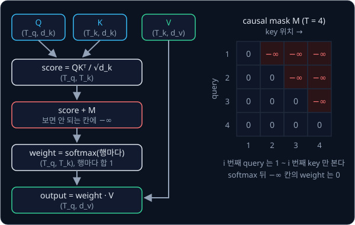
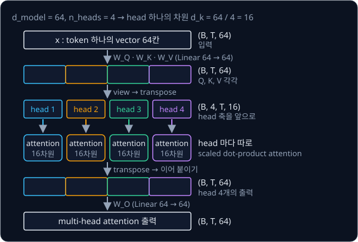
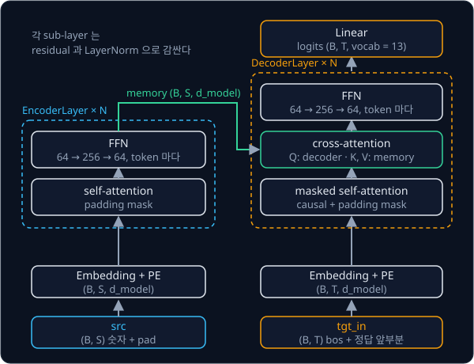

# Transformer

## 배경

### seq2seq 와 attention

[PyTorch Training Loop](../pytorch-mlp/README.md) 의 MLP 는 길이가 정해진 vector 하나를 받아 class 하나를 낸다. 번역처럼
길이가 제각각인 sequence 를 받아 다른 sequence 를 내는 문제는 seq2seq(sequence-to-sequence)라고 부른다. 이 과제의 숫자열
뒤집기도 seq2seq 라서, `3 1 4` 를 받으면 `4 1 3` 을 내야 한다.

RNN 기반 seq2seq 에서는 encoder 가 입력을 한 token 씩 읽으며 고정 크기 vector 하나에 눌러 담고, decoder 는 그 vector 하나만
보고 출력을 만들었다. 그래서 문장이 길수록 앞부분 정보가 흐려졌다. 2014년 Bahdanau 등은 decoder 가 출력 token 을 하나
만들 때마다 encoder 의 모든 위치를 다시 보고, 지금 필요한 위치에 큰 weight 를 주어 가중 평균하게 했는데, 이 방식이
attention 이다. 2017년 Transformer 는 recurrence 를 아예 빼고 attention 만으로 encoder 와 decoder 를 쌓았다. 모든 위치를
한 번에 계산하므로 RNN 과 달리 sequence 방향으로도 병렬로 학습할 수 있다.

### token 과 embedding

숫자 0–9 는 id 0–9 를 쓰고, 여기에 `<pad>`(10), `<bos>`(11, begin of sequence), `<eos>`(12, end of sequence) 세 special
token 을 더해 vocabulary 는 13개다. 길이가 다른 sequence 를 한 batch 로 묶을 때는 짧은 sequence 의 뒤를 `<pad>` 로 채운다.

`nn.Embedding(13, d_model)` 은 `(13, d_model)` 크기의 학습되는 표이고, id 로 그 표의 행 하나를 꺼내 token 의 vector 로 쓴다.
그래서 `(B, T)` 모양의 id tensor 가 `(B, T, d_model)` 모양의 vector tensor 가 된다. $B$ 는 batch 크기, $T$ 는 sequence 길이,
$d_\text{model}$ 은 token vector 의 차원(이 과제의 기본값 64)이다.

### scaled dot-product attention

attention 은 위치마다 vector 세 개를 만든다. query $q$ 는 "이 위치가 찾는 것", key $k$ 는 "이 위치가 가진 것", value $v$ 는
"이 위치가 넘겨줄 내용" 이고, 모두 token vector 에 서로 다른 Linear 를 곱해 얻는다. query $i$ 와 key $j$ 의 내적이 클수록
위치 $i$ 는 위치 $j$ 의 value 를 많이 가져간다.

$$
\mathrm{Attention}(Q, K, V) = \mathrm{softmax}\!\left(\frac{QK^\top}{\sqrt{d_k}} + M\right) V,
\qquad \mathrm{softmax}(s)_j = \frac{e^{s_j}}{\sum_{j'} e^{s_{j'}}}
$$

- $Q$ 는 query 를 모은 `(T_q, d_k)` 행렬, $K$ 와 $V$ 는 key·value 를 모은 `(T_k, d_k)`·`(T_k, d_v)` 행렬이다
- $QK^\top$ 은 `(T_q, T_k)` 의 score 표이고, $[i, j]$ 칸이 query $i$ 와 key $j$ 의 내적이다
- $d_k$ 는 query·key vector 의 차원이고, score 를 $\sqrt{d_k}$ 로 나눈다
- $M$ 은 mask 로, 보면 안 되는 칸에 $-\infty$ 를, 나머지에 0 을 둔다
- softmax 는 score 표의 행마다 따로 적용해 각 행을 합이 1 인 weight 로 바꾼다. 출력은 이 weight 로 value 를 가중 평균한
  `(T_q, d_v)` 행렬이다

query 하나 $q = [1, 0]$ 와 key·value 세 개로 계산하면 아래와 같다. 여기서 $d_k = 2$ 다.

| 위치 $j$ | key $k_j$ | value $v_j$ | score $q \cdot k_j / \sqrt 2$ | weight | 세 번째 위치를 mask 했을 때 weight |
| --- | --- | --- | --- | --- | --- |
| 1 | $[1, 0]$ | $[1, 0]$ | 0.707 | 0.401 | 0.670 |
| 2 | $[0, 1]$ | $[0, 2]$ | 0 | 0.198 | 0.330 |
| 3 | $[1, 1]$ | $[3, 3]$ | 0.707 | 0.401 | 0 |

출력은 weight 로 가중 평균한 $0.401\,[1, 0] + 0.198\,[0, 2] + 0.401\,[3, 3] = [1.604, 1.599]$ 이다. 세 번째 위치를 mask 하면 그
score 가 $-\infty$ 가 되어 $e^{-\infty} = 0$ 이므로 weight 가 0 이 되고, 남은 두 위치의 weight 가 다시 합 1 로 나뉘어 출력은
$[0.670, 0.660]$ 이 된다.



### padding mask 와 causal mask

이 과제의 mask 는 True 가 "보지 않는다" 이다. mask 는 두 가지를 쓴다.

- **padding mask**: key 위치가 `<pad>` 인 열을 막는다. `<pad>` 는 길이를 맞추려고 채운 자리라서 내용이 없다. batch 의 행마다
  `<pad>` 위치가 다르므로 `(B, T_k)` 모양의 표에서 시작한다
- **causal mask**: decoder 의 self-attention 에서 query $i$ 가 자기보다 뒤인 key $j > i$ 를 보지 못하게 막는다. 학습 때는 정답
  sequence 전체를 한꺼번에 넣지만, 추론 때는 뒤쪽 token 이 아직 없기 때문이다. 위 그림 오른쪽처럼 `(T, T)` 표의 대각선 위가
  True 다

### multi-head attention

attention 을 한 번만 하면 위치마다 weight 분포가 하나뿐이다. multi-head attention 은 $d_\text{model}$ 차원을 head $h$ 개로
나눠 head 마다 따로 attention 을 하고, 결과를 이어 붙인 뒤 Linear $W_O$ 를 한 번 더 곱한다. 그래서 head 마다 서로 다른 위치
관계를 볼 수 있다.

$$
\mathrm{head}_i = \mathrm{Attention}(Q_i, K_i, V_i), \qquad
\mathrm{MultiHead} = \mathrm{Concat}(\mathrm{head}_1, \dots, \mathrm{head}_h)\, W_O
$$

$Q_i, K_i, V_i$ 는 $X W_Q$, $X W_K$, $X W_V$ 를 head 별 차원 $d_k = d_\text{model} / h$ 씩 나눈 $i$ 번째 조각이다. 기본값
$d_\text{model} = 64$, $h = 4$ 이면 head 하나는 16차원이다.



self-attention 과 cross-attention 은 같은 `MultiHeadAttention` 을 입력만 다르게 해서 쓴다. self-attention 은 query·key·value 를
모두 같은 sequence 에서 만들고(`x_q` 와 `x_kv` 가 같다), cross-attention 은 query 를 decoder 쪽에서, key·value 를 encoder 의
출력에서 만든다.

### positional encoding

attention 은 위치를 보지 않고 vector 끼리의 내적만 쓰므로, token 의 순서를 따로 알려 주지 않으면 구분하지 못한다. Transformer 는
위치 $pos$ 마다 sin·cos 값으로 된 vector 를 embedding 에 더한다.

$$
PE(pos, 2i) = \sin\!\left(\frac{pos}{10000^{2i / d_\text{model}}}\right), \qquad
PE(pos, 2i + 1) = \cos\!\left(\frac{pos}{10000^{2i / d_\text{model}}}\right)
$$

$pos$ 는 0 부터 세는 위치, $i$ 는 차원 쌍의 번호다. 짝수 차원에 sin, 홀수 차원에 cos 를 쓰고, 뒤 차원일수록 분모가 커져
천천히 변한다. $d_\text{model} = 4$ 로 계산하면 아래와 같다.

| $pos$ | $\sin(pos)$ | $\cos(pos)$ | $\sin(pos / 100)$ | $\cos(pos / 100)$ |
| --- | --- | --- | --- | --- |
| 0 | 0.000 | 1.000 | 0.000 | 1.000 |
| 1 | 0.841 | 0.540 | 0.010 | 1.000 |
| 2 | 0.909 | −0.416 | 0.020 | 1.000 |
| 3 | 0.141 | −0.990 | 0.030 | 1.000 |

### encoder layer 와 decoder layer

encoder layer 는 self-attention 과 FFN 두 sub-layer 로, decoder layer 는 masked self-attention, cross-attention, FFN 세
sub-layer 로 이뤄진다.

- **FFN**(feed-forward network)은 `Linear(d_model → d_ff)`, ReLU, `Linear(d_ff → d_model)` 을 token 마다 따로 적용한다.
  기본값은 64 → 256 → 64 다
- **residual** 은 sub-layer 의 출력에 입력을 더하는 연결 $x + \mathrm{Sublayer}(x)$ 이다. 층이 깊어져도 gradient 가 덧셈 경로로
  바로 전달된다
- **LayerNorm** 은 token vector 하나의 값들을 평균 0·분산 1 로 맞춘 뒤 학습되는 scale 을 곱하고 shift 를 더한다

LayerNorm 의 위치는 두 가지다. 원래 논문은 $\mathrm{LayerNorm}(x + \mathrm{Sublayer}(x))$ 인 Post-LN 이고, 2020년 Xiong 등은
$x + \mathrm{Sublayer}(\mathrm{LayerNorm}(x))$ 인 Pre-LN 이 learning rate warm-up 없이도 안정적으로 학습된다는 것을 보였다.
Pre-LN 은 마지막 층 뒤에 LayerNorm 을 한 번 더 둔다. 이 과제에서는 둘 중 어느 쪽을 써도 된다.



### teacher forcing 과 greedy decoding

학습 때는 decoder 에 정답을 한 칸 밀어 넣고, 각 위치에서 다음 token 을 맞히게 한다. 이 방식을 teacher forcing 이라 한다.
`max_len = 5` 인 batch 에 `3 1 4` 가 들어가면 아래와 같다.

| tensor | shape | `3 1 4` 의 행 |
| --- | --- | --- |
| `src` | (B, max_len) | `3 1 4 <pad> <pad>` |
| `tgt` | (B, max_len + 2) | `<bos> 4 1 3 <eos> <pad> <pad>` |
| decoder 입력 `tgt[:, :-1]` | (B, max_len + 1) | `<bos> 4 1 3 <eos> <pad>` |
| 정답 `tgt[:, 1:]` | (B, max_len + 1) | `4 1 3 <eos> <pad> <pad>` |

decoder 입력의 `<bos>` 위치는 `4` 를, `4` 위치는 `1` 을 맞혀야 한다. loss 는 위치마다 13개 class 의 cross entropy 이고,
정답이 `<pad>` 인 위치는 뺀다. causal mask 가 있어서 각 위치는 자기보다 앞의 정답만 본다.

추론 때는 정답이 없으므로 `<bos>` 하나로 시작해 decoder 를 돌리고, 마지막 위치의 logits 에서 가장 큰 id 를 골라 뒤에 붙인다.
이를 `<eos>` 가 나오거나 최대 길이가 될 때까지 반복하는 방식이 greedy decoding 이다. exact match 정확도는 출력 sequence
전체가 정답과 같은 예제의 비율이다.

### cross-attention heatmap

decoder 마지막 layer 의 cross-attention weight 는 head 마다 `(T_tgt, T_src)` 표다. $[t, s]$ 칸은 decoder 의 $t$ 번째 위치가
encoder 의 $s$ 번째 입력을 얼마나 보는지를 뜻하고, 이 표를 색으로 그린 것이 heatmap 이다. 길이 $L$ 인 숫자열을 뒤집으면
$t$ 번째 출력이 $L - 1 - t$ 번째 입력과 같으므로, 학습이 잘 되면 weight 가 오른쪽 위에서 왼쪽 아래로 가는 역대각선에 모인다.

## 목표

- scaled dot-product attention 과 multi-head attention 을 짜서 `nn.MultiheadAttention` 과 출력을 맞춘다
- sinusoidal positional encoding, padding mask, causal mask 를 짠다
- self-attention·cross-attention·FFN 에 residual 과 LayerNorm 을 붙인 encoder·decoder layer 로 encoder-decoder 모델을 만든다
- teacher forcing 으로 학습시키고 greedy decoding 으로 숫자열을 뒤집는다
- cross-attention weight 를 heatmap 으로 그린다

**직접 짤 것**: attention, multi-head 분할과 합치기, positional encoding, mask, encoder·decoder layer, greedy decoding.
**가져다 써도 되는 것**: 앞 과제의 내 `Linear` 또는 `nn.Linear`, `nn.Embedding`, `nn.LayerNorm`, `torch.optim.AdamW`.
`nn.MultiheadAttention`·`nn.Transformer`·`F.scaled_dot_product_attention` 은 비교용으로만 쓴다.

## 준비물

- Python 3.12, torch, matplotlib, pytest
- 데이터는 코드로 만든다 — 0–9 숫자 1–10 개로 된 sequence 와 그 역순
- GPU 불필요 — 2 layer·d_model 64 정도의 모델은 CPU 에서 몇 분 안에 학습된다

## 진행 순서

1. `data.py` 의 `make_batch` 를 채운다. 작은 batch 를 출력해 `tgt` 가 위 표처럼 `<bos>`, 역순 숫자, `<eos>`, `<pad>` 순서인지 본다
2. `attention.py` 의 `scaled_dot_product_attention` 을 채운다. 위 숫자 예에서 weight 가 `[0.401, 0.198, 0.401]`, 세 번째를 mask 하면
   `[0.670, 0.330, 0]` 이 되는지 `test_attention.py` 에 test 로 적는다
3. `MultiHeadAttention` 을 채우고, `nn.MultiheadAttention(64, 4, batch_first=True)` 의 weight 를 옮겨 넣어 같은 입력에 1e-5 이내로
   같은 출력을 내는지 `test_attention.py` 에서 확인한다
4. `causal_mask` 와 padding mask 를 만드는 코드, `transformer.py` 의 `PositionalEncoding` 을 채운다. `causal_mask(4)` 가 위 그림의 표와
   같은지, $d_\text{model} = 4$ 의 positional encoding 이 위 표와 같은지 본다
5. `EncoderLayer`·`DecoderLayer` 를 채우고 N 층씩 쌓아 `Seq2SeqTransformer.forward` 를 만든다. logits 가 `(B, T_tgt, 13)` 인지,
   decoder 입력에서 $t$ 번째보다 뒤의 token 을 바꿔도 $t$ 번째까지의 출력이 1e-6 이내로 그대로인지 `test_attention.py` 에서 확인한다
6. `train.py` 에서 teacher forcing 으로 학습시킨다. 정답이 `<pad>` 인 위치는 loss 에서 뺀다
7. `greedy_decode` 를 채우고, 학습에 쓰지 않은 1,000개 sequence(길이 1–10)의 exact match 정확도를 출력한다
8. 한 예제의 cross-attention weight 를 head 별 heatmap 으로 그려 `results/cross_attention.png` 로 저장하고 커밋한다

## 시작점

아래 파일은 모두 리포에 들어 있다.

```text
transformer/
├── pyproject.toml      # 이 과제의 Python 버전과 패키지
├── uv.lock
├── data.py             # PAD·BOS·EOS·VOCAB, make_batch 의 stub
├── attention.py        # scaled_dot_product_attention, MultiHeadAttention, causal_mask 의 stub
├── transformer.py      # PositionalEncoding, EncoderLayer, DecoderLayer, Seq2SeqTransformer 의 stub
├── train.py            # 학습, greedy decoding 정확도, cross-attention heatmap
└── test_attention.py   # nn.MultiheadAttention 비교와 mask 검사를 직접 쓰는 test
```

[data.py](data.py)·[attention.py](attention.py)·[transformer.py](transformer.py) 의 함수와 class 는 몸통이 `raise NotImplementedError` 인
stub 이고, 이름과 signature 는 그대로 둔 채 몸통을 채운다. `transformer.py` 는 같은 폴더의 `attention.py` 에서
`MultiHeadAttention` 을 import 하고, `Seq2SeqTransformer` 의 `vocab`·`pad_id`·`bos_id`·`eos_id` 에는 `train.py` 가 `data.py` 의
`VOCAB`·`PAD`·`BOS`·`EOS` 를 넘긴다.
`transformer.py`·`attention.py` 는 ViT·RT-1·ACT 과제가 import 해서 쓰므로 두 파일은 `data.py` 를 import 하지 않는다. 채점용
test 는 없어서 평가 기준은 [test_attention.py](test_attention.py) 에 직접 쓴 test 와 `train.py` 의 출력, heatmap 으로 확인한다.
패키지는 `pyproject.toml` 에 있고, 이 폴더에서 `uv run` 을 처음 실행할 때 `.venv/` 에 설치된다.

```bash
cd projects/transformer
uv run pytest
uv run python train.py
```

## 평가 기준

- [ ] `nn.MultiheadAttention(batch_first=True)` 의 weight 를 옮겨 넣은 내 multi-head attention 이 같은 입력에 1e-5 이내로 같은 출력을 낸다
- [ ] decoder 입력에서 $t$ 번째보다 뒤에 있는 token 을 바꿔도 $t$ 번째까지의 decoder 출력이 1e-6 이내로 그대로다
- [ ] 처음 보는 1,000개 sequence(길이 1–10)에서 greedy decoding 의 exact match 정확도가 99% 이상이다
- [ ] 적어도 한 head 의 cross-attention heatmap 에 역대각선이 보인다
- [ ] (선택) CS336 assignment1-basics 의 `test_scaled_dot_product_attention`·`test_4d_scaled_dot_product_attention` 을 adapter 로 연결해 통과시킨다

## 생각해 볼 질문

1. score 를 $\sqrt{d_k}$ 로 나누지 않으면 $d_k$ 가 클 때 softmax 출력과 학습 초기 gradient 에 어떤 일이 생기는가?
2. positional encoding 을 빼면 이 모델은 숫자열을 뒤집지 못한다. 입력 순서를 섞었을 때 encoder 의 attention 출력이 어떻게 바뀌는지로 설명할 수 있는가?
3. 길이 10 까지만 보고 학습한 모델에 길이 15 를 넣으면 어떻게 될까? positional encoding 이 sinusoidal 일 때와 학습되는 embedding 일 때 무엇이 다른가?

## 힌트

<details>
<summary>mask 의 True 가 뜻하는 것</summary>

`nn.MultiheadAttention` 의 bool mask 는 True 가 "보지 않는다" 이고, `F.scaled_dot_product_attention` 과 CS336 test 는 True 가
"본다" 다. 비교할 때마다 어느 규칙인지 먼저 확인한다. mask 는 softmax 전에 score 를 $-\infty$ 로 채우는 방식으로 적용해야
남은 위치의 weight 합이 1 이 된다.

</details>

<details>
<summary>nn.MultiheadAttention 의 weight 배치</summary>

`in_proj_weight` 는 $W_Q, W_K, W_V$ 를 세로로 이어 붙인 `(3·d_model, d_model)` 행렬이고 `in_proj_bias` 도 같은 순서다.
출력 projection 은 `out_proj` 에 따로 있다.

</details>

<details>
<summary>loss 는 내려가는데 decoding 결과가 엉망일 때</summary>

학습 때 decoder 입력과 정답이 한 칸 어긋나 있는지 확인한다. 어긋나 있지 않으면 모델은 입력을 그대로 베끼는 법만 배운다.
greedy decoding 에서도 학습 때와 같은 causal mask 와 padding mask 를 쓰는지 본다.

</details>

<details>
<summary>heatmap 에 쓸 cross-attention weight 꺼내기</summary>

`MultiHeadAttention.forward` 는 출력만 돌려주므로, 마지막으로 계산한 attention weight 를 `self.last_weights` 같은 attribute 에
저장해 두면 학습이 끝난 뒤 decoder 마지막 layer 의 cross-attention 에서 `(B, n_heads, T_tgt, T_src)` 를 꺼낼 수 있다.
head 하나의 표를 `plt.imshow` 로 그리면 heatmap 이 된다.

</details>

## 참고 자료

- Ashish Vaswani 등, [Attention Is All You Need](https://arxiv.org/abs/1706.03762) — 그림 1 의 전체 구조, 3.2절 attention 과
  multi-head, 3.3절 FFN, 3.5절 positional encoding
- Dzmitry Bahdanau, Kyunghyun Cho, Yoshua Bengio, [Neural Machine Translation by Jointly Learning to Align and Translate](https://arxiv.org/abs/1409.0473) —
  3절에 decoder 가 encoder 위치마다 weight 를 주는 방식과 그 weight 를 그린 alignment 그림이 있다
- Ruibin Xiong 등, [On Layer Normalization in the Transformer Architecture](https://arxiv.org/abs/2002.04745) — Post-LN 과 Pre-LN 의 비교
- Jay Alammar, [The Illustrated Transformer](https://jalammar.github.io/illustrated-transformer/) — query·key·value 와 multi-head 를 그림으로
  따라가는 글
- 3Blue1Brown, [Attention in transformers, step-by-step](https://www.youtube.com/watch?v=eMlx5fFNoYc) — query·key 내적과 softmax 가
  하는 일을 그림으로 보여 주는 영상
- Lilian Weng, [Attention? Attention!](https://lilianweng.github.io/posts/2018-06-24-attention/) — Bahdanau attention 부터 Transformer
  까지 attention 의 여러 형태
- Andrej Karpathy, [Let's build GPT: from scratch, in code, spelled out.](https://www.youtube.com/watch?v=kCc8FmEb1nY) — causal
  self-attention 과 multi-head 를 처음부터 짜 보이는 영상
- PyTorch 문서, [nn.MultiheadAttention](https://docs.pytorch.org/docs/stable/generated/torch.nn.MultiheadAttention.html) — weight 배치와 mask 규칙
- Stanford CS336, [Language Modeling from Scratch](https://cs336.stanford.edu/spring2025/) 와
  [assignment1-basics](https://github.com/stanford-cs336/assignment1-basics) — 강의와 선택 평가 기준의 test
- Harvard NLP, [The Annotated Transformer](https://nlp.seas.harvard.edu/annotated-transformer/) — 논문을 따라가는 전체 구현, 막혔을 때만 열기

## 남은 한계

encoder-decoder 는 (입력, 정답) 쌍이 있어야 학습되고, 입력도 이산 token 열로만 받는다. 정답 쌍 없이 text 자체로 다음
token 을 배우는 [GPT-2](../gpt/README.md), 이미지를 patch token 으로 읽는 [ViT](../vit/README.md), action 을 token 으로 내는
[RT-1](../rt1/README.md), action chunk 를 생성하는 [ACT](../act/README.md) 는 모두 이 구조를 바탕으로 한다.
