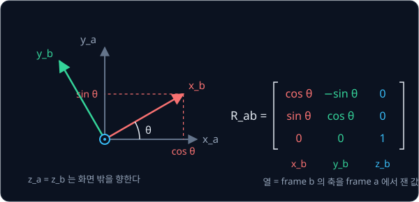
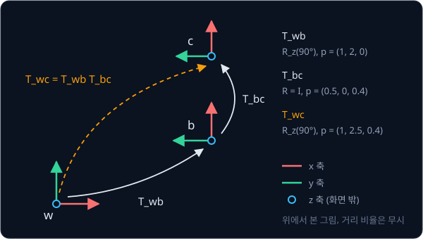
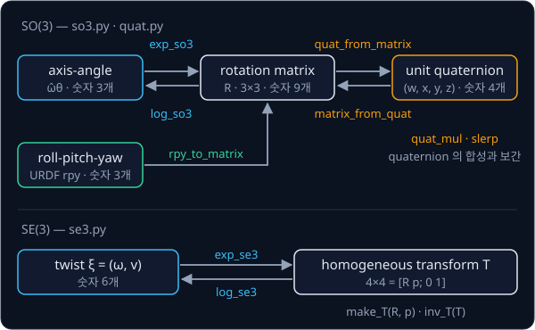

# Rigid Transforms

## 배경

warmup 에서 다룬 벡터에는 기준이 따로 없었지만, 로봇에서는 같은 점이라도 어느 frame 에서 본 값인지를 늘 함께 따져야 한다.
카메라가 본 cube 위치를 팔의 base frame 기준으로 옮기려면 두 frame 사이의 rotation 과 translation 을 알아야 하고, 그 둘을
묶은 것이 rigid transform 이다. 이번 과제에서는 rotation 과 pose 를 적는 여러 방법과 그 사이의 변환을 numpy 로 직접 짜고
scipy 의 구현과 숫자로 맞춰 본다.

### frame 과 좌표

frame 은 원점 하나와 서로 수직인 x·y·z 축 세 개로 이루어진 기준이다. 같은 점이라도 어느 frame 에서 재느냐에 따라 좌표가
달라지므로, 이 과제에서는 좌표에 frame 이름을 아래 첨자로 붙인다. $p_b$ 는 frame $b$ 에서 잰 점 $p$ 의 좌표이고, $p_{wb}$ 는
frame $w$ 에서 잰 frame $b$ 원점의 위치다.

예를 들어 로봇 base frame $b$ 가 world frame $w$ 의 $(1, 2, 0)$ 에 놓여 있고 z 축을 중심으로 90° 돌아 있으면, base 의 x 축은
world 의 $+y$ 방향을, base 의 y 축은 world 의 $-x$ 방향을 가리킨다. base 에서 $(0.3, 0, 0.1)$ 에 있는 cube 는 base 원점에서
base 의 x 축, 곧 world 의 $+y$ 방향으로 0.3 m 떨어져 있으므로 world 좌표는 $(1, 2.3, 0.1)$ 이다.

### rotation matrix

frame $a$ 를 기준으로 frame $b$ 가 돌아간 정도는 3×3 rotation matrix $R_{ab}$ 로 적는다. $R_{ab}$ 의 첫째·둘째·셋째 열은 frame
$b$ 의 x·y·z 축을 frame $a$ 에서 잰 unit vector 다. 그래서 frame $b$ 에서 잰 방향 $v_b$ 에 $R_{ab}$ 를 곱하면 같은 방향을
frame $a$ 에서 잰 값 $v_a = R_{ab}\,v_b$ 가 된다.



z 축 기준 90° rotation 은 x 축을 $(0, 1, 0)$ 으로, y 축을 $(-1, 0, 0)$ 으로 보내므로 아래 행렬이 되고, 앞 예의 cube 방향은
$R_z(90°)\,(0.3, 0, 0.1)^\top = (0, 0.3, 0.1)^\top$ 으로 바뀐다.

$$
R_z(90°) = \begin{bmatrix} 0 & -1 & 0 \\ 1 & 0 & 0 \\ 0 & 0 & 1 \end{bmatrix}
$$

세 열은 길이가 1 이고 서로 수직이며 오른손 좌표계를 이루므로 $R^\top R = I$ 와 $\det R = 1$ 이 성립한다. 이 두 조건을 만족하는
3×3 행렬 전체의 집합을 SO(3)(special orthogonal group)라고 부른다. $R^\top R = I$ 라서 역행렬은 transpose 이고,
$R_{ba} = R_{ab}^\top$ 이다.

### homogeneous transform 과 합성

frame 사이에는 rotation 과 함께 원점의 위치 차이 $p_{ab}$ 도 있어서, 점의 좌표는 $p_a = R_{ab}\,p_b + p_{ab}$ 로 바뀐다. 좌표
끝에 1 을 붙인 4차원 벡터(homogeneous coordinates)를 쓰면 이 식이 4×4 행렬 곱 하나가 된다.

$$
\begin{bmatrix} p_a \\ 1 \end{bmatrix} =
\underbrace{\begin{bmatrix} R_{ab} & p_{ab} \\ 0 & 1 \end{bmatrix}}_{T_{ab}}
\begin{bmatrix} p_b \\ 1 \end{bmatrix}
$$

$T_{ab}$ 를 homogeneous transform 이라 하고, 이런 4×4 행렬 전체의 집합이 SE(3)(special Euclidean group)다. $T_{ab}$ 는 frame
$a$ 에서 본 frame $b$ 의 pose 이면서, frame $b$ 의 좌표를 frame $a$ 의 좌표로 바꾸는 행렬이다. 앞 예의 $T_{wb}$ 는 $R_z(90°)$
와 $(1, 2, 0)$ 으로 이루어지고, $T_{wb}\,(0.3, 0, 0.1, 1)^\top = (1, 2.3, 0.1, 1)^\top$ 이다.

frame 여러 개를 거치는 변환은 행렬 곱으로 잇는다. $T_{wb}\,T_{bc}$ 의 $b$ 처럼 가운데 아래 첨자가 같도록 곱하면 순서를
틀리지 않는다. 역변환은 $R^{-1} = R^\top$ 이라는 성질만으로 계산된다.

$$
T_{wc} = T_{wb}\,T_{bc}, \qquad
T_{ab}^{-1} = T_{ba} = \begin{bmatrix} R_{ab}^\top & -R_{ab}^\top p_{ab} \\ 0 & 1 \end{bmatrix}
$$

base 에서 $(0.5, 0, 0.4)$ 에 rotation 없이 카메라 frame $c$ 를 달면, $T_{wc} = T_{wb}\,T_{bc}$ 의 위치는
$R_z(90°)\,(0.5, 0, 0.4)^\top + (1, 2, 0)^\top = (1, 2.5, 0.4)^\top$ 이다.



### axis-angle 과 exponential map

rotation matrix 는 숫자 9개를 쓰지만 3D rotation 은 숫자 3개로 정해진다. 모든 rotation 은 어떤 unit axis $\hat\omega$ 를
중심으로 angle $\theta$ 만큼 돈 것으로 적을 수 있기 때문이다. 둘을 곱한 3차원 벡터 $\hat\omega\theta$ 를 axis-angle 또는
rotation vector 라고 하고, z 축 기준 90° 는 $(0, 0, \pi/2)$ 다.

axis-angle 에서 rotation matrix 를 만드는 식이 Rodrigues 공식이다.

$$
R = \exp([\hat\omega]\theta) = I + \sin\theta\,[\hat\omega] + (1-\cos\theta)\,[\hat\omega]^2, \qquad
[\hat\omega] = \begin{bmatrix} 0 & -\omega_3 & \omega_2 \\ \omega_3 & 0 & -\omega_1 \\ -\omega_2 & \omega_1 & 0 \end{bmatrix}
$$

$[\hat\omega]$ 는 $[\hat\omega]\,v = \hat\omega \times v$ 가 되는 3×3 skew-symmetric 행렬이다. 3차원 벡터를 이 행렬로 바꾸는 연산을
hat, 거꾸로 행렬에서 벡터를 꺼내는 연산을 vee 라고 부른다. Rodrigues 공식은 행렬 $[\hat\omega]\theta$ 를 넣은 exponential
$\sum_k ([\hat\omega]\theta)^k / k!$ 를 정리한 결과라서 SO(3) 의 exponential map 이라고도 한다. $\hat\omega = (0, 0, 1)$,
$\theta = \pi/2$ 를 넣으면 $\sin\theta = 1$, $1 - \cos\theta = 1$ 이라 $R = I + [\hat\omega] + [\hat\omega]^2$ 이 되고, 계산해 보면
위의 $R_z(90°)$ 와 같다.

반대 방향인 log 는 rotation matrix 에서 axis 와 angle 을 꺼낸다. angle 은 $[0, \pi]$ 범위로 고르는데, $\theta = 0$ 이면 axis 가
정해지지 않고 $\theta = \pi$ 근처에서는 axis 를 구하는 식이 0 에 가까운 수로 나누게 되어 두 경우를 따로 다뤄야 한다.

### unit quaternion

unit quaternion 은 길이가 1 인 숫자 4개 $q = (w, x, y, z)$ 로 rotation 을 적고, axis-angle 과 다음 관계가 있다.

$$
q = \left(\cos\tfrac{\theta}{2},\ \hat\omega\sin\tfrac{\theta}{2}\right)
$$

z 축 기준 90° 는 $(\cos 45°, 0, 0, \sin 45°) \approx (0.7071, 0, 0, 0.7071)$ 이다. 같은 axis 로 $\theta + 2\pi$ 만큼 돌아도 같은
rotation 인데, 그러면 $\theta/2$ 가 $\pi$ 만큼 커져 네 숫자의 부호가 모두 뒤집힌다. 그래서 $q$ 와 $-q$ 는 같은 rotation 이다.

rotation 두 개를 잇는 합성은 quaternion 곱 $q_1 \otimes q_2$ 이고, rotation matrix 의 곱 $R_1 R_2$ 에 대응한다. $v_i$ 는 $q_i$ 의
$(x, y, z)$ 세 성분이다.

$$
q_1 \otimes q_2 = \big(w_1 w_2 - v_1\cdot v_2,\ \ w_1 v_2 + w_2 v_1 + v_1 \times v_2\big)
$$

두 자세 사이를 부드럽게 잇는 보간(interpolation)에는 slerp(spherical linear interpolation)를 쓴다. 4차원 unit sphere 위에서
$q_0$ 와 $q_1$ 을 잇는 호를 따라 일정한 속도로 움직이는 방법으로, Shoemake(1985)가 컴퓨터 animation 에 도입했다.
$\Omega$ 는 두 quaternion 사이의 각도이고 $t$ 는 0 에서 1 까지 움직인다.

$$
\mathrm{slerp}(q_0, q_1, t) = \frac{\sin\big((1-t)\Omega\big)}{\sin\Omega}\,q_0 + \frac{\sin(t\Omega)}{\sin\Omega}\,q_1,
\qquad \cos\Omega = q_0 \cdot q_1
$$

### roll-pitch-yaw

URDF 는 joint 와 link 의 자세를 `rpy="roll pitch yaw"` 세 숫자로 적는다. parent frame 의 고정된 x 축으로 roll, y 축으로 pitch,
z 축으로 yaw 만큼 차례로 돌린다는 뜻이고, 나중에 돈 것이 왼쪽에 곱해지므로 $R = R_z(\text{yaw})\,R_y(\text{pitch})\,R_x(\text{roll})$
이다. 예를 들어 rpy 가 $(\pi/2, 0, \pi/2)$ 이면 x 축 기준 90° 를 먼저, z 축 기준 90° 를 나중에 돌린 결과다.

$$
R_z(90°)\,R_x(90°) = \begin{bmatrix} 0 & 0 & 1 \\ 1 & 0 & 0 \\ 0 & 1 & 0 \end{bmatrix}
$$

열을 읽으면 새 x 축은 parent 의 $+y$, 새 y 축은 $+z$, 새 z 축은 $+x$ 방향이다.

### twist 와 SE(3) exponential map

axis-angle 이 숫자 3개로 rotation 을 적듯, twist $\xi = (\omega, v)$ 는 숫자 6개로 rotation 과 translation 을 함께 적는다.
$\omega$ 는 axis-angle 과 같은 rotation 부분이고 $v$ 는 translation 부분이다. SO(3) 의 exp 가 axis-angle 을 rotation matrix 로
바꾸듯, SE(3) 의 exp 는 twist 를 homogeneous transform 으로 바꾼다.

$$
\exp(\xi) = \begin{bmatrix} \exp([\omega]) & V v \\ 0 & 1 \end{bmatrix}
$$

translation 이 $v$ 그대로가 아니라 $Vv$ 인 이유는, exp 가 rotation 과 translation 을 동시에 일정한 속도로 진행한 결과이기
때문이다. 그 경로는 나사(screw)처럼 휘어지고, $V$ 의 식은 힌트에 있다. 예를 들어 $\xi = (0, 0, \pi/2,\ 1, 0, 0)$ 은 z 축 기준
90° 를 도는 동안 x 방향으로 1 만큼 나아가는 움직임인데, 도착한 위치는 $(1, 0, 0)$ 이 아니라 약 $(0.6366, 0.6366, 0)$ 이다.
log 는 그 반대로 homogeneous transform 에서 twist 를 꺼낸다.



## 목표

- `hat`·`exp`·`log` 로 axis-angle 과 rotation matrix 를 오가는 SO(3) 함수를 만든다
- rotation matrix ↔ quaternion 변환, quaternion 곱, slerp 를 만든다
- URDF 가 쓰는 roll-pitch-yaw 를 rotation matrix 로 바꾼다
- homogeneous transform 의 합성·역변환과 SE(3) 의 exp·log 를 만든다
- frame 몇 개를 3D 화살표로 그려 합성 순서가 맞는지 눈으로 확인한다

**직접 짤 것**: 위 변환 전부. numpy 의 기본 선형대수(`@`, `np.linalg.norm`, `np.linalg.svd`)만으로 짠다.
**가져다 써도 되는 것**: 정답 비교용 `scipy.spatial.transform` 의 `Rotation`·`RigidTransform`·`Slerp`, 그림용 matplotlib.

## 준비물

- Python 3.12, numpy, scipy(`RigidTransform` 은 1.16 부터 들어 있다), matplotlib, pytest
- GPU 불필요

## 진행 순서

1. `so3.py` 의 `hat`·`vee` 를 짜고, [test_transforms.py](test_transforms.py) 에 `hat(w) @ v` 가 `np.cross(w, v)` 와 같은지
   보는 test 를 쓴다
2. `exp_so3` 를 Rodrigues 공식으로 짜서 `Rotation.from_rotvec(rotvec).as_matrix()` 와 비교한다. `(0, 0, np.pi / 2)` 를
   넣으면 배경의 $R_z(90°)$ 가 나와야 한다
3. `log_so3` 를 짜서 `Rotation.as_rotvec` 와 비교하고, rotation angle 이 $10^{-9}$, $\pi - 10^{-6}$, $\pi - 10^{-9}$ 일 때도 NaN
   이 나지 않는지 확인한다
4. `quat.py` 의 `quat_from_matrix`·`matrix_from_quat`·`quat_mul` 을 짜서 `Rotation.as_quat(scalar_first=True)` 와 부호 차이를
   빼고 비교한다. `matrix_from_quat(quat_mul(q1, q2))` 가 `matrix_from_quat(q1) @ matrix_from_quat(q2)` 와 같은지도 본다
5. `so3.py` 의 `rpy_to_matrix` 를 짜서 `Rotation.from_euler("xyz", [roll, pitch, yaw]).as_matrix()` 와 비교한다.
   $(\pi/2, 0, \pi/2)$ 를 넣으면 배경의 예와 같은 행렬이 나와야 한다
6. `se3.py` 의 `make_T`·`inv_T`·`exp_se3`·`log_se3` 를 짜서 `RigidTransform.from_exp_coords`·`as_exp_coords` 와 비교하고,
   `inv_T(T) @ T` 가 단위행렬인지 확인한다. scipy 의 exp coordinates 도 앞 3개가 rotation, 뒤 3개가 translation 이다
7. `quat.py` 의 `slerp` 를 짜서 `Slerp` 와 비교한다
8. `viz.py` 의 `main` 에서 world·base·camera 세 frame 을 화살표로 그려 `results/frames.png` 로 저장한다. 배경의 예를 넣으면
   camera 원점이 world 의 $(1, 2.5, 0.4)$ 에 그려져야 한다

## 시작점

아래 파일은 모두 리포에 들어 있다.

```text
transforms/
├── pyproject.toml       # 이 과제의 Python 버전과 패키지
├── uv.lock
├── so3.py               # hat, vee, exp_so3, log_so3, rpy_to_matrix 의 stub
├── quat.py              # quat_from_matrix, matrix_from_quat, quat_mul, slerp 의 stub
├── se3.py               # make_T, inv_T, exp_se3, log_se3 의 stub
├── viz.py               # frame 을 화살표로 그리는 그림
└── test_transforms.py   # scipy 와 비교하는 test 를 직접 쓴다
```

[so3.py](so3.py)·[quat.py](quat.py)·[se3.py](se3.py) 의 함수는 몸통이 `raise NotImplementedError` 인 stub 이고, 이름과
signature 는 그대로 둔 채 몸통을 채운다. quaternion 은 (w, x, y, z), twist 는 (omega, v) 순서다.
[Forward Kinematics](../forward-kinematics/README.md) 와 [Inverse Kinematics](../inverse-kinematics/README.md) 가 `so3.py` 를
import 해서 쓰므로 signature 를 바꾸지 않는다. 채점용 test 는 없어서 평가 기준은 [test_transforms.py](test_transforms.py) 에
직접 쓴 test 로 확인한다. 패키지는 `pyproject.toml` 에 있고, 이 폴더에서 `uv run` 을 처음 실행할 때 `.venv/` 에 설치된다.

```bash
cd projects/transforms
uv run pytest
uv run python viz.py
```

## 평가 기준

- [ ] 무작위 rotation 10,000개에서 `exp_so3(log_so3(R))` 와 `R` 의 원소별 차이가 1e-10 안이다
- [ ] 내 quaternion 이 `Rotation.as_quat(scalar_first=True)` 와 부호 차이를 빼고 1e-12 안에서 같다
- [ ] rotation angle $10^{-9}$, $\pi - 10^{-6}$, $\pi - 10^{-9}$ 에서도 `log_so3` 가 NaN 없이 `Rotation.as_rotvec` 와 1e-9 안에서
      일치한다
- [ ] `exp_se3`·`log_se3` 가 `RigidTransform.from_exp_coords`·`as_exp_coords` 와 1e-10 안에서 일치한다
- [ ] `inv_T(T) @ T` 가 단위행렬과 1e-12 안에서 같다
- [ ] (선택) slerp 결과가 `Slerp` 와 1e-12 안에서 같고, 보간하는 동안 angular velocity 가 일정하다

## 생각해 볼 질문

1. $q$ 와 $-q$ 가 같은 rotation 인데도 slerp 를 하기 전에 둘 중 하나를 골라야 하는 이유는? 고르지 않으면 어떤 경로로
   보간되는가?
2. roll-pitch-yaw 세 숫자로 모든 rotation 을 적을 수 있는데, 로봇 소프트웨어가 내부 계산에는 quaternion 이나 rotation matrix 를
   쓰는 이유는?
3. $T_{ab}T_{bc}$ 에서 오른쪽에 곱한 변환은 어느 frame 기준의 움직임인가? 같은 움직임을 왼쪽에 곱하면 무엇이 달라지는가?

## 힌트

<details>
<summary>rotation angle 이 π 근처일 때의 log</summary>

$(R - R^\top)/(2\sin\theta)$ 로 axis 를 구하면 $\sin\theta \to 0$ 에서 0 을 0 으로 나누게 되고, $\arccos$ 로 구한 angle 도
$\pi$ 근처에서 정밀도를 잃는다. rotation matrix 를 먼저 quaternion 으로 바꾸고 angle 을 $2\,\mathrm{atan2}(\lVert v\rVert, w)$
로 구하면 0 근처와 $\pi$ 근처에서 모두 안정적이다. quaternion 으로 바꿀 때는 trace 와 대각 원소 가운데 가장 큰 쪽을 골라 그
값으로 나누는 Shepperd 의 방법을 쓴다.

</details>

<details>
<summary>quaternion 순서와 Euler angle 규약</summary>

scipy 의 `as_quat` 는 기본이 (x, y, z, w) 이고 `scalar_first=True` 를 주면 (w, x, y, z) 다. MuJoCo 는 (w, x, y, z) 를 쓰므로
프로젝트 안에서 한 가지로 정해 둔다. URDF 의 `rpy` 는 고정축 x → y → z 순서라서
$R = R_z(\text{yaw})\,R_y(\text{pitch})\,R_x(\text{roll})$ 이고, scipy 에서는 소문자 `"xyz"`(extrinsic)가 같은 규약이다.

</details>

<details>
<summary>SE(3) exp 의 translation 부분</summary>

twist $(\omega, v)$ 의 exp 에서 translation 은 $v$ 그대로가 아니라 $V v$ 다. rotation 과 translation 이 동시에 일어나면 경로가
나선(screw)을 그리기 때문인데, $\theta = \lVert\omega\rVert$ 라 하면
$V = I + \frac{1-\cos\theta}{\theta^2}[\omega] + \frac{\theta-\sin\theta}{\theta^3}[\omega]^2$ 이다. $\theta \to 0$ 에서는 이 계수를
Taylor 전개로 바꿔 계산해야 0 에 가까운 수로 나누지 않는다.

</details>

## 참고 자료

- Lynch & Park, [Modern Robotics](https://hades.mech.northwestern.edu/index.php/Modern_Robotics) 3장 rigid-body motions —
  무료 [PDF](https://hades.mech.northwestern.edu/images/7/7f/MR.pdf) 와 절마다 짧은 강의 영상이 있고, SO(3)·SE(3)·exponential
  coordinates 를 이 과제와 같은 기호로 설명한다
- Russ Tedrake, [Robotic Manipulation — Ch. 3 Basic Pick and Place](https://manipulation.csail.mit.edu/pick.html) 의
  "Monogram Notation"·"Spatial Algebra" 절 — frame 이름을 기호에 붙여 합성 순서 실수를 막는 표기법
- 3Blue1Brown, [Quaternions and 3d rotation, explained interactively](https://www.youtube.com/watch?v=zjMuIxRvygQ) 와
  [interactive 페이지](https://eater.net/quaternions) — quaternion 곱이 rotation 이 되는 이유를 그림으로 보여 준다.
  배경이 더 필요하면 [Visualizing the 4d numbers Quaternions](https://www.youtube.com/watch?v=d4EgbgTm0Bg) 을 먼저 본다
- Joan Solà, [Quaternion kinematics for the error-state Kalman filter](https://arxiv.org/abs/1711.02508) 1–3장 — quaternion 의
  곱, rotation matrix 변환, slerp, 순서·부호 규약을 식으로 정리한 참고서. Hamilton 규약과 (w, x, y, z) 순서를 이 과제와 같이 쓴다
- Solà 외, [A micro Lie theory for state estimation in robotics](https://arxiv.org/abs/1812.01537) — SO(3)·SE(3) 의 exp·log 를
  한 틀로 정리한 짧은 글
- Ken Shoemake, [Animating rotation with quaternion curves](https://doi.org/10.1145/325165.325242) (1985) — slerp 를 처음 제안한 글
- scipy [`Rotation`](https://docs.scipy.org/doc/scipy/reference/generated/scipy.spatial.transform.Rotation.html) ·
  [`RigidTransform`](https://docs.scipy.org/doc/scipy/reference/generated/scipy.spatial.transform.RigidTransform.html) 문서 —
  비교 대상의 순서와 부호 규약 확인용
- 막혔을 때만 열기: [NxRLab/ModernRobotics](https://github.com/NxRLab/ModernRobotics/tree/master/packages/Python) 의
  `MatrixExp3`·`MatrixLog3`·`MatrixExp6`, [pytransform3d](https://github.com/dfki-ric/pytransform3d)

## 남은 한계

frame 하나하나는 다룰 수 있지만, joint 가 여러 개 이어진 팔에서 joint angle 이 end-effector pose 를 어떻게 정하는지와 pixel 이
3D 점과 어떻게 이어지는지는 아직 계산하지 못한다. 앞의 것은 [Forward Kinematics](../forward-kinematics/README.md), 뒤의 것은
[Camera Geometry](../camera-geometry/README.md) 에서 다룬다.
