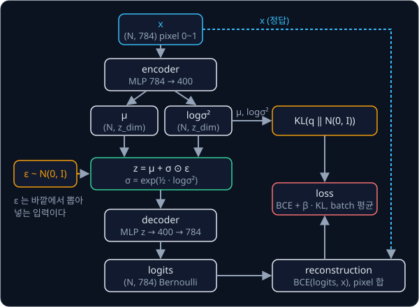

# VAE

## 배경

### 답 하나와 분포

[PyTorch Training Loop](../pytorch-mlp/README.md) 의 MLP 는 입력 하나에 출력 하나를 내는 deterministic 함수다. 같은 입력에
정답이 여럿이면 MSE regression 은 그 평균을 낸다. 정답이 +1 과 −1 반반이면 MSE 를 가장 작게 하는 출력은 0 인데, 0 은 어느
정답과도 같지 않다. 새 샘플을 만들어 내려면 답 하나가 아니라 데이터의 분포 $p(x)$, 즉 어떤 $x$ 가 얼마나 자주 나오는지를
배워서 그 분포에서 뽑아야 한다.

### autoencoder 와 latent

autoencoder 는 encoder 가 784 pixel 의 MNIST 이미지를 숫자 몇 개 $z$ 로 줄이고, decoder 가 $z$ 에서 이미지를 되살리도록
학습한다. 이 $z$ 를 latent 라고 부르는데, 데이터에 직접 보이지 않고 모델이 스스로 정하는 값이라서 붙은 이름이다. 그런데
보통의 autoencoder 는 $z$ 가 어디에 놓여야 하는지 정하지 않으므로, 학습에 쓴 이미지들의 $z$ 사이 빈 곳을 decode 하면 숫자가
아닌 그림이 나올 수 있다. VAE(variational autoencoder)는 $z$ 가 표준 정규분포 $\mathcal N(0, I)$ 를 따르도록 잡아서,
$\mathcal N(0, I)$ 에서 아무 $z$ 나 뽑아 decode 해도 숫자가 나오게 한다.

$\mathcal N(\mu, \sigma^2)$ 는 평균 $\mu$, 표준편차 $\sigma$ 인 정규분포이고, $\mathcal N(0, I)$ 는 `z_dim` 개의 차원이 서로
독립인 $\mathcal N(0, 1)$ 을 따르는 분포다. VAE 의 encoder 는 이미지마다 차원별 $\mu_j$ 와 $\sigma_j$ 를 내고, 이 분포를
$q_\phi(z \mid x) = \mathcal N(\mu, \mathrm{diag}(\sigma^2))$ 로 쓴다. $\phi$ 는 encoder 의 parameter, $\theta$ 는 decoder 의
parameter 이고, $q_\phi(z \mid x)$ 는 "이미지 $x$ 가 주어졌을 때 $z$ 의 분포" 로 읽는다.

### Bernoulli decoder 와 BCE

MNIST pixel 은 0 ~ 1 사이 값이다. decoder 는 pixel $i$ 마다 logit $\ell_i$ 를 내고, $p_i = \mathrm{sigmoid}(\ell_i)$ 를 그 pixel
이 1 일 확률로 본다(Bernoulli 분포). 이때 이미지 전체의 log 확률은 pixel 마다의 binary cross entropy(BCE)를 더한 값에 부호를
바꾼 것이다.

$$
\log p_\theta(x \mid z) = \sum_{i=1}^{784} \big[x_i \log p_i + (1 - x_i)\log(1 - p_i)\big] = -\sum_{i=1}^{784} \mathrm{BCE}(p_i, x_i)
$$

| pixel 값 $x_i$ | decoder 확률 $p_i$ | BCE |
| --- | --- | --- |
| 1 | 0.9 | 0.105 |
| 1 | 0.1 | 2.303 |
| 0.3 (회색) | 0.9 | 1.643 |

`F.binary_cross_entropy_with_logits` 는 sigmoid 를 거치지 않은 logit 을 바로 받아 계산하므로 $p_i$ 가 0 이나 1 에 아주
가까워도 값이 무한대로 튀지 않는다. 학습 전 decoder 의 logit 이 0 근처면 $p_i \approx 0.5$ 라서 pixel 값과 상관없이 BCE 가
$\ln 2 \approx 0.693$ 이고, 784 pixel 을 더하면 약 543 이다.

### ELBO

$\log p_\theta(x)$ 는 가능한 모든 $z$ 에 대해 $p_\theta(x \mid z)$ 를 적분해야 해서 직접 계산할 수 없다. VAE 는 대신 그 하한인
ELBO(evidence lower bound)를 최대화한다.

$$
\log p_\theta(x) \ \ge\ \mathbb E_{q_\phi(z\mid x)}\big[\log p_\theta(x\mid z)\big] - D_{\mathrm{KL}}\big(q_\phi(z\mid x)\,\Vert\,\mathcal N(0, I)\big)
$$

- 첫 항은 reconstruction 항이다. encoder 의 분포에서 $z$ 를 뽑아 decode 했을 때 원래 이미지가 다시 나올 log 확률이고, 실제로는
  $z$ 를 한 번 뽑아 위의 $-\sum \mathrm{BCE}$ 로 계산한다
- 둘째 항은 encoder 의 분포가 prior $\mathcal N(0, I)$ 에서 멀어지지 않게 잡는 regularizer 다
- $\mathbb E_{q}[\cdot]$ 는 $z$ 를 $q$ 에서 뽑았을 때의 평균이다

ELBO 를 최대화하는 것은 negative ELBO, 즉 $\sum \mathrm{BCE} + D_\mathrm{KL}$ 을 loss 로 최소화하는 것과 같다. 부등호의 양변 차이는
$q_\phi(z \mid x)$ 와 실제 posterior $p_\theta(z \mid x)$ 사이의 KL 이라서 0 이상이다.

### KL divergence

KL divergence $D_\mathrm{KL}(q \Vert p) = \mathbb E_{z \sim q}[\log q(z) - \log p(z)]$ 는 두 분포가 얼마나 다른지를 재는 값이다.
항상 0 이상이고 두 분포가 같을 때만 0 이며, $q$ 와 $p$ 의 자리를 바꾸면 값이 달라진다. $q$ 가 차원별로 독립인 Gaussian 이고 $p$ 가
$\mathcal N(0, I)$ 이면 적분 없이 식 하나로 계산된다.

$$
D_{\mathrm{KL}} = \frac12\sum_{j=1}^{z\_\mathrm{dim}}\big(\mu_j^2 + \sigma_j^2 - \log\sigma_j^2 - 1\big)
$$

| $\mu$ | $\sigma$ | 한 차원의 KL |
| --- | --- | --- |
| 0 | 1 | 0 |
| 1 | 1 | 0.5 |
| 0 | 0.5 | 0.318 |
| 1.5 | 0.5 | 1.443 |
| 0 | 2 | 0.807 |


encoder 가 $\sigma$ 대신 $\log\sigma^2$(코드의 `logvar`)를 내면 $\sigma^2 = e^{\text{logvar}}$ 라서 식의 $\sigma_j^2$ 와
$\log\sigma_j^2$ 를 그대로 바꿔 쓸 수 있다.

### reparameterization trick

$z$ 를 $q_\phi(z \mid x)$ 에서 바로 sampling 하면 그 단계는 $\mu$ 와 $\sigma$ 의 미분 가능한 함수가 아니어서 encoder 까지
gradient 가 흐르지 않는다. reparameterization trick 은 무작위성을 바깥의 $\epsilon$ 으로 옮기고 $z$ 를 $\mu$ 와 $\sigma$ 의
미분 가능한 함수로 만든다.

$$
z = \mu + \sigma \odot \epsilon,\qquad \epsilon\sim\mathcal N(0, I)
$$

$\odot$ 은 원소별 곱이다. 예를 들어 $\mu = 0.5$, $\sigma = 2$ 에서 $\epsilon = 0.3$ 을 뽑으면 $z = 1.1$ 이고,
$\partial z / \partial \mu = 1$, $\partial z / \partial \sigma = \epsilon = 0.3$ 이라서 loss 의 gradient 가 $z$ 를 거쳐 $\mu$ 와
$\sigma$, 그리고 encoder 로 전달된다. $\epsilon$ 은 학습할 parameter 와 상관없이 뽑은 입력이다.



### latent 그림과 보간

`z_dim=2` 로 학습하면 test 이미지마다 encoder 가 낸 $\mu$ 를 2차원 평면의 점으로 찍을 수 있다. 점을 label 별 색으로 칠하면
같은 숫자끼리 모이는지 보인다. 반대로 평면 위의 격자점을 decoder 에 넣어 나온 이미지를 격자 모양으로 늘어놓으면, latent
공간의 각 위치가 어떤 숫자를 만드는지 한눈에 보인다. prior $\mathcal N(0, 1)$ 은 값의 99.7% 가 $[-3, 3]$ 안에 있어서 격자를 이
범위로 잡는다.

보간은 test 이미지 두 장의 $\mu_a$, $\mu_b$ 를 잇는 직선 위에서 양 끝을 포함해 점 10개를 고르게 골라 decode 하는 것이다.
latent 공간이 매끄럽게 학습됐다면 한 숫자가 다른 숫자로 조금씩 바뀌는 이미지가 나온다.

### CVAE

CVAE(conditional VAE)는 조건 $c$ 를 encoder 와 decoder 양쪽 입력에 이어 붙여 $q_\phi(z \mid x, c)$ 와 $p_\theta(x \mid z, c)$ 를
학습한다. MNIST 에서는 $c$ 를 10차원 one-hot label 로 둔다. 어떤 숫자인지는 $c$ 가 알려 주므로, $z$ 에는 굵기나 기울기처럼
label 로 정해지지 않는 나머지가 담기기를 기대한다. [ACT](../act/README.md) 는 이 구조로 시연 action chunk 를 latent 로 압축한다.

## 목표

- encoder 가 $\mu$ 와 $\log\sigma^2$ 를 내고 decoder 가 pixel 별 Bernoulli logits 를 내는 MLP VAE 를 만든다
- reconstruction(BCE)과 closed form KL 로 negative ELBO loss 를 짠다
- latent 2차원 VAE 로 test set 의 latent 분포를 그리고 latent 격자를 decode 해 본다
- latent 20차원 VAE 로 두 숫자 사이의 latent 보간 이미지를 만든다
- (선택) label 을 조건으로 받는 CVAE 로 원하는 숫자를 생성한다

**직접 짤 것**: encoder·decoder, reparameterization, Gaussian KL, negative ELBO, 보간, CVAE 의 조건 입력.
**가져다 써도 되는 것**: `nn.Linear`, `torch.optim`, `F.binary_cross_entropy_with_logits`, torchvision 의 MNIST loader,
`torch.distributions`(KL 비교용).

## 준비물

- Python 3.12, `torch`, `torchvision`, `matplotlib`, `pytest`
- MNIST
- GPU 불필요. MLP VAE 는 CPU 로도 학습된다

## 진행 순서

1. `train.py` 에서 torchvision MNIST 를 `data/` 로 받아 $[0, 1]$ 범위의 784차원 vector 로 바꾼다. batch 하나의 shape 이
   `(N, 784)` 이고 최솟값 0, 최댓값 1 인지 출력해 본다
2. `vae.py` 의 `reparameterize`·`kl_normal` 을 채운다. `kl_normal` 이 위 KL 표의 값과
   `torch.distributions.kl_divergence(Normal(mu, std), Normal(0, 1)).sum(-1)` 에 1e-5 이내로 맞는지, `reparameterize` 를 거친 $z$
   로는 encoder 에 gradient 가 생기고 `Normal(mu, std).sample()` 로는 encoder 의 `.grad` 가 `None` 으로 남는지 `test_vae.py` 에서
   확인한다
3. `VAE` 의 `encode`·`decode`·`forward` 와 `neg_elbo` 를 채운다. `recon_logits` 가 `(N, 784)`, `mu`·`logvar` 가 `(N, z_dim)` 이고,
   학습 전 reconstruction 항이 543 근처인지 본다
4. `train.py` 로 `z_dim=2` 와 `z_dim=20` 두 모델을 학습시키며 epoch 마다 test set negative ELBO 를 기록하고, 기록을
   `results/test_elbo.txt` 로 저장한다
5. `plots.py` 에서 `z_dim=2` 모델로 test set 의 $\mu$ 를 label 별 색으로 찍은 그림과 $[-3, 3]^2$ 격자를 decode 한 그림을
   `results/latent_2d.png`·`results/grid_2d.png` 로 저장한다
6. `interpolate` 를 채우고 `plots.py` 에서 `z_dim=20` 모델로 test 숫자 두 장 사이를 10단계로 보간한 그림을
   `results/interpolation.png` 로 저장한다
7. (선택) `cond_dim=10` 으로 one-hot label 을 encoder·decoder 양쪽 입력에 붙인 CVAE 를 학습시키고, 같은 $z$ 에서 label 만 바꾼
   그림을 `results/cvae.png` 로 저장한다
8. `results/` 의 기록과 그림을 커밋한다

## 시작점

아래 파일은 모두 리포에 들어 있다.

```text
vae/
├── pyproject.toml   # 이 과제의 Python 버전과 패키지
├── uv.lock
├── vae.py           # reparameterize, kl_normal, VAE, neg_elbo, interpolate 의 stub
├── train.py         # MNIST 로 z_dim=2·20 학습, test set negative ELBO 기록
├── plots.py         # latent 분포, 격자 decode, 보간 그림
└── test_vae.py      # KL 비교와 gradient 검사를 직접 쓰는 test
```

[vae.py](vae.py) 의 함수와 `VAE` 의 method 는 몸통이 `raise NotImplementedError` 인 stub 이고, 이름과 signature 는 그대로 둔 채
몸통을 채운다. 채점용 test 는 없어서 평가 기준은 [test_vae.py](test_vae.py) 에 직접 쓴 test 와 `results/` 의 기록·그림으로
확인한다. 패키지는 `pyproject.toml` 에 있고, 이 폴더에서 `uv run` 을 처음 실행할 때 `.venv/` 에 설치된다.

```bash
cd projects/vae
uv run pytest
uv run python train.py
uv run python plots.py
```

## 평가 기준

- [ ] `kl_normal` 이 `torch.distributions.kl_divergence(Normal(mu, std), Normal(0, 1)).sum(-1)` 과 1e-5 이내로 같다
- [ ] `reparameterize` 로 만든 $z$ 로 loss 를 계산하면 encoder parameter 에 gradient 가 생기고, `Normal(mu, std).sample()` 로 바꾸고 reconstruction loss 만 backward 하면 encoder 의 `.grad` 가 `None` 으로 남는다
- [ ] test set negative ELBO 가 학습 내내 줄고, `z_dim=20` 이 `z_dim=2` 보다 낮다
- [ ] `z_dim=2` 의 latent 그림에서 숫자별 군집이 보이고, 격자 decode 그림에서 이웃한 칸끼리 숫자가 부드럽게 바뀐다
- [ ] 보간 이미지의 중간 단계도 흐릿하나마 숫자 모양을 유지한다
- [ ] (선택) CVAE 에서 $z$ 를 고정하고 label 만 바꾸면 굵기·기울기 같은 필체는 유지된 채 숫자만 바뀐다

## 생각해 볼 질문

1. reparameterization 없이 $z$ 를 sampling 하면 encoder 로 gradient 가 가지 않는 이유는? 그래도 gradient 를 추정하려면 어떤 방법이 있고, 그 방법의 약점은?
2. KL 항의 weight $\beta$ 를 0 으로 두면 latent 공간이 어떻게 되고, 아주 크게 두면 어떻게 되는가?
3. VAE 의 샘플이 실제 MNIST 보다 흐릿하게 나오는 것은 decoder 의 어떤 가정 때문인가?

## 힌트

<details>
<summary>loss 의 크기를 맞추는 법</summary>

reconstruction 항은 pixel 784개를 모두 더하고 KL 은 latent 차원을 모두 더한 뒤, 둘을 합한 값의 batch 평균을 낸다.
reconstruction 을 pixel 평균으로 내면 KL 이 상대적으로 784배 무거워져서 latent 가 prior 로 붕괴하고(posterior collapse), 모든 샘플이 비슷한 흐릿한
숫자가 된다.

</details>

<details>
<summary>보간과 그림에 쓸 z</summary>

학습 때는 sampling 한 $z$ 를 쓰지만, 보간의 양 끝점과 latent 그림에는 encoder 가 낸 $\mu$ 를 쓴다. encoder 가 $\sigma$ 대신
$\log\sigma^2$ 를 내게 하면 양수 제약 없이 학습되고 `exp` 로 언제든 되돌릴 수 있다.

</details>

## 참고 자료

- Diederik P. Kingma, Max Welling, [An Introduction to Variational Autoencoders](https://arxiv.org/abs/1906.02691) — 2장이 ELBO 와
  reparameterization 을 원 논문보다 천천히 유도한다
- Diederik P. Kingma, Max Welling, [Auto-Encoding Variational Bayes](https://arxiv.org/abs/1312.6114) — 원 논문. 부록 B 에 Gaussian
  KL 의 closed form 유도가 있다
- Carl Doersch, [Tutorial on Variational Autoencoders](https://arxiv.org/abs/1606.05908) — 수식보다 그림과 직관으로 VAE 를 설명하는 입문 tutorial
- Kihyuk Sohn, Honglak Lee, Xinchen Yan, [Learning Structured Output Representation using Deep Conditional Generative Models](https://proceedings.neurips.cc/paper/2015/hash/8d55a249e6baa5c06772297520da2051-Abstract.html) — CVAE
- Lilian Weng, [From Autoencoder to Beta-VAE](https://lilianweng.github.io/posts/2018-08-12-vae/) — autoencoder 에서 VAE, β-VAE 로 이어지는 흐름
- Jeremy Jordan, [Variational autoencoders](https://www.jeremyjordan.me/variational-autoencoders/) — latent 공간과 reparameterization 을 그림으로 보여 주는 글
- MIT 6.S184, [Flow Matching and Diffusion Models](https://diffusion.csail.mit.edu/) — 4강 Latent Spaces and Neural Network
  Architectures 가 VAE 와 latent 공간을 다룬다
- [Wikipedia — Kullback–Leibler divergence](https://en.wikipedia.org/wiki/Kullback%E2%80%93Leibler_divergence) — KL 의 정의와 성질
- PyTorch examples, [`vae/main.py`](https://github.com/pytorch/examples/blob/main/vae/main.py) — MNIST MLP VAE 한 파일. 막혔을 때만 열기
- LeRobot, [`modeling_act.py`](https://github.com/huggingface/lerobot/blob/main/src/lerobot/policies/act/modeling_act.py) — ACT 가 CVAE latent 를 학습 때는 sampling 하고 추론 때는 0 으로 두는 부분

## 남은 한계

VAE 는 decoder 한 번으로 샘플을 내서 빠르지만, latent 하나에 이미지 전체를 담아야 해서 세밀한 구조를 잃고 샘플이 흐릿하다.
다음 과제는 생성을 수백 번의 작은 denoising 단계로 나눈 [DDPM](../ddpm/README.md), 이 구조를 CVAE 로 바꿔 시연 action chunk 를
latent 로 압축하는 [ACT](../act/README.md), latent 공간 안에서 미래를 예측하는 [World Model](../world-model/README.md) 이다.
