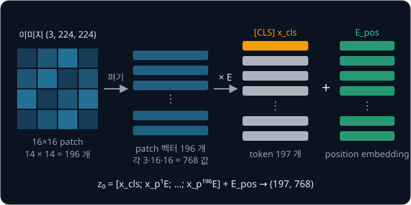
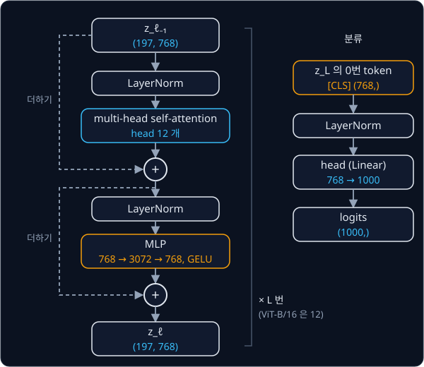

# ViT

## 배경

[CNN](../cnn/README.md) 은 가까운 pixel 끼리 관련이 깊고 같은 패턴은 어디에 나와도 같다는 가정을 convolution 구조 자체에
담고 있다. 이렇게 모델 구조에 미리 넣어 둔 가정을 inductive bias 라고 한다. 데이터가 적을 때는 이 inductive bias 가 큰 도움이
되지만, 멀리 떨어진 영역 사이의 관계는 층을 여러 번 거친 뒤에야 볼 수 있다. [Transformer](../transformer/README.md) 의
attention 은 sequence 안의 모든 token 쌍을 한 층에서 바로 비교하는데, 2020년 Dosovitskiy 등은 이미지를 단어처럼 token 으로
잘라 이 구조에 거의 그대로 넣었다. 이 모델이 ViT(Vision Transformer)다.

### patch token

ViT 는 $H\times W$ 이미지를 $P\times P$ 크기의 patch $N = HW/P^2$ 개로 자른다. 224×224 이미지를 16×16 patch 로 자르면 가로
14 개, 세로 14 개라 $N = 196$ 이다. patch 하나는 channel 3 개 × 16 × 16 = 768 개 숫자인데, 이것을 한 줄로 편 vector $x_p^i$ 에
모든 patch 가 함께 쓰는 행렬 $E$ 를 곱해 $D$ 차원 token 으로 만든다. 이 과정이 patch embedding 이다.

맨 앞에는 학습되는 [CLS] token $x_{\text{cls}}$ 하나를 붙인다. 이 token 은 이미지의 어느 patch 에도 해당하지 않고, encoder 를
거치며 다른 token 들의 정보를 모아 이미지 전체를 대표하는 자리로 쓰인다. 이름은 classification 에서 왔고, 같은 방식을 먼저 쓴
언어 모델 BERT 에서 가져왔다.

token 마다 자기 자리의 위치 정보를 담은 position embedding $E_{\text{pos}}$ 를 더한다. ViT 의 position embedding 은
sin·cos 식이 아니라 자리마다 학습되는 vector 다.

$$
z_0 = [\,x_{\text{cls}};\ x_p^1 E;\ \dots;\ x_p^N E\,] + E_{\text{pos}}
$$

| 기호 | 뜻 | ViT-B/16 의 모양 |
| --- | --- | --- |
| $x_p^i$ | $i$ 번째 patch 를 편 vector | $(C P^2,) = (768,)$ |
| $E$ | 모든 patch 가 함께 쓰는 linear projection | $(768, D) = (768, 768)$ |
| $x_{\text{cls}}$ | 학습되는 [CLS] token | $(D,)$ |
| $E_{\text{pos}}$ | 학습되는 position embedding, token 마다 하나 | $(N + 1, D) = (197, 768)$ |
| $z_0$ | encoder 의 입력 | $(197, 768)$ |

$[\,a; b; \dots]$ 는 token 을 순서대로 쌓는다는 뜻이다.



patch 를 펴서 같은 $E$ 를 곱하는 일은 kernel 크기와 stride 가 모두 $P$ 인 convolution 과 같다. kernel 이 겹치지 않고 patch 하나씩을
정확히 덮으면서 같은 weight 를 쓰기 때문이다. torchvision 의 ViT 도 patch embedding 을 `nn.Conv2d` 로 구현한다.

### LayerNorm

LayerNorm 은 [ResNet](../resnet/README.md) 의 BatchNorm 과 식은 같지만 평균·분산을 구하는 방향이 다르다. BatchNorm 은 channel
하나의 값을 batch 전체에서 모아 정규화하고, LayerNorm 은 token 하나의 $D$ 개 값을 그 token 안에서 정규화한다. 그래서 batch 크기와
상관없이 train 과 eval 에서 똑같이 동작한다. $D = 4$ 인 token $[1, 2, 3, 6]$ 이라면 평균 3, 분산 3.5 로 정규화해
$[-1.069, -0.535, 0, 1.604]$ 가 되고, 여기에 학습되는 $\gamma$·$\beta$ 를 곱하고 더한다.

### encoder block

encoder block 은 multi-head self-attention(MSA)과 MLP 두 부분으로 되어 있다. MSA 는 [Transformer](../transformer/README.md)
과제에서 짠 것과 같고, MLP 는 token 마다 따로 Linear($D \to$ mlp_dim) → GELU → Linear(mlp_dim $\to D$) 를 거는 작은 network 다.
GELU 는 ReLU 와 비슷하지만 0 근처에서 꺾이지 않고 매끄럽게 휘는 activation 이다.

ViT 는 각 부분의 입력에 LayerNorm 을 먼저 거는 pre-norm 구조를 쓰고, 두 부분 모두 출력을 입력에 더하는 residual 연결을 둔다.

$$
z'_\ell = \mathrm{MSA}(\mathrm{LN}(z_{\ell-1})) + z_{\ell-1}, \qquad
z_\ell = \mathrm{MLP}(\mathrm{LN}(z'_\ell)) + z'_\ell, \qquad
y = \mathrm{LN}(z_L^0)
$$

$\ell$ 은 몇 번째 block 인지, $L$ 은 block 수다. $z_L^0$ 은 마지막 block 출력의 0번 token, 곧 [CLS] 자리이고, 분류는 이 자리의
출력 $y$ 에 linear head 를 붙여서 한다.



### ViT-B/16

ViT-B/16 은 Base 크기에 patch 16 을 쓴 모델이다. 논문에 따르면 ImageNet-21k 나 JFT-300M 같은 큰 데이터로 pre-train 해야 비슷한
크기의 ResNet 을 앞선다.

| 항목 | 값 |
| --- | --- |
| 입력 | 224×224 |
| patch $P$ | 16 |
| token 수 | patch 196 + [CLS] 1 = 197 |
| 폭 $D$ | 768 |
| block 수 $L$ | 12 |
| attention head | 12 |
| MLP 폭 | 3072 |
| parameter | 86,567,656 |

torchvision 의 `state_dict` 는 152 개 tensor 로 되어 있고, 이름은 아래처럼 module 구조를 따른다.

| torchvision key | 모양 |
| --- | --- |
| `conv_proj.weight` | (768, 3, 16, 16) |
| `class_token` | (1, 1, 768) |
| `encoder.pos_embedding` | (1, 197, 768) |
| `encoder.layers.encoder_layer_0.self_attention.in_proj_weight` | (2304, 768) |
| `encoder.layers.encoder_layer_0.mlp.0.weight` | (3072, 768) |
| `heads.head.weight` | (1000, 768) |

## 목표

- 이미지를 patch token 으로 바꾸는 patch embedding 을 reshape 방식과 conv 방식으로 짜서 같은 결과가 나오는지 확인한다
- [Transformer](../transformer/README.md) 과제의 multi-head attention 으로 pre-norm encoder block 을 만든다
- torchvision `vit_b_16` 의 `IMAGENET1K_V1` weight 를 옮겨 넣고 logits 를 비교한다
- 작은 ViT 를 CIFAR-10 에서 처음부터 학습해 [ResNet](../resnet/README.md) 과제의 CIFAR 망과 정확도를 비교한다
- (선택) [CLS] token 의 attention map 을 이미지 위에 겹쳐 그린다

**직접 짤 것**: patchify, patch embedding, [CLS] token, position embedding, encoder block(attention 은 앞 과제 것을 재사용),
weight 이식.
**가져다 써도 되는 것**: `nn.Linear`, `nn.LayerNorm`, `nn.GELU`, `nn.Conv2d`(patch embedding 비교용), 이미지 전처리
(`ViT_B_16_Weights.IMAGENET1K_V1.transforms()`), torchvision `vit_b_16`(비교용).

## 준비물

- Python 3.12, `torch`, `torchvision`, `matplotlib`, `pytest`
- [Imagenette](https://github.com/fastai/imagenette) val 이미지, CIFAR-10. 둘 다 `data/` 에 두면 `.gitignore` 에 걸려 커밋되지 않는다
- [Transformer](../transformer/README.md) 과제의 `attention.py` — encoder block 의 attention 으로 불러 쓴다
- weight 이식과 비교는 CPU 로 충분하고(ViT-B/16 은 parameter 약 8,660만 개), CIFAR-10 학습은 8 GB GPU 나 Colab T4 면 된다

## 진행 순서

1. `vit.py` 에 `(N, C, H, W)` 를 `(N, num_patches, C·P²)` 로 바꾸는 `patchify` 를 짠다. 224×224 입력, $P = 16$ 이면 `(N, 196, 768)` 이 나와야 한다
2. `patchify` + `nn.Linear` 와 `kernel_size = stride = P` 인 `nn.Conv2d` 에 같은 weight 를 넣어 출력을 비교하는 test 를
   `test_vit.py` 에 쓴다
3. [CLS] token, position embedding, pre-norm `EncoderBlock` 으로 `ViT` 를 조립하고 parameter 수를 torchvision 과 비교한다.
   attention 은 Transformer 과제의 `attention.py` 를 불러 쓴다
4. `load_vit.py` 에서 torchvision `vit_b_16` 의 `state_dict` 를 내 모델로 옮기는 대응표를 만든다
5. 같은 이미지에서 내 모델과 torchvision 모델의 eval logits 를 비교하고, Imagenette val 이미지 전체에서 top-1 예측을 비교한다
6. `train_cifar.py` 에서 patch 4, 폭 192, 6층 정도의 작은 ViT 를 CIFAR-10 에서 처음부터 학습한다
7. 같은 epoch 수로 학습한 ResNet 과제의 CIFAR 망과 test 정확도를 표로 비교해 `results/cifar_accuracy.md` 로 커밋한다

## 시작점

아래 파일은 모두 리포에 들어 있다.

```text
vit/
├── pyproject.toml    # 이 과제의 Python 버전과 패키지
├── uv.lock
├── vit.py            # patchify, PatchEmbed, EncoderBlock, ViT 의 stub
├── load_vit.py       # torchvision vit_b_16 → 내 ViT, load_torchvision_vit 의 stub
├── train_cifar.py    # 작은 ViT 를 CIFAR-10 에서 처음부터 학습
└── test_vit.py       # patch embedding·parameter 수·logits 를 비교하는 test 를 직접 쓴다
```

[vit.py](vit.py)·[load_vit.py](load_vit.py) 의 함수와 method 는 몸통이 `raise NotImplementedError` 인 stub 이고,
이름과 signature 는 그대로 둔 채 몸통을 채운다. [vit.py](vit.py) 첫머리에서 [Transformer](../transformer/README.md) 과제 폴더를
`sys.path` 에 더해 `attention.py` 의 `MultiHeadAttention` 을 import 해 두었다. 채점용 test 는 없어서 평가 기준은
[test_vit.py](test_vit.py) 에 직접 쓴 test 와 `train_cifar.py` 의 정확도 기록으로 확인한다. 패키지는 `pyproject.toml` 에 있고,
이 폴더에서 `uv run` 을 처음 실행할 때 `.venv/` 에 설치된다.

```bash
cd projects/vit
uv run pytest
uv run python train_cifar.py
```

## 평가 기준

- [ ] 같은 weight 를 넣은 `patchify` + `nn.Linear` 와 `nn.Conv2d` patch embedding 의 출력 차이가 1e-5 미만이다
- [ ] 내 ViT-B/16 의 parameter 수가 torchvision 과 같은 86,567,656 개다
- [ ] weight 를 옮겨 넣은 뒤 eval logits 가 torchvision `vit_b_16` 과 최대 1e-3 이내로 같다(CPU, float32)
- [ ] Imagenette val 이미지 전체에서 1000-class top-1 예측이 torchvision 과 100% 같다
- [ ] CIFAR-10 에서 처음부터 학습한 작은 ViT 와 ResNet 과제 CIFAR 망의 test 정확도를 같은 epoch 기준으로 기록했다
- [ ] (선택) position embedding 을 0 으로 두고 patch 순서를 섞어도 [CLS] 출력이 바뀌지 않는지 확인한다

## 생각해 볼 질문

1. position embedding 이 없으면 ViT 는 patch 순서를 구별할 수 있는가? CNN 은 위치 정보를 어디서 얻는가?
2. 같은 CIFAR-10 으로 처음부터 학습하면 작은 ViT 의 정확도가 대체로 ResNet 보다 낮게 나온다. 그런데 데이터가 수억 장으로 늘면 순서가 뒤집히는 이유는?
3. 입력 해상도를 224 에서 384 로 올리면 token 수와 attention 계산량은 어떻게 변하고, 학습된 position embedding 은 어떻게 처리해야 하는가?

## 힌트

<details>
<summary>attention weight 를 옮길 때</summary>

torchvision encoder 는 `nn.MultiheadAttention` 을 쓰는데, Q·K·V projection 이 `in_proj_weight` 하나에 세로로 이어 붙어 있다.
내 attention 이 Q·K·V projection 을 따로 두었다면 이 tensor 를 세 조각으로 나눠야 하고, 순서는 이름 그대로 Q, K, V 다.

</details>

<details>
<summary>logits 가 조금씩 어긋날 때</summary>

torchvision ViT 의 LayerNorm 은 `eps=1e-6` 이라 `nn.LayerNorm` 기본값(1e-5)과 다르다. MLP 의 `nn.GELU` 도 tanh 근사가 아닌
erf 버전이다. position embedding 은 [CLS] 를 붙인 뒤의 197개 token 전체에 더한다.

</details>

## 참고 자료

- Alexey Dosovitskiy et al., [An Image is Worth 16x16 Words](https://arxiv.org/abs/2010.11929) (2020) — 3.1절의 식 (1)–(4) 가
  이 과제의 모델 전부이고, 표 1 에 ViT-B·L·H 의 크기가 있다
- Yannic Kilcher, [An Image is Worth 16x16 Words (Paper Explained)](https://www.youtube.com/watch?v=TrdevFK_am4) — 논문을
  그림과 함께 읽어 주는 영상
- Dive into Deep Learning, [Transformers for Vision](https://d2l.ai/chapter_attention-mechanisms-and-transformers/vision-transformer.html)
  — patch embedding 과 ViT block 을 코드와 함께 설명한다
- Jay Alammar, [The Illustrated Transformer](https://jalammar.github.io/illustrated-transformer/) — self-attention 과 multi-head 를
  그림으로 다시 볼 때
- Jimmy Lei Ba et al., [Layer Normalization](https://arxiv.org/abs/1607.06450) (2016) — BatchNorm 과 정규화 방향이 어떻게 다른지
- Ruibin Xiong et al., [On Layer Normalization in the Transformer Architecture](https://arxiv.org/abs/2002.04745) (2020) — pre-norm
  과 post-norm 의 차이
- PyTorch 문서, [nn.MultiheadAttention](https://docs.pytorch.org/docs/stable/generated/torch.nn.MultiheadAttention.html) —
  `in_proj_weight` 에 Q·K·V 가 이어 붙어 있는 구조
- Google Research, [vision_transformer](https://github.com/google-research/vision_transformer) — 논문의 공식 JAX 구현과 weight
- torchvision, [`vit_b_16` weight 문서](https://docs.pytorch.org/vision/stable/models/generated/torchvision.models.vit_b_16.html) —
  weight 별 전처리와 ImageNet 정확도
- torchvision, [`vision_transformer.py`](https://github.com/pytorch/vision/blob/main/torchvision/models/vision_transformer.py) —
  key 구조 확인용. 구현은 막혔을 때만 연다
- lucidrains, [vit-pytorch](https://github.com/lucidrains/vit-pytorch) — 짧은 PyTorch ViT 구현 모음. 막혔을 때만 연다

## 남은 한계

ViT 도 정해진 class 목록 안에서만 분류해서, 새 개념을 알아보게 하려면 그 개념에 label 을 단 데이터가 다시 필요하다. image
encoder 를 text encoder 와 함께 학습해 문장으로 개념을 지정할 수 있게 만든 모델이 [CLIP](../clip/README.md) 이다.
