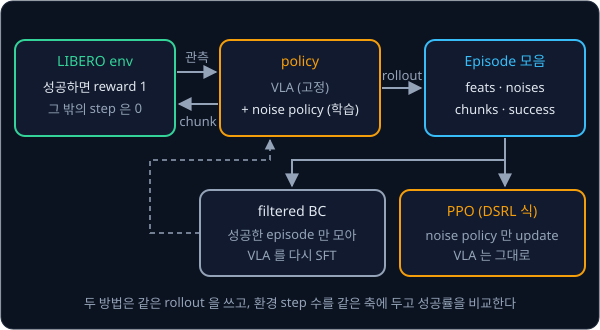
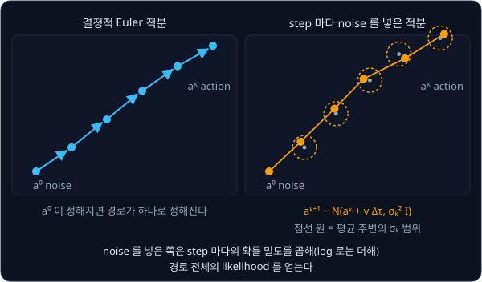
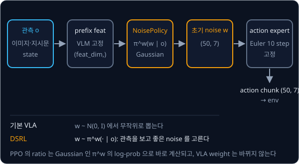

# VLA + RL

## 배경

[π0](../pi0/README.md) 에서 만든 VLA 는 시연을 따라 하도록 학습해서 시연의 질을 넘기 어렵고, 시연에 없던 상태로 벗어나면 회복하는
법을 모른다. 성공했는지만 알려 주는 reward 로 policy 를 직접 개선하는 RL fine-tuning 은 이 두 한계를 겨냥한다. 이 과제에서는 SFT 한
VLA 의 성공률을 기준선으로 두고, 성공한 rollout 만 다시 배우는 filtered BC 와 VLA 를 고정한 채 초기 noise 만 고르는 DSRL 식 noise
policy 를 같은 환경 step 축에서 비교한다.

### sparse reward 와 rollout

RL 에서 policy 가 환경에서 한 번 시도한 기록을 rollout(episode)이라 하고, 시도 중 받는 점수를 reward 라고 한다. 이 과제의 reward 는
task 를 성공하면 1, 그 밖에는 모두 0 이다. 성공 여부만 알려 주는 이런 reward 를 sparse reward 라고 하는데, 어떤 동작이 좋았는지는
알려 주지 않아서 policy 는 성공한 episode 와 실패한 episode 의 차이에서만 배운다. 예를 들어 task 하나에서 20 episode 를 돌려 6 번
성공하면, 학습 batch 에서 reward 1 을 받은 episode 는 6 개뿐이다.

VLA 는 action 을 chunk 단위로 내므로 RL 의 결정 하나도 chunk 하나로 잡는다. episode 하나에서 chunk 를 최대 50 번(`max_chunks`)
실행하고, 그 사이에 성공하면 reward 1 을 받고 끝난다.



### filtered BC

filtered BC 는 지금 policy 로 rollout 을 모은 뒤 성공한 episode 만 골라 그 action 을 정답 삼아 다시 SFT 하는 방법이다.
[Behavior Cloning](../behavior-cloning/README.md) 과 같은 loss 를 쓰고 데이터만 바꾸는데, 이 과정을 2–3 번 되풀이하면 policy 가 자기
성공 사례 쪽으로 조금씩 옮겨 간다. reward 를 따로 계산하지 않아서 가장 단순한 비교군이 된다.

### PPO 와 log-likelihood

[PPO](../ppo/README.md) 는 새 policy 와 rollout 을 모은 옛 policy 가 같은 action 에 매긴 확률의 비율 $r$ 로 update 크기를 조절한다.

$$
r(\theta) = \frac{\pi_\theta(a \mid o)}{\pi_{\theta_\text{old}}(a \mid o)}, \qquad
L^{\text{CLIP}} = \mathbb{E}\Big[\min\big(r\,\hat A,\ \mathrm{clip}(r, 1-\epsilon, 1+\epsilon)\,\hat A\big)\Big]
$$

$\hat A$ 는 그 action 이 평균보다 얼마나 좋았는지를 나타내는 advantage 이고, value head 와 GAE 로 구한다. 이 식을 쓰려면 policy 가
실제로 낸 action 의 log-likelihood $\log \pi_\theta(a \mid o)$ 를 계산할 수 있어야 한다. 2024–2025 년에 나온 VLA RL 방법들은 이
값을 어떻게 얻는지에 따라 갈린다.

action 을 token 으로 내는 VLA(OpenVLA 계열)는 softmax 확률에서 token 의 log-prob 이 바로 나오므로 LLM 에서 쓰던 PPO·GRPO 를
거의 그대로 쓸 수 있고, VLA-RL·SimpleVLA-RL·RL4VLA(What Can RL Bring to VLA Generalization?)가 이 방식을 쓴다. flow matching 으로
action 을 생성하는 π0 계열은 ODE 로 noise 를 action 으로 옮기기 때문에 생성된 action 의 likelihood 를 계산하기 어렵다. DPPO 는
DDPM 의 denoising step 을 그대로 Gaussian transition 으로 쓰고, ReinFlow·πRL 은 flow 의 적분 step 마다 Gaussian noise 를 넣어
Gaussian transition 을 만든다. 두 경우 모두 $K$ step 짜리 denoising 경로의 log-likelihood 를 Gaussian log-density 의 합으로 계산해
PPO 의 ratio 에 쓴다.

$$
\log\pi_\theta(a^{0:K}\mid o)=\sum_{k=0}^{K-1}\log\mathcal N\Big(a^{k+1};\ a^k + v_\theta(a^k,\tau_k,o)\,\Delta\tau,\ \sigma_k^2 I\Big)
$$

$a^0$ 은 출발 noise, $a^K$ 는 마지막에 나온 action chunk, $a^k$ 는 그 사이 $k$ 번째 적분 step 의 값이다. $v_\theta$ 는 action
expert 의 velocity, $\tau_k$ 는 $k$ 번째 step 의 flow time, $\Delta\tau$ 는 step 크기, $\sigma_k$ 는 그 step 에 넣는 noise 의
표준편차다. 한 step 은 평균이 "Euler step 으로 갔을 자리" 인 Gaussian 에서 다음 점을 뽑는 것이고, 그 Gaussian 의 log-density 는

$$
\log\mathcal N(x;\ \mu,\ \sigma^2 I) = -\frac{\lVert x-\mu \rVert^2}{2\sigma^2} - \frac{d}{2}\log(2\pi\sigma^2)
$$

이다. $d$ 는 $x$ 의 차원 수다. 예를 들어 1 차원에서 $\sigma = 0.1$ 이고 뽑힌 점이 평균에서 0.05 떨어져 있으면 log-density 는
$-0.125 + 1.384 \approx 1.259$ 이고, 평균에 정확히 떨어지면 1.384 다.



### DSRL: noise 공간의 policy

VLA 의 weight 를 아예 건드리지 않는 방법도 있다. DSRL 은 flow·diffusion policy 의 초기 noise $w$ 를 action 으로 보는 작은 policy
$\pi^w(w\mid o)$ 를 RL 로 학습해서, 같은 VLA 가 더 좋은 action chunk 를 내도록 noise 쪽에서 조종한다. 기본 VLA 는 $w$ 를
$\mathcal N(0, I)$ 에서 무작위로 뽑지만, noise policy 는 관측을 보고 $w$ 를 고른다.

chunk 가 $(50, 7)$ 이면 $w$ 도 $(50, 7)$, 숫자 350 개다. noise policy 는 VLM prefix feature 를 받아 $w$ 의 평균과 표준편차를 내는
Gaussian policy 라서 log-likelihood 가 바로 계산되고, [PPO](../ppo/README.md) 과제의 코드를 거의 그대로 쓸 수 있다. 이 방법은 같은
$w$ 를 넣으면 VLA 가 늘 같은 chunk 를 낸다는 성질에 기댄다. sampler 안에서 무작위성이 더 섞이면 noise policy 가 고른 $w$ 와 결과
사이의 관계가 흐려진다.



### 실물 시스템과 GPU 규모

실물에서는 사람의 개입과 시연을 섞는 ConRFT, advantage 를 조건으로 넣어 학습하는 π\*0.6 같은 시스템이 나왔다. π\*0.6 의 방법은
RECAP(RL with Experience and Corrections via Advantage-conditioned Policies)이라 부른다. 어느 방법이 표준이 될지는 아직 정해지지
않았다. 논문들은 대부분 data-center GPU 여러 장으로 수십억 parameter VLA 를 학습하므로(SimpleVLA-RL 공개 코드는 80 GB A800 8 장
기준), 8 GB GPU 에서는 작은 VLA 를 고정하고 task 를 몇 개로 줄여 재현하는 정도가 현실적이다.

## 목표

- [π0](../pi0/README.md) 의 작은 VLA 를 LIBERO task 몇 개에 SFT 한 checkpoint 의 성공률을 기준선으로 잰다
- 성공 여부를 sparse reward 로 주는 rollout 환경과 평가 루프를 짠다
- 성공한 rollout 만 모아 다시 SFT 하는 filtered BC 를 가장 단순한 비교군으로 돌린다
- VLA 는 고정하고 초기 noise 만 고르는 DSRL 식 noise policy 를 [PPO](../ppo/README.md) 로 학습한다
- (선택) action expert 에 noise 를 주입해 PPO 로 직접 fine-tuning 하고 세 방법을 비교한다

**직접 짤 것**: rollout·reward·평가 루프, filtered BC, noise policy 와 그 학습 루프, (선택) denoising 경로 log-likelihood 와 PPO loss.
**가져다 써도 되는 것**: [π0](../pi0/README.md) 에서 만든 VLA, LeRobot 의 LIBERO 환경과 `lerobot/libero` dataset, 내 PPO 코드,
비교용 LeRobot SmolVLA checkpoint.

## 준비물

- Python 3.12, numpy, `torch`, torchvision, `transformers`, Pillow, matplotlib, pytest, `lerobot[libero,smolvla]`(LIBERO env·`lerobot/libero` dataset·
  비교용 SmolVLA), [π0](../pi0/README.md) 결과물
- LIBERO 는 Linux 가 필요하고, 모니터 없이 렌더링하려면 `MUJOCO_GL=egl` 을 쓴다
- GPU: 500M 이하 VLM 을 bf16 으로 고정하고 noise policy 나 action expert 만 학습하면 8 GB 에 들어간다. rollout 의 매 chunk 마다 VLA
  forward 가 필요해서 학습 시간이 sim 속도와 GPU 추론 속도에 묶이고, task 몇 개로 줄여도 실험 하나에 하루 가까이 걸릴 수 있다
- 7B 급 VLA 나 전체 parameter RL 은 80 GB 급 GPU 여러 장이 필요하므로 cloud GPU 를 빌려야 한다

## 진행 순서

1. `rl_config.py` 에 π0 checkpoint 경로와 suite 를 적는다. LIBERO suite 하나에서 SFT 성공률이 30–70% 인 task 3–5 개를 골라
   `train_task_ids` 에, 학습에 쓰지 않을 task 를 `heldout_task_ids` 에 적는다(이미 100% 에 가까운 task 는 개선할 여지가 없다)
2. `env.py` 의 `make_env` 로 성공하면 reward 1, 아니면 0 을 주는 env 를 만든다
3. `rollout.py` 의 `VLAPolicy` 를 채운다. `sample_chunk` 는 받은 초기 noise 를 π0 의 `euler_sample` 에 `noise` 로 넘긴다. `test_rollout.py` 에 같은 noise 로 같은
   chunk 가 $10^{-5}$ 안에서 나오는지 보는 test 를 쓴다
4. 같은 파일의 `rollout` 으로 action chunk 단위로 VLA 를 실행해 `Episode` 하나를 모은다
5. `evaluate.py` 의 `success_rate` 로 고정한 초기 상태와 seed 에서 task 별 기준선 성공률을 잰다
6. `filtered_bc.py` 로 성공한 episode 만 모아 SFT 를 다시 하기를 2–3 번 반복하고, 매번 쓴 환경 step 수와 성공률을 기록한다
7. `noise_policy.py` 의 `NoisePolicy` 와 `main` 으로 VLM prefix feature 를 입력으로 $w$ 를 내는 Gaussian noise policy 와 value head 를
   PPO 로 학습한다. `NoisePolicy` 의 `act`·`value` 는 ppo 과제의 `GaussianAgent` 와 같은 interface 라서 `ppo_loss` 에 그대로 넣는다
8. SFT·filtered BC·noise policy 세 판의 성공률을 환경 step 축에 겹쳐 그려 `results/` 에 저장한다
9. `heldout_task_ids` 의 task 에서 성공률이 떨어지지 않았는지 잰다. (선택) `flow_ppo.py` 로 action expert 를 직접 학습한 판을 더한다

## 시작점

아래 파일은 모두 리포에 들어 있다.

```text
vla-rl/
├── pyproject.toml    # 이 과제의 Python 버전과 패키지
├── uv.lock
├── rl_config.py      # RLConfig: checkpoint, suite, task 목록, 평가 episode 수
├── env.py            # make_env: sparse success reward 를 주는 LIBERO env
├── rollout.py        # Episode, VLAPolicy, rollout
├── filtered_bc.py    # 성공 episode 로 다시 SFT
├── noise_policy.py   # NoisePolicy: PPO 로 학습하는 DSRL 식 latent-noise policy
├── flow_ppo.py       # (선택) denoising_log_prob, action expert 에 직접 PPO
├── evaluate.py       # success_rate, 세 방법 비교
└── test_rollout.py   # 같은 noise → 같은 chunk 를 보는 test
```

[rl_config.py](rl_config.py) 에는 설정값이 들어 있고, [env.py](env.py)·[rollout.py](rollout.py)·[noise_policy.py](noise_policy.py)·
[flow_ppo.py](flow_ppo.py)·[evaluate.py](evaluate.py) 의 함수는 몸통이 `raise NotImplementedError` 인 stub 이다. 이름과
signature 는 그대로 둔 채 몸통을 채운다. 채점용 test 는 없어서 평가 기준은 [test_rollout.py](test_rollout.py) 에 직접 쓴 test 와
`results/` 의 성공률 표·그림으로 확인한다. 함수는 설정값을 기본값으로 두지 않으므로 `RLConfig` 의 값을 넘겨 부른다.
[rollout.py](rollout.py) 는 첫머리에서 pi0 과제 폴더를 `sys.path` 에 더해 `Pi0Lite`·`euler_sample` 을, [noise_policy.py](noise_policy.py)·
[flow_ppo.py](flow_ppo.py) 는 ppo 과제 폴더를 더해 `ppo_loss`·`compute_gae` 를 import 한다. PPO hyperparameter 는
[rl_config.py](rl_config.py) 가 같은 폴더에서 가져온 `PPOConfig` 로 `RLConfig.ppo` 에 둔다. 패키지는
`pyproject.toml` 에 있고, 이 폴더에서 `uv run` 을 처음 실행할 때 `.venv/` 에 설치된다. LIBERO 는 Linux 에서만 돈다.

```bash
cd projects/vla-rl
uv run pytest
MUJOCO_GL=egl uv run python evaluate.py      # Linux, 화면 없는 서버
MUJOCO_GL=egl uv run python noise_policy.py
```

## 평가 기준

- [ ] `sample_chunk` 에 같은 noise 를 넣으면 같은 action chunk 가 $10^{-5}$ 안에서 나온다(noise policy 가 기대는 성질)
- [ ] 학습에 쓴 task 의 평균 성공률을 noise policy 가 SFT 기준선보다 10%p 이상 올린다(task 마다 20 episode 이상으로 잰다)
- [ ] 같은 성공률 향상까지 필요한 환경 step 수를 filtered BC 와 noise policy 사이에서 비교한 표가 있다
- [ ] 학습에 쓰지 않은 task 의 성공률이 기준선 대비 5%p 넘게 떨어지지 않는다
- [ ] (선택) action expert 를 직접 PPO 로 학습한 판에서 SFT policy 와의 KL 이나 BC loss 를 함께 걸지 않으면 성공률이 급격히 떨어지는지 확인한다
- [ ] (선택) 같은 protocol 에 LeRobot 의 SmolVLA 를 기준선으로 넣어 모델 크기에 따라 개선 폭이 어떻게 달라지는지 본다

## 생각해 볼 질문

1. flow matching policy 는 sample 을 쉽게 뽑지만 그 action 의 log-likelihood 는 바로 계산하기 어렵다. 이것이 PPO 의 ratio 에서 왜
   문제가 되고, denoising step 마다 noise 를 넣으면 무엇을 얻고 무엇을 잃는가?
2. 성공 여부만 주는 sparse reward 에서 SFT 성공률이 0% 인 task 를 RL 로 개선할 수 있는가? 30% 인 task 와 무엇이 다른가?
3. noise 공간 RL 은 VLA 가 원래 낼 수 있는 action 분포 바깥으로 나가지 못한다. 이 제약은 장점인가 단점인가?

## 힌트

<details>
<summary>개선이 보이지 않을 때 먼저 볼 것</summary>

task 당 평가 episode 가 10 개면 성공 하나가 10%p 라서 작은 개선은 noise 에 묻힌다. 평가 수를 늘리고 초기 상태를 고정한 다음,
학습 batch 안에 reward 1 을 받은 episode 가 몇 개인지 센다. 성공이 거의 없으면 RL 이 배울 신호도 없다.

</details>

<details>
<summary>noise policy 의 출력 범위</summary>

VLA 는 학습 때 표준 Gaussian 에서 뽑은 noise 만 보았으므로 noise policy 가 $\lVert w\rVert$ 를 키우면 action 이 망가진다. 출력을
tanh 로 묶거나 $\mathrm{KL}\big(\pi^w(\cdot\mid o)\,\Vert\,\mathcal N(0,I)\big)$ 를 약한 penalty 로 둔다. noise policy 는 off-policy 로
학습해도 되므로, [DQN → SAC](../off-policy/README.md) 를 했다면 SAC 로 바꿔 sample efficiency 를 비교해 볼 수 있다.

</details>

<details>
<summary>8 GB 에 맞추는 법</summary>

VLM prefix 는 고정이므로 같은 관측의 prefix feature 는 한 번만 계산해 rollout 과 update 에서 함께 쓴다. 학습하는 parameter 는 noise
policy 나 action expert 뿐이라 optimizer state 도 작다. rollout 은 bf16 으로 추론하고, update 때는 작은 head 만 fp32 로 계산한다.

</details>

## 참고 자료

- A. Wagenmaker 외, [Steering Your Diffusion Policy with Latent Space Reinforcement Learning](https://arxiv.org/abs/2506.15799)
  — DSRL 논문. [프로젝트 페이지](https://diffusion-steering.github.io/) 에 π0 를 noise 공간에서 조종한 LIBERO·실물 결과가 있다
- J. Schulman 외, [Proximal Policy Optimization Algorithms](https://arxiv.org/abs/1707.06347) 와 OpenAI Spinning Up
  [PPO](https://spinningup.openai.com/en/latest/algorithms/ppo.html) — clipped objective 의 원 논문과 짧은 해설
- J. Schulman 외, [High-Dimensional Continuous Control Using Generalized Advantage Estimation](https://arxiv.org/abs/1506.02438) —
  value head 로 advantage 를 구하는 GAE
- A. Ren 외, [Diffusion Policy Policy Optimization](https://arxiv.org/abs/2409.00588) — DDPM 의 denoising step 을 Gaussian
  transition 으로 보고 PPO 를 거는 방법. [DPPO 프로젝트 페이지](https://diffusion-ppo.github.io/)
- T. Zhang 외, [ReinFlow](https://arxiv.org/abs/2505.22094) 와 K. Chen 외, [πRL](https://arxiv.org/abs/2510.25889) — flow 의 적분
  step 에 noise 를 넣어 log-likelihood 를 만드는 방법. [ReinFlow 프로젝트 페이지](https://reinflow.github.io/)
- D. McAllister 외, [Flow Matching Policy Gradients](https://arxiv.org/abs/2507.21053) — likelihood 를 직접 계산하지 않고
  conditional flow matching loss 로 PPO 의 ratio 를 근사하는 FPO. [프로젝트 페이지](https://flowreinforce.github.io/)
- J. Liu 외, [What Can RL Bring to VLA Generalization?](https://arxiv.org/abs/2505.19789) — OpenVLA 에 PPO·GRPO·DPO 를 비교한
  empirical study. [RL4VLA 프로젝트 페이지](https://rlvla.github.io/)
- H. Li 외, [SimpleVLA-RL](https://arxiv.org/abs/2509.09674) 와 [공개 코드](https://github.com/PRIME-RL/SimpleVLA-RL) — OpenVLA-OFT
  를 LIBERO·RoboTwin 에서 RL 로 학습한다. 필요한 GPU 규모를 가늠하는 용도
- [RLinf](https://github.com/RLinf/RLinf) — πRL 과 π0 용 DSRL 구현이 있는 VLA RL 프레임워크라 막혔을 때만 연다
- [ConRFT 프로젝트 페이지](https://cccedric.github.io/conrft/) 와 Physical Intelligence, [π\*0.6](https://arxiv.org/abs/2511.14759)·
  [블로그](https://www.physicalintelligence.company/blog/pistar06) — 실물 시도와 사람의 개입으로 VLA 를 다듬는 시스템
- LeRobot [LIBERO 문서](https://huggingface.co/docs/lerobot/libero) — 설치, 평가 protocol, dataset

## 남은 한계

이 과제는 sim 이 성공 여부를 바로 알려 주는 경우만 다룬다. 실물에서는 성공을 판정하는 reward model, 사람의 개입, 안전한 reset 까지
시스템 전체를 설계해야 한다. 다음 단계로 SO-101 같은 팔에 LeRobot 의 [HIL-SERL](https://huggingface.co/docs/lerobot/hilserl) 도구로
reward classifier 와 개입을 붙여 볼 수 있다.
