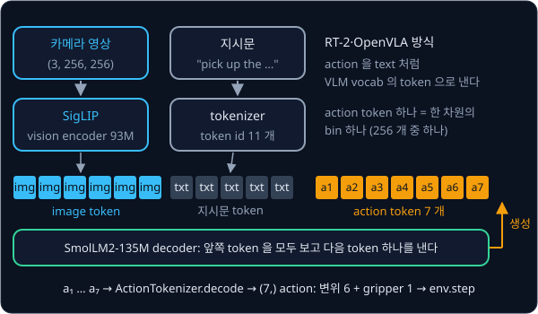
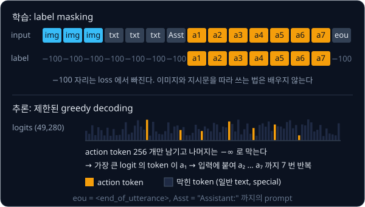

# RT-2 → OpenVLA

## 배경

[RT-1](../rt1/README.md) 과제의 mini RT-1 은 PushT 시연만으로 학습해서, 언어 지시를 이해하지 못하고 시연에 없던 물체를 다룰
상식도 없다. 그런데 RT-1 의 action 은 이미 차원마다 256 개 중 하나를 고르는 token 이었다. Google 의 RT-2(2023) 는 이 token 을
web 데이터로 사전학습된 VLM 의 vocabulary 에 그대로 넣어, 이미지와 지시문을 보고 action 을 text 처럼 생성하게 했다. 이 과제에서는
같은 아이디어를 500M 이하의 작은 VLM(SmolVLM-256M·500M) 에 적용해 LIBERO 에서 fine-tune 하고, 언어 조건을 붙인 mini RT-1 과
비교한다.

### VLM 과 VLA

VLM(Vision-Language Model)은 이미지와 text 를 함께 받아 text 를 생성하는 모델이다. 이미지는 vision encoder 가 patch 마다
vector 로 바꾸고, connector 가 이 vector 들을 언어 모델의 token embedding 과 같은 차원으로 맞춘다. 그러면 이미지 조각들이
지시문 token 앞에 놓인 "image token" 이 되고, [GPT-2](../gpt/README.md) 과제에서 짠 것 같은 decoder 가 그 뒤를 이어 text 를
한 token 씩 생성한다. vision encoder 는 [CLIP](../clip/README.md) 처럼 이미지·text 쌍으로 학습된 것을 쓰는 경우가 많다.

이 과제의 SmolVLM-256M 은 vision encoder SigLIP(93M) 과 언어 모델 SmolLM2(135M) 로 이루어져 있다. 지시문
"pick up the alphabet soup and place it in the basket" 은 SmolVLM tokenizer 로 token 11 개가 된다.

VLA(Vision-Language-Action model)는 VLM 이 text 대신 로봇 action 을 내도록 fine-tune 한 모델이다. RT-2 와 OpenVLA 는 action 을
VLM vocab 의 token 으로 바꿔서, 모델 구조를 거의 그대로 둔 채 "다음 token 맞히기" 학습만으로 VLA 를 만들었다.



### RT-2 의 action token

RT-2 는 end-effector 6-DoF 변위와 gripper 를 각각 256 bin 으로 나누고 종료 여부를 더해 정수 8 개를 정답 text 로 두었다.
PaLI-X 처럼 1000 까지의 정수가 각자 token 인 모델에서는 그 숫자 token 을 action 으로 썼고, PaLM-E 처럼 그렇지 않은 모델에서는
가장 드물게 쓰이는 token 256 개를 덮어썼다. robot 데이터와 원래의 web VQA 데이터를 섞어 학습했고(co-fine-tuning), 이렇게
만든 모델을 VLA 라 부르기 시작했다.

RT-2 는 공개되지 않았지만 OpenVLA(2024) 가 같은 방식을 7B 공개 모델로 재현했다. Llama 2 에 DINOv2 와 SigLIP feature 를 합친
vision encoder 를 붙이고, Open X-Embodiment 의 시연 97 만 개로 학습했으며, Llama tokenizer 에서 거의 안 쓰이는 vocab 끝쪽
token 256 개를 action bin 으로 덮어썼다.

### action 의 discretization

LIBERO 의 action 은 7 차원이다. end-effector 의 변위 6 개(위치 $\Delta x, \Delta y, \Delta z$ 와 회전
$\Delta\text{roll}, \Delta\text{pitch}, \Delta\text{yaw}$)와 gripper 여닫기 1 개이고, 값의 범위는 $[-1, 1]$ 이다.
discretization 은 연속값을 정해진 구간(bin) 가운데 하나의 번호로 바꾸는 일이다. 차원마다 범위 $[\text{low}, \text{high}]$ 를
256 개의 같은 폭 구간으로 나누고, 값이 속한 구간의 번호를 고른다. 되돌릴 때는 그 구간의 중심값을 쓴다.

범위는 학습 action 의 1 번째와 99 번째 분위수(percentile)로 정한다. 최댓값·최솟값을 쓰면 드물게 튀는 값 몇 개 때문에 범위가
넓어져, 대부분의 값이 몰린 가운데에 bin 이 적게 배정된다. 범위 밖의 값은 가장자리 bin 으로 잘라 넣는다(clip).

예를 들어 어떤 차원의 low 가 −0.9, high 가 0.9 이면 bin 폭은 $1.8 / 256 \approx 0.00703$ 이다. action 값 0.25 는 163 번 bin 에
들어가고, 되돌리면 그 bin 의 중심 0.2496 이 나와 오차는 0.0004 다. 이 오차는 어떤 값이든 bin 폭의 절반(0.0035)을 넘지 않는다.
범위 밖의 1.3 은 255 번 bin 으로 잘린다.

![연속 action 한 차원을 [low, high] 에서 256 bin 으로 나누고, bin 번호를 VLM vocab 의 드문 token id 로 바꾼다](figures/action-tokenization.svg)

### action bin 으로 쓸 token

bin 번호 0–255 를 VLM 이 낼 수 있게 하려면 vocab 의 token 256 개를 골라 bin 마다 하나씩 대응시킨다. 새 token 을 추가하면
embedding 을 처음부터 배워야 하므로, RT-2·OpenVLA 처럼 이미 있지만 거의 쓰이지 않는 token 을 덮어쓴다.

SmolVLM-256M 의 vocab 은 49,280 개인데, 0–16 번과 49,152–49,279 번은 대화 구분자·image 자리 token·`<end_of_utterance>` 같은
added token 이다. 이 token 을 action 으로 덮어쓰면 processor 가 만든 입력의 구조가 깨지므로, 그 사이의 일반 token 가운데
LIBERO 지시문 corpus 에 거의 나오지 않는 256 개를 고른다.

### 학습 loss 와 label masking

학습은 [GPT-2](../gpt/README.md) 과제와 같은 next-token prediction 이다. 이미지와 지시문 뒤에 action token 7 개를 정답으로
붙이고, 각 action token 을 그 앞의 모든 token 으로 맞히게 한다.

$$
\mathcal{L} = -\sum_{d=1}^{D} \log p_\theta\big(\tau(b_d) \ \big|\ \text{image},\ \text{instruction},\ \tau(b_1), \dots, \tau(b_{d-1})\big)
$$

$D = 7$ 은 action 차원 수, $b_d$ 는 $d$ 번째 차원의 bin, $\tau$ 는 bin 을 vocab id 로 바꾸는 표, $p_\theta$ 는 모델이 다음
token 에 매긴 확률이다. 이미지·지시문 자리에는 loss 를 걸지 않으려고 그 자리의 label 을 −100 으로 둔다. PyTorch 의
`cross_entropy` 는 label 이 −100 인 자리를 계산에서 빼기 때문에, loss 는 action token 7 자리에서만 나온다.

### 제한된 decoding

추론에서는 이미지와 지시문을 넣고 token 을 하나 생성해 입력 끝에 붙이고, 다시 다음 token 을 생성하기를 7 번 되풀이한다. 매
step 의 logits 는 vocab 49,280 개 전부에 대한 점수라서 그대로 고르면 일반 단어가 나올 수 있다. action token 256 개를 뺀 나머지
logit 을 $-\infty$ 로 막은 뒤 가장 큰 것을 고르면(greedy) 늘 bin 하나가 나온다.



### LIBERO 와 평가

LIBERO 는 MuJoCo 기반 Franka 팔 simulation benchmark 로, "알파벳 수프를 집어 바구니에 넣어라" 같은 언어 지시가 붙은 task 를
suite 단위로 묶어 둔다. `libero_object` 처럼 suite 하나에 task 가 10 개 있고, task 마다 episode 10 번을 돌려 성공률을 잰다.
episode 100 번의 평균 성공률에는 Wilson 95% 구간을 붙여 불확실성을 함께 적는다. $n$ 번 중 $k$ 번 성공하면 $\hat p = k / n$ 이고
구간은 아래와 같으며, $z = 1.96$ 이다.

$$
\frac{\hat p + \frac{z^2}{2n} \pm z\sqrt{\frac{\hat p(1-\hat p)}{n} + \frac{z^2}{4n^2}}}{1 + \frac{z^2}{n}}
$$

### FiLM 과 언어 조건 mini RT-1

비교 대상인 mini RT-1 에는 지시문을 넣을 자리가 없다. FiLM(Feature-wise Linear Modulation)은 조건 vector 에서 channel 마다
scale $\gamma$ 와 shift $\beta$ 를 만들어 CNN feature map 을 $\gamma \odot x + \beta$ 로 바꾸는 layer 다. RT-1 도 지시문
embedding 을 FiLM 으로 EfficientNet 에 넣었다.

$$
\gamma = W_\gamma\, e + b_\gamma, \qquad \beta = W_\beta\, e + b_\beta, \qquad
\text{FiLM}(x)_{c} = \gamma_c\, x_{c} + \beta_c
$$

$e$ (B, d_text) 는 [CLIP](../clip/README.md) 과제의 text encoder 가 낸 지시문 embedding, $x$ (B, C, H, W) 는 feature map,
$c$ 는 channel 번호다. 예를 들어 channel 이 3 개이고 $\gamma = [1.2, 0.5, 1.0]$, $\beta = [0, 0.1, -0.2]$ 이면 첫 channel 은
1.2 배로 커지고, 둘째는 절반으로 줄어 0.1 이 더해지고, 셋째는 0.2 만큼 내려간다. 지시문이 바뀌면 $\gamma, \beta$ 가 바뀌어
같은 이미지에서도 다른 feature 가 강조된다.

## 목표

- SmolVLM 의 vocabulary 에서 action bin 으로 쓸 token 256 개를 고르고 bin ↔ token id 표를 만든다
- LIBERO suite 하나의 시연으로 "이미지 + 지시문 → action token 7 개" 를 fine-tune 한다
- 추론 때 action token 만 나오도록 logits 를 제한해 7 개 token 을 decode 하고 env 에 넣는다
- suite 의 10 task 성공률을 재고 언어 조건 mini RT-1 과 비교한다

**직접 짤 것**: `ActionTokenizer`(분위수 범위, binning, token 대응), 학습 샘플 구성과 label masking, 제한된 decoding, LIBERO
eval 루프, mini RT-1 에 언어를 넣는 FiLM.
**가져다 써도 되는 것**: transformers 의 SmolVLM 모델·processor, peft 의 LoRA, `LeRobotDataset`, LeRobot 의 LIBERO env,
[CLIP](../clip/README.md) 에서 만든 text encoder, [RT-1](../rt1/README.md) 의 mini RT-1.

## 준비물

- Python 3.12, numpy, torch, transformers, peft, Pillow, matplotlib, pytest
- `lerobot[libero]` — LeRobot 의 LIBERO env 와 `LeRobotDataset`. LIBERO simulator(`hf-libero`)는 Linux 에서만 설치되고,
  화면 없는 서버에서는 `MUJOCO_GL=egl`
- 비교용 baseline 에 쓰는 rt1·clip 과제의 패키지(OpenAI `clip`, `ftfy`, `regex`, torchvision)
- dataset: `lerobot/libero` (1,693 episode, 40 task, 256×256 카메라 2 대, 8 차원 state, 7 차원 action, 1.9 GB)
- VLM: `HuggingFaceTB/SmolVLM-256M-Instruct` (SigLIP 93M + SmolLM2-135M) 또는 `HuggingFaceTB/SmolVLM-500M-Instruct`
- 256M 은 bf16 에 작은 batch 로 두면 8 GB GPU 에서 전체 fine-tune 이 가능한 크기다. 500M 을 쓰거나 batch 를 키우려면 LoRA·
  gradient checkpointing 을 쓰거나 24 GB 급 cloud GPU(L4 등)를 빌린다. macOS 에서는 LIBERO 가 돌지 않으므로 Linux 머신이나
  Colab 을 쓴다

## 진행 순서

1. transformers 로 SmolVLM 을 불러 LIBERO frame 한 장과 "What is in this image?" 같은 질문을 넣고, 그림을 설명하는 답이
   나오는지부터 확인한다
2. `action_tokenizer.py` 의 `pick_action_token_ids` 를 채운다. `tokenizer.all_special_ids` 와 added token 범위를 확인하고, 일반
   token 가운데 지시문 corpus 에 거의 안 나오는 256 개를 고른다
3. 같은 파일의 `ActionTokenizer` 를 채우고, `test_action_tokenizer.py` 에 encode 후 decode 한 오차가 bin 폭의 절반 이하인지와
   special·added token 이 섞이지 않았는지 보는 test 를 쓴다
4. `libero_data.py` 의 `build_sample` 로 이미지·지시문·action token 7 개를 학습 샘플로 만들고, action token 자리 밖의 label 이 모두
   −100 인지 확인한다
5. `train.py` 로 suite 하나(예: `libero_object`)의 시연을 fine-tune 한다. 학습에 쓰지 않은 episode 의 frame 에서 7 개 token 의
   정확도와 decode 한 action 의 L1 오차를 `results/` 에 기록한다
6. `decode.py` 의 `predict_action` 으로 action token 256 개만 남기는 logits mask 를 걸어 7 개 token 을 greedy decode 하고,
   `eval_libero.py` 의 `evaluate_suite` 에서 env 에 넣는다
7. suite 의 10 task × 10 episode 성공률을 task 별 표로 `results/` 에 남긴다
8. `baseline_rt1.py` 에서 mini RT-1 에 CLIP text embedding 을 `FiLM` 으로 넣어 같은 데이터로 학습하고, 같은 protocol 로 평가해
   같은 표에 적는다

## 시작점

아래 파일은 모두 리포에 들어 있다.

```text
vla-tokens/
├── pyproject.toml            # 이 과제의 Python 버전과 패키지
├── uv.lock
├── action_tokenizer.py       # ActionTokenizer, pick_action_token_ids: bin ↔ vocab id
├── libero_data.py            # build_sample: lerobot/libero → (pixel_values, input_ids, labels)
├── train.py                  # 전체 또는 LoRA fine-tune
├── decode.py                 # predict_action: action token 7 개의 제한된 greedy decoding
├── eval_libero.py            # evaluate_suite: LeRobot LIBERO env 루프, task 별 성공률
├── baseline_rt1.py           # FiLM: mini RT-1 + CLIP text FiLM
└── test_action_tokenizer.py  # ActionTokenizer 의 round-trip 오차와 고른 id 를 보는 test
```

[action_tokenizer.py](action_tokenizer.py)·[libero_data.py](libero_data.py)·[decode.py](decode.py)·[eval_libero.py](eval_libero.py)·
[baseline_rt1.py](baseline_rt1.py) 의 함수는 몸통이 `raise NotImplementedError` 인 stub 이고, 이름과 signature 는 그대로 둔 채
몸통을 채운다. 채점용 test 는 없어서 평가 기준은 [test_action_tokenizer.py](test_action_tokenizer.py) 에 직접 쓴 test 와
`results/` 에 남긴 정확도·성공률 표로 확인한다. [baseline_rt1.py](baseline_rt1.py) 는 첫머리에서 rt1·clip 과제 폴더를
`sys.path` 에 더해 rt1 과제의 `MiniRT1` 과 clip 과제의 `TextEncoder` 를 import 한다. 패키지는 `pyproject.toml` 에 있고, 이 폴더에서 `uv run` 을 처음 실행할 때 `.venv/` 에 설치된다. LIBERO 평가는
Linux 에서만 돈다.

```bash
cd projects/vla-tokens
uv run pytest
uv run python train.py
MUJOCO_GL=egl uv run python eval_libero.py   # Linux, 화면 없는 서버
```

## 평가 기준

- [ ] `ActionTokenizer` 로 encode 후 decode 한 action 의 오차가 분위수 범위 안에서 차원별 bin 폭의 절반 이하다
- [ ] 고른 256 개 id 에 special token·added token 이 하나도 없다
- [ ] held-out 시연 frame 에서 7 개 token 의 정확도와 decode 한 action 의 L1 오차를 기록한다
- [ ] 같은 suite 의 10 task × 10 episode 성공률을 VLA 와 mini RT-1 에 대해 task 별 표로 남기고, 두 모델의 평균 성공률에 Wilson 95% 구간을 붙인다
- [ ] (선택) 같은 장면에서 지시문의 물체 이름만 장면에 있는 다른 물체로 바꿨을 때 VLA 가 그 물체 쪽으로 움직이는지 영상으로 확인한다

## 생각해 볼 질문

1. VLM 이 web 에서 배운 지식은 어떤 경로로 로봇 action 까지 넘어오는가? 넘어오는 지식과 넘어오지 않는 지식을 하나씩 들 수 있는가?
2. action 하나에 token 7 개를 autoregressive 로 하나씩 내야 한다. 50 Hz 제어가 필요한 과제에서는 어떤 문제가 생기는가?
3. RT-2 는 robot 데이터만으로 fine-tune 하지 않고 web 데이터를 섞었다. 섞지 않으면 무엇을 잃는가?

## 힌트

<details>
<summary>덮어쓸 token 을 고르는 기준</summary>

SmolVLM-256M 의 vocab 은 49,280 개인데, 49,152 번부터 끝까지 128 개는 image 자리 token·reserved special token·
`<end_of_utterance>` 같은 added token 이다. OpenVLA 처럼 "vocab 끝 256 개" 를 그대로 덮으면 이 token 들까지 덮게 되므로,
`tokenizer.all_special_ids` 와 added token 을 빼고 그 앞쪽 일반 token 에서 고른다.

</details>

<details>
<summary>image token 수를 줄이는 법</summary>

SmolVLM processor 는 기본으로 image splitting 을 켜고 긴 변을 2048 까지 키우기 때문에, 256×256 frame 한 장도 여러 tile 로
쪼개져 token 이 크게 는다. `do_image_splitting=False` 나 `size={"longest_edge": 512}` 로 processor 를 만들면 frame 한 장이 tile 하나로
들어가 메모리와 학습 시간이 줄어든다.

</details>

<details>
<summary>LIBERO env 사용법</summary>

`make_env(make_env_config("libero", task="libero_object"), n_envs=1)` 는 `{suite: {task_id: VectorEnv}}` 모양으로 env 를
돌려준다. task 마다 지시문이 다르므로 env 에서 지시문을 읽어 모델 입력에 넣고, dataset 의 action 정의(end-effector 변위 6 +
gripper 1, 범위 [-1, 1]) 와 env 의 control mode 가 같은지 먼저 확인한다.

</details>

## 참고 자료

- A. Brohan 외, [RT-2: Vision-Language-Action Models Transfer Web Knowledge to Robotic Control](https://arxiv.org/abs/2307.15818)
  — 3.2절이 action 을 token 으로 바꾸는 방법과 co-fine-tuning 이다. [project page](https://robotics-transformer2.github.io/) 에
  처음 보는 물체·지시를 다루는 영상이 있다
- M. J. Kim 외, [OpenVLA: An Open-Source Vision-Language-Action Model](https://arxiv.org/abs/2406.09246) — 구조, action
  tokenization, 학습 데이터 구성. [project page](https://openvla.github.io/)
- OpenVLA 의 [`action_tokenizer.py`](https://github.com/openvla/openvla/blob/main/prismatic/vla/action_tokenizer.py) — 같은 일을
  하는 공식 구현이라 막혔을 때만 연다
- A. Marafioti 외, [SmolVLM: Redefining small and efficient multimodal models](https://arxiv.org/abs/2504.05299) — SmolVLM 의
  vision encoder·connector·image token 수. 256M·500M 모델은 Hugging Face blog
  [SmolVLM Grows Smaller](https://huggingface.co/blog/smolervlm) 에 정리돼 있다
- transformers [SmolVLM 문서](https://huggingface.co/docs/transformers/model_doc/smolvlm) 와
  [SmolVLM-256M-Instruct](https://huggingface.co/HuggingFaceTB/SmolVLM-256M-Instruct) model card — processor 옵션과 chat template
- B. Liu 외, [LIBERO: Benchmarking Knowledge Transfer for Lifelong Robot Learning](https://arxiv.org/abs/2306.03310) — suite 의
  구성. LeRobot [LIBERO 문서](https://huggingface.co/docs/lerobot/libero) 와 [`lerobot/libero`](https://huggingface.co/datasets/lerobot/libero)
  dataset card 에 env 사용법과 평가 protocol 이 있다
- E. Perez 외, [FiLM: Visual Reasoning with a General Conditioning Layer](https://arxiv.org/abs/1709.07871) — baseline 에 쓰는
  FiLM layer 의 원 논문
- A. Brohan 외, [RT-1: Robotics Transformer for Real-World Control at Scale](https://arxiv.org/abs/2212.06817) — FiLM 으로 지시문을
  EfficientNet 에 넣는 구조와 256 bin action
- E. Hu 외, [LoRA: Low-Rank Adaptation of Large Language Models](https://arxiv.org/abs/2106.09685) 와 peft
  [LoRA 개념 문서](https://huggingface.co/docs/peft/main/en/conceptual_guides/lora) — 500M 모델을 작은 GPU 에서 fine-tune 할 때
- Stanford SAIL blog, [MiniVLA: A Better VLA with a Smaller Footprint](https://ai.stanford.edu/blog/minivla/) — 0.5B 급 LLM 으로
  VLA 를 줄인 사례
- [nanoVLM](https://github.com/huggingface/nanoVLM) — 작은 VLM 의 구조를 짧은 PyTorch 코드로 읽기 좋다

## 남은 한계

action 하나를 얻으려면 token 7 개를 순서대로 생성해야 해서 느리고, 256 bin 해상도가 고주파·정밀 제어를 막는다. [π0](../pi0/README.md) 는
VLM 옆에 별도의 action expert 를 두고, 이 expert 가 연속 action chunk 를 flow matching 으로 한 번에 생성한다.
