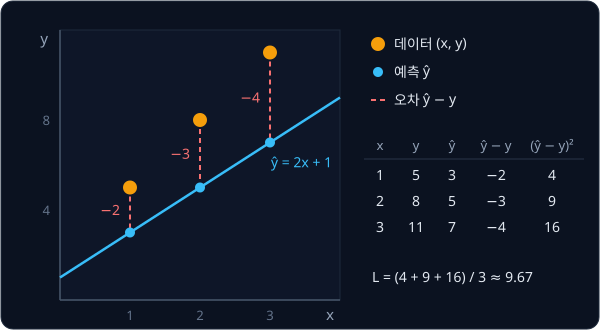
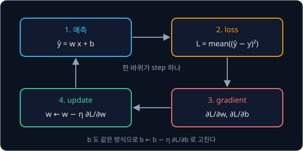
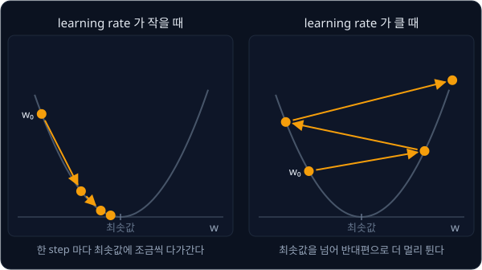

# NumPy Warm-up

## 배경

흩어진 점들을 가장 잘 지나는 직선을 찾는 문제는 1805년 Legendre 가 least squares 로 정리했고, 1847년 Cauchy 는 식을 직접
풀지 않고 조금씩 고쳐 가며 답에 다가가는 gradient descent 를 제안했다. 이 과제에서는 정답을 미리 아는 직선 문제에
gradient descent 를 써서, 반복이 정말 정답으로 다가가는지와 learning rate 가 크면 왜 발산하는지를 눈으로 확인한다.
뒤에 나오는 학습 과제는 모두 여기서 짜는 loop(예측 → loss → gradient → update)를 더 크게 키운 것이다.

### 데이터와 linear regression

데이터는 점 $N$ 개 $(x_1, y_1), \dots, (x_N, y_N)$ 이다. 이 과제에서는 정답 직선 $y = 3x + 2$ 위의 값에 noise 를 더해
점을 만드는데, noise 는 측정 오차처럼 무작위로 더해지는 작은 값이다.

$$
x \sim U(0, 10), \qquad y = 3x + 2 + \epsilon, \qquad \epsilon \sim \mathcal N(0, 1)
$$

$U(0, 10)$ 은 0 과 10 사이에서 고르게 뽑는다는 뜻이고, $\mathcal N(0, 1)$ 은 평균 0·표준편차 1 인 정규분포(normal
distribution)에서 뽑는다는 뜻이다. 정규분포에서 뽑은 값은 대부분 −2 와 2 사이에 들어서, 점들은 직선 위아래로 2 안팎만큼
흩어진다.

모델은 직선 하나다.

$$
\hat y = w x + b
$$

$\hat y$ (y hat) 은 모델의 예측, $w$ 는 기울기(weight), $b$ 는 $x = 0$ 일 때의 값(bias)이다. 데이터를 보고 $w, b$ 를
정하는 일을 linear regression 이라고 부르고, 이 데이터라면 $w \approx 3$, $b \approx 2$ 가 나와야 한다.

### 오차와 MSE

점 하나에서 예측과 정답의 차이 $\hat y_i - y_i$ 를 오차(residual)라고 한다. 직선이 데이터에 얼마나 맞는지를 숫자 하나로
나타내려고 오차를 제곱해 평균하는데, 이것이 MSE(mean squared error)이고 이 과제의 loss 다.

$$
L(w, b) = \frac{1}{N}\sum_{i=1}^{N} (\hat y_i - y_i)^2 = \frac{1}{N}\sum_{i=1}^{N} (w x_i + b - y_i)^2
$$

제곱을 하면 오차의 부호가 사라져 위로 빗나간 점과 아래로 빗나간 점이 서로 지워지지 않고, 큰 오차가 더 크게 벌을 받는다.
loss 는 데이터가 아니라 $w, b$ 의 함수다. 데이터는 고정돼 있고, $w, b$ 를 바꿀 때마다 loss 가 바뀐다.

예를 들어 세 점 $(1, 5), (2, 8), (3, 11)$ 에 직선 $\hat y = 2x + 1$ 을 대 보면 오차는 $-2, -3, -4$ 이고 loss 는
$(4 + 9 + 16) / 3 \approx 9.67$ 이다.



loss 가 가장 작아지는 $w, b$ 를 찾는 것이 Legendre 의 least squares 다. 세 점은 정확히 $y = 3x + 2$ 위에 있으므로
$w = 3$, $b = 2$ 에서 loss 가 0 이 된다.

### derivative 와 partial derivative

derivative(미분계수)는 입력을 아주 조금 바꿨을 때 출력이 얼마나 바뀌는지의 비율이고, 그래프로 보면 그 점에서 곡선의
기울기다. $f(w) = w^2$ 에서 $w = 3$ 을 $0.001$ 만큼 늘리면 $f(3.001) - f(3) = 0.006001$ 이라, 비율은 약 $6.001$ 이다.
늘리는 양을 더 줄이면 비율은 $6$ 에 다가가는데, 이 극한값이 derivative $f'(3) = 6$ 이다. 공식으로는 $f'(w) = 2w$ 다.

derivative 가 양수면 $w$ 를 키울 때 $f$ 도 커지고, 음수면 $f$ 가 작아진다. 그래서 $f$ 를 줄이려면 derivative 의 반대
방향으로 $w$ 를 옮기면 된다.

loss $L(w, b)$ 처럼 입력이 둘 이상이면 하나만 조금 바꾸고 나머지는 고정한 채 비율을 잰다. 이것이 partial
derivative(편미분)이고, $\frac{\partial L}{\partial w}$ 는 $b$ 를 고정하고 $w$ 만 바꿀 때의 비율이다. 두 partial
derivative 를 모은 벡터 $\left(\frac{\partial L}{\partial w}, \frac{\partial L}{\partial b}\right)$ 를 gradient 라고 하며,
gradient 는 loss 가 가장 빨리 커지는 방향을 가리킨다.

MSE 의 gradient 는 아래와 같다.

$$
\frac{\partial L}{\partial w} = \frac{2}{N}\sum_i (\hat y_i - y_i)\,x_i, \qquad
\frac{\partial L}{\partial b} = \frac{2}{N}\sum_i (\hat y_i - y_i)
$$

$(\hat y_i - y_i)^2$ 의 derivative 는 $2(\hat y_i - y_i)$ 에 "$\hat y_i$ 가 그 변수에 따라 바뀌는 비율" 을 곱한 것이다.
$\hat y_i = w x_i + b$ 는 $w$ 가 1 늘면 $x_i$ 만큼, $b$ 가 1 늘면 1 만큼 늘어나서 두 식의 차이는 $x_i$ 를 곱하느냐뿐이다.

세 점 $(1, 5), (2, 8), (3, 11)$ 에서 $w = b = 0$ 이면 예측은 모두 0 이고 오차는 $-5, -8, -11$ 이다.

| 값 | 계산 | 결과 |
| --- | --- | --- |
| $L$ | $(25 + 64 + 121) / 3$ | $70$ |
| $\partial L / \partial w$ | $\frac{2}{3}\,(-5 \cdot 1 - 8 \cdot 2 - 11 \cdot 3)$ | $-36$ |
| $\partial L / \partial b$ | $\frac{2}{3}\,(-5 - 8 - 11)$ | $-16$ |

두 값이 모두 음수이므로 $w$ 와 $b$ 를 키우면 loss 가 줄어든다.

### gradient descent 와 learning rate

gradient descent 는 gradient 의 반대 방향으로 조금 움직이기를 되풀이한다.

$$
w \leftarrow w - \eta\,\frac{\partial L}{\partial w}, \qquad b \leftarrow b - \eta\,\frac{\partial L}{\partial b}
$$

$\eta$ (eta) 는 learning rate 로, 한 번에 얼마나 움직일지 정하는 양수다. 위의 세 점에서 $\eta = 0.01$ 로 한 번
움직이면 $w = 0 - 0.01 \times (-36) = 0.36$, $b = 0.16$ 이 되고, loss 는 $70$ 에서 $55.34$ 로 줄어든다. 이 반복 한 번을
step 이라고 부른다.



learning rate 가 너무 작으면 수천 step 을 돌아도 거의 움직이지 않는다. 반대로 너무 크면 한 step 에 최솟값을 지나쳐
반대편으로 더 멀리 가고, 다음 step 에서는 gradient 가 더 커져 더 멀리 튀다가 loss 가 `inf` 나 `nan` 이 된다. 이것을
발산(divergence)이라고 한다.



linear regression 은 이 최솟값을 식 한 줄(normal equation)로 바로 구할 수 있지만, 뒤에 나올 neural network 에는 그런 식이
없어서 gradient descent 처럼 조금씩 고쳐 가며 다가가는 방법으로 학습한다.

### finite difference 검산

손으로 유도한 gradient 식은 틀리기 쉬워서, derivative 의 정의대로 숫자를 넣어 계산한 값과 비교해 검산한다. $w$ 를
$h$ 만큼 늘린 loss 와 줄인 loss 의 차이를 $2h$ 로 나누는 central difference 를 쓴다.

$$
\frac{\partial L}{\partial w} \approx \frac{L(w + h, b) - L(w - h, b)}{2h}, \qquad h = 10^{-5}
$$

위의 세 점에서 $w = b = 0$ 일 때 이 값은 $-36.00000000005821$ 로, 식으로 구한 $-36$ 과 소수점 아래 10자리까지 같다.
두 값의 차이는 상대 오차 $|a - b| / \max(|a|, |b|)$ 로 재는데, 값의 크기와 상관없이 비교할 수 있어서다. 평가 기준은 이
상대 오차가 $10^{-6}$ 보다 작을 것을 요구한다.

### vectorization

NumPy 배열 `x` 는 숫자 $N$ 개를 한 덩어리로 담고, `x.shape` 가 `(N,)` 이다. `w * x + b` 라고 쓰면 원소마다 곱하고 더한
배열이 한 번에 나온다. 예를 들어 `x = np.array([1., 2., 3.])` 이면 `2 * x + 1` 은 `array([3., 5., 7.])` 이다. `np.mean`
같은 함수도 배열 전체에 한 번에 적용된다.

Python 의 for 문은 원소 하나마다 인터프리터를 거치지만, 배열 연산은 NumPy 안의 C 코드가 loop 를 돌아서 데이터가 클수록
훨씬 빠르다. 이렇게 for 문 대신 배열 연산으로 짜는 것을 vectorization 이라고 하고, 뒤의 PyTorch 과제도 같은 방식으로 짠다.

### 정답 비교용 normal equation

linear regression 은 loss 의 최솟값을 normal equation 이라는 식으로 바로 구할 수 있고, `np.linalg.lstsq` 가 그 계산을
해 준다. 첫 열이 $x_i$, 둘째 열이 1 인 행렬 $A$ 를 만들면 $A \begin{bmatrix} w \\ b \end{bmatrix} \approx y$ 의
least squares 해가 $[w, b]$ 다. 위의 세 점이면 정확히 $[3, 2]$ 가 나온다. gradient descent 로 찾은 값이 이 정답에
얼마나 가까운지 보면 반복이 제대로 수렴했는지 알 수 있다.

## 목표

- $y = 3x + 2 + \text{noise}$ 데이터를 만들고 직선을 gradient descent 로 맞춘다
- gradient 를 손으로 유도해 코드로 옮기고 finite difference 로 검산한다
- 찾은 $w, b$ 를 `np.linalg.lstsq` 의 정답과 비교한다
- 데이터·직선·loss curve 를 matplotlib 로 그리고, learning rate 에 따른 수렴과 발산을 비교한다

**직접 짤 것**: 예측, loss, gradient, update loop. for 문 대신 NumPy 배열 연산(vectorization)으로 짠다.
**가져다 써도 되는 것**: 정답 비교용 `np.linalg.lstsq`, 그림을 그리는 matplotlib.

## 준비물

- Python 3.12, numpy, matplotlib, pytest
- [uv](https://docs.astral.sh/uv/getting-started/installation/) — 가상환경과 패키지 설치
- GPU 불필요

## 진행 순서

1. `cd projects/warmup` 에서 `uv run pytest` 를 한 번 실행한다. 처음 실행할 때 `pyproject.toml` 의 Python 3.12 와
   패키지가 `.venv/` 에 설치되고, 아직 test 를 쓰지 않았으므로 `no tests ran` 이 나오면 정상이다
2. `linreg.py` 의 `make_data` 를 채운다. `np.random.default_rng(seed)` 로 만든 generator 에서 $x \sim U(0, 10)$ 100개와
   noise 를 뽑아 $y = 3x + 2 + \epsilon$ 을 만든다. `x.shape`·`y.shape` 가 모두 `(100,)` 이고 `x` 가 0 과 10 사이인지
   확인한다
3. `predict`·`mse`·`grad` 를 for 문 없이 배열 연산으로 채운다. `x = np.array([1., 2., 3.])`, `y = np.array([5., 8., 11.])`
   이면 `mse(0, 0, x, y)` 가 `70.0`, `grad(0, 0, x, y)` 가 `(-36.0, -16.0)` 이어야 한다
4. `numerical_grad` 를 central difference 로 채우고, `test_linreg.py` 에 최적점에서 먼 $(w, b)$ 몇 곳에서 `grad` 와 상대
   오차가 1e-6 보다 작은지 보는 test 를 쓴다
5. `fit` 을 채운다. $w = b = 0$ 에서 시작해 step 마다 loss 를 `loss_history` 에 기록한다. 위의 세 점에 `lr=0.01` 로 한
   step 만 돌리면 $w = 0.36$, $b = 0.16$ 이 된다
6. `test_linreg.py` 에 `make_data()` 의 데이터로 `fit` 이 찾은 $w, b$ 와 `np.linalg.lstsq` 의 해가 1e-3 이내로 같은지 보는
   test 를 쓴다. `uv run pytest` 로 4·6단계의 test 를 돌린다
7. `plot.py` 의 `main` 에서 데이터 위에 찾은 직선을 겹쳐 그리고, 옆 그림에 loss curve(log 축)를 그려
   `results/fit.png` 로 저장한다
8. 같은 `main` 에서 learning rate 0.001·0.01·0.05 의 loss curve 세 개를 한 그림에 겹쳐 그려
   `results/learning_rates.png` 로 저장하고, 두 그림을 커밋한다

## 시작점

아래 파일은 모두 리포에 들어 있다.

```text
warmup/
├── pyproject.toml   # 이 과제의 Python 버전과 패키지
├── uv.lock
├── linreg.py        # make_data, predict, mse, grad, numerical_grad, fit 의 stub
├── plot.py          # 데이터와 직선, loss curve, learning rate 비교 그림
└── test_linreg.py   # grad 검산과 lstsq 비교를 직접 쓰는 test
```

[linreg.py](linreg.py) 의 함수는 몸통이 `raise NotImplementedError` 인 stub 이고, 이름과 signature 는 그대로 둔 채 몸통을
채운다. 채점용 test 는 없어서 평가 기준은 [test_linreg.py](test_linreg.py) 에 직접 쓴 test 와 `plot.py` 의 그림으로
확인한다. 패키지는 `pyproject.toml` 에 있고, 이 폴더에서 `uv run` 을 처음 실행할 때 `.venv/` 에 설치된다.

```bash
cd projects/warmup
uv run pytest
uv run python plot.py
```

## 평가 기준

- [ ] 최적점에서 먼 $(w, b)$ 몇 곳에서 `grad` 와 `numerical_grad` 의 상대 오차가 1e-6 보다 작다
- [ ] lr 0.01·5,000 step 으로 찾은 $w, b$ 가 `np.linalg.lstsq` 의 해와 1e-3 이내로 같다
- [ ] lr 0.05 에서는 loss 가 몇백 step 안에 `inf` 나 `nan` 으로 발산하는 것이 그림에 보인다
- [ ] (선택) $N = 100{,}000$ 에서 배열 연산으로 짠 `grad` 가 Python for 문 버전보다 10배 이상 빠르다
- [ ] (선택) $x$ 를 평균 0·표준편차 1 로 standardize 하면 lr 을 0.1 로 키워도 발산하지 않고, 50 step 안에 정답과 1e-3 이내로 맞는다

## 생각해 볼 질문

1. loss 가 $L(w) = a w^2$ 뿐이라면 update 는 $w \leftarrow (1 - 2\eta a)\, w$ 가 된다. 어떤 $\eta$ 부터 발산하는지 이 식으로 설명할 수 있는가?
2. normal equation 이라는 정답 식이 있는데도 큰 문제에서 gradient descent 를 쓰는 이유는?
3. lr 0.01 의 loss curve 는 처음에 빨리 떨어진 뒤 오래 완만하게 내려가는데, 그동안 주로 $b$ 가 움직인다. 왜 그런가?

## 힌트

<details>
<summary>shape 가 (N,) 인지 (N, 1) 인지</summary>

`x` 가 `(N,)` 이고 `y` 가 `(N, 1)` 이면 `predict(...) - y` 는 오류 없이 `(N, N)` 이 된다(broadcasting). loss 값이 이상하게
크면 중간 배열의 `.shape` 부터 찍어 본다.

</details>

<details>
<summary>loss 가 줄다가 갑자기 nan 이 될 때</summary>

learning rate 가 loss 곡면의 가장 가파른 방향에 비해 크다. lr 을 줄이거나 $x$ 의 scale 을 맞춘다(평균을 빼고 표준편차로
나눈다). scale 을 맞춰 찾은 $w, b$ 는 원래 scale 로 되돌려야 `np.linalg.lstsq` 의 해와 비교할 수 있다.

</details>

<details>
<summary>numerical_grad 의 h 를 아주 작게 했는데 오차가 더 커질 때</summary>

컴퓨터의 실수(float64)는 유효숫자가 16자리 정도라서, $h$ 가 너무 작으면 $L(w + h)$ 와 $L(w - h)$ 가 거의 같은 수가 되고
그 차이에서 유효숫자가 대부분 사라진다. $h$ 는 `1e-5` 근처가 알맞다.

</details>

<details>
<summary>loss curve 를 log 축으로 그리기</summary>

matplotlib 에서 `ax.set_yscale("log")` 를 쓰면 세로축이 log 축이 된다. loss 가 70 에서 1 아래까지 줄어드는 과정이 한
그림에 고르게 보인다. 발산해 `inf` 가 된 값은 그려지지 않으므로, 발산하는 곡선은 어느 step 에서 끊기는지로 읽는다.

</details>

## 참고 자료

- 3Blue1Brown, [The paradox of the derivative](https://www.youtube.com/watch?v=9vKqVkMQHKk) — derivative 를 "아주 조금
  바꿨을 때의 비율" 로 보는 관점. [Essence of calculus](https://www.youtube.com/playlist?list=PLZHQObOWTQDMsr9K-rj53DwVRMYO3t5Yr)
  재생목록의 2편이다
- 3Blue1Brown, [Gradient descent, how neural networks learn](https://www.youtube.com/watch?v=IHZwWFHWa-w) — gradient 가
  loss 곡면에서 가리키는 방향과 gradient descent 의 그림
- Google Machine Learning Crash Course, [Linear regression: Gradient descent](https://developers.google.com/machine-learning/crash-course/linear-regression/gradient-descent)
  — loss curve 를 읽는 법과 learning rate 에 따른 수렴·발산
- Stanford CS231n, [Optimization: Stochastic Gradient Descent](https://cs231n.github.io/optimization-1/) — numerical
  gradient 와 analytic gradient 를 비교하는 gradient check, central difference 를 쓰는 이유
- Stanford CS229, [Lecture Notes](https://cs229.stanford.edu/main_notes.pdf) — 1장의 linear regression, LMS 규칙과 normal
  equation 유도
- [NumPy: the absolute basics for beginners](https://numpy.org/doc/stable/user/absolute_beginners.html) — 배열 만들기와
  배열 연산. [Broadcasting](https://numpy.org/doc/stable/user/basics.broadcasting.html) 은 shape 가 다른 배열끼리 계산되는
  규칙이다
- [numpy.linalg.lstsq](https://numpy.org/doc/stable/reference/generated/numpy.linalg.lstsq.html) — 정답 비교에 쓰는 함수의
  인자와 반환값
- [Matplotlib Quick start guide](https://matplotlib.org/stable/users/explain/quick_start.html) — `fig, ax` 로 그림을 그리고
  저장하는 기본 흐름
- Dive into Deep Learning, [Linear Regression Implementation from Scratch](https://d2l.ai/chapter_linear-regression/linear-regression-scratch.html)
  — 같은 문제를 처음부터 짠 구현이라 막혔을 때만 연다

## 남은 한계

linear regression 은 연속값 하나를 직선으로 예측할 뿐이라 class 를 가르는 분류도, 직선으로 안 되는 관계도 다루지 못한다.
여기서부터 과제가 분야별로 나뉘어, 학습 모델은 [Perceptron](../perceptron/README.md), 로봇은 [Rigid Transforms](../transforms/README.md) 와
[PID Control](../pid-control/README.md), reward 로 배우는 학습은 [Bandits & MDPs](../bandit-mdp/README.md), 언어는
[BPE Tokenizer](../tokenizer/README.md) 에서 시작한다.
