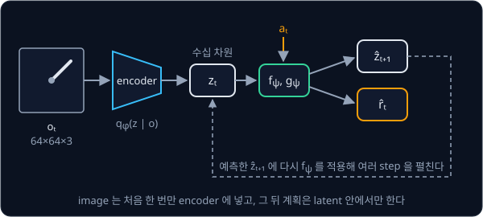
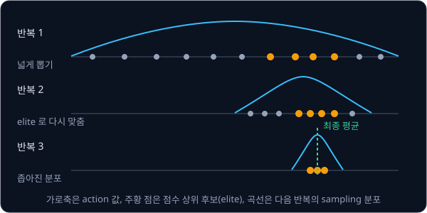
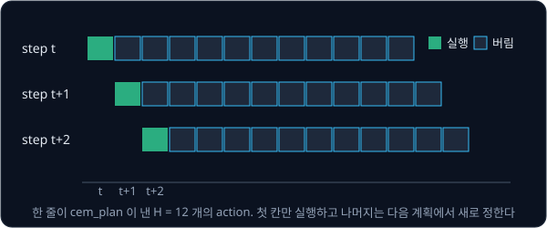

# World Model

## 배경

[Policy Gradient](../policy-gradient/README.md) 의 방법들은 환경이 어떻게 움직이는지 모른 채 시행착오만으로 배워서, CartPole 같은
작은 문제에도 많은 episode 가 필요하다. 환경의 다음 상태와 reward 를 예측하는 model 을 데이터로 배워 두면, 실제 환경에서 움직이기
전에 model 안에서 행동의 결과를 미리 예측해 보고 고를 수 있다. 이런 model 을 world model 이라 하고, world model 을 쓰는 RL 을
model-based RL, 쓰지 않는 RL 을 model-free RL 이라고 한다.

### pixel 관측

이 과제의 환경은 [DQN → SAC](../off-policy/README.md) 에서도 쓴 `Pendulum-v1` 이지만, agent 는 진자의 각도와 각속도 대신 카메라로
찍은 64×64 RGB image 만 본다. image 한 장은 숫자 $64 \times 64 \times 3 = 12{,}288$ 개인데, 진자의 실제 state 는
$(\cos\theta, \sin\theta, \dot\theta)$ 세 값이면 충분하다. 또 image 한 장에는 진자가 어느 쪽을 가리키는지는 보이지만 어느 쪽으로 얼마나 빨리
돌고 있는지는 보이지 않아서, 속도를 알려면 연속한 frame 두 장을 함께 보거나 지난 frame 들을 요약해야 한다.

### encoder 와 latent

차원이 큰 image 는 [VAE](../vae/README.md) 같은 encoder 로 수십 차원짜리 latent $z_t$ 로 줄이고, 그 뒤 dynamics 와 reward 는 이
latent 공간에서 배운다. encoder $q_\phi$ 는 지금까지의 관측 $o_{\le t}$ 를 받아 $z_t$ 의 분포를 내고, decoder 는 $z_t$ 에서 image 를
다시 그린다. VAE 의 복원 loss 가 $z_t$ 에 image 의 정보를 담게 만든다.

### latent dynamics 와 reward model

dynamics model $f_\psi$ 는 지금 latent 와 action 으로 다음 latent 를, reward model $g_\psi$ 는 그 step 의 reward 를 예측한다.

$$
z_t\sim q_\phi(z_t\mid o_{\le t}),\qquad \hat z_{t+1}= f_\psi(z_t,a_t),\qquad \hat r_t = g_\psi(z_t,a_t)
$$

$\phi$ 는 encoder 의 weight, $\psi$ 는 dynamics·reward model 의 weight, hat($\hat{\ }$)은 예측값이다. 한 번 encoder 로 $z_t$ 를
얻으면 그 뒤로는 image 없이 $f_\psi$ 를 거듭 적용해 여러 step 앞을 예측할 수 있다. 실제 관측으로 고치지 않고 자기 예측 위에 다시
예측하는 이런 rollout 을 open-loop rollout 이라고 한다.



학습 때 한 step 예측만 맞추면, 늘 실제 $z_t$ 에서 출발하는 학습과 자기 예측 위에 다시 예측하는 planning 사이에 차이가 생긴다.
그래서 `multistep_loss` 는 실제 frame 에서 얻은 $z_t$ 하나에서 출발해 action 만 주고 `horizon` step 을 펼친 뒤, 펼친 예측마다 실제
frame 에서 얻은 latent 와 실제 reward 를 비교한다.

### CEM

world model 을 얻으면 action 을 고르는 일은 "예측한 reward 합이 가장 큰 action sequence 찾기" 가 된다.

$$
a^*_{t:t+H}=\arg\max_{a_{t:t+H}}\ \sum_{k=t}^{t+H-1} g_\psi(\hat z_k, a_k),\qquad \hat z_t = z_t,\ \ \hat z_{k+1}=f_\psi(\hat z_k,a_k)
$$

$H$ 는 계획할 길이(horizon)다. cross-entropy method(CEM)는 이 최대화를 gradient 없이 sampling 으로 푼다.

1. step 마다 평균 0, 표준편차가 큰 Gaussian 을 하나씩 둔다(shape `(H, act_dim)`)
2. 그 분포에서 action sequence 후보 `candidates` 개를 뽑아 action 범위로 자른다
3. 후보마다 latent 안에서 rollout 해 예측 reward 합으로 점수를 매긴다
4. 점수 상위 `top_k` 개(elite)의 평균과 표준편차로 분포를 다시 맞춘다
5. 2–4 를 `iters` 번 되풀이하고 마지막 평균을 계획으로 낸다

`cem_plan` 의 기본값이면 후보 1000 개 × 반복 10 번이라 실제 step 하나마다 rollout 을 만 번 하므로, 후보를 batch 하나로 묶어 한
번에 계산해야 빠르다.



### MPC

model predictive control(MPC)은 매 step 계획을 새로 세우되 첫 action 하나만 실제로 실행하는 방식이다. 다음 step 에서는 새로
받은 관측으로 다시 encode 하고 다시 계획하므로, 계획이 조금 틀려도 실제 결과를 보고 바로잡을 수 있다.



### oracle 과 정규화 점수

latent agent 의 성능은 model 오차와 planner 의 한계가 섞인 결과다. 이 둘을 가르려고 같은 `cem_plan` 에 latent model 대신 실제
pendulum 식을 score 함수로 넣은 oracle 을 함께 돌린다. oracle 의 return 은 model 이 완벽할 때 이 planner 가 낼 수 있는 상한에
가깝고, 무작위 action 의 return 은 하한이다. 평가 기준은 그 사이 어디쯤인지를 정규화 점수로 잰다.

$$
\text{score} = \frac{R - R_\text{random}}{R_\text{oracle} - R_\text{random}}
$$

Pendulum-v1 의 episode 는 200 step 이고, 무작위 action 의 평균 return 은 −1200 안팎, 기본 인자의 `cem_plan` 에 실제 dynamics 를
넣은 oracle 은 −225 안팎이다. 이 두 값이면 정규화 점수 0.7 은 return 약 −520 에 해당한다.

### 데이터 수집 반복

처음 dataset 은 무작위 action 으로만 모은다. 그 dataset 으로 학습한 model 과 planner 로 episode 를 더 모아 dataset 에 합치고,
model 을 다시 학습하기를 몇 번 되풀이한다. 평가 기준은 이 반복 횟수(0 회 = 무작위 데이터만)에 따라 return 이 어떻게 바뀌는지
곡선으로 남기게 한다.

### 설계 선택

Ha & Schmidhuber 2018 은 VAE 와 MDN-RNN 으로 world model 을 만들고 그 안에서 작은 controller 를 evolution strategy 로 학습했고,
PlaNet 은 deterministic·stochastic 상태를 함께 쓰는 latent dynamics(RSSM)와 CEM 으로 64×64 image 만 보고 DeepMind Control 과제를
풀었다. 이 분야에는 아직 정해진 표준 구현이 없어서, decoder 로 image 를 복원할지, latent 를 확률적으로 둘지, 몇 step 을 펼쳐
학습할지에 따라 결과가 크게 달라진다. 최근에는 pixel 을 복원하지 않고 representation 공간에서만 예측하는 V-JEPA 2, 대규모 영상으로
학습한 Cosmos 같은 video world model 까지 나왔다. 이 과제에서는 논문 하나를 그대로 재현하기보다 작은 환경에서 이 선택들을 직접
비교한다.

## 목표

- `Pendulum-v1` 을 64×64 image 로만 관측하는 wrapper 와 무작위 행동 dataset 을 만든다
- VAE encoder 와 latent dynamics·reward model 을 학습한다
- latent 안에서 CEM 으로 계획하는 MPC agent 를 짜서 실제 환경에서 돌린다
- planner 가 모은 데이터를 다시 학습에 넣는 반복으로 model 을 개선한다
- 같은 CEM 을 실제 pendulum dynamics 로 돌린 oracle 과 비교해 model 오차가 성능을 얼마나 떨어뜨리는지 잰다

**직접 짤 것**: 데이터 수집, encoder·decoder, dynamics·reward model, multi-step 학습 loss, CEM planner, MPC 루프, oracle.
**가져다 써도 되는 것**: [VAE](../vae/README.md) 에서 짠 코드, gymnasium 렌더러, `torchvision` 의 resize, 아래 참고 구현.

## 준비물

- Python 3.12, numpy, `torch`, `torchvision`, `gymnasium[classic_control]`(Pendulum 렌더에 쓰는 pygame 이 함께 설치된다), matplotlib, pytest
- (선택) `dm_control` — PlaNet 이 쓴 cartpole swingup 같은 과제로 넓힐 때. 이 폴더에서 `uv add dm_control` 로 더한다
- 8 GB GPU 로 충분하다. 64×64 image 수만 장과 작은 CNN·MLP·GRU 라 model 학습은 수십 분 단위이고, CEM 은 후보 수백–천 개를 batch
  하나로 계산하므로 GPU 에서 계획이 빨라진다

## 진행 순서

1. `data.py` 의 `PixelPendulum` 을 채운다. Pendulum 을 `render_mode="rgb_array"` 로 만들고(렌더 frame 은 500×500×3) 64×64 로 줄인
   image 만 observation 으로 내보내며, true state 는 평가용으로 `info["state"]` 에만 둔다
2. `collect` 를 채워 무작위 action 으로 episode 수십 개를 모으고 `(o_t, a_t, r_t, o_{t+1})` dataset 을 `data/` 에 저장한다
3. `frame_vae.py` 에 64×64×3 frame 용 conv encoder·decoder 를 짜고, frame 에 학습해 복원 image 를 확인한다.
   `reparameterize`·`kl_normal` 은 VAE 과제의 코드를 import 해 쓴다
4. 연속 2 frame 을 쌓는 방식과 GRU 로 history 를 요약하는 방식 중 하나를 골라 latent state 를 정의한다
5. `dynamics.py` 의 `LatentDynamics` 와 `multistep_loss` 를 채워 latent dynamics 와 reward head 를 여러 step 을 펼친 예측 loss 로
   학습한다
6. `planner.py` 의 `cem_plan` 을 채우고, 매 step 첫 action 만 실행하는 MPC 루프를 같은 파일에 짠다
7. `oracle.py` 에서 실제 pendulum 식을 후보 1000 개에 한 번에 적용하는 score 함수로 같은 `cem_plan` 을 돌려 $R_\text{oracle}$ 을
   잰다. oracle 이 진자를 세우지 못하면 latent 판보다 planner 부터 고친다
8. `train.py` 에서 planner 로 모은 episode 를 dataset 에 더해 model 을 다시 학습하는 반복을 몇 번 돌고, 반복마다 MPC agent 의 return
   과 정규화 점수를 `results/` 에 기록한다

## 시작점

아래 파일은 모두 리포에 들어 있다.

```text
world-model/
├── pyproject.toml        # 이 과제의 Python 버전과 패키지
├── uv.lock
├── data.py               # PixelPendulum, collect 의 stub
├── frame_vae.py          # 64×64 frame 용 conv VAE. VAE 과제의 reparameterize·kl_normal 을 import 한다
├── dynamics.py           # LatentDynamics, multistep_loss 의 stub
├── planner.py            # cem_plan 의 stub 과 MPC 루프
├── oracle.py             # 실제 pendulum 식으로 돌리는 oracle
├── train.py              # 데이터 수집과 model 학습 반복
└── test_world_model.py   # wrapper·rollout 모양·oracle·CEM 을 확인하는 test 를 직접 쓴다
```

[data.py](data.py)·[dynamics.py](dynamics.py)·[planner.py](planner.py) 의 함수와 method 는 몸통이 `raise NotImplementedError` 인
stub 이고, 이름과 signature 는 그대로 둔 채 몸통을 채운다. [frame_vae.py](frame_vae.py) 에는 VAE 과제 폴더를 `sys.path` 에 더해
`reparameterize`·`kl_normal` 을 import 하는 줄만 있고, conv encoder·decoder 는 직접 짠다.
채점용 test 는 없어서 평가 기준은 [test_world_model.py](test_world_model.py) 에 직접 쓴 test 와 `results/` 의 기록·그림으로 확인한다.
패키지는 `pyproject.toml` 에 있고, 이 폴더에서 `uv run` 을 처음 실행할 때 `.venv/` 에 설치된다.

```bash
cd projects/world-model
uv run pytest
uv run python oracle.py
uv run python train.py
```

## 평가 기준

- [ ] latent 에서 linear regression probe 로 읽은 $(\cos\theta, \sin\theta, \dot\theta)$ 의 $R^2$ 가 성분마다 0.9 이상이다(true state 는
  이 평가에만 쓴다)
- [ ] 실제 frame 에서 시작해 action 만 주고 10 step 을 open-loop 로 rollout 한 latent 를 probe 로 읽은 각도 오차를 step 별로 그렸고,
  decode 한 image 가 실제 frame 과 같은 쪽을 가리킨다
- [ ] latent MPC agent 의 평균 return 이 정규화 점수 $(R-R_\text{random})/(R_\text{oracle}-R_\text{random})$ 로 0.7 이상이다
- [ ] 데이터 수집 반복 횟수(0 회 = 무작위 데이터만)에 따라 return 이 오르는 곡선이 있다
- [ ] (선택) decoder 없이 latent 예측과 reward 예측만으로 학습한 판, 또는 RSSM 판을 같은 지표로 비교한다
- [ ] (선택) planner 를 latent 안에서 학습한 actor-critic 으로 바꾼 Dreamer 식 agent 를 [Policy Gradient](../policy-gradient/README.md) 코드로 만든다

## 생각해 볼 질문

1. decoder 를 빼고 다음 latent 를 맞히는 loss 만 쓰면 어떤 자명한 해로 collapse 하는가? reward 예측이나 천천히 움직이는 target encoder 는
   이 collapse 를 어떻게 막는가?
2. 한 step 예측 오차가 작아도 12 step 을 rollout 하면 크게 틀어질 수 있다. planner 는 model 이 틀린 곳을 어느 쪽으로 이용하게 되는가?
   매 step 다시 계획하는 MPC 는 이 문제를 어디까지 줄이는가?
3. 무작위 행동 데이터만으로 배운 model 은 pendulum 이 똑바로 선 근처를 거의 본 적이 없다. planner 로 모은 데이터를 다시 학습에
   넣는 반복은 이 문제를 어떻게 푸는가?

## 힌트

<details>
<summary>CEM 이 엉뚱한 action 을 고를 때</summary>

oracle 로 planner 부터 검증한다. oracle 도 pendulum 을 세우지 못하면 model 이 아니라 planner 문제라서 horizon, 후보 수, action repeat
(같은 action 을 2–4 step 반복해 실질 horizon 을 늘리는 것)부터 조정한다. oracle 은 세우는데 latent 판만 못 세우면 reward head 의
예측을 실제 reward 와 나란히 그려 본다.

</details>

<details>
<summary>open-loop 예측이 몇 step 만에 흐려질 때</summary>

한 step 예측 loss 만 쓰면 학습 때는 늘 실제 $z_t$ 에서 출발하지만 planning 때는 자기 예측 위에 다시 예측한다. 학습 때도 여러
step 을 자기 예측으로 펼쳐 loss 를 더하면 이 불일치가 줄어든다. PlaNet 의 latent overshooting 이 같은 문제를 다룬다.

</details>

<details>
<summary>oracle 을 batch 로 돌리는 법</summary>

Pendulum 의 dynamics 는 gymnasium 소스의 `step()` 안 몇 줄이라 numpy 나 torch 로 옮기면 후보 1000 개를 한 번에 계산할 수 있다.
env 를 1000 개 복사할 필요가 없다.

</details>

## 참고 자료

- David Ha, Jürgen Schmidhuber, [World Models](https://arxiv.org/abs/1803.10122) (2018)·[interactive 판](https://worldmodels.github.io/)
  — VAE·MDN-RNN·controller 로 나눈 구성. interactive 판은 그림을 직접 조작해 볼 수 있다
- Danijar Hafner 외, [Learning Latent Dynamics for Planning from Pixels](https://arxiv.org/abs/1811.04551) (2019)·[PlaNet 프로젝트 페이지](https://danijar.com/project/planet/)
  — RSSM, latent overshooting, CEM planning. 이 과제의 MPC 구성과 가장 가깝다
- Danijar Hafner 외, [Dream to Control](https://arxiv.org/abs/1912.01603) (2020)·[Mastering Diverse Domains through World Models](https://arxiv.org/abs/2301.04104)
  (2023)·[DreamerV3 프로젝트 페이지](https://danijar.com/project/dreamerv3/) — planner 대신 latent 안에서 actor-critic 을 학습하는 방향
- Nicklas Hansen 외, [TD-MPC2](https://arxiv.org/abs/2310.16828) (2024)·[프로젝트 페이지](https://tdmpc2.com/) — decoder 없는 latent model
  위에서 계획하는 연속 제어 방법
- BAIR, [Model-Based Reinforcement Learning: Theory and Practice](https://bair.berkeley.edu/blog/2019/12/12/mbpo/) — model 오차가
  rollout 길이에 따라 커지는 문제와 짧은 rollout 으로 다루는 방법
- [Wikipedia — Cross-entropy method](https://en.wikipedia.org/wiki/Cross-entropy_method)·[Model predictive control](https://en.wikipedia.org/wiki/Model_predictive_control)
  — CEM 과 MPC 의 일반적인 정의
- Gymnasium [Pendulum](https://gymnasium.farama.org/environments/classic_control/pendulum/) 문서 — state·action·reward 의 정의.
  oracle 에 옮길 dynamics 는 gymnasium 소스의 `PendulumEnv.step` 에 있다
- [Kaixhin/PlaNet](https://github.com/Kaixhin/PlaNet) — PlaNet 의 PyTorch 재구현. 막혔을 때만 연다
- [ctallec/world-models](https://github.com/ctallec/world-models) — Ha & Schmidhuber 의 PyTorch 재구현. 막혔을 때만 연다
- 더 읽을거리: NVIDIA [Cosmos](https://github.com/nvidia-cosmos/cosmos-predict2)([논문](https://arxiv.org/abs/2501.03575)) — 대규모 영상으로
  학습한 world foundation model, Meta [V-JEPA 2](https://github.com/facebookresearch/vjepa2)([논문](https://arxiv.org/abs/2506.09985)) —
  representation 공간에서 예측하는 video model 과 그 위에서 CEM 으로 계획하는 action-conditioned model(V-JEPA 2-AC)

## 남은 한계

이 과제의 world model 은 고정된 카메라로 보는 관절 하나짜리 pendulum 을 다룬다. 접촉이 많은 조작이나 실제 로봇 영상으로 가면
예측이 금방 흐려져서, latent 안에서 policy 까지 학습하는 DreamerV3 나 대규모 영상으로 사전학습한 Cosmos·V-JEPA 2 처럼 더 큰 model 과
데이터가 필요하다. V-JEPA 2-AC 는 DROID 의 로봇 영상 62 시간 미만으로 action-conditioned model 을 학습해 실물 Franka 팔에서
image goal planning 을 했는데, 이 과제의 latent CEM 과 비슷한 구조를 실물 규모로 키운 사례라서 다음에 읽을 만하다.
